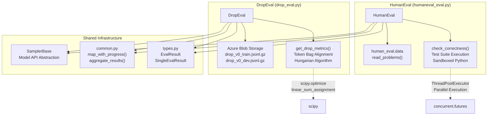
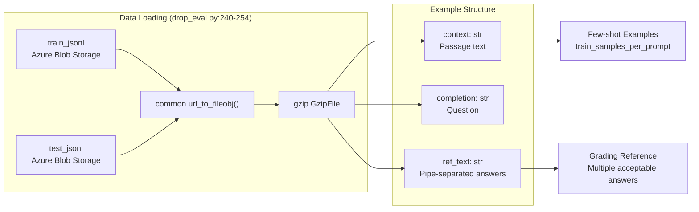
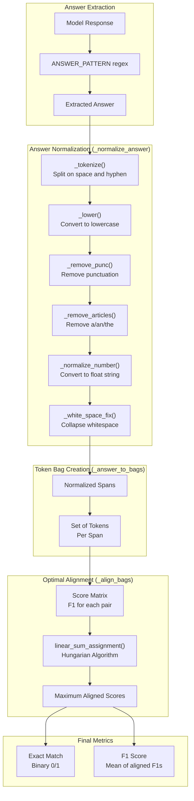
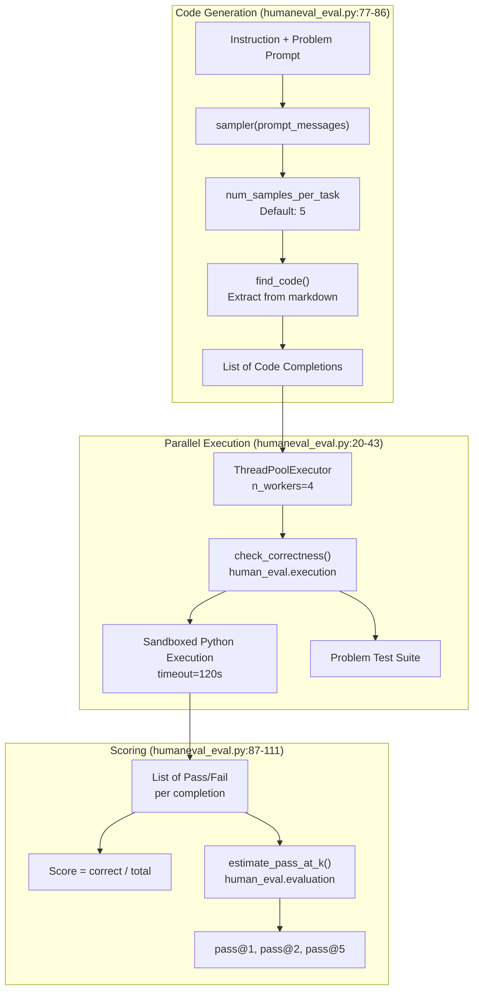

<!-- source: DeepWiki mcp.deepwiki.com · repo openai/simple-evals · page 4.4 Other Benchmarks · fetched 2026-10-26 -->

# Other Benchmarks

<details>
<summary>Relevant source files</summary>

The following files were used as context for generating this wiki page:

- [drop_eval.py](drop_eval.py)
- [humaneval_eval.py](humaneval_eval.py)

</details>


## Purpose and Scope

This page documents two additional benchmark implementations in simple-evals that evaluate distinct capabilities not covered by the language understanding, mathematical reasoning, or reference implementation categories:

- **DROP** - Reading comprehension requiring discrete reasoning over paragraphs
- **HumanEval** - Python code generation evaluated through test execution

For language understanding benchmarks (MMLU, GPQA), see [Language Understanding Benchmarks](#4.2). For mathematical reasoning (MATH, MGSM), see [Mathematical Reasoning Benchmarks](#4.3). For actively maintained reference implementations, see [Reference Implementations](#4.1).

Both benchmarks documented here are **frozen as of July 2025** and will not receive updates for new models.

---

## Overview of Other Benchmarks

The two benchmarks in this category evaluate fundamentally different capabilities through distinct grading methodologies:

| Benchmark | Task Type | Evaluation Method | Key Metrics | Dataset Size |
|-----------|-----------|-------------------|-------------|--------------|
| DROP | Reading comprehension | Token bag alignment + F1 | Exact Match, F1 Score | ~9,500 dev examples |
| HumanEval | Code generation | Test suite execution | pass@1, pass@2, pass@5 | 164 problems |

### Benchmark Architecture Comparison



**Sources:** [drop_eval.py:1-314](), [humaneval_eval.py:1-115]()

---

## DROP: Reading Comprehension with Discrete Reasoning

The `DropEval` class implements the DROP benchmark (Discrete Reasoning Over Paragraphs), which evaluates a model's ability to perform numerical and discrete reasoning over text passages.

### Dataset Structure and Loading

DROP loads training and test data from Azure Blob Storage, where each example contains a passage and a question requiring reasoning:



**Sources:** [drop_eval.py:236-254]()

The `DropEval` constructor accepts these parameters:

| Parameter | Default | Purpose |
|-----------|---------|---------|
| `num_examples` | `None` | Limit test set size for debugging |
| `train_samples_per_prompt` | `3` | Number of few-shot examples per prompt |

### Prompt Construction with Few-Shot Learning

DROP uses few-shot prompting by randomly sampling training examples to prepend before the test question:

[drop_eval.py:258-281]()

The prompt structure follows this pattern:
1. Task description header
2. 3 training examples (by default) with passages, questions, and answers
3. Test example with passage and question (no answer)
4. Instruction to format answer with "Answer: $ANSWER"

### Answer Grading with Token Bag Alignment

DROP implements a sophisticated grading algorithm that handles multiple acceptable answer formats (numbers, spans, dates) through token bag alignment:



**Sources:** [drop_eval.py:30-172]()

#### Key Normalization Functions

The grading pipeline applies multiple normalization steps defined in [drop_eval.py:31-83]():

- `_remove_articles()` - Removes "a", "an", "the" using regex
- `_white_space_fix()` - Collapses multiple spaces
- `_remove_punc()` - Strips punctuation (except for numbers)
- `_lower()` - Converts to lowercase
- `_tokenize()` - Splits on spaces and hyphens
- `_normalize_number()` - Converts numeric strings to float representation

#### Token Bag Alignment Algorithm

The core grading logic uses the Hungarian algorithm to find optimal alignment between predicted and gold answer token bags:

[drop_eval.py:101-116]()

The `_align_bags()` function:
1. Constructs a score matrix where `scores[i,j]` is the F1 between gold answer `i` and predicted answer `j`
2. Uses `scipy.optimize.linear_sum_assignment()` to find optimal 1-1 mapping
3. Returns maximum scores for each gold answer

#### F1 Computation

F1 is computed at the token level using set intersection:

[drop_eval.py:119-134]()

The function handles edge cases where either bag is empty (precision/recall = 1.0) and computes F1 as the harmonic mean.

### Evaluation Results and Metrics

The `DropEval.__call__()` method returns an `EvalResult` containing:

| Metric | Description | Computation |
|--------|-------------|-------------|
| `score` | Binary correctness | Fuzzy match against any reference answer |
| `em_score` | Exact Match | 1.0 if token sets exactly match |
| `f1_score` | F1 Score | Mean of optimally aligned token F1s |

The `drop_metric()` function [drop_eval.py:225-234]() computes both EM and F1 against all reference answers and returns the maximum scores.

**Sources:** [drop_eval.py:236-313]()

---

## HumanEval: Code Generation Evaluation

The `HumanEval` class implements evaluation of Python code generation using the HumanEval benchmark from OpenAI, which consists of 164 programming problems with test suites.

### Dataset Loading and Structure

HumanEval loads problems from the `human_eval` package:

[humaneval_eval.py:46-63]()

Constructor parameters:

| Parameter | Default | Purpose |
|-----------|---------|---------|
| `num_examples` | `250` | Subset size (max 164 for full dataset) |
| `num_samples_per_task` | `5` | Number of code samples per problem |
| `ks_passes` | `[1, 2, 5]` | Values of k for pass@k metrics |
| `timeout` | `120` | Execution timeout in seconds |

Each problem from `read_problems()` contains:
- `prompt` - Function signature and docstring
- `test` - Test suite code
- `entry_point` - Function name to test

### Code Extraction from Model Responses

The evaluation extracts Python code from model responses using regex to find markdown code blocks:

[humaneval_eval.py:68-75]()

The extraction process:
1. Searches for ` ```python\n...\n``` ` code blocks using `re.DOTALL`
2. Takes the first match, or uses the entire response if no code blocks found
3. Removes the function signature by finding `":\n    "` and keeping everything after

### Test Execution and Correctness Checking

HumanEval evaluates code by executing it against test suites in a sandboxed environment:



**Sources:** [humaneval_eval.py:20-114]()

### Functional Correctness Evaluation

The `evaluate_functional_correctness()` function orchestrates parallel test execution:

[humaneval_eval.py:20-43]()

Key implementation details:
- Uses `ThreadPoolExecutor` with 4 workers for parallel execution
- Each completion is submitted to `check_correctness()` from the `human_eval` package
- `check_correctness()` runs the code with the test suite in a sandboxed environment
- Results are collected using `as_completed()` to process futures as they finish
- Returns a list of binary pass/fail indicators

### Pass@k Metrics

HumanEval reports pass@k metrics, which estimate the probability that at least one of k samples passes the test suite:

[humaneval_eval.py:105-110]()

The `estimate_pass_at_k()` function from the `human_eval` package computes:

$$\text{pass@k} = \mathbb{E}_{Problems}\left[1 - \frac{\binom{n-c}{k}}{\binom{n}{k}}\right]$$

where:
- `n` = total samples per problem
- `c` = number of correct samples
- `k` = number of samples to consider

This metric is aggregated across all problems in the evaluation set.

### Output Format

Each `SingleEvalResult` for HumanEval contains:

| Field | Content |
|-------|---------|
| `html` | Rendered prompt, first completion, and pass/fail status |
| `score` | Fraction of completions that passed (correct/total) |
| `convo` | Prompt messages + all completions as assistant messages |
| `metrics` | Dictionary with `pass@k` for each k ∈ `ks_passes` |

The final `EvalResult` aggregates metrics across all problems, computing mean pass@k values.

**Sources:** [humaneval_eval.py:65-114]()

---

## Comparison of Grading Strategies

The two benchmarks employ fundamentally different grading approaches suited to their task types:

| Aspect | DROP | HumanEval |
|--------|------|-----------|
| **Grading Type** | Self-grading (deterministic) | Self-grading (execution-based) |
| **Primary Method** | Token bag F1 with Hungarian alignment | Test suite execution in sandbox |
| **External Dependencies** | `scipy.optimize` | `human_eval` package |
| **Parallelization** | Sequential (single-threaded) | Parallel (`ThreadPoolExecutor`) |
| **Multiple Answers** | Handles via alignment algorithm | Handles via multiple samples |
| **Timeout Handling** | N/A (instant grading) | 120s per code execution |
| **Partial Credit** | Yes (F1 score 0-100) | No (binary pass/fail per sample) |
| **Metrics Reported** | EM, F1 | pass@k for k=[1,2,5] |

Both benchmarks avoid LLM-based grading, making them faster and more deterministic than benchmarks like SimpleQA or HealthBench (see [Reference Implementations](#4.1)).

**Sources:** [drop_eval.py:1-314](), [humaneval_eval.py:1-115]()

---

