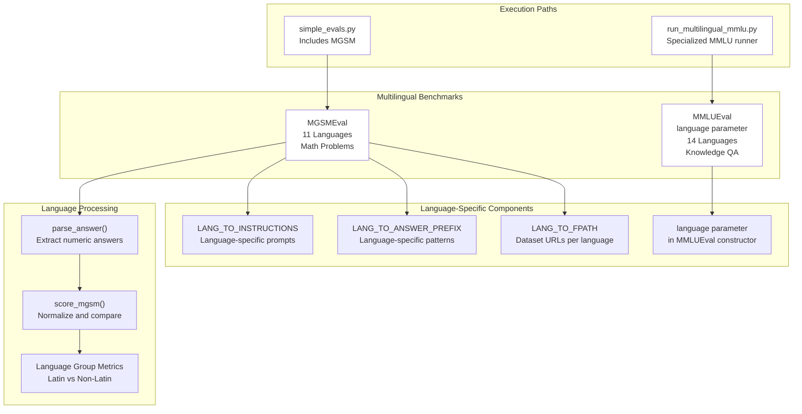
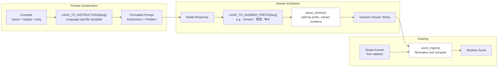
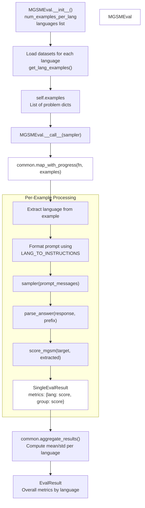
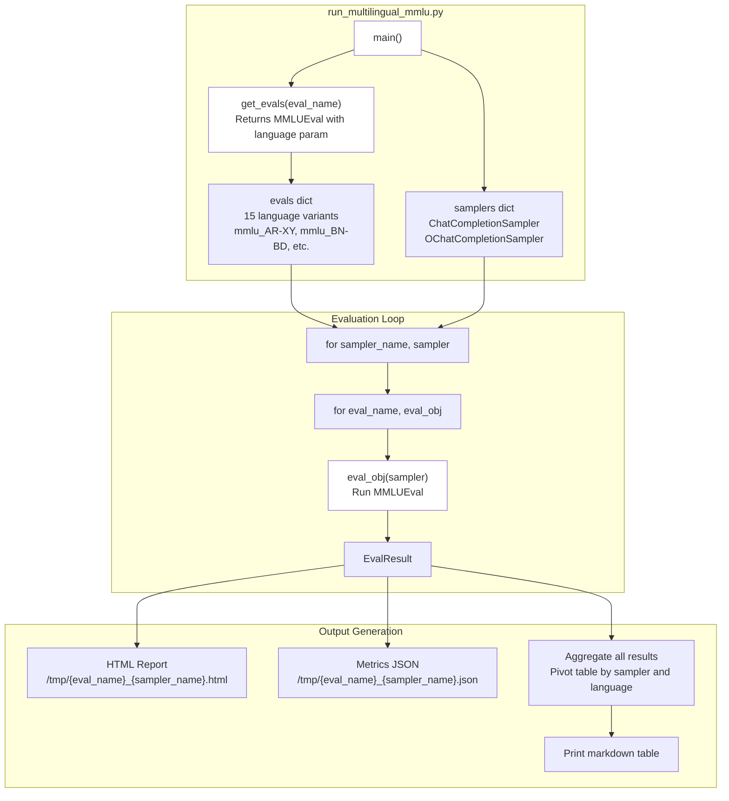

<!-- source: DeepWiki mcp.deepwiki.com · repo openai/simple-evals · page 5 Multilingual Evaluation · fetched 2026-10-26 -->

# Multilingual Evaluation

<details>
<summary>Relevant source files</summary>

The following files were used as context for generating this wiki page:

- [mgsm_eval.py](mgsm_eval.py)
- [multilingual_mmlu_benchmark_results.md](multilingual_mmlu_benchmark_results.md)
- [run_multilingual_mmlu.py](run_multilingual_mmlu.py)
- [simple_evals.py](simple_evals.py)

</details>


This page documents the multilingual evaluation capabilities in simple-evals, which enable assessment of language model performance across multiple languages. The framework provides two multilingual benchmarks: MGSM (Multilingual Grade School Math) covering 11 languages and Multilingual MMLU covering 14 languages with professional human translations.

For information about the monolingual MMLU benchmark in English, see [MMLU: Massive Multitask Language Understanding](#4.2.1). For general mathematical reasoning evaluation, see [Mathematical Reasoning Benchmarks](#4.3).

## Overview

The simple-evals framework includes two benchmarks specifically designed for multilingual evaluation:

| Benchmark | Languages | Task Type | Grading Method | Primary Use |
|-----------|-----------|-----------|----------------|-------------|
| MGSM | 11 | Grade school math problems | Numeric answer comparison | Multilingual mathematical reasoning |
| Multilingual MMLU | 14 | Multiple-choice knowledge questions | Answer extraction and matching | Multilingual language understanding |

Both benchmarks use language-specific prompts and answer extraction patterns to ensure fair evaluation across diverse writing systems and linguistic structures.

**Sources:** [mgsm_eval.py:1-193](), [multilingual_mmlu_benchmark_results.md:1-31](), [run_multilingual_mmlu.py:1-145]()

## Multilingual Evaluation Architecture



**Sources:** [mgsm_eval.py:1-193](), [run_multilingual_mmlu.py:1-145](), [simple_evals.py:281-284]()

## MGSM: Multilingual Grade School Math

The `MGSMEval` class implements the Multilingual Grade School Math benchmark, which evaluates mathematical reasoning capabilities across 11 languages. The benchmark consists of grade-school level math word problems requiring multi-step reasoning.

### Language Coverage

MGSM supports 11 languages defined in [mgsm_eval.py:15-17]():

```python
ALL_LANGUAGES = ["bn", "de", "en", "es", "fr", "ja", "ru", "sw", "te", "th", "zh"]
LATIN_LANGUAGES = ["de", "en", "es", "fr", "sw"]
NON_LATIN_LANGUAGES = ["bn", "ja", "ru", "te", "th", "zh"]
```

| Language Code | Language | Script Type | Language Group |
|---------------|----------|-------------|----------------|
| bn | Bengali | Non-Latin | group_non_latin |
| de | German | Latin | group_latin |
| en | English | Latin | group_latin |
| es | Spanish | Latin | group_latin |
| fr | French | Latin | group_latin |
| ja | Japanese | Non-Latin | group_non_latin |
| ru | Russian | Non-Latin | group_non_latin |
| sw | Swahili | Latin | group_latin |
| te | Telugu | Non-Latin | group_non_latin |
| th | Thai | Non-Latin | group_non_latin |
| zh | Chinese | Non-Latin | group_non_latin |

The datasets are hosted remotely with URLs defined in [mgsm_eval.py:19-31]() as `LANG_TO_FPATH` dictionary.

**Sources:** [mgsm_eval.py:15-31]()

### Language-Specific Prompts and Answer Patterns



Each language has a customized instruction template stored in `LANG_TO_INSTRUCTIONS` [mgsm_eval.py:32-66](). These templates:
- Provide instructions in the target language
- Request step-by-step reasoning
- Specify the answer format using language-specific prefixes
- Emphasize providing only the numeric answer

For example, the English template [mgsm_eval.py:33-35]():
```
Solve this math problem. Give the reasoning steps before giving the final answer 
on the last line by itself in the format of "Answer:". Do not add anything other 
than the integer answer after "Answer:".
```

The Chinese template [mgsm_eval.py:63-65]():
```
解决这个数学问题。在最后一行给出答案前，请提供推理步骤。最后一行应该以 "答案: " 
的形式独立给出答案。在 "答案：" 后不要添加除整数答案之外的任何内容。
```

Answer prefixes for each language are defined in `LANG_TO_ANSWER_PREFIX` [mgsm_eval.py:68-80]():

| Language | Answer Prefix | Script |
|----------|--------------|--------|
| en | Answer | Latin |
| bn | উত্তর | Bengali |
| de | Antwort | Latin |
| es | Respuesta | Latin |
| fr | Réponse | Latin |
| ja | 答え | Japanese |
| ru | Ответ | Cyrillic |
| sw | Jibu | Latin |
| te | సమాధానం | Telugu |
| th | คำตอบ | Thai |
| zh | 答案 | Chinese |

**Sources:** [mgsm_eval.py:32-80]()

### Answer Extraction and Grading

The `parse_answer()` function [mgsm_eval.py:83-94]() extracts numeric answers:

1. Splits the response text by the language-specific answer prefix
2. Extracts all numbers (including decimals) using regex `r"\d+\.?\d*"`
3. Returns the last number found, stripping trailing decimal points

The `score_mgsm()` function [mgsm_eval.py:97-104]() normalizes and compares answers:

1. Strips trailing zeros and decimal points from predictions
2. Removes commas from both target and prediction
3. Performs exact string comparison

This approach handles various numeric formats while remaining language-agnostic at the comparison stage.

**Sources:** [mgsm_eval.py:83-104]()

### Evaluation Execution



The evaluation loop in `MGSMEval.__call__()` [mgsm_eval.py:154-192]():

1. For each example, extracts the language code
2. Determines language group (Latin vs Non-Latin) for additional metrics
3. Formats the prompt using the language-specific template
4. Queries the model via the sampler
5. Extracts the numeric answer using the language-specific prefix
6. Scores by comparing to the target answer
7. Returns `SingleEvalResult` with metrics for both the specific language and the language group

The final `EvalResult` includes per-language accuracy and group-level statistics computed by `common.aggregate_results()`.

**Sources:** [mgsm_eval.py:130-192]()

## Multilingual MMLU

Multilingual MMLU extends the standard MMLU benchmark with professional human translations into 14 languages. This benchmark evaluates language understanding and domain knowledge across diverse linguistic contexts.

### Language Coverage and Translation Quality

The benchmark covers 14 languages with ISO locale codes [run_multilingual_mmlu.py:52-79]():

| Language | Locale Code | Region |
|----------|-------------|--------|
| Arabic | AR-XY | - |
| Bengali | BN-BD | Bangladesh |
| Chinese (Simplified) | ZH-CN | China |
| English | EN-US | United States |
| French | FR-FR | France |
| German | DE-DE | Germany |
| Hindi | HI-IN | India |
| Indonesian | ID-ID | Indonesia |
| Italian | IT-IT | Italy |
| Japanese | JA-JP | Japan |
| Korean | KO-KR | South Korea |
| Portuguese | PT-BR | Brazil |
| Spanish | ES-LA | Latin America |
| Swahili | SW-KE | Kenya |
| Yoruba | YO-NG | Nigeria |

As noted in [multilingual_mmlu_benchmark_results.md:3](), the translations were performed by professional human translators to ensure accuracy, particularly for low-resource languages like Yoruba.

**Sources:** [multilingual_mmlu_benchmark_results.md:1-4](), [run_multilingual_mmlu.py:52-79]()

### Running Multilingual MMLU



The specialized runner [run_multilingual_mmlu.py:15-145]() orchestrates multilingual MMLU evaluation:

1. **Sampler Configuration** [run_multilingual_mmlu.py:17-46](): Defines a set of models to evaluate, including GPT-4o variants and O-series models
2. **Evaluation Factory** [run_multilingual_mmlu.py:48-81](): The `get_evals()` function instantiates `MMLUEval` with the `language` parameter set to the appropriate locale code
3. **Execution** [run_multilingual_mmlu.py:106-121](): Double loop iterates over all sampler-language combinations, running evaluations and saving results
4. **Aggregation** [run_multilingual_mmlu.py:122-140](): Collects all metrics and pivots into a table with samplers as rows and languages as columns

The key difference from standard MMLU is passing the `language` parameter to `MMLUEval` constructor, which internally loads the translated dataset for that language.

To run the multilingual MMLU benchmark:

```bash
python -m simple-evals.run_multilingual_mmlu
```

**Sources:** [run_multilingual_mmlu.py:1-145](), [multilingual_mmlu_benchmark_results.md:26-30]()

### Performance Characteristics

The results in [multilingual_mmlu_benchmark_results.md:6-24]() reveal several patterns:

1. **High-resource languages** (English, French, German, Italian, Spanish, Portuguese, Japanese, Korean, Chinese) show consistently strong performance across all models, typically 80-91% accuracy
2. **Mid-resource languages** (Arabic, Bengali, Hindi, Indonesian) demonstrate good but slightly lower performance, typically 75-90% accuracy
3. **Low-resource languages** (Swahili, Yoruba) show more substantial performance degradation, with Yoruba in particular reaching only 45-78% accuracy depending on the model

The performance drop in low-resource languages likely reflects both:
- Reduced pre-training data in those languages
- Translation quality challenges (despite using professional translators)
- Intrinsic linguistic complexity or cultural context differences

**Sources:** [multilingual_mmlu_benchmark_results.md:6-24]()

## Language-Specific Considerations

### Script and Encoding Handling

Both benchmarks correctly handle diverse writing systems:

- **Latin scripts**: German, English, Spanish, French, Swahili (MGSM); plus several more in MMLU
- **Non-Latin scripts**: Bengali, Japanese, Russian, Telugu, Thai, Chinese (MGSM); plus Arabic, Hindi, Korean, Yoruba (MMLU)

Dataset loading in MGSM explicitly handles UTF-8 encoding [mgsm_eval.py:107-118]():

```python
with common.url_to_fileobj(fpath, binary=True) as f:
    for raw_line in f:
        line = raw_line.decode("utf-8").strip()
        inputs, targets = line.split("\t")
```

This ensures proper handling of Unicode characters across all languages.

**Sources:** [mgsm_eval.py:107-118]()

### Answer Pattern Variations

Different languages express answers using distinct linguistic patterns:

1. **Word order**: Some languages place the answer marker before the number, others after
2. **Punctuation**: Use of colons, spaces, and other delimiters varies
3. **Number formatting**: Decimal separators (period vs comma) and thousand separators differ

The `parse_answer()` function accommodates these variations by:
- Using language-specific prefixes to locate the answer
- Extracting all numeric patterns with a permissive regex
- Taking the last number found, which typically represents the final answer

The grading function normalizes both commas in numbers to handle regional formatting differences [mgsm_eval.py:97-104]().

**Sources:** [mgsm_eval.py:83-104]()

### Metrics and Reporting

MGSM produces metrics at three levels:

1. **Per-language metrics**: Individual accuracy for each of the 11 languages [mgsm_eval.py:188]()
2. **Language group metrics**: Aggregate accuracy for Latin vs Non-Latin scripts [mgsm_eval.py:157-158]()
3. **Overall metric**: Mean accuracy across all examples [mgsm_eval.py:192]()

The `SingleEvalResult` for each example includes both the specific language and the group classification:

```python
metrics={language: score, latin_language: score}
```

This enables analysis of whether models perform differently on Latin vs Non-Latin scripts, which can reveal biases in pre-training data distribution.

**Sources:** [mgsm_eval.py:154-192]()

## Integration with Main Evaluation Runner

MGSM is integrated into the main evaluation suite [simple_evals.py:281-284]():

```python
case "mgsm":
    return MGSMEval(
        num_examples_per_lang=10 if debug_mode else num_examples or 250
    )
```

By default, it evaluates 250 examples per language (2,750 total examples across 11 languages). In debug mode, only 10 examples per language are used.

Multilingual MMLU, in contrast, uses a specialized runner and is not included in the main `simple_evals.py` script, reflecting its status as a more specialized benchmark requiring separate orchestration.

**Sources:** [simple_evals.py:281-284](), [run_multilingual_mmlu.py:1-145]()

---

