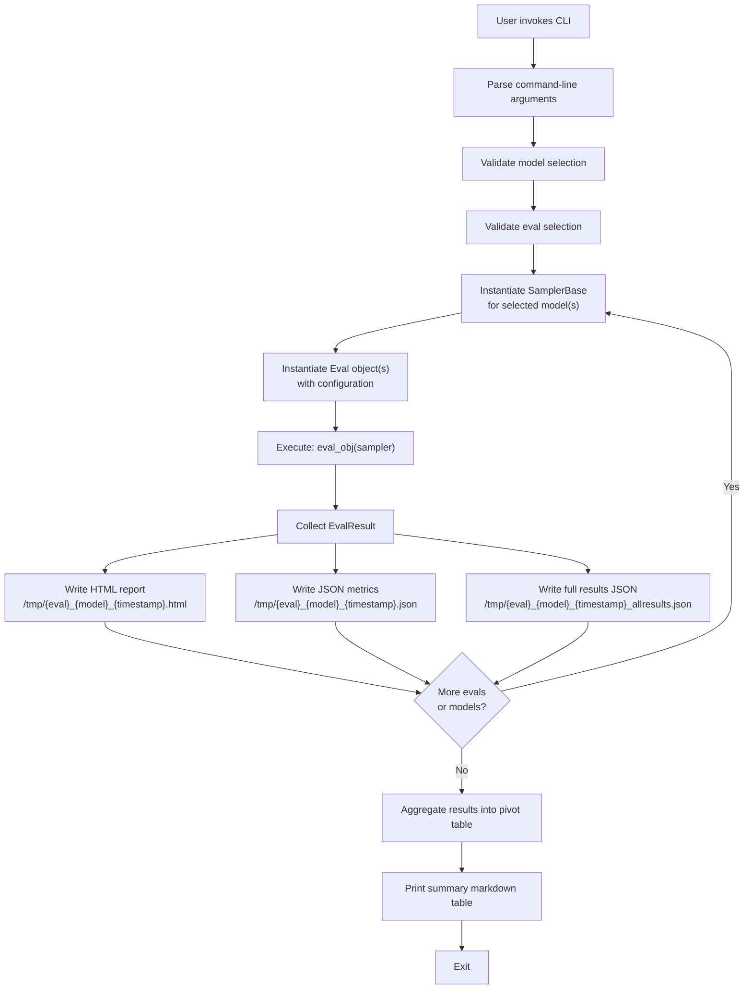
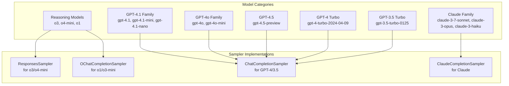
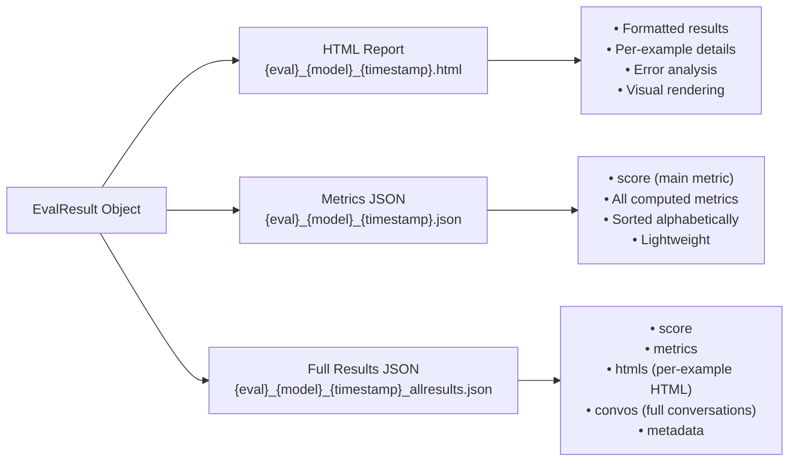
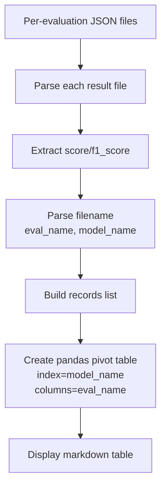

<!-- source: DeepWiki mcp.deepwiki.com · repo openai/simple-evals · page 6 Running Evaluations · fetched 2026-10-26 -->

# Running Evaluations

<details>
<summary>Relevant source files</summary>

The following files were used as context for generating this wiki page:

- [README.md](README.md)
- [run_multilingual_mmlu.py](run_multilingual_mmlu.py)
- [simple_evals.py](simple_evals.py)

</details>


This page provides a practical guide for executing evaluations using the simple-evals framework. It covers command-line usage, configuration options, and understanding output formats.

For information about the architecture and design of evaluations, see [Evaluation Framework](#3.3). For details about specific benchmarks, see [Evaluation Benchmarks](#4).

---

## Overview

Evaluations are executed via command-line scripts that orchestrate the complete pipeline: model sampling, response grading, and result aggregation. The framework provides two main entry points:

1. **`simple_evals.py`**: Main evaluation runner supporting all benchmarks and models
2. **`run_multilingual_mmlu.py`**: Specialized runner for multilingual MMLU evaluation

Both scripts follow the same execution pattern: instantiate a sampler for the target model, create evaluation objects for selected benchmarks, run the evaluation loop, and generate output files.

**Sources:** [simple_evals.py:1-430](), [run_multilingual_mmlu.py:1-145]()

---

## Basic Execution Flow



**Sources:** [simple_evals.py:29-426]()

---

## Command-Line Interface

### Main Evaluation Runner

The primary interface is through the `simple_evals.py` module:

```bash
python -m simple-evals.simple_evals [OPTIONS]
```

### Available Arguments

| Argument | Type | Default | Description |
|----------|------|---------|-------------|
| `--list-models` | flag | - | Display all available model configurations and exit |
| `--model` | string | (all models) | Comma-separated list of model names to evaluate |
| `--eval` | string | (all evals) | Comma-separated list of evaluation names to run |
| `--examples` | integer | varies by eval | Override default number of examples to evaluate |
| `--n-repeats` | integer | varies by eval | Number of sampling repeats (MATH, GPQA, HealthBench) |
| `--n-threads` | integer | 120 | Number of concurrent threads (HealthBench only) |
| `--debug` | flag | false | Enable debug mode (reduced example count, debug suffix on outputs) |

**Sources:** [simple_evals.py:30-62]()

### Listing Available Models

To see all configured model samplers:

```bash
python -m simple-evals.simple_evals --list-models
```

This displays model names from the `models` dictionary defined at [simple_evals.py:65-236](). Example output:

```
Available models:
 - o3
 - o3_high
 - o3_low
 - o4-mini
 - o1
 - gpt-4.1
 - gpt-4o
 - claude-3-7-sonnet-20250219
 ...
```

**Sources:** [simple_evals.py:238-242]()

---

## Model Selection

### Model Configuration Dictionary

All available models are defined in a dictionary at [simple_evals.py:65-236](). Each entry maps a model name to a configured `SamplerBase` instance:



**Key Model Configurations:**

- **Reasoning Models**: Use `ResponsesSampler` (o3/o4-mini) or `OChatCompletionSampler` (o1/o3-mini) with `reasoning_model=True` or `reasoning_effort` parameters
- **GPT Models**: Use `ChatCompletionSampler` with `system_message=OPENAI_SYSTEM_MESSAGE_API` and `max_tokens=2048`
- **Claude Models**: Use `ClaudeCompletionSampler` with optional system message configuration

**Sources:** [simple_evals.py:65-236]()

### Selecting Models

**Single model:**
```bash
python -m simple-evals.simple_evals --model gpt-4.1
```

**Multiple models:**
```bash
python -m simple-evals.simple_evals --model gpt-4.1,gpt-4o,o3
```

**All models (default):**
```bash
python -m simple-evals.simple_evals
```

The validation logic at [simple_evals.py:244-250]() checks that requested models exist in the dictionary and filters the models dictionary accordingly.

**Sources:** [simple_evals.py:244-250]()

---

## Evaluation Selection

### Available Evaluations

The `get_evals()` function at [simple_evals.py:262-335]() instantiates evaluation objects based on name:

| Eval Name | Class | Default Examples | Supports n-repeats | Configuration |
|-----------|-------|------------------|-------------------|---------------|
| `mmlu` | `MMLUEval` | ~14k questions | No | Subject-based sampling |
| `math` | `MathEval` | 500 problems | Yes (default: 10) | Uses `equality_checker` sampler |
| `gpqa` | `GPQAEval` | 448 questions | Yes (default: 10) | Answer permutation |
| `mgsm` | `MGSMEval` | 250/language | No | 11 languages |
| `drop` | `DropEval` | 9536 examples | No | 3-shot prompting |
| `humaneval` | `HumanEval` | 164 problems | No | Code execution |
| `simpleqa` | `SimpleQAEval` | ~4k questions | No | Requires `grader_model` |
| `browsecomp` | `BrowseCompEval` | 402 examples | No | Requires `grader_model` |
| `healthbench` | `HealthBenchEval` | 320 examples | Yes (default: 1) | Requires `grader_model`, supports `subset_name` and `n_threads` |
| `healthbench_hard` | `HealthBenchEval` | subset | Yes (default: 1) | Hard subset only |
| `healthbench_consensus` | `HealthBenchEval` | subset | Yes (default: 1) | Consensus subset only |
| `healthbench_meta` | `HealthBenchMetaEval` | varies | Yes (default: 1) | Meta-evaluation variant |

**Sources:** [simple_evals.py:262-335]()

### Grading Models

Some evaluations require a grading model for LLM-based assessment. The grading sampler is instantiated at [simple_evals.py:254-260]():

```python
grading_sampler = ChatCompletionSampler(
    model="gpt-4.1-2025-04-14",
    system_message=OPENAI_SYSTEM_MESSAGE_API,
    max_tokens=2048,
)
equality_checker = ChatCompletionSampler(model="gpt-4-turbo-preview")
```

- **`grading_sampler`**: Used by SimpleQA, BrowseComp, and HealthBench for response quality assessment
- **`equality_checker`**: Used by MATH for semantic equivalence checking

**Sources:** [simple_evals.py:254-260]()

### Selecting Evaluations

**Single evaluation:**
```bash
python -m simple-evals.simple_evals --eval mmlu --model gpt-4.1
```

**Multiple evaluations:**
```bash
python -m simple-evals.simple_evals --eval mmlu,math,gpqa --model gpt-4.1
```

**All evaluations (default):**
```bash
python -m simple-evals.simple_evals --model gpt-4.1
```

**Sources:** [simple_evals.py:336-362]()

---

## Configuration Options

### Example Count Override

The `--examples` flag overrides the default number of examples for any evaluation:

```bash
python -m simple-evals.simple_evals --model gpt-4.1 --eval mmlu --examples 100
```

This is useful for quick testing or resource-constrained scenarios. When `--examples` is not specified:
- **Debug mode** (`--debug`): Uses 5-10 examples per eval
- **Normal mode**: Uses full dataset or eval-specific defaults

**Sources:** [simple_evals.py:262-265]()

### Repeat Sampling

For evaluations that support stochastic sampling (MATH, GPQA, HealthBench), `--n-repeats` controls how many times each example is sampled:

```bash
python -m simple-evals.simple_evals --model gpt-4.1 --eval math --n-repeats 20
```

Default values:
- **MATH**: 10 repeats
- **GPQA**: 10 repeats
- **HealthBench**: 1 repeat

**Sources:** [simple_evals.py:48-51](), [simple_evals.py:271-275](), [simple_evals.py:277-280](), [simple_evals.py:303-309]()

### Thread Concurrency

For HealthBench evaluations, `--n-threads` controls parallel execution:

```bash
python -m simple-evals.simple_evals --model gpt-4.1 --eval healthbench --n-threads 50
```

Default: 120 threads. Adjust based on API rate limits and available resources.

**Sources:** [simple_evals.py:53-57]()

### Debug Mode

Debug mode enables rapid iteration during development:

```bash
python -m simple-evals.simple_evals --debug --model gpt-4.1 --eval mmlu
```

Effects:
- Reduces example count to 1-10 per evaluation
- Appends `_DEBUG` suffix to all output files
- Sets `n-repeats` to 1 for applicable evals

**Sources:** [simple_evals.py:58](), [simple_evals.py:262-265](), [simple_evals.py:365-366]()

---

## Output Files

### File Naming Convention

All output files follow this pattern:

```
/tmp/{eval_name}_{model_name}_{timestamp}[_DEBUG].{extension}
```

- **`eval_name`**: Name of the evaluation (e.g., `mmlu`, `math`)
- **`model_name`**: Name of the model (e.g., `gpt-4.1`, `o3`)
- **`timestamp`**: Format `YYYYMMDD_HHMMSS` (e.g., `20250124_143052`)
- **`_DEBUG`**: Appended when `--debug` flag is used
- **`extension`**: `.html`, `.json`, or `_allresults.json`

**Sources:** [simple_evals.py:371-380]()

### Output File Types



**Sources:** [simple_evals.py:380-405]()

### HTML Report

**Path:** `/tmp/{eval_name}_{model_name}_{timestamp}.html`

Generated by `common.make_report()`, the HTML report provides human-readable evaluation results:
- Summary statistics and scores
- Per-example results with model responses
- Visual formatting for easy review
- Error analysis and debugging information

**Example:**
```bash
# Output location
Writing report to /tmp/mmlu_gpt-4.1_20250124_143052.html
```

**Sources:** [simple_evals.py:380-383]()

### Metrics JSON

**Path:** `/tmp/{eval_name}_{model_name}_{timestamp}.json`

Contains lightweight metric summary:

```json
{
  "accuracy": 0.923,
  "score": 0.923,
  "stem_accuracy": 0.945,
  "humanities_accuracy": 0.911,
  "social_sciences_accuracy": 0.898
}
```

- **`score`**: Primary evaluation metric (always present)
- **Additional metrics**: Eval-specific breakdowns
- **Sorted alphabetically** for consistency

**Sources:** [simple_evals.py:384-392]()

### Full Results JSON

**Path:** `/tmp/{eval_name}_{model_name}_{timestamp}_allresults.json`

Complete evaluation trace for reproducibility:

```json
{
  "score": 0.923,
  "metrics": {
    "accuracy": 0.923,
    "stem_accuracy": 0.945
  },
  "htmls": ["<html>...</html>", ...],
  "convos": [[{"role": "user", "content": "..."}, ...], ...],
  "metadata": {"model_name": "gpt-4.1", ...}
}
```

Structure matches `EvalResult` fields:
- **`score`**: Main metric
- **`metrics`**: All computed metrics
- **`htmls`**: Per-example HTML strings
- **`convos`**: Full conversation histories as `MessageList` arrays
- **`metadata`**: Additional context (timestamps, configuration, etc.)

**Sources:** [simple_evals.py:394-404]()

---

## Result Aggregation

After all evaluations complete, results are aggregated into a pivot table:



**Example output:**
```
All results: 
|                       |   mmlu |   math |   gpqa |
|:----------------------|-------:|-------:|-------:|
| gpt-4.1               |  90.2  |  82.1  |  66.3  |
| gpt-4o                |  85.7  |  68.5  |  46.0  |
| o3                    |  92.9  |  97.8  |  82.8  |
```

The aggregation logic at [simple_evals.py:407-425]() collects results from all generated JSON files and creates a comparative summary.

**Sources:** [simple_evals.py:407-425]()

---

## Multilingual MMLU Runner

For evaluating models on translated MMLU benchmarks, use the specialized runner:

```bash
python -m simple-evals.run_multilingual_mmlu
```

### Supported Languages

The runner evaluates MMLU across 15 languages defined at [run_multilingual_mmlu.py:83-102]():

| Language Code | Language |
|---------------|----------|
| `EN-US` | English (US) |
| `AR-XY` | Arabic |
| `BN-BD` | Bengali (Bangladesh) |
| `DE-DE` | German (Germany) |
| `ES-LA` | Spanish (Latin America) |
| `FR-FR` | French (France) |
| `HI-IN` | Hindi (India) |
| `ID-ID` | Indonesian (Indonesia) |
| `IT-IT` | Italian (Italy) |
| `JA-JP` | Japanese (Japan) |
| `KO-KR` | Korean (Korea) |
| `PT-BR` | Portuguese (Brazil) |
| `ZH-CN` | Chinese (China) |
| `SW-KE` | Swahili (Kenya) |
| `YO-NG` | Yoruba (Nigeria) |

Each language variant is a separate evaluation (e.g., `mmlu_EN-US`, `mmlu_AR-XY`).

**Sources:** [run_multilingual_mmlu.py:48-102]()

### Multilingual Configuration

The runner has a hardcoded debug flag and sampler selection at [run_multilingual_mmlu.py:16-46]():

```python
debug = True  # Set to False for full evaluation
samplers = {
    "gpt-4o_chatgpt": ChatCompletionSampler(...),
    "o3-mini": OChatCompletionSampler(...),
    ...
}
```

To run full multilingual evaluations:
1. Edit `run_multilingual_mmlu.py` and set `debug = False`
2. Modify `samplers` dictionary to include desired models
3. Execute the script

**Sources:** [run_multilingual_mmlu.py:15-46]()

---

## Example Usage Scenarios

### Quick Test Run

Test a single model on one evaluation with reduced examples:

```bash
python -m simple-evals.simple_evals \
  --debug \
  --model gpt-4.1 \
  --eval mmlu
```

Output: `/tmp/mmlu_gpt-4.1_{timestamp}_DEBUG.html`

**Sources:** [simple_evals.py:58-62]()

### Comprehensive Benchmark

Evaluate a model on all benchmarks with full datasets:

```bash
python -m simple-evals.simple_evals --model gpt-4.1
```

This runs all evaluations defined at [simple_evals.py:346-362]() with default configurations.

**Sources:** [simple_evals.py:346-362]()

### Model Comparison

Compare multiple models on specific benchmarks:

```bash
python -m simple-evals.simple_evals \
  --model gpt-4.1,gpt-4o,o3 \
  --eval mmlu,math,gpqa
```

Produces 9 output file sets (3 models × 3 evals) and a comparative pivot table.

**Sources:** [simple_evals.py:244-250](), [simple_evals.py:373-425]()

### Stochastic Evaluation

Run multiple sampling passes for statistical significance:

```bash
python -m simple-evals.simple_evals \
  --model gpt-4.1 \
  --eval math \
  --n-repeats 30
```

Each problem is sampled 30 times; metrics reflect aggregated statistics.

**Sources:** [simple_evals.py:271-275]()

### Resource-Constrained Testing

Evaluate on a sample with controlled concurrency:

```bash
python -m simple-evals.simple_evals \
  --model gpt-4.1 \
  --eval healthbench \
  --examples 50 \
  --n-threads 20
```

Limits to 50 examples with 20 concurrent threads.

**Sources:** [simple_evals.py:60-61](), [simple_evals.py:53-57]()

---

## Execution Environment Requirements

### API Keys

Set environment variables before running:

```bash
export OPENAI_API_KEY="sk-..."        # For OpenAI samplers
export ANTHROPIC_API_KEY="sk-ant-..."  # For Claude samplers
```

**Sources:** [README.md:94]()

### Dependencies

Ensure required packages are installed:

```bash
# For HumanEval
git clone https://github.com/openai/human-eval
pip install -e human-eval

# For OpenAI API
pip install openai

# For Anthropic API
pip install anthropic
```

**Sources:** [README.md:96-114]()

### Output Directory

All results are written to `/tmp/`. Ensure this directory is writable and has sufficient space for:
- Multiple HTML reports (can be several MB each)
- JSON files (typically KB to MB range)
- Full results JSON (largest, contains all conversation data)

**Sources:** [simple_evals.py:380]()

---

## Error Handling and Debugging

### Model Not Found

If an invalid model name is provided:

```bash
python -m simple-evals.simple_evals --model invalid-model
# Output: Error: Model 'invalid-model' not found.
```

Check available models with `--list-models`.

**Sources:** [simple_evals.py:246-249]()

### Evaluation Not Found

If an invalid evaluation name is provided:

```bash
python -m simple-evals.simple_evals --eval invalid-eval
# Output: Error: eval 'invalid-eval' not found.
```

Valid evaluation names are defined in the match statement at [simple_evals.py:267-334]().

**Sources:** [simple_evals.py:340-344]()

### Debug Mode for Troubleshooting

When debugging evaluation logic or sampler issues:

```bash
python -m simple-evals.simple_evals \
  --debug \
  --model gpt-4.1 \
  --eval mmlu \
  --examples 1
```

This runs on a single example, making it easy to inspect the HTML report and identify issues.

**Sources:** [simple_evals.py:58](), [simple_evals.py:262-265]()

---

