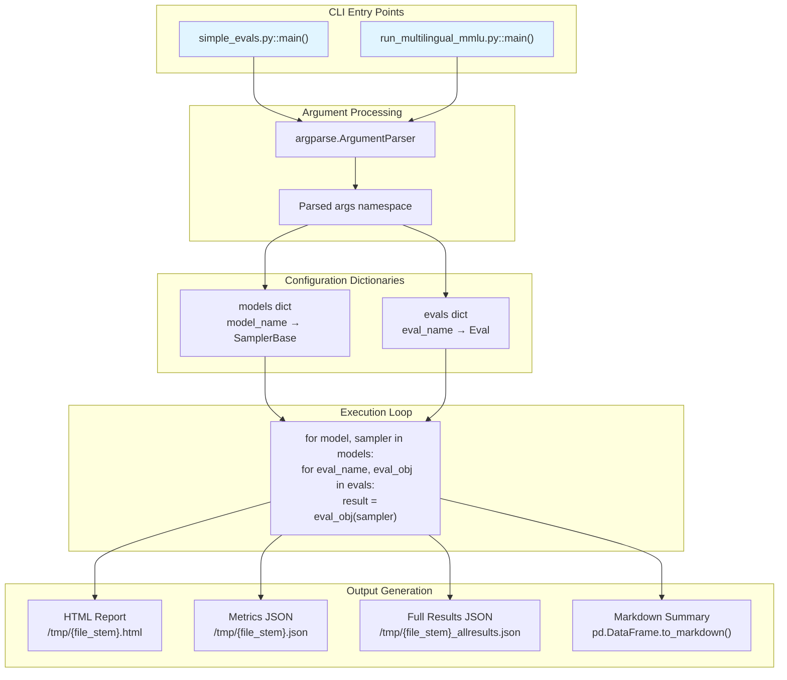
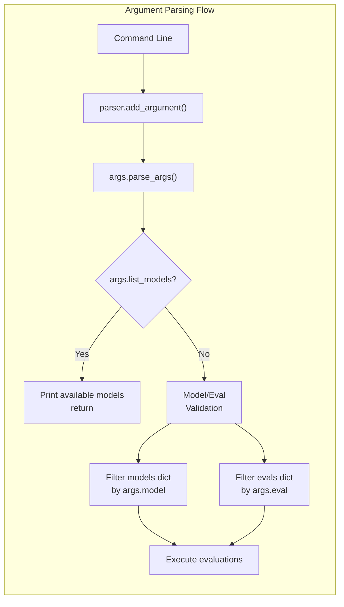
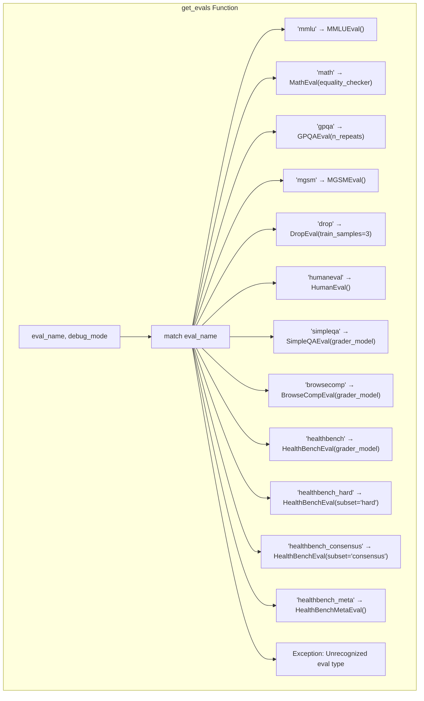
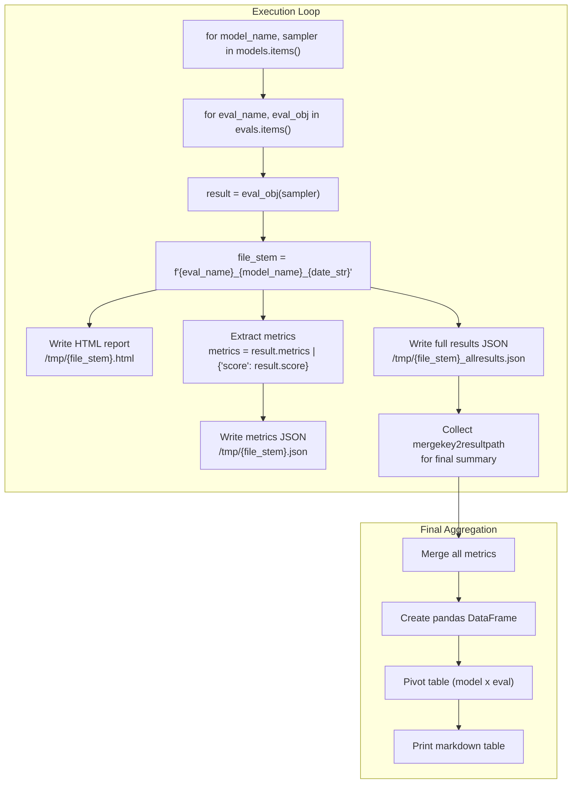
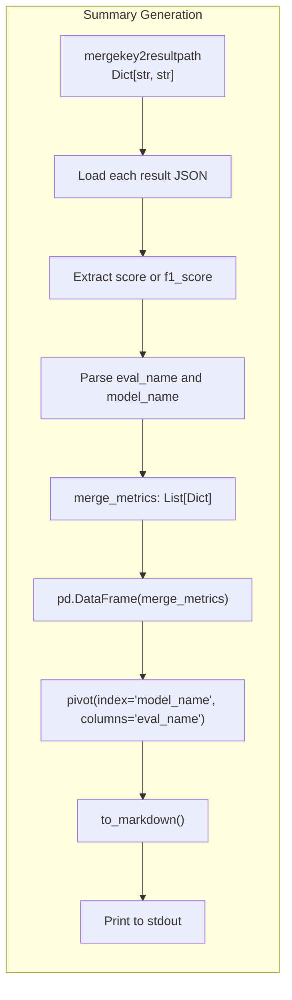

<!-- source: DeepWiki mcp.deepwiki.com · repo openai/simple-evals · page 6.1 Command-Line Interface · fetched 2026-10-26 -->

# Command-Line Interface

<details>
<summary>Relevant source files</summary>

The following files were used as context for generating this wiki page:

- [README.md](README.md)
- [run_multilingual_mmlu.py](run_multilingual_mmlu.py)
- [simple_evals.py](simple_evals.py)

</details>


This page documents the command-line interface (CLI) for running evaluations in simple-evals. The CLI provides the primary method for executing benchmark evaluations against language models, with support for model selection, evaluation configuration, and result generation. 

For information about the output files produced by the CLI, see [Output Files and Reports](#6.2). For details about the evaluation framework architecture, see [Evaluation Framework](#3.3).

## Overview

The simple-evals repository provides two CLI entry points:

1. **`simple_evals.py`** - Main evaluation runner supporting all benchmarks
2. **`run_multilingual_mmlu.py`** - Specialized runner for multilingual MMLU evaluation across 15 languages

Both scripts follow a similar pattern: parse command-line arguments, instantiate samplers (model wrappers), execute selected evaluations, and generate output files.



**Sources:** [simple_evals.py:29-430](), [run_multilingual_mmlu.py:15-145]()

## Main CLI Entry Point

The primary CLI is invoked as a Python module:

```bash
python -m simple-evals.simple_evals [OPTIONS]
```

The `main()` function at [simple_evals.py:29-426]() orchestrates the entire evaluation workflow.

### Argument Parser Configuration

The CLI uses `argparse.ArgumentParser` to define command-line options:

| Argument | Type | Default | Description |
|----------|------|---------|-------------|
| `--list-models` | flag | False | List all available models and exit |
| `--model` | str | None | Select specific model(s), comma-separated list supported |
| `--eval` | str | None | Select specific eval(s), comma-separated list supported |
| `--n-repeats` | int | None | Number of evaluation repeats (eval-specific) |
| `--n-threads` | int | 120 | Number of threads for HealthBench/HealthBenchMeta |
| `--debug` | flag | False | Enable debug mode (limited examples) |
| `--examples` | int | None | Override default number of examples per eval |

**Sources:** [simple_evals.py:30-62]()



**Sources:** [simple_evals.py:30-62](), [simple_evals.py:238-250](), [simple_evals.py:336-362]()

## Model Selection

The `models` dictionary at [simple_evals.py:65-236]() maps model names to sampler instances. Models are organized by family:

### Model Dictionary Structure

```mermaid
graph TD
    subgraph "Model Registry"
        ModelsDict["models: Dict[str, SamplerBase]"]
    end
    
    subgraph "Reasoning Models"
        O3["'o3' → ResponsesSampler"]
        O3High["'o3_high' → ResponsesSampler<br/>reasoning_effort='high'"]
        O3Low["'o3_low' → ResponsesSampler<br/>reasoning_effort='low'"]
        O4Mini["'o4-mini' → ResponsesSampler"]
        O1["'o1' → OChatCompletionSampler"]
        O3Mini["'o3-mini' → OChatCompletionSampler"]
    end
    
    subgraph "GPT Models"
        GPT41["'gpt-4.1' → ChatCompletionSampler<br/>OPENAI_SYSTEM_MESSAGE_API"]
        GPT4o["'gpt-4o' → ChatCompletionSampler"]
        GPT45["'gpt-4.5-preview' → ChatCompletionSampler"]
        GPT35["'gpt-3.5-turbo-0125' → ChatCompletionSampler"]
    end
    
    subgraph "Claude Models"
        Claude37["'claude-3-7-sonnet-20250219' → ClaudeCompletionSampler"]
        Claude3Opus["'claude-3-opus-20240229_empty' → ClaudeCompletionSampler"]
    end
    
    ModelsDict --> O3
    ModelsDict --> O3High
    ModelsDict --> O3Low
    ModelsDict --> O4Mini
    ModelsDict --> O1
    ModelsDict --> O3Mini
    ModelsDict --> GPT41
    ModelsDict --> GPT4o
    ModelsDict --> GPT45
    ModelsDict --> GPT35
    ModelsDict --> Claude37
    ModelsDict --> Claude3Opus
```



**Sources:** [simple_evals.py:65-236]()

### Listing Available Models

The `--list-models` flag prints all registered model names:

```bash
python -m simple-evals.simple_evals --list-models
```

Implementation at [simple_evals.py:238-242]():
```python
if args.list_models:
    print("Available models:")
    for model_name in models.keys():
        print(f" - {model_name}")
    return
```

### Selecting Specific Models

The `--model` argument accepts either a single model name or a comma-separated list:

```bash
# Single model
python -m simple-evals.simple_evals --model gpt-4o

# Multiple models
python -m simple-evals.simple_evals --model gpt-4o,o3-mini,claude-3-7-sonnet-20250219
```

Model validation occurs at [simple_evals.py:244-250]():
```python
if args.model:
    models_chosen = args.model.split(",")
    for model_name in models_chosen:
        if model_name not in models:
            print(f"Error: Model '{model_name}' not found.")
            return
    models = {model_name: models[model_name] for model_name in models_chosen}
```

If no `--model` is specified, all models in the dictionary are evaluated.

**Sources:** [simple_evals.py:244-250]()

## Evaluation Selection

The `get_evals()` function at [simple_evals.py:262-334]() instantiates evaluation objects based on the eval name and debug mode.

### Eval Factory Function



**Sources:** [simple_evals.py:262-334]()

### Supported Eval Names

| Eval Name | Class | Special Configuration |
|-----------|-------|----------------------|
| `mmlu` | `MMLUEval` | num_examples |
| `math` | `MathEval` | equality_checker, n_repeats=10 |
| `gpqa` | `GPQAEval` | n_repeats=10 |
| `mgsm` | `MGSMEval` | num_examples_per_lang=250 |
| `drop` | `DropEval` | train_samples_per_prompt=3 |
| `humaneval` | `HumanEval` | num_examples |
| `simpleqa` | `SimpleQAEval` | grader_model (gpt-4.1) |
| `browsecomp` | `BrowseCompEval` | grader_model (gpt-4.1) |
| `healthbench` | `HealthBenchEval` | grader_model, n_threads |
| `healthbench_hard` | `HealthBenchEval` | subset_name="hard" |
| `healthbench_consensus` | `HealthBenchEval` | subset_name="consensus" |
| `healthbench_meta` | `HealthBenchMetaEval` | grader_model, n_threads |

**Sources:** [simple_evals.py:262-334]()

### Selecting Specific Evals

The `--eval` argument accepts comma-separated eval names:

```bash
# Single eval
python -m simple-evals.simple_evals --model gpt-4o --eval mmlu

# Multiple evals
python -m simple-evals.simple_evals --model gpt-4o --eval mmlu,math,gpqa
```

If no `--eval` is specified, all evals are executed (lines [simple_evals.py:346-362]()):
```python
else:
    evals = {
        eval_name: get_evals(eval_name, args.debug)
        for eval_name in [
            "mmlu", "math", "gpqa", "mgsm", "drop", "humaneval",
            "simpleqa", "browsecomp", "healthbench", 
            "healthbench_hard", "healthbench_consensus", "healthbench_meta",
        ]
    }
```

**Sources:** [simple_evals.py:336-362]()

## Grading Model Configuration

Several evaluations require a separate grader model for scoring responses. The grading sampler is instantiated at [simple_evals.py:254-260]():

```python
grading_sampler = ChatCompletionSampler(
    model="gpt-4.1-2025-04-14",
    system_message=OPENAI_SYSTEM_MESSAGE_API,
    max_tokens=2048,
)
equality_checker = ChatCompletionSampler(model="gpt-4-turbo-preview")
# ^^^ used for fuzzy matching, just for math
```

The `grading_sampler` is used by:
- SimpleQA ([simple_evals.py:294]())
- BrowseComp ([simple_evals.py:299]())
- HealthBench ([simple_evals.py:304]())
- HealthBenchMeta ([simple_evals.py:328]())

The `equality_checker` is used only by MATH eval for semantic equivalence checking ([simple_evals.py:272]()).

**Sources:** [simple_evals.py:254-260]()

## Debug Mode and Example Control

### Debug Mode

The `--debug` flag enables debug mode, which significantly reduces the number of examples evaluated:

```bash
python -m simple-evals.simple_evals --model gpt-4o --eval mmlu --debug
```

Debug mode affects example counts at [simple_evals.py:262-264]():
```python
def get_evals(eval_name, debug_mode):
    num_examples = (
        args.examples if args.examples is not None else (5 if debug_mode else None)
    )
```

Debug mode example counts per eval:

| Eval | Debug Examples | Production Examples |
|------|----------------|---------------------|
| mmlu | 1 | Full dataset |
| math | n_repeats=1 | n_repeats=10 |
| gpqa | n_repeats=1 | n_repeats=10 |
| mgsm | 10 per language | 250 per language |
| drop | 10 | Full dataset |
| humaneval | 10 | Full dataset |
| simpleqa | 10 | Full dataset |
| browsecomp | 10 | Full dataset |
| healthbench | 10 | Full dataset |

**Sources:** [simple_evals.py:262-332]()

### Example Count Override

The `--examples` argument overrides the default number of examples:

```bash
# Evaluate only 50 examples
python -m simple-evals.simple_evals --model gpt-4o --eval mmlu --examples 50
```

This argument takes precedence over both debug mode and default settings ([simple_evals.py:263-265]()).

**Sources:** [simple_evals.py:60-61](), [simple_evals.py:263-265]()

## Evaluation-Specific Arguments

### n-repeats

The `--n-repeats` argument controls how many times to repeat an evaluation (for variance estimation):

```bash
python -m simple-evals.simple_evals --model gpt-4o --eval math --n-repeats 5
```

Supported by:
- **math**: Default 10 repeats ([simple_evals.py:274]())
- **gpqa**: Default 10 repeats ([simple_evals.py:278]())
- **healthbench**: Default 1 repeat ([simple_evals.py:306]())
- **healthbench_hard**: Default 1 repeat ([simple_evals.py:314]())
- **healthbench_consensus**: Default 1 repeat ([simple_evals.py:322]())
- **healthbench_meta**: Default 1 repeat ([simple_evals.py:330]())

**Sources:** [simple_evals.py:47-51](), [simple_evals.py:274](), [simple_evals.py:278](), [simple_evals.py:306]()

### n-threads

The `--n-threads` argument controls parallelism for HealthBench evaluations:

```bash
python -m simple-evals.simple_evals --model gpt-4o --eval healthbench --n-threads 64
```

Default value is 120 threads ([simple_evals.py:53-57]()). Only affects HealthBench and HealthBenchMeta evaluations.

**Sources:** [simple_evals.py:53-57](), [simple_evals.py:307]()

## Execution Flow

The main execution loop iterates over all model-eval combinations at [simple_evals.py:373-405]():



**Sources:** [simple_evals.py:371-425]()

### Output File Naming

Output files follow the pattern:

```
/tmp/{eval_name}_{model_name}_{YYYYMMDD_HHMMSS}[_DEBUG].{ext}
```

Where:
- `eval_name`: Name of the evaluation (e.g., "mmlu", "math")
- `model_name`: Name of the model (e.g., "gpt-4o", "o3-mini")
- `YYYYMMDD_HHMMSS`: Timestamp when the run started ([simple_evals.py:371-372]())
- `_DEBUG`: Suffix added in debug mode ([simple_evals.py:365]())
- `ext`: File extension (.html, .json, or _allresults.json)

Example filenames:
```
/tmp/mmlu_gpt-4o_20250116_143022.html
/tmp/mmlu_gpt-4o_20250116_143022.json
/tmp/mmlu_gpt-4o_20250116_143022_allresults.json
```

**Sources:** [simple_evals.py:371-404]()

### Output File Types

Three files are generated per model-eval combination:

1. **HTML Report** (`{file_stem}.html`)
   - Human-readable evaluation report
   - Generated by `common.make_report(result)`
   - Contains individual example results and metrics
   - Path: [simple_evals.py:380-383]()

2. **Metrics JSON** (`{file_stem}.json`)
   - Compact JSON with aggregated metrics
   - Contains `result.metrics` merged with overall `score`
   - Metrics sorted alphabetically by key
   - Path: [simple_evals.py:385-392]()

3. **Full Results JSON** (`{file_stem}_allresults.json`)
   - Complete evaluation trace
   - Contains: `score`, `metrics`, `htmls`, `convos`, `metadata`
   - Used for reproducibility and detailed analysis
   - Path: [simple_evals.py:394-404]()

**Sources:** [simple_evals.py:380-404]()

## Final Results Summary

After all evaluations complete, the CLI generates a summary table at [simple_evals.py:407-425]():



The summary table has models as rows and evals as columns, displaying the primary metric for each combination.

**Sources:** [simple_evals.py:407-425]()

## Multilingual MMLU Runner

The `run_multilingual_mmlu.py` script provides a specialized interface for evaluating multilingual MMLU across 15 languages.

### Supported Languages

| Language Code | Language Name |
|---------------|---------------|
| EN-US | English (United States) |
| AR-XY | Arabic |
| BN-BD | Bengali (Bangladesh) |
| DE-DE | German (Germany) |
| ES-LA | Spanish (Latin America) |
| FR-FR | French (France) |
| HI-IN | Hindi (India) |
| ID-ID | Indonesian (Indonesia) |
| IT-IT | Italian (Italy) |
| JA-JP | Japanese (Japan) |
| KO-KR | Korean (Korea) |
| PT-BR | Portuguese (Brazil) |
| ZH-CN | Chinese (China) |
| SW-KE | Swahili (Kenya) |
| YO-NG | Yoruba (Nigeria) |

**Sources:** [run_multilingual_mmlu.py:48-102]()

### Usage

The multilingual MMLU runner is hardcoded to run all 15 language variants:

```bash
python -m simple-evals.run_multilingual_mmlu
```

Debug mode is controlled by the `debug` variable at [run_multilingual_mmlu.py:16]() (must be edited in code, not via CLI).

The script follows the same pattern as the main CLI:
- Instantiates samplers
- Creates MMLUEval instances with different language parameters
- Executes all model-eval combinations
- Generates identical output file structure
- Produces final markdown summary table

**Sources:** [run_multilingual_mmlu.py:15-145]()

## Usage Examples

### List Available Models

```bash
python -m simple-evals.simple_evals --list-models
```

### Run Single Model on Single Eval

```bash
python -m simple-evals.simple_evals --model gpt-4o --eval mmlu
```

### Run Multiple Models on Multiple Evals

```bash
python -m simple-evals.simple_evals \
  --model gpt-4o,o3-mini,claude-3-7-sonnet-20250219 \
  --eval mmlu,math,gpqa
```

### Debug Mode with Limited Examples

```bash
python -m simple-evals.simple_evals --model gpt-4o --eval mmlu --debug
```

### Custom Example Count

```bash
python -m simple-evals.simple_evals --model gpt-4o --eval mmlu --examples 100
```

### HealthBench with Threading Configuration

```bash
python -m simple-evals.simple_evals \
  --model gpt-4o \
  --eval healthbench \
  --n-threads 64 \
  --n-repeats 3
```

### Math Eval with Custom Repeats

```bash
python -m simple-evals.simple_evals \
  --model o3-mini \
  --eval math \
  --n-repeats 5
```

**Sources:** [simple_evals.py:29-430](), [README.md:117-126]()

---

