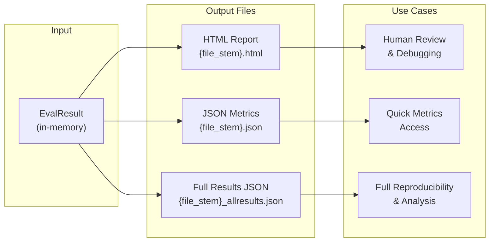
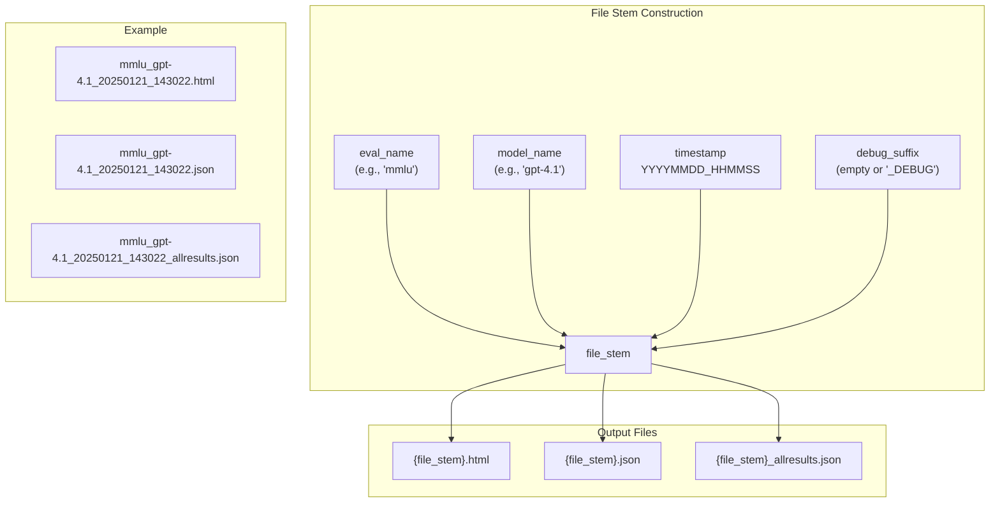
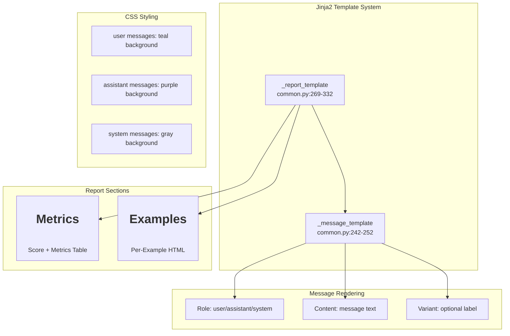
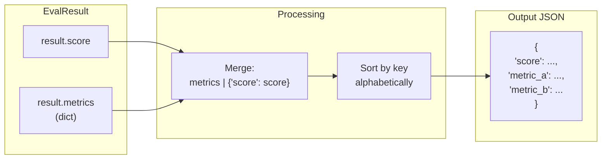
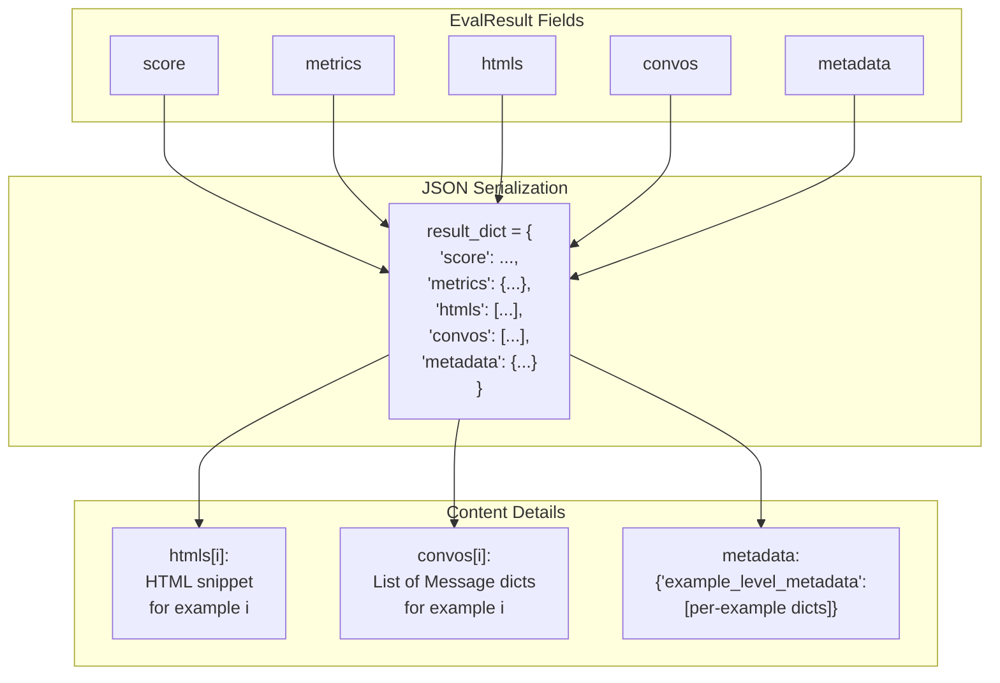
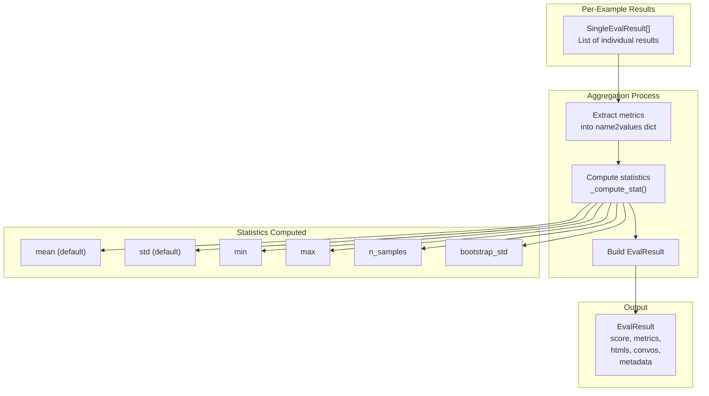
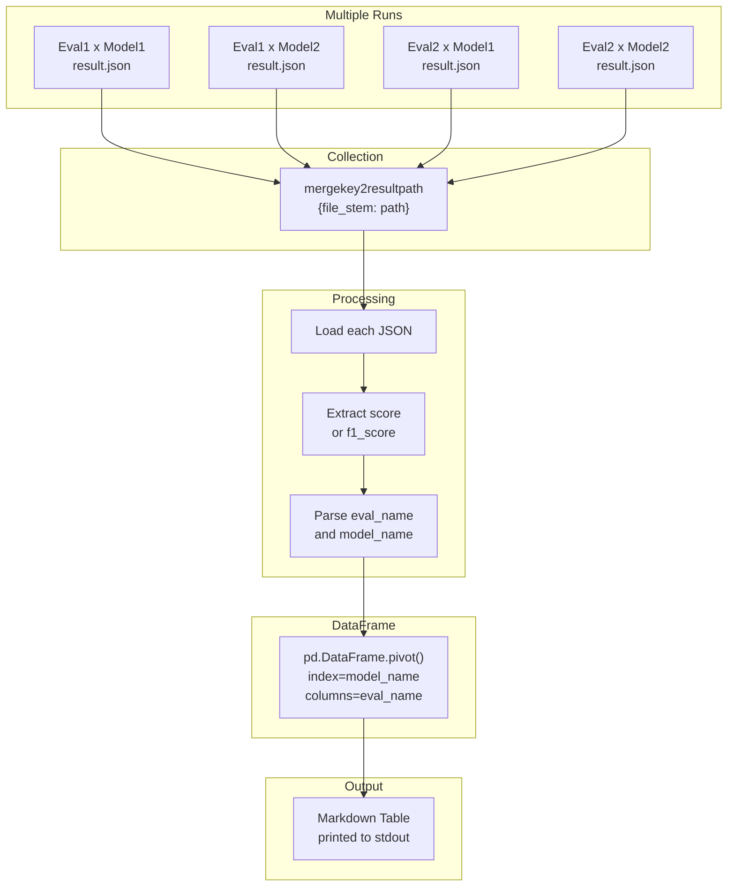
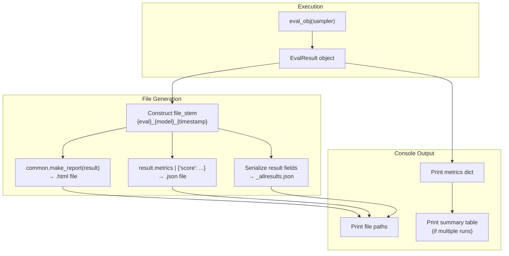

<!-- source: DeepWiki mcp.deepwiki.com · repo openai/simple-evals · page 6.2 Output Files and Reports · fetched 2026-10-26 -->

# Output Files and Reports

<details>
<summary>Relevant source files</summary>

The following files were used as context for generating this wiki page:

- [common.py](common.py)
- [run_multilingual_mmlu.py](run_multilingual_mmlu.py)
- [simple_evals.py](simple_evals.py)

</details>


This document describes the output files generated by simple-evals evaluation runs, their structure, naming conventions, and how to interpret them. For information about running evaluations and command-line options, see [Command-Line Interface](#6.1). For extending the framework with custom result formats, see [Creating Custom Evaluations](#7.2).

## Purpose and Scope

Each evaluation run produces three types of output files that serve different purposes: HTML reports for human review, lightweight JSON metrics for quick programmatic access, and full results JSON for complete reproducibility. This page documents the structure and location of these files, the data they contain, and how to use them for analysis.

## Output File Types

The evaluation framework generates three distinct output files per evaluation run, each optimized for different use cases:



**Sources:** [simple_evals.py:380-404]()

### HTML Reports

HTML reports provide human-readable visualization of evaluation results with styled output. Generated via `common.make_report()`, they include a metrics summary table and detailed per-example traces.

**File Location:** `/tmp/{file_stem}.html`

**Structure:**
- **Metrics Table**: Overall score and all computed metrics
- **Example Sections**: Individual prompt-response pairs with extracted answers and scores
- **Styling**: CSS-styled messages with color-coded roles (user/assistant/system)

**Sources:** [simple_evals.py:380-383](), [common.py:335-343](), [common.py:269-332]()

### JSON Metrics Files

JSON metrics files contain lightweight, easily parseable evaluation scores and statistics. These files are sorted alphabetically by key for consistent formatting.

**File Location:** `/tmp/{file_stem}.json`

**Content Structure:**
```
{
  "score": <overall_score>,
  "metric_name_1": <value>,
  "metric_name_2": <value>,
  ...
}
```

The file merges `result.metrics` with the overall `result.score` and sorts all keys alphabetically before serialization.

**Sources:** [simple_evals.py:384-392]()

### Full Results JSON

Full results JSON files contain complete evaluation traces including all conversations, HTML snippets, and metadata. These files enable complete reproducibility and detailed analysis.

**File Location:** `/tmp/{file_stem}_allresults.json`

**Content Structure:**
```
{
  "score": <overall_score>,
  "metrics": {<metric_name>: <value>, ...},
  "htmls": [<html_snippet_1>, <html_snippet_2>, ...],
  "convos": [<conversation_1>, <conversation_2>, ...],
  "metadata": {<metadata_dict>}
}
```

Each field corresponds directly to attributes of the `EvalResult` type:
- `score`: Final aggregated score (can be `null`)
- `metrics`: Dictionary of computed metrics
- `htmls`: List of HTML snippets for each example
- `convos`: List of conversation traces (list of messages)
- `metadata`: Evaluation-specific metadata including example-level data

**Sources:** [simple_evals.py:394-404](), [types.py (implied)]()

## File Naming Convention

Output files follow a systematic naming pattern that encodes the evaluation name, model name, timestamp, and debug status.



**Pattern:** `{eval_name}_{model_name}_{YYYYMMDD_HHMMSS}{debug_suffix}.{extension}`

**Components:**
- **eval_name**: The evaluation benchmark name (e.g., `mmlu`, `math`, `simpleqa`)
- **model_name**: The model identifier from the samplers dictionary
- **timestamp**: Date and time of run in `YYYYMMDD_HHMMSS` format
- **debug_suffix**: `_DEBUG` when `--debug` flag is used, otherwise empty
- **extension**: `.html`, `.json`, or `_allresults.json`

**Sources:** [simple_evals.py:365-379]()

## HTML Report Structure

HTML reports use Jinja2 templates to render evaluation results with structured styling. The template system separates presentation from data.



**Template Variables:**
- `score`: Overall evaluation score (rounded to 3 decimal places)
- `metrics`: Dictionary of metric names and values
- `htmls`: List of per-example HTML snippets

**Message Styling:**
| Role | Background Color | Text Color |
|------|------------------|------------|
| user | #B2DFDB (teal) | #00695C |
| assistant | #B39DDB (purple) | #4527A0 |
| system | #EEEEEE (gray) | #212121 |

The `message_to_html()` function converts individual messages to styled HTML divs with role labels and optional variant tags.

**Sources:** [common.py:242-264](), [common.py:269-332](), [common.py:335-343]()

## JSON Structure Details

### Metrics JSON Structure

The metrics JSON file provides a flat dictionary structure optimized for quick parsing and comparison across models.



**Key Features:**
- **Flat Structure**: No nested dictionaries for easy access
- **Alphabetical Sorting**: Keys sorted for consistent diff-ing
- **Score Promotion**: `score` field extracted from nested structure
- **Type Preservation**: Numeric values preserved (not stringified)

**Example:**
```json
{
  "accuracy": 0.753,
  "accuracy:bootstrap_std": 0.019,
  "accuracy:std": 0.087,
  "score": 0.753
}
```

**Sources:** [simple_evals.py:384-392]()

### Full Results JSON Structure

The full results JSON preserves complete evaluation state for reproducibility and debugging.



**Field Descriptions:**

| Field | Type | Description |
|-------|------|-------------|
| `score` | float or null | Overall evaluation score |
| `metrics` | dict | All computed metrics with names as keys |
| `htmls` | list[str] | HTML snippet for each evaluation example |
| `convos` | list[list[Message]] | Complete conversation trace per example |
| `metadata` | dict | Evaluation metadata including example-level data |

The `convos` field contains the full message history for each example, enabling exact reproduction of model inputs. Each conversation is a list of `Message` dictionaries with `role` and `content` fields.

**Sources:** [simple_evals.py:394-404](), [common.py:183-216]()

## Result Aggregation Pipeline

Evaluation results flow through an aggregation pipeline that computes statistics and produces the final `EvalResult` object.



**Aggregation Function:** `aggregate_results()` in [common.py:183-216]()

**Process:**
1. **Collection**: Gather all `SingleEvalResult` objects from individual examples
2. **Extraction**: Extract metric values and scores into `name2values` dictionary
3. **Statistical Computation**: Compute configured statistics for each metric
4. **Result Construction**: Build final `EvalResult` with aggregated metrics

**Default Statistics:**
- `mean`: Primary statistic (used when no suffix specified)
- `std`: Standard deviation

**Additional Statistics** (via `name2stats` parameter):
- `min`: Minimum value
- `max`: Maximum value
- `n_samples`: Sample count
- `bootstrap_std`: Bootstrap standard deviation (1000 iterations)

**Metric Naming Convention:**
- Mean values: `{metric_name}` (no suffix)
- Other statistics: `{metric_name}:{stat_name}` (e.g., `accuracy:std`)

**Sources:** [common.py:183-216](), [common.py:164-180]()

## Cross-Evaluation Summary

The main evaluation runner produces a cross-evaluation summary table when running multiple evaluations across multiple models.



**Implementation:** [simple_evals.py:407-424]()

**Process:**
1. **Collection**: Map each `{file_stem}` to its result JSON path
2. **Loading**: Read all result JSON files
3. **Extraction**: Extract primary metric (prefers `f1_score`, falls back to `score`)
4. **Parsing**: Parse eval name and model name from file stem
5. **Pivoting**: Create pandas DataFrame with models as rows, evals as columns
6. **Display**: Print as markdown table to stdout

**Output Format:**
```
All results:
|           | eval_name |   mmlu |   math |   gpqa |
|:----------|----------:|-------:|-------:|-------:|
| model_name|           |        |        |        |
| gpt-4.1   |           |  0.845 |  0.723 |  0.612 |
| gpt-4o    |           |  0.832 |  0.698 |  0.589 |
```

The table provides a quick visual comparison of model performance across all evaluated benchmarks.

**Sources:** [simple_evals.py:407-424](), [run_multilingual_mmlu.py:122-139]()

## Reading Output Files

### HTML Reports

HTML reports are self-contained files that can be opened directly in a web browser. They include:

1. **Metrics Section**: Table at the top showing overall score and all metrics
2. **Examples Section**: Scrollable list of individual evaluation examples
3. **Per-Example Content**:
   - Prompt conversation with color-coded messages
   - Sampled model response
   - Correct answer and extracted answer
   - Individual example score

**Navigation:** Use browser search (Ctrl+F / Cmd+F) to find specific examples or metrics.

**Sources:** [common.py:269-332]()

### JSON Files

JSON files can be parsed programmatically or viewed with JSON formatters.

**Loading Metrics:**
```python
import json

# Load metrics
with open("/tmp/mmlu_gpt-4.1_20250121_143022.json") as f:
    metrics = json.load(f)
score = metrics["score"]
```

**Loading Full Results:**
```python
# Load full results
with open("/tmp/mmlu_gpt-4.1_20250121_143022_allresults.json") as f:
    results = json.load(f)
conversations = results["convos"]
html_snippets = results["htmls"]
```

**Sources:** [simple_evals.py:384-404]()

## File Locations and Management

All output files are written to `/tmp/` by default. This location is hardcoded in the evaluation runners.

**Output Directory:** `/tmp/`

**File Lifecycle:**
- Files persist until manually deleted or system clears `/tmp/`
- No automatic cleanup or rotation
- Files accumulate across multiple runs

**Storage Considerations:**
- HTML reports: ~10KB - 1MB depending on example count
- JSON metrics: <10KB (lightweight)
- Full results JSON: ~100KB - 10MB (includes all conversations)

**Note:** On Unix-like systems, `/tmp/` may be cleared on reboot. Copy important results to a permanent location for long-term storage.

**Sources:** [simple_evals.py:380-404](), [run_multilingual_mmlu.py:111-120]()

## Example Output Flow

This diagram shows the complete flow from evaluation execution to file generation:



**Example Console Output:**
```
Writing report to /tmp/mmlu_gpt-4.1_20250121_143022.html
{'accuracy': 0.845, 'accuracy:std': 0.012, 'score': 0.845}
Writing results to /tmp/mmlu_gpt-4.1_20250121_143022.json
Writing all results to /tmp/mmlu_gpt-4.1_20250121_143022_allresults.json
```

**Sources:** [simple_evals.py:375-404]()

---

