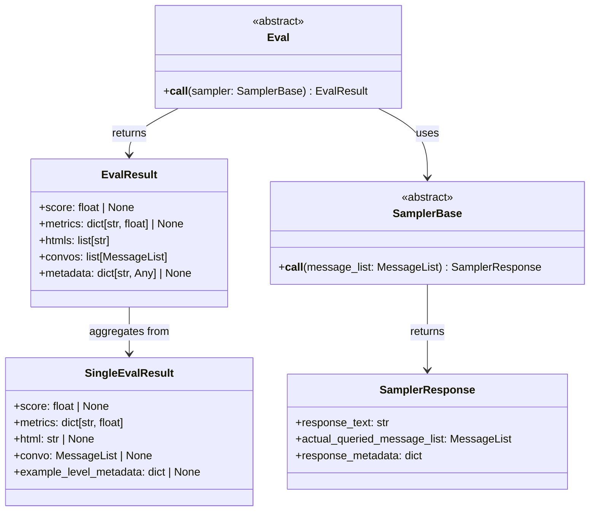
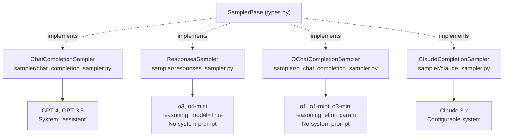
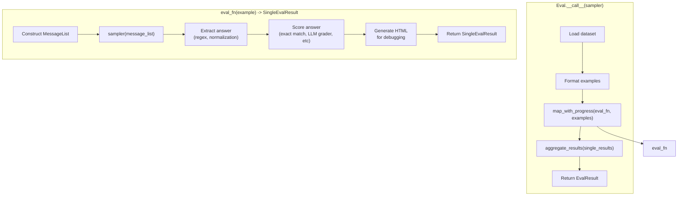
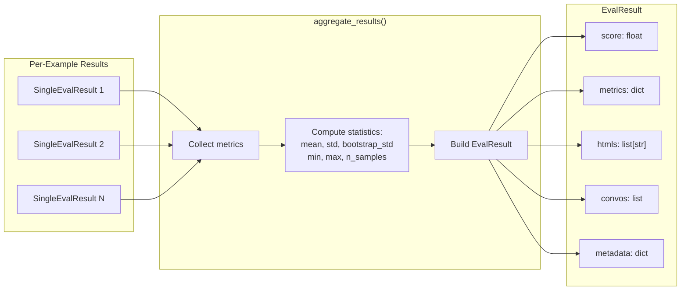

<!-- source: DeepWiki mcp.deepwiki.com · repo openai/simple-evals · page 7 Extending the Framework · fetched 2026-10-26 -->

# Extending the Framework

Relevant source files

The following files were used as context for generating this wiki page:

- [README.md](README.md)
- [common.py](common.py)
- [types.py](types.py)

This document provides technical guidance for extending the simple-evals framework, primarily intended for users who fork the repository or build derivative evaluation systems. The framework provides two primary extension points through well-defined interfaces in [types.py]().

**Extension Approaches:**

| Extension Type | Acceptance Status | Use Case |
|---------------|-------------------|----------|
| New Model Samplers | May be accepted in PRs | Adding support for new LLM APIs |
| New Evaluations | Not accepted | Fork the repo for custom benchmarks |
| Bug Fixes | May be accepted | Corrections to existing code |
| Result Rows | May be accepted | Benchmark results for new models |

For detailed implementation guidance, see the child pages:
- **Page 7.1**: Adding New Models
- **Page 7.2**: Creating Custom Evaluations

> **Deprecation Notice**: As of July 2025, simple-evals is frozen for most benchmarks. The maintainers are "not accepting new evals" in the main repository. However, the core infrastructure (types, samplers, common utilities) is designed for reuse in derivative work.

Sources: [README.md:1-3](), [README.md:66-69]()

## Framework Architecture and Extension Points

The simple-evals framework defines two abstract interfaces in [types.py]() that serve as extension points. Understanding these interfaces is essential for extending the framework.

**Core Type System**

**Extension Point 1**: Implement `SamplerBase` to add new model APIs  
**Extension Point 2**: Implement `Eval` to add new benchmarks

Sources: [types.py:1-67]()

## Interface Contracts

Both extension points require implementing specific method signatures. The framework relies on duck typing rather than explicit inheritance, but implementations must conform to these contracts.

**SamplerBase Interface**

| Component | Type | Description |
|-----------|------|-------------|
| Input | `MessageList` | List of message dicts with `role` and `content` keys |
| Output | `SamplerResponse` | Object containing `response_text`, `actual_queried_message_list`, and `response_metadata` |
| Method Signature | `__call__(self, message_list: MessageList) -> SamplerResponse` | Core sampling method |

**Eval Interface**

| Component | Type | Description |
|-----------|------|-------------|
| Input | `SamplerBase` | Any object implementing the sampler interface |
| Output | `EvalResult` | Aggregated results with score, metrics, htmls, convos, metadata |
| Method Signature | `__call__(self, sampler: SamplerBase) -> EvalResult` | Core evaluation method |

Sources: [types.py:4-5](), [types.py:9-17](), [types.py:18-28](), [types.py:31-42](), [types.py:59-66]()

## Implementing a New Sampler

Samplers are adapters between the evaluation framework and LLM APIs. They handle API-specific details like authentication, request formatting, and response parsing. See **Page 7.1** for detailed implementation guidance.

**Sampler Implementation Requirements**

A valid sampler must:
1. Implement `__call__(self, message_list: MessageList) -> SamplerResponse`
2. Accept a `MessageList` (list of dicts with `role` and `content` keys)
3. Return a `SamplerResponse` dataclass with three fields:
   - `response_text`: The model's text response
   - `actual_queried_message_list`: The actual messages sent to the API (may differ from input due to system message insertion)
   - `response_metadata`: Dict containing API-specific metadata (token counts, model version, etc.)

**Existing Sampler Implementations**

Sources: [types.py:18-28](), [types.py:9-16]()

**Key Implementation Considerations**

| Consideration | Description | Example |
|--------------|-------------|---------|
| System Messages | Some models don't support system prompts (o-series) | o1 models: Must strip system messages |
| API Parameters | Model-specific parameters vary | o1: `reasoning_effort`, GPT: `temperature` |
| Message Formatting | API message format may differ from framework format | Anthropic requires different structure |
| Error Handling | Handle rate limits, API errors gracefully | Implement retries, exponential backoff |
| Metadata Tracking | Capture token usage, latency for analysis | Store in `response_metadata` dict |

Sources: [README.md:130-139]()

## Implementing a New Evaluation

Evaluations implement specific benchmarks by loading datasets, formatting prompts, grading responses, and aggregating results. New evaluations are not accepted in the main repository but the framework is designed for extension in forks. See **Page 7.2** for detailed implementation guidance.

**Evaluation Implementation Pattern**

**Required Implementation Steps**

| Step | Method/Component | Purpose |
|------|-----------------|---------|
| 1. Constructor | `__init__(self, num_examples=None, ...)` | Initialize eval configuration |
| 2. Main Entry | `__call__(self, sampler: SamplerBase) -> EvalResult` | Orchestrate evaluation |
| 3. Dataset Loading | Custom dataset loading logic | Load benchmark data |
| 4. Per-Example Eval | Function returning `SingleEvalResult` | Evaluate single examples |
| 5. Result Aggregation | `common.aggregate_results(results)` | Compute final metrics |

Sources: [types.py:59-66](), [types.py:44-56](), [common.py:183-216]()

**Grading Strategy Patterns**

The framework supports three grading patterns:

| Pattern | Implementation | Use Cases | Examples |
|---------|---------------|-----------|----------|
| **Self-Grading** | Regex + normalization | Objective answers, multiple choice | MMLU, GPQA, MGSM |
| **LLM-Grading** | Separate grader model | Subjective quality, open-ended | SimpleQA, BrowseComp, HealthBench |
| **Execution-Based** | Code execution, test suites | Functional correctness | HumanEval |
| **Hybrid** | Regex + LLM equality check | Math problems with equivalent forms | MATH |

Sources: [common.py:15-30](), [common.py:78-136](), [common.py:157-161]()

## Common Utilities for Extensions

The [common.py]() module provides reusable utilities that simplify implementing new evaluations. These are designed to be used by any evaluation implementation.

**Available Utility Functions**

| Function | Purpose | Typical Usage |
|----------|---------|---------------|
| `map_with_progress(f, xs, num_threads)` | Parallel execution with progress bar | Process examples in parallel |
| `aggregate_results(single_results, ...)` | Statistical aggregation | Compute mean, std, bootstrap confidence intervals |
| `make_report(eval_result)` | HTML report generation | Create visual reports from results |
| `format_multichoice_question(row)` | Multiple choice formatting | Format ABCD questions consistently |
| `check_equality(sampler, expr1, expr2)` | LLM-based equivalence | Check if two expressions are semantically equal |
| `normalize_response(response)` | Text normalization | Strip LaTeX, markdown formatting |
| `normalize_extracted_answer(answer)` | Answer normalization | Handle multilingual character mappings |

**Result Aggregation Flow**

Sources: [common.py:1-409](), [common.py:183-216](), [common.py:219-234](), [common.py:335-343]()

**Prompt Templates and Patterns**

The framework provides standard prompt templates in [common.py]():

- `QUERY_TEMPLATE_MULTICHOICE`: Standard format for ABCD questions
- `ANSWER_PATTERN_MULTICHOICE`: Regex for extracting multiple choice answers
- `ANSWER_PATTERN`: General answer extraction pattern
- `MULTILINGUAL_ANSWER_REGEXES`: Patterns for 15+ languages
- `EQUALITY_TEMPLATE`: Template for semantic equivalence checking
- `HTML_JINJA`: Template for rendering evaluation results

Sources: [common.py:15-76](), [common.py:78-136](), [common.py:139-150]()

## Testing and Debugging Extensions

When developing new samplers or evaluations, use these strategies for validation:

**Development Workflow**

| Stage | Command | Purpose |
|-------|---------|---------|
| Initial Testing | Set `num_examples=5` in constructor | Quick validation of basic functionality |
| Debug Single Example | Print intermediate values in eval function | Inspect prompt formatting, answer extraction |
| Parallel Testing | Use `os.getenv("debug")` check | Switch between serial (debuggable) and parallel execution |
| Full Evaluation | Remove example limit | Run complete benchmark |

**Debug Mode Pattern**

The framework checks `os.getenv("debug")` to enable serial execution in [common.py:230-234]():
- When set: Examples processed sequentially (easier to debug with print statements)
- When unset: Examples processed in parallel ThreadPool (faster execution)

**Validation Checklist for New Samplers**

- [ ] Returns `SamplerResponse` with all three required fields
- [ ] Handles messages with `role` and `content` keys
- [ ] Populates `response_metadata` with useful information
- [ ] Tracks `actual_queried_message_list` (may differ from input due to system message insertion)
- [ ] Implements error handling for API failures
- [ ] Respects rate limits with appropriate retry logic

**Validation Checklist for New Evaluations**

- [ ] Returns `EvalResult` via `aggregate_results()`
- [ ] Each example returns `SingleEvalResult` with score or metrics
- [ ] HTML generation works for error analysis
- [ ] Prompt formatting matches expected model input
- [ ] Answer extraction handles edge cases (missing answers, invalid formats)
- [ ] Grading logic is consistent and well-tested
- [ ] Dataset loading is robust and reproducible

Sources: [common.py:219-234](), [README.md:116-127]()

## Best Practices for Extensions

1. **Follow Existing Patterns**: Study the implementation of similar samplers or evaluation tasks and follow the same patterns.

2. **Thorough Testing**: Test your extensions with a small number of examples using the `--examples` flag or `--debug` mode before running full evaluations.

3. **Documentation**: Add comments explaining any non-obvious parts of your implementation, especially for custom parameters or model-specific behaviors.

4. **Error Handling**: Implement robust error handling, especially for API calls that might fail or have rate limits.

5. **Reproducibility**: Make sure your extensions produce consistent results for the same inputs.

Sources: [README.md:46-51](), [README.md:58-69]()

## Conclusion

Simple-Evals provides a structured framework for evaluating language models. By implementing new samplers, you can extend support to new model APIs. While the architecture also supports adding new evaluation tasks, note that the maintainers are currently not accepting PRs for new evaluation tasks.

For more information on specific components of the system, refer to:
- [Architecture](#2) - For an overview of the system architecture
- [Model Samplers](#2.1) - For details on the existing sampler system
- [Command Line Interface](#4) - For usage instructions

---

