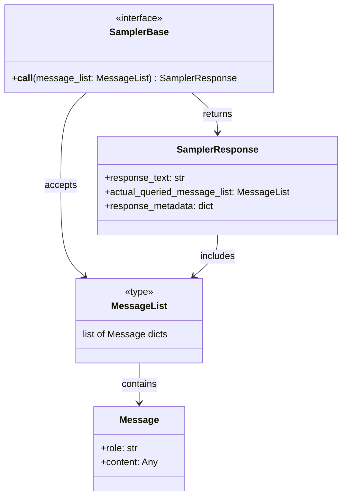
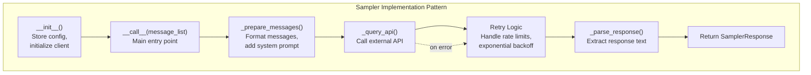
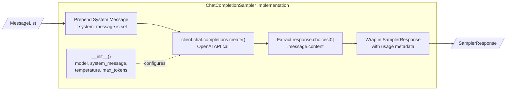
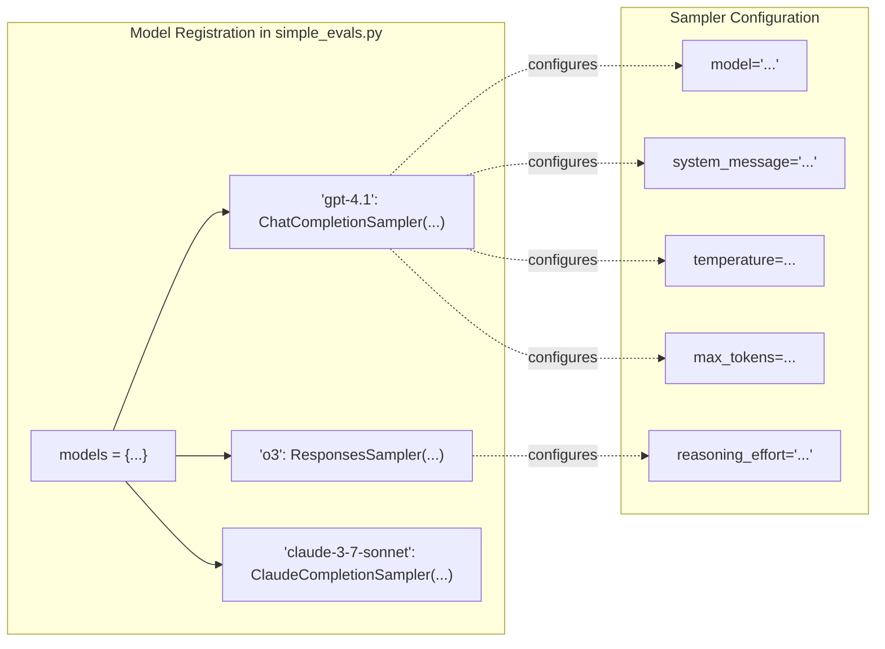
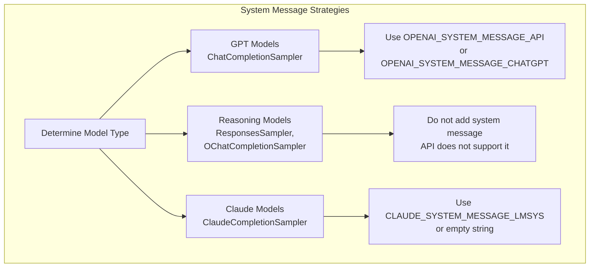
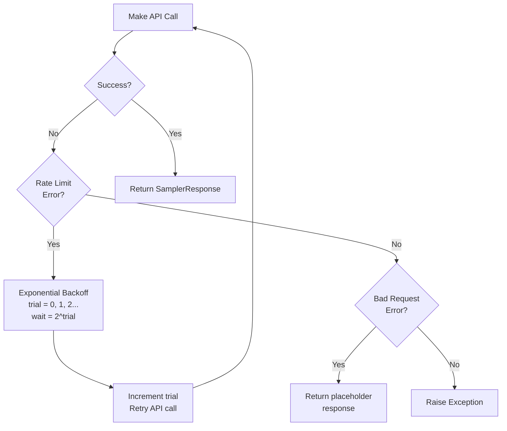
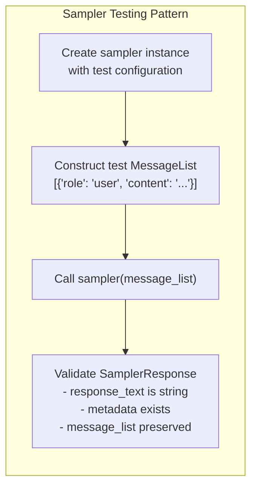
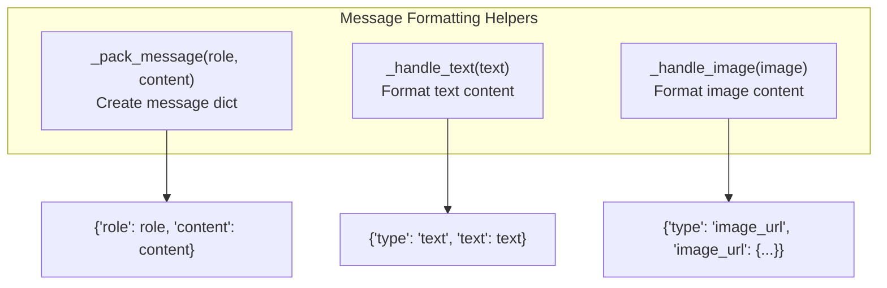

<!-- source: DeepWiki mcp.deepwiki.com · repo openai/simple-evals · page 7.1 Adding New Models · fetched 2026-10-26 -->

# Adding New Models

<details>
<summary>Relevant source files</summary>

The following files were used as context for generating this wiki page:

- [run_multilingual_mmlu.py](run_multilingual_mmlu.py)
- [sampler/chat_completion_sampler.py](sampler/chat_completion_sampler.py)
- [simple_evals.py](simple_evals.py)
- [types.py](types.py)

</details>


This page explains how to add support for new language models to the simple-evals framework by implementing the sampler interface. For information about creating new evaluation benchmarks, see [Creating Custom Evaluations](#7.2). For details on the existing sampler implementations, see [Model Samplers](#3.2).

**Important**: As of July 2025, the simple-evals framework is in frozen maintenance mode. While the core infrastructure remains available for reuse in derivative projects, new models will not be accepted into the main repository. This documentation serves as a guide for extending the framework in your own fork or derivative work.

## Overview

Adding a new model to simple-evals requires two steps:

1. **Implement a sampler class** that conforms to the `SamplerBase` interface
2. **Register the model** in the models dictionary

The sampler abstraction allows benchmarks to work with any model through a uniform interface, while each sampler handles model-specific API details, authentication, and response formatting.

Sources: [types.py:18-28](), [simple_evals.py:65-236]()

## The SamplerBase Interface

All model samplers must implement the `SamplerBase` interface, which defines a single callable method that accepts a message list and returns a `SamplerResponse`.



**Interface Contract**

| Component | Type | Description |
|-----------|------|-------------|
| **Input** | `MessageList` | List of message dictionaries with `role` and `content` keys |
| **Output** | `SamplerResponse` | Contains response text, metadata, and actual queried messages |

The `SamplerResponse` dataclass has three required fields:

- `response_text`: The model's generated text response
- `actual_queried_message_list`: The complete message list sent to the API (including any system messages)
- `response_metadata`: Dictionary containing usage statistics and other metadata

Sources: [types.py:1-28]()

## Implementing a New Sampler

### Basic Structure

A minimal sampler implementation follows this pattern:



### Required Components

When implementing a new sampler, you need to handle:

1. **Client Initialization**: Set up the API client and credentials
2. **Message Formatting**: Convert the generic message list to the API's expected format
3. **System Message Handling**: Inject system prompts if required
4. **API Calling**: Execute the API request with appropriate parameters
5. **Error Handling**: Implement retry logic for rate limits and transient errors
6. **Response Parsing**: Extract the response text and metadata

Sources: [sampler/chat_completion_sampler.py:16-97]()

### Example: ChatCompletionSampler

The `ChatCompletionSampler` demonstrates a complete implementation for OpenAI's chat completion API:



Key implementation details:

- **Constructor parameters**: [chat_completion_sampler.py:21-27]()
  - `model`: Model identifier string
  - `system_message`: Optional system prompt to prepend
  - `temperature`: Sampling temperature (default 0.5)
  - `max_tokens`: Maximum response length (default 1024)

- **System message injection**: [chat_completion_sampler.py:59-62]()
  - Prepends system message to message list if configured
  - Uses `_pack_message()` helper to format messages

- **Error handling**: [chat_completion_sampler.py:64-96]()
  - Catches rate limit exceptions and retries with exponential backoff
  - Handles `BadRequestError` by returning placeholder response
  - Validates that response content is not None

Sources: [sampler/chat_completion_sampler.py:1-97]()

## Sampler Type Comparison

The framework includes four sampler types, each designed for different API patterns:

| Sampler Class | API | Models | System Prompt | Special Features |
|---------------|-----|--------|---------------|------------------|
| `ChatCompletionSampler` | OpenAI Chat | GPT-4, GPT-3.5 | ✓ Supported | Standard chat API |
| `ResponsesSampler` | OpenAI Responses | o3, o4-mini, o1-pro | ✗ Not supported | `reasoning_model=True`, `reasoning_effort` param |
| `OChatCompletionSampler` | OpenAI Chat | o1, o3-mini | ✗ Not supported | `reasoning_effort` param |
| `ClaudeCompletionSampler` | Anthropic | Claude 3.x | ✓ Configurable | Different message format |

**Key Differences**:

- **OpenAI reasoning models** (o-series) do not accept system messages and require special flags
- **Claude models** use Anthropic's API with different authentication and message formatting
- **Standard GPT models** support full chat API features including system messages

Sources: [simple_evals.py:18-25](), [simple_evals.py:65-236]()

## Registering Models

### Model Dictionary Structure

Models are registered in the `models` dictionary in `simple_evals.py`. Each entry maps a model identifier to a configured sampler instance:



### Registration Examples

**Standard GPT-4 Model**: [simple_evals.py:135-139]()
```python
"gpt-4.1": ChatCompletionSampler(
    model="gpt-4.1-2025-04-14",
    system_message=OPENAI_SYSTEM_MESSAGE_API,
    max_tokens=2048,
)
```

**Reasoning Model with Effort**: [simple_evals.py:76-80]()
```python
"o3_high": ResponsesSampler(
    model="o3-2025-04-16",
    reasoning_model=True,
    reasoning_effort="high",
)
```

**Claude Model**: [simple_evals.py:229-232]()
```python
"claude-3-7-sonnet-20250219": ClaudeCompletionSampler(
    model="claude-3-7-sonnet-20250219",
    system_message=CLAUDE_SYSTEM_MESSAGE_LMSYS,
)
```

### Model Naming Conventions

Model identifiers in the dictionary follow these patterns:

- **Base model**: `gpt-4.1`, `o3`, `claude-3-7-sonnet`
- **Variant suffix**: `_high`, `_low`, `_temp-1` for configuration variants
- **Special versions**: Full version strings or configuration descriptors

Sources: [simple_evals.py:65-236]()

## System Message Handling

Different model families require different system message approaches:



**System Message Constants**:

| Constant | Value | Usage |
|----------|-------|-------|
| `OPENAI_SYSTEM_MESSAGE_API` | "You are a helpful assistant." | Standard API models |
| `OPENAI_SYSTEM_MESSAGE_CHATGPT` | "You are ChatGPT, a large language model..." | ChatGPT-specific models |
| `CLAUDE_SYSTEM_MESSAGE_LMSYS` | Empty or LMSYS-style prompt | Claude models |

**Important**: Reasoning models (o1, o3, o4-mini) do not support system messages. Attempting to include one will cause an API error. These samplers should not prepend system messages to the message list.

Sources: [sampler/chat_completion_sampler.py:9-13](), [sampler/claude_sampler.py]()

## Implementation Checklist

When implementing a new sampler, ensure you handle:

### Required Methods and Properties

| Component | Requirement | Example |
|-----------|-------------|---------|
| `__init__()` | Initialize API client, store configuration | [chat_completion_sampler.py:21-35]() |
| `__call__()` | Main sampling method, returns `SamplerResponse` | [chat_completion_sampler.py:58-79]() |
| API client | Authenticated client for external API | [chat_completion_sampler.py:29]() |

### Error Handling



**Key error handling patterns**:

1. **Rate limit retry**: [chat_completion_sampler.py:88-95]()
   - Exponential backoff: `2^trial` seconds
   - Unlimited retries (consider adding max retry limit in production)

2. **Bad request handling**: [chat_completion_sampler.py:81-87]()
   - Return placeholder response instead of crashing
   - Log error for debugging

3. **Empty response validation**: [chat_completion_sampler.py:73-74]()
   - Check if API returned None
   - Raise exception to trigger retry

Sources: [sampler/chat_completion_sampler.py:64-96]()

## Testing Your Implementation

### Basic Validation

Test your sampler with a simple message list:



### Integration with Evaluations

To verify your sampler works with the evaluation framework:

1. **Register the model** in the models dictionary
2. **Run a simple evaluation** with `--debug` flag and limited examples
3. **Check output files** for proper response formatting
4. **Verify metrics** are calculated correctly

Example command:
```bash
python -m simple_evals --model your_model_name --eval mmlu --examples 5 --debug
```

Sources: [simple_evals.py:29-63]()

## Common Implementation Patterns

### Pattern 1: Message Formatting Helpers

Create helper methods for consistent message formatting:



Examples from `ChatCompletionSampler`:
- `_pack_message()`: [chat_completion_sampler.py:55-56]()
- `_handle_text()`: [chat_completion_sampler.py:52-53]()
- `_handle_image()`: [chat_completion_sampler.py:37-50]()

### Pattern 2: Configuration Storage

Store all configuration parameters as instance attributes for easy debugging and introspection:

| Attribute | Purpose |
|-----------|---------|
| `model` | Model identifier for API calls |
| `temperature` | Sampling temperature |
| `max_tokens` | Maximum response length |
| `system_message` | System prompt to prepend |
| `api_key_name` | Environment variable name for API key |

Sources: [sampler/chat_completion_sampler.py:21-35]()

### Pattern 3: Metadata Preservation

Always include useful metadata in the `SamplerResponse`:

- **Usage statistics**: Token counts, API costs
- **Model version**: Actual model used (may differ from requested)
- **Timing information**: Request duration
- **API-specific data**: Any additional response fields

Example: [chat_completion_sampler.py:75-79]()

Sources: [sampler/chat_completion_sampler.py:58-97](), [types.py:9-16]()

## Advanced Considerations

### Multi-Modal Support

If your model supports images or other media types, implement content handling methods:

- Parse multi-part content in messages
- Convert images to appropriate format (base64, URLs)
- Set `image_format` attribute appropriately

Reference implementation: [chat_completion_sampler.py:37-50]()

### Model-Specific Parameters

Some models require special parameters:

| Parameter | Models | Purpose |
|-----------|--------|---------|
| `reasoning_model=True` | o3, o4-mini, o1-pro | Enable reasoning mode |
| `reasoning_effort` | o-series | Control reasoning depth ("low", "medium", "high") |
| `temperature` | Most models | Control randomness (0.0-1.0) |

Configure these in the constructor and pass them to the API call.

### Authentication

Handle API keys through environment variables:

1. Define `api_key_name` attribute (e.g., "OPENAI_API_KEY")
2. Initialize client with `os.environ.get(api_key_name)`
3. Document required environment variables for users

Sources: [sampler/chat_completion_sampler.py:28-29]()

---

**Summary**: Adding a new model requires implementing the `SamplerBase` interface with proper error handling, message formatting, and response parsing. Register your sampler in the models dictionary with appropriate configuration. While the main repository is frozen, this infrastructure is available for reuse in derivative projects.

Sources: [types.py:18-28](), [sampler/chat_completion_sampler.py:1-97](), [simple_evals.py:65-236]()

---

