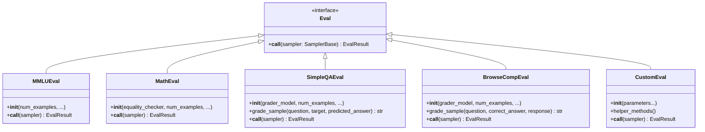
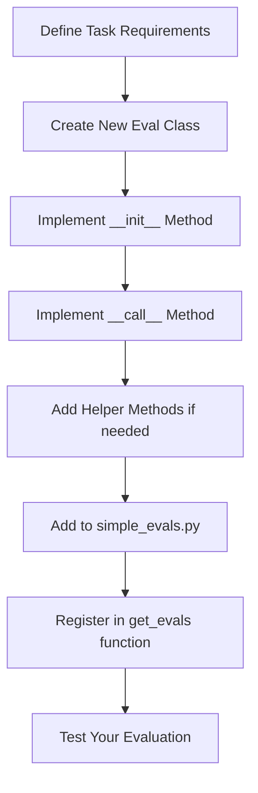
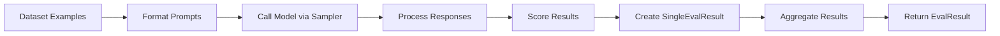
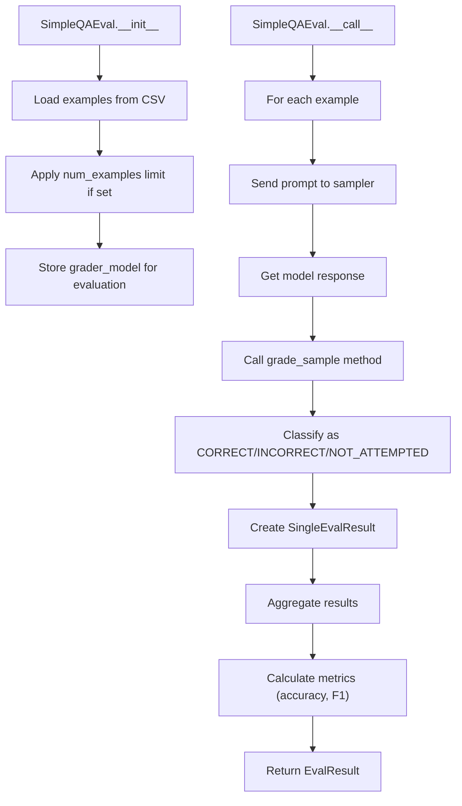
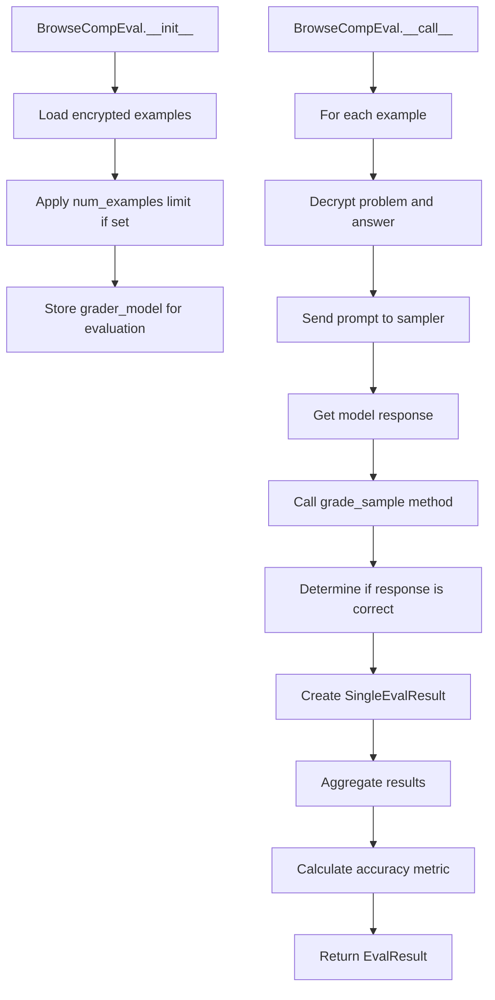

<!-- source: DeepWiki mcp.deepwiki.com · repo openai/simple-evals · page 7.2 Creating Custom Evaluations · fetched 2026-10-26 -->

# Adding New Evaluation Tasks

<details>
<summary>Relevant source files</summary>

The following files were used as context for generating this wiki page:

- [common.py](common.py)
- [mmlu_eval.py](mmlu_eval.py)
- [simpleqa_eval.py](simpleqa_eval.py)
- [types.py](types.py)

</details>


This document provides a comprehensive guide for extending the simple-evals framework with custom evaluation tasks. It covers the architecture of evaluation tasks, the step-by-step process for creating new ones, and best practices for implementation. For information about adding support for new language models, see [Adding New Models](#6.1).

## Evaluation Task Framework Overview

In the simple-evals framework, evaluation tasks are implemented as classes that inherit from the `Eval` base class. Each evaluation task is responsible for loading a dataset, processing examples, calling a model sampler, evaluating responses, and aggregating results.

### Evaluation Task Class Hierarchy



Sources: [simpleqa_eval.py:99-191](), [browsecomp_eval.py:66-142](), [simple_evals.py:131-169]()

### Core Components of an Evaluation Task

All evaluation tasks in the framework share common components:

1. **Dataset Loading**: Loading and preparing the examples to evaluate
2. **Prompt Formatting**: Converting examples into appropriate prompts for the model
3. **Response Processing**: Extracting and validating answers from model responses
4. **Scoring**: Determining the correctness of responses
5. **Result Aggregation**: Combining individual results into overall metrics

Sources: [browsecomp_eval.py:66-142](), [simpleqa_eval.py:99-191](), [common.py:175-202]()

## Implementation Workflow

The process of adding a new evaluation task follows these steps:



Sources: [simple_evals.py:131-169](), [browsecomp_eval.py:66-142](), [simpleqa_eval.py:99-191]()

## Creating a New Evaluation Task

Let's walk through the detailed process of creating a new evaluation task.

### Step 1: Define Your Evaluation Task

First, determine the purpose and requirements of your evaluation task:

| Aspect | Questions to Consider |
|--------|------------------------|
| Capability | What language model capability are you testing? (factual knowledge, reasoning, code generation, etc.) |
| Dataset | What dataset will you use? How will you load it? |
| Scoring Method | How will you determine correctness? (exact match, semantic similarity, custom grader) |
| Metrics | What metrics will you report beyond basic accuracy? |

Sources: [simpleqa_eval.py:1-5](), [browsecomp_eval.py:1-5]()

### Step 2: Create a New Evaluation Class

Create a new file named `<taskname>_eval.py` with your evaluation class. Your class should inherit from the `Eval` base class:

```python
from . import common
from .types import Eval, EvalResult, SamplerBase, SingleEvalResult

class MyCustomEval(Eval):
    def __init__(self, num_examples=None, n_repeats=1):
        # Initialize your evaluation task
        pass
        
    def __call__(self, sampler: SamplerBase) -> EvalResult:
        # Implement evaluation logic
        pass
```

Sources: [browsecomp_eval.py:66-142](), [simpleqa_eval.py:99-191]()

### Step 3: Implement the `__init__` Method

The `__init__` method should load your dataset and prepare the examples for evaluation. Here's a typical implementation pattern:

```python
def __init__(self, num_examples=None, n_repeats=1, **kwargs):
    # Load dataset
    data = load_dataset_from_source()
    examples = [prepare_example(item) for item in data]
    
    # Handle example count limits
    if num_examples:
        examples = examples[:num_examples]
    
    # Apply repetition if specified
    self.examples = examples * n_repeats
    
    # Store any additional parameters needed for evaluation
    self.additional_parameters = kwargs.get('parameter', default_value)
```

In existing implementations, you can see this pattern in SimpleQAEval:

Sources: [simpleqa_eval.py:100-110](), [browsecomp_eval.py:67-77]()

### Step 4: Implement the `__call__` Method

The `__call__` method processes each example, calls the model sampler, evaluates responses, and aggregates results. Here's the typical data flow:



A typical implementation follows this pattern:

```python
def __call__(self, sampler: SamplerBase) -> EvalResult:
    def process_example(example):
        # Format the prompt for this example
        prompt_messages = [
            sampler._pack_message(content=format_prompt(example), role="user")
        ]
        
        # Call the model using the sampler
        response_text = sampler(prompt_messages)
        
        # Evaluate the response
        score = evaluate_response(example, response_text)
        
        # Create HTML and return single result
        html = create_html_output(prompt_messages, response_text, score, example)
        
        return SingleEvalResult(
            html=html, 
            score=score, 
            convo=prompt_messages + [dict(content=response_text, role="assistant")],
            metrics={"your_metric": value}
        )
    
    # Process all examples in parallel with progress display
    results = common.map_with_progress(process_example, self.examples)
    
    # Aggregate individual results into final EvalResult
    return common.aggregate_results(results)
```

Sources: [simpleqa_eval.py:127-191](), [browsecomp_eval.py:94-142](), [common.py:175-202]()

### Step 5: Add Helper Methods (if needed)

Many evaluation tasks require additional helper methods to implement specific functionality:

| Helper Method Type | Examples |
|--------------------|----------|
| Answer Extraction | Parsing model responses to extract structured answers |
| Grading Logic | Determining if an answer is correct, possibly using another model |
| Custom Metrics | Calculating task-specific metrics beyond basic accuracy |

For example, the SimpleQAEval class has a `grade_sample` helper method that uses a grader model to evaluate responses:

Sources: [simpleqa_eval.py:112-125](), [browsecomp_eval.py:79-92]()

### Step 6: Register Your Evaluation in simple_evals.py

To make your evaluation available in the framework:

1. Import your class at the top of `simple_evals.py`:
   ```python
   from .mycustom_eval import MyCustomEval
   ```

2. Add your evaluation to the `get_evals` function:
   ```python
   def get_evals(eval_name, debug_mode):
       num_examples = (
           args.examples if args.examples is not None else (5 if debug_mode else None)
       )
       match eval_name:
           # Existing cases...
           case "mycustom":
               return MyCustomEval(
                   num_examples=10 if debug_mode else num_examples,
                   # Other parameters...
               )
           case _:
               raise Exception(f"Unrecognized eval type: {eval_name}")
   ```

3. Add your evaluation name to the `evals` dictionary:
   ```python
   evals = {
       eval_name: get_evals(eval_name, args.debug)
       for eval_name in [..., "mycustom"]
   }
   ```

Sources: [simple_evals.py:5-12](), [simple_evals.py:131-169](), [simple_evals.py:171-174]()

## Example Implementations

Let's examine two existing evaluation tasks to understand implementation patterns.

### Example 1: SimpleQA Evaluation

The SimpleQA evaluation measures short-form factuality in language models:



Key implementation features:
- Uses a separate grader model to evaluate responses
- Classifies responses into three categories: CORRECT, INCORRECT, NOT_ATTEMPTED
- Calculates specialized metrics like accuracy_given_attempted and F1

Sources: [simpleqa_eval.py:99-191]()

### Example 2: BrowseComp Evaluation

The BrowseComp evaluation assesses browsing capabilities:



Key implementation features:
- Handles encrypted data with a decrypt method
- Uses a grader model to evaluate response correctness
- Focuses on accuracy as the primary metric

Sources: [browsecomp_eval.py:66-142]()

## Working with Results and Metrics

When implementing your evaluation task, it's important to understand how results are processed.

### SingleEvalResult Structure

For each example, you create a `SingleEvalResult` with:

```python
SingleEvalResult(
    html=html,          # HTML representation for report
    score=score,        # Numeric score (typically 0 or 1)
    convo=conversation, # Conversation history
    metrics={           # Additional metrics
        "metric1": value1,
        "metric2": value2
    }
)
```

Sources: [simpleqa_eval.py:151-155](), [browsecomp_eval.py:119-122]()

### Aggregation with common.aggregate_results

The `common.aggregate_results` function combines individual results:

```python
aggregate_results(
    single_eval_results,  # List of SingleEvalResult objects
    default_stats=("mean", "std"),  # Stats to compute for each metric
    name2stats=None  # Optional custom stats for specific metrics
)
```

This returns an `EvalResult` with:
- Overall score (mean of individual scores)
- Aggregated metrics with statistics
- HTML reports for all examples
- Conversation history for all examples

Sources: [common.py:175-202](), [simpleqa_eval.py:191](), [browsecomp_eval.py:142]()

## Testing and Debugging

To test your evaluation task:

1. Run with the `--debug` flag to process a small number of examples:
   ```bash
   python -m simple_evals --debug --model gpt-4o
   ```

2. Use the `--examples` parameter to specify a custom number of examples:
   ```bash
   python -m simple_evals --model gpt-4o --examples 10
   ```

3. Check the HTML reports generated at `/tmp/<eval_name>_<model_name>.html`

Sources: [simple_evals.py:22-36](), [simple_evals.py:176-193]()

## Best Practices

When implementing a new evaluation task, follow these best practices:

1. **Configurability**: Make your evaluation configurable with parameters like `num_examples` and `n_repeats`

2. **Robust Answer Extraction**: Implement robust parsing methods to handle variations in model responses

3. **Comprehensive Metrics**: Track multiple metrics beyond basic accuracy to provide a more complete picture 

4. **Detailed Reporting**: Generate detailed HTML reports with all relevant information for manual inspection

5. **Error Handling**: Handle potential errors in model responses, dataset loading, and answer processing

6. **Efficiency**: Use `common.map_with_progress` for parallel processing of examples

7. **Documentation**: Add docstrings and comments explaining the purpose and behavior of your evaluation task

8. **Reuse Common Components**: Leverage existing utilities in the `common` module rather than reimplementing functionality

Sources: [simpleqa_eval.py:1-5](), [browsecomp_eval.py:1-5](), [common.py:205-213]()

## Summary

Adding a new evaluation task to the simple-evals framework involves:

1. Creating a new class that inherits from `Eval`
2. Implementing dataset loading in the `__init__` method
3. Implementing response evaluation in the `__call__` method
4. Adding helper methods for specialized functionality
5. Registering the evaluation in `simple_evals.py`

By following this guide, you can extend the framework with custom evaluation tasks tailored to your specific requirements.