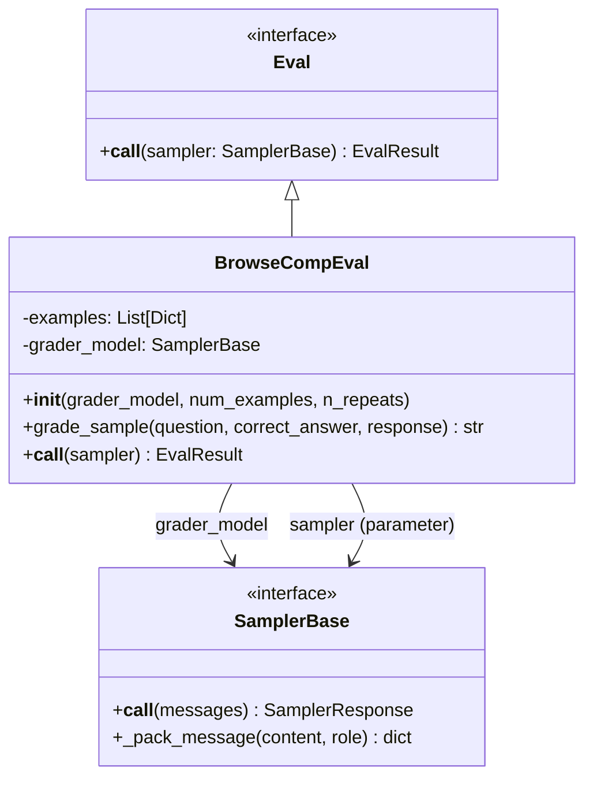
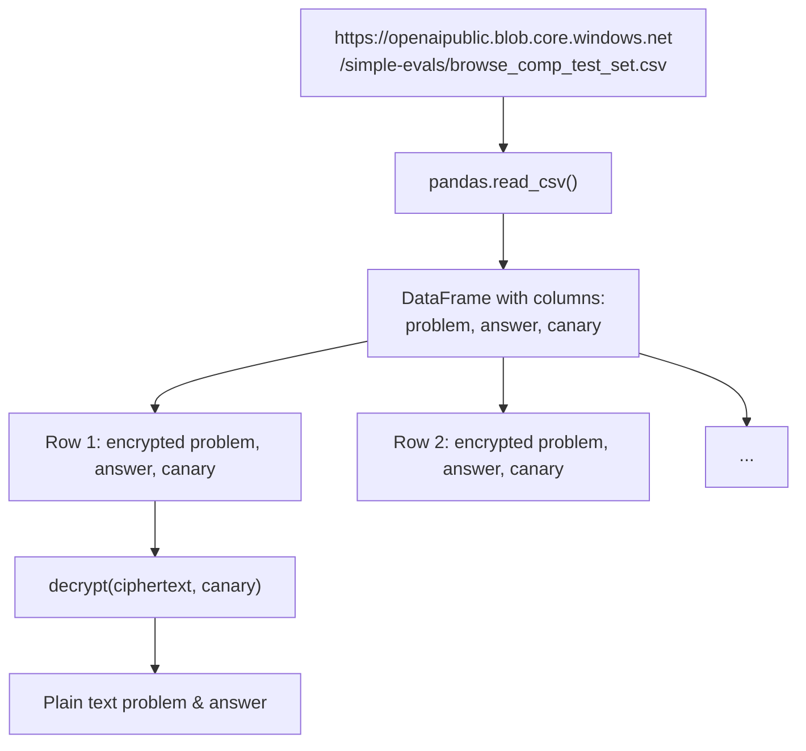
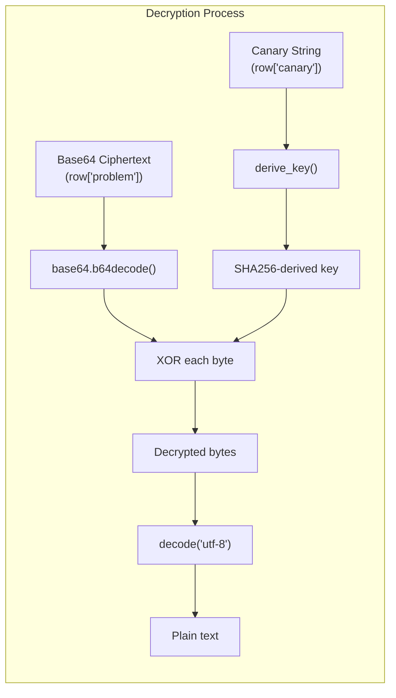
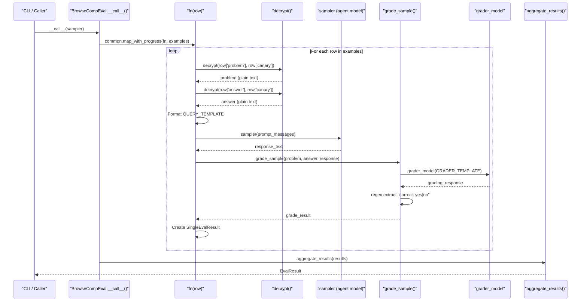
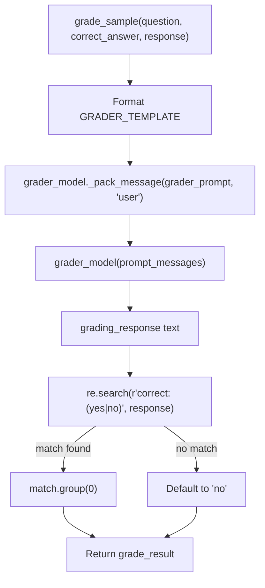
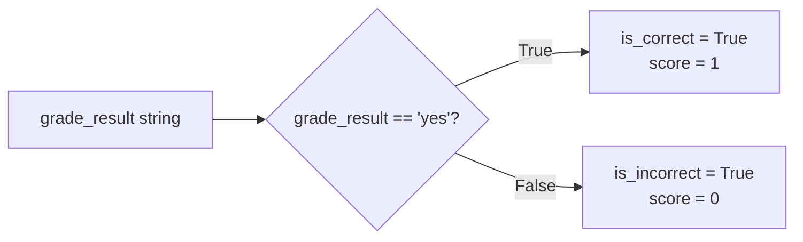
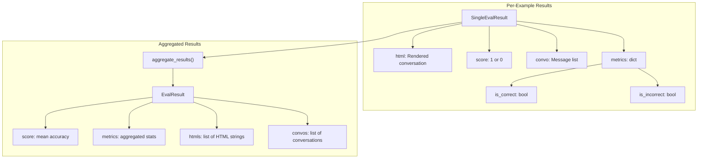
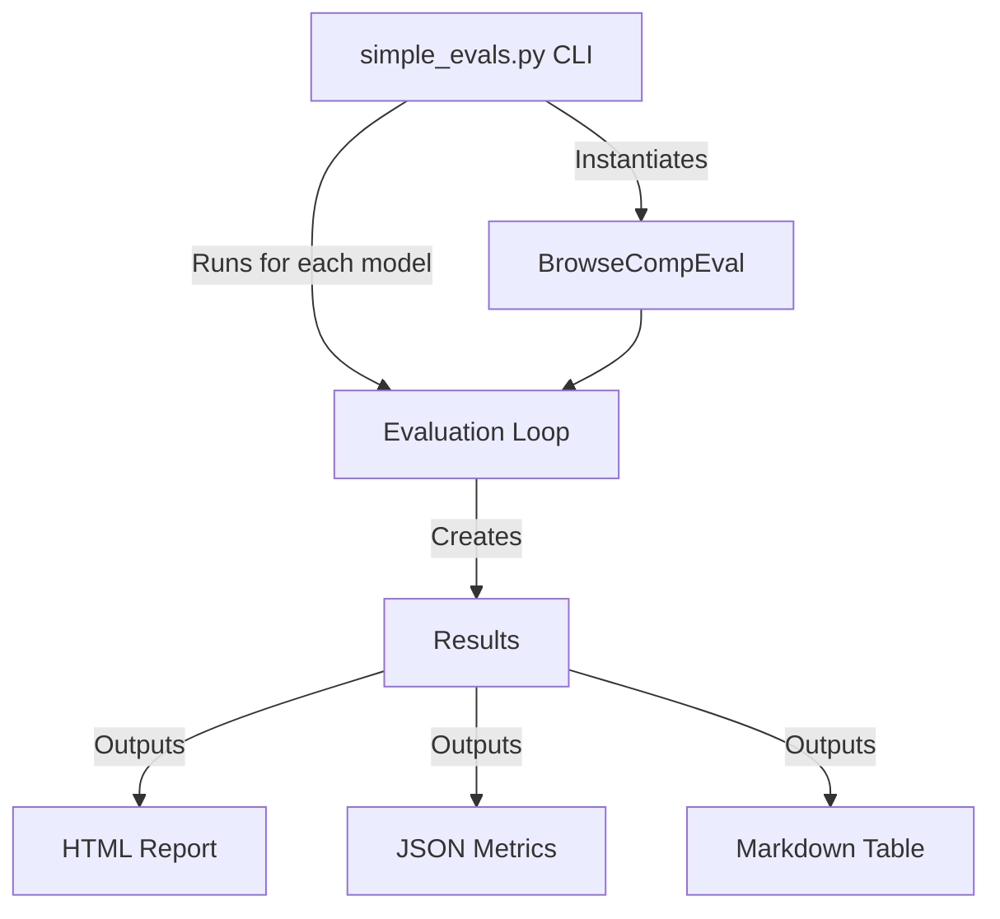

<!-- source: DeepWiki mcp.deepwiki.com · repo openai/simple-evals · extra page BrowseComp: Browsing Agent Evaluation · fetched 2026-10-26 -->

# BrowseComp: Browsing Agent Evaluation

<details>
<summary>Relevant source files</summary>

The following files were used as context for generating this wiki page:

- [browsecomp_eval.py](browsecomp_eval.py)

</details>


## Overview

BrowseComp is a benchmark for evaluating browsing agents—language models designed to search and retrieve information to answer questions. The implementation uses an encrypted dataset, employs a two-stage grading process with a separate grader model, and extracts correctness judgments via regex pattern matching.

**Key characteristics:**
- Dataset hosted remotely with XOR encryption
- Two-stage evaluation: model generates response, then grader model judges correctness
- Grader uses structured template to extract answer and compare against ground truth
- Primary metric: accuracy (percentage of correct responses)

**Status:** Active reference implementation (maintained beyond July 2025 deprecation)

Sources: [browsecomp_eval.py:1-5]()

## Class Structure

**BrowseCompEval Class Architecture**


The `BrowseCompEval` class implements the `Eval` interface and requires two samplers:
1. **Model sampler** (parameter to `__call__`): The browsing agent being evaluated
2. **Grader sampler** (`self.grader_model`): A separate model (typically GPT-4o) that judges response correctness

| Component | Type | Description |
|-----------|------|-------------|
| `examples` | `List[Dict]` | Encrypted problem-answer pairs with canary keys |
| `grader_model` | `SamplerBase` | Separate LLM used to grade model responses |
| `grade_sample()` | Method | Invokes grader model and extracts yes/no judgment |
| `__call__()` | Method | Main evaluation loop iterating over examples |

Sources: [browsecomp_eval.py:66-77](), [browsecomp_eval.py:13]()

## Dataset and Encryption

BrowseComp uses an encrypted dataset to prevent test set contamination. The CSV is hosted at a public Azure Blob Storage URL and contains encrypted problem-answer pairs.

**Dataset Structure**


**Encryption Scheme**

The dataset uses XOR cipher encryption with per-example keys:



**Decryption Functions**

| Function | Purpose | Implementation |
|----------|---------|----------------|
| `derive_key(password, length)` | Generates XOR key from canary | SHA256 hash, repeated to match ciphertext length |
| `decrypt(ciphertext_b64, password)` | Decrypts base64-encoded data | Base64 decode → XOR with derived key → UTF-8 decode |

Each row contains three encrypted fields:
- `problem`: The question/task for the agent
- `answer`: The correct answer (ground truth)
- `canary`: Decryption key unique to this example

Sources: [browsecomp_eval.py:50-63](), [browsecomp_eval.py:68-71](), [browsecomp_eval.py:96-98]()

## Evaluation Flow

**Two-Stage Evaluation Process**


**Processing Pipeline**

| Stage | Code Location | Purpose |
|-------|---------------|---------|
| 1. Dataset Load | `__init__` [browsecomp_eval.py:68-71]() | Load CSV from Azure Blob, sample if `num_examples` specified |
| 2. Decryption | `fn()` [browsecomp_eval.py:97-98]() | Decrypt problem and answer using canary key |
| 3. Model Query | `fn()` [browsecomp_eval.py:99-104]() | Format with `QUERY_TEMPLATE`, invoke agent sampler |
| 4. Grading | `grade_sample()` [browsecomp_eval.py:79-93]() | Format with `GRADER_TEMPLATE`, invoke grader sampler |
| 5. Result Collection | `fn()` [browsecomp_eval.py:122-125]() | Create `SingleEvalResult` with score and metrics |
| 6. Aggregation | `aggregate_results()` [browsecomp_eval.py:145]() | Compute accuracy from all results |

Sources: [browsecomp_eval.py:95-145]()

## Prompt Templates

BrowseComp uses two templates to structure the two-stage evaluation process.

### Query Template (Agent Model)

The `QUERY_TEMPLATE` formats the problem for the agent being evaluated. It instructs the model to provide explanation, exact answer, and confidence.

```
{Question}

Your response should be in the following format:
Explanation: {{your explanation for your final answer}}
Exact Answer: {{your succinct, final answer}}
Confidence: {{your confidence score between 0% and 100% for your answer}}
```

**Usage:** Applied at [browsecomp_eval.py:100]() to create `prompt_messages` for the agent sampler.

### Grader Template (Grader Model)

The `GRADER_TEMPLATE` instructs the grader model to judge response correctness. The template specifies a structured format for the grader's output.

**Required fields in grader response:**
- `extracted_final_answer`: Final answer extracted from agent response (or 'None')
- `reasoning`: Explanation comparing extracted answer to correct answer
- `correct`: "yes" if answers match, "no" otherwise
- `confidence`: Confidence score extracted from agent response

**Key instruction:** The grader focuses solely on whether answers match, not on solving the problem or proposing alternative answers.

```
Judge whether the following [response] to [question] is correct or not based on the precise and unambiguous [correct_answer] below.

[question]: {question}

[response]: {response}

Your judgement must be in the format and criteria specified below:

extracted_final_answer: The final exact answer extracted from the [response]. Put the extracted answer as 'None' if there is no exact, final answer to extract from the response.

[correct_answer]: {correct_answer}

reasoning: Explain why the extracted_final_answer is correct or incorrect based on [correct_answer], focusing only on if there are meaningful differences between [correct_answer] and the extracted_final_answer. Do not comment on any background to the problem, do not attempt to solve the problem, do not argue for any answer different than [correct_answer], focus only on whether the answers match.

correct: Answer 'yes' if extracted_final_answer matches the [correct_answer] given above, or is within a small margin of error for numerical problems. Answer 'no' otherwise, i.e. if there if there is any inconsistency, ambiguity, non-equivalency, or if the extracted answer is incorrect.


confidence: The extracted confidence score between 0|\%| and 100|\%| from [response]. Put 100 if there is no confidence score available.
```

**Usage:** Applied at [browsecomp_eval.py:80-84]() in `grade_sample()` method.

Sources: [browsecomp_eval.py:16-45]()

## Grading Mechanism

The `grade_sample()` method implements answer extraction and correctness judgment via a separate grader model.

**Grading Flow**


**Answer Extraction via Regex**

The grading relies on regex pattern matching to extract the final judgment:

```python
match = re.search(r"correct: (yes|no)", grading_response)
return match.group(0) if match else "no"  # Default to "no" if no match
```

| Pattern | Source | Purpose |
|---------|--------|---------|
| `r"correct: (yes\|no)"` | [browsecomp_eval.py:92]() | Extracts correctness judgment from structured grader output |

The grader model is expected to output a structured response containing `correct: yes` or `correct: no`. If the pattern is not found (malformed grader response), the evaluation defaults to marking the answer as incorrect.

**Grade to Score Mapping**



Sources: [browsecomp_eval.py:79-93](), [browsecomp_eval.py:105-112]()

## Metrics and Results

BrowseComp reports accuracy as the primary metric, computed from per-example correctness judgments.

**Metric Computation**

| Metric | Calculation | Description |
|--------|-------------|-------------|
| `is_correct` | `sum(result.metrics["is_correct"]) / len(results)` | Proportion of examples judged correct |
| `is_incorrect` | `sum(result.metrics["is_incorrect"]) / len(results)` | Proportion of examples judged incorrect |
| `accuracy` | `aggregate_metrics["is_correct"]` | Primary reported metric (equivalent to `is_correct`) |

**Result Objects**



**Output**

The evaluation prints aggregate metrics and accuracy to console:
```
AGGREGATE METRICS
{'is_correct': 0.75, 'is_incorrect': 0.25}
##################
Accuracy: 0.750
```

The final `EvalResult` contains:
- Overall accuracy score
- Individual HTML renderings for each example
- Full conversation histories
- Aggregated metrics

Sources: [browsecomp_eval.py:122-145]()

## Usage in Simple-Evals

To use BrowseComp in the simple-evals framework, it's initialized with a grader model and an optional limit on the number of examples to evaluate:

```python
browsecomp = BrowseCompEval(
    grader_model=grading_sampler,  # Typically a ChatCompletionSampler with GPT-4o
    num_examples=10  # For debugging, or None for full evaluation
)
```

The evaluation is then run by calling this instance with a sampler that interfaces with the agent being evaluated:

```python
result = browsecomp(sampler)
```

Sources: [simple_evals.py:127-167]()

## Integration with Simple-Evals

BrowseComp is one of the evaluations available in the simple-evals command-line interface. It's included in the list of evaluations that can be run against any of the available models.



Sources: [simple_evals.py:164-167](), [simple_evals.py:171-213]()

## Summary

BrowseComp provides a standardized benchmark for evaluating information-seeking capabilities of language models and browsing agents. The evaluation works by:

1. Presenting the agent with questions that would typically require web browsing
2. Collecting and formatting the agent's responses
3. Using a separate grader model to judge the correctness of those responses
4. Calculating accuracy metrics across the evaluation dataset

This approach allows for consistent, automated evaluation of browsing agents across different model architectures and capabilities.

---

