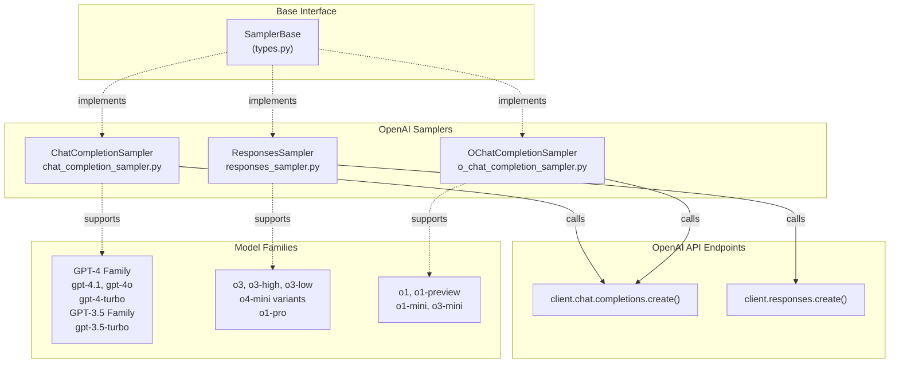
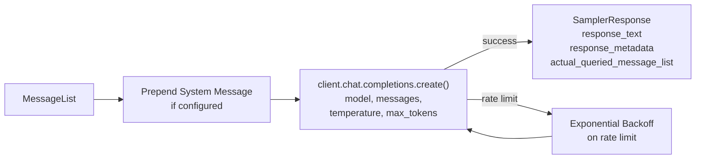
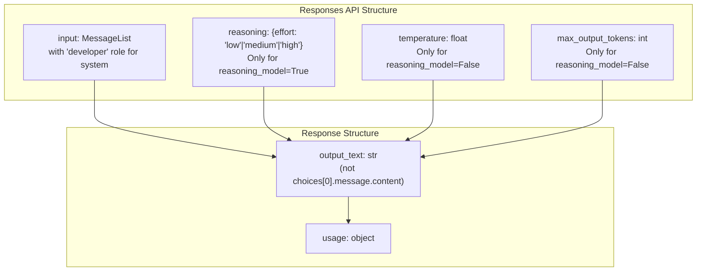
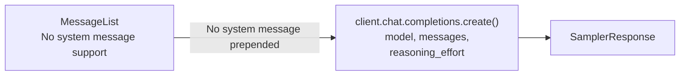
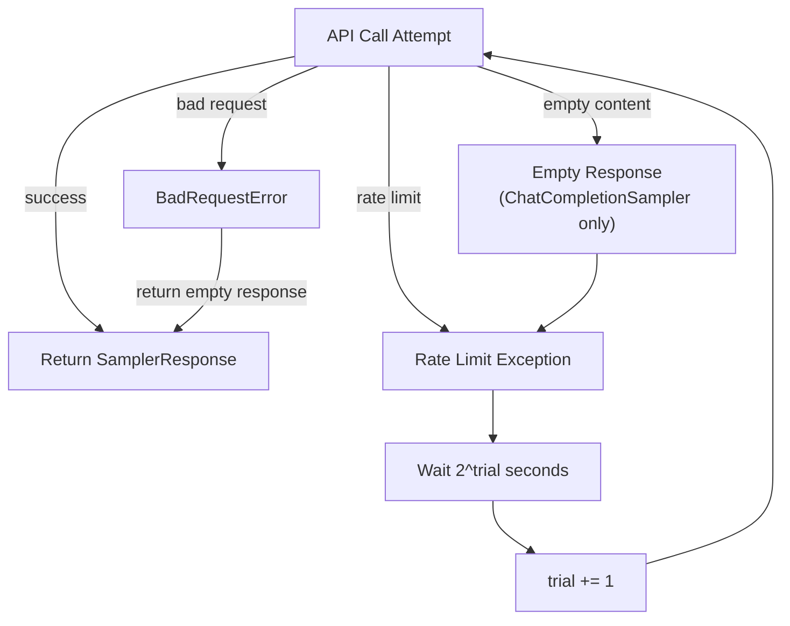
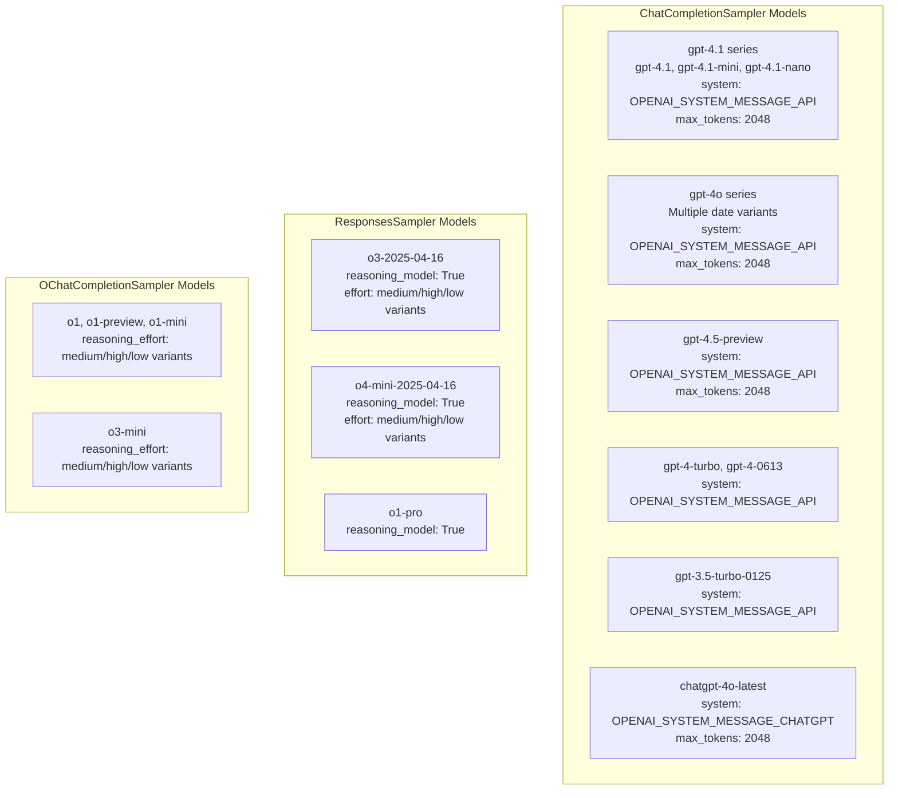

<!-- source: DeepWiki mcp.deepwiki.com · repo openai/simple-evals · extra page OpenAI Samplers · fetched 2026-10-26 -->

# OpenAI Samplers

<details>
<summary>Relevant source files</summary>

The following files were used as context for generating this wiki page:

- [run_multilingual_mmlu.py](run_multilingual_mmlu.py)
- [sampler/chat_completion_sampler.py](sampler/chat_completion_sampler.py)
- [sampler/o_chat_completion_sampler.py](sampler/o_chat_completion_sampler.py)
- [sampler/responses_sampler.py](sampler/responses_sampler.py)
- [simple_evals.py](simple_evals.py)

</details>


This document covers the three OpenAI sampler implementations in the simple-evals framework. These samplers provide unified interfaces to different OpenAI API endpoints and model families, abstracting away the differences in API structure, parameter support, and system message handling. For information about the Claude sampler, see [3.2.2](#3.2.2). For the overall sampler architecture and the `SamplerBase` interface, see [3.2](#3.2).

## Overview

The framework implements three distinct OpenAI sampler classes, each specialized for different API patterns and model characteristics:

| Sampler Class | API Endpoint | Model Families | Key Characteristic |
|--------------|--------------|----------------|-------------------|
| `ChatCompletionSampler` | `chat.completions.create` | GPT-4, GPT-4o, GPT-3.5 | Standard chat models with full parameter support |
| `ResponsesSampler` | `responses.create` | o3, o4-mini, o1-pro | Reasoning models using responses API |
| `OChatCompletionSampler` | `chat.completions.create` | o1, o1-preview, o1-mini, o3-mini | O-series models with reasoning_effort parameter |

The separation exists because these model families require fundamentally different API calls and parameter configurations. Reasoning models (o-series) do not support system messages and require special reasoning control parameters.

**Sources:** [sampler/chat_completion_sampler.py:1-97](), [sampler/responses_sampler.py:1-102](), [sampler/o_chat_completion_sampler.py:1-81](), [simple_evals.py:18-25]()

## Sampler Architecture



**Sources:** [sampler/chat_completion_sampler.py:16-97](), [sampler/responses_sampler.py:11-102](), [sampler/o_chat_completion_sampler.py:10-81]()

## ChatCompletionSampler

The `ChatCompletionSampler` class provides access to standard GPT models through OpenAI's chat completions API. This is the most feature-complete sampler, supporting temperature control, max_tokens limits, and system messages.

### Implementation Details



The sampler's `__call__` method [sampler/chat_completion_sampler.py:58-79]() implements the following flow:

1. **System Message Injection**: If `system_message` is configured, prepends it to the message list with role `"system"` [sampler/chat_completion_sampler.py:59-62]()
2. **API Call**: Invokes `client.chat.completions.create()` with model name, message list, temperature, and max_tokens [sampler/chat_completion_sampler.py:66-71]()
3. **Response Extraction**: Extracts content from `response.choices[0].message.content` [sampler/chat_completion_sampler.py:72]()
4. **Error Handling**: Implements exponential backoff for rate limits [sampler/chat_completion_sampler.py:88-95]()

### Configuration Parameters

| Parameter | Type | Default | Description |
|-----------|------|---------|-------------|
| `model` | str | `"gpt-3.5-turbo"` | Model identifier |
| `system_message` | str \| None | None | System prompt to prepend |
| `temperature` | float | 0.5 | Sampling temperature |
| `max_tokens` | int | 1024 | Maximum response length |

### System Message Constants

The framework defines two standard system messages [sampler/chat_completion_sampler.py:9-13]():

- **`OPENAI_SYSTEM_MESSAGE_API`**: `"You are a helpful assistant."` - Used for API-style models
- **`OPENAI_SYSTEM_MESSAGE_CHATGPT`**: Includes GPT-4 architecture description and knowledge cutoff date - Used for ChatGPT models

### Model Assignments

The following models in [simple_evals.py:135-223]() use `ChatCompletionSampler`:

**GPT-4.1 Series**:
- `gpt-4.1-2025-04-14`, `gpt-4.1-mini-2025-04-14`, `gpt-4.1-nano-2025-04-14`

**GPT-4o Series**:
- `gpt-4o`, `gpt-4o-2024-11-20`, `gpt-4o-2024-08-06`, `gpt-4o-2024-05-13`, `gpt-4o-mini-2024-07-18`

**GPT-4.5 and GPT-4-turbo**:
- `gpt-4.5-preview-2025-02-27`, `gpt-4-turbo-2024-04-09`, `gpt-4-0613`

**GPT-3.5**:
- `gpt-3.5-turbo-0125`

**ChatGPT Models** (using `OPENAI_SYSTEM_MESSAGE_CHATGPT`):
- `chatgpt-4o-latest`

**Sources:** [sampler/chat_completion_sampler.py:16-97](), [simple_evals.py:135-223]()

## ResponsesSampler

The `ResponsesSampler` class interfaces with OpenAI's responses API, introduced for newer reasoning models (o3, o4-mini, o1-pro). This API uses a different request/response structure and supports reasoning effort control.

### API Differences



Key differences from chat completions API:

1. **System Message Role**: Uses `"developer"` instead of `"system"` [sampler/responses_sampler.py:58]()
2. **Parameter Name**: Uses `input` instead of `messages` [sampler/responses_sampler.py:71]()
3. **Response Field**: Uses `response.output_text` instead of `response.choices[0].message.content` [sampler/responses_sampler.py:82]()
4. **Reasoning Control**: Supports `reasoning: {effort: str}` parameter for reasoning models [sampler/responses_sampler.py:64-72]()
5. **Conditional Parameters**: Temperature and max_output_tokens only available when `reasoning_model=False` [sampler/responses_sampler.py:74-80]()

### Configuration Parameters

| Parameter | Type | Default | Description |
|-----------|------|---------|-------------|
| `model` | str | `"gpt-4.1"` | Model identifier |
| `system_message` | str \| None | None | System prompt (becomes "developer" role) |
| `temperature` | float | 0.5 | Sampling temperature (non-reasoning only) |
| `max_tokens` | int | 1024 | Maximum output tokens (non-reasoning only) |
| `reasoning_model` | bool | False | Enable reasoning model mode |
| `reasoning_effort` | str \| None | None | Reasoning effort level: "low", "medium", "high" |

### Content Type Handling

The sampler uses distinct content type identifiers [sampler/responses_sampler.py:49-50]():
- **Text**: `{"type": "input_text", "text": str}`
- **Image**: `{"type": "input_image", "image_url": str}`

Compare to `ChatCompletionSampler` which uses `"text"` and `"image_url"` type names [sampler/chat_completion_sampler.py:52-53]().

### Model Assignments

The following models in [simple_evals.py:67-104]() use `ResponsesSampler`:

**o3 Series**:
- `o3-2025-04-16` (medium effort by default, also with high/low variants and temp=1.0 variant)

**o4-mini Series**:
- `o4-mini-2025-04-16` (medium effort by default, also with high/low variants)

**o1-pro**:
- `o1-pro`

All are configured with `reasoning_model=True`.

**Sources:** [sampler/responses_sampler.py:11-102](), [simple_evals.py:67-104]()

## OChatCompletionSampler

The `OChatCompletionSampler` class supports o1-series models (o1, o1-preview, o1-mini, o3-mini) using the chat completions API with a `reasoning_effort` parameter. This is a transitional API design between standard chat models and the newer responses API.

### Implementation Characteristics



Key distinguishing features:

1. **No System Message Support**: The constructor does not accept a `system_message` parameter [sampler/o_chat_completion_sampler.py:15-20]()
2. **No Temperature/Max Tokens**: Does not support temperature or max_tokens parameters [sampler/o_chat_completion_sampler.py:15-26]()
3. **Reasoning Effort**: Only custom parameter is `reasoning_effort` which can be `"low"`, `"medium"` (default), or `"high"` [sampler/o_chat_completion_sampler.py:18]()
4. **Uses Chat Completions API**: Despite being for reasoning models, uses `client.chat.completions.create()` [sampler/o_chat_completion_sampler.py:53]()

### Configuration Parameters

| Parameter | Type | Default | Description |
|-----------|------|---------|-------------|
| `model` | str | `"o1-mini"` | Model identifier |
| `reasoning_effort` | str \| None | None | Reasoning effort: "low", "medium", "high" |

Note the absence of `system_message`, `temperature`, and `max_tokens` parameters compared to `ChatCompletionSampler`.

### API Call Structure

[sampler/o_chat_completion_sampler.py:52-57]()
```python
response = self.client.chat.completions.create(
    model=self.model,
    messages=message_list,
    reasoning_effort=self.reasoning_effort,
)
```

The `reasoning_effort` parameter is passed directly to the API call, unlike `ResponsesSampler` which wraps it in a `reasoning` dictionary.

### Model Assignments

The following models in [simple_evals.py:105-133]() use `OChatCompletionSampler`:

**o1 Series**:
- `o1`, `o1-preview`, `o1-mini` (with high/low effort variants for o1)

**o3-mini Series**:
- `o3-mini` (medium effort by default, also with high/low variants)

**Sources:** [sampler/o_chat_completion_sampler.py:10-81](), [simple_evals.py:105-133]()

## Configuration Comparison

### Parameter Support Matrix

| Feature | ChatCompletionSampler | ResponsesSampler | OChatCompletionSampler |
|---------|----------------------|------------------|----------------------|
| System Message | ✓ (role: "system") | ✓ (role: "developer") | ✗ |
| Temperature | ✓ | ✓ (non-reasoning only) | ✗ |
| Max Tokens | ✓ (`max_tokens`) | ✓ (`max_output_tokens`, non-reasoning only) | ✗ |
| Reasoning Effort | ✗ | ✓ (`reasoning: {effort}`) | ✓ (`reasoning_effort`) |
| API Endpoint | `chat.completions` | `responses` | `chat.completions` |

### System Message Handling Across Samplers

```mermaid
graph TD
    subgraph "ChatCompletionSampler"
        ChatInput["MessageList"]
        ChatSys["system_message configured?"]
        ChatPrepend["Prepend with role='system'"]
        ChatAPI["chat.completions.create()"]
        
        ChatInput --> ChatSys
        ChatSys -->|"yes"| ChatPrepend
        ChatSys -->|"no"| ChatAPI
        ChatPrepend --> ChatAPI
    end
    
    subgraph "ResponsesSampler"
        RespInput["MessageList"]
        RespSys["system_message configured?"]
        RespPrepend["Prepend with role='developer'"]
        RespAPI["responses.create()"]
        
        RespInput --> RespSys
        RespSys -->|"yes"| RespPrepend
        RespSys -->|"no"| RespAPI
        RespPrepend --> RespAPI
    end
    
    subgraph "OChatCompletionSampler"
        OInput["MessageList"]
        OAPI["chat.completions.create()<br/>No system message support"]
        
        OInput --> OAPI
    end
```



**Sources:** [sampler/chat_completion_sampler.py:58-62](), [sampler/responses_sampler.py:56-59](), [sampler/o_chat_completion_sampler.py:49-57]()

### Message Content Formatting

Each sampler implements helper methods for formatting message content, but with different type identifiers:

| Content Type | ChatCompletionSampler | ResponsesSampler | OChatCompletionSampler |
|--------------|----------------------|------------------|----------------------|
| Text | `{"type": "text"}` | `{"type": "input_text"}` | `{"type": "text"}` |
| Image | `{"type": "image_url"}` | `{"type": "input_image"}` | `{"type": "image_url"}` |

**Methods:**
- `_handle_text(text: str)` - [sampler/chat_completion_sampler.py:52-53](), [sampler/responses_sampler.py:49-50](), [sampler/o_chat_completion_sampler.py:43-44]()
- `_handle_image(image: str, ...)` - [sampler/chat_completion_sampler.py:37-50](), [sampler/responses_sampler.py:36-47](), [sampler/o_chat_completion_sampler.py:28-41]()

## Error Handling

All three samplers implement identical error handling patterns:

### Rate Limiting Strategy



**Common Pattern** [sampler/chat_completion_sampler.py:88-95](), [sampler/responses_sampler.py:93-100](), [sampler/o_chat_completion_sampler.py:72-79]():

```python
except Exception as e:
    exception_backoff = 2**trial  # exponential back off
    print(f"Rate limit exception so wait and retry {trial} after {exception_backoff} sec", e)
    time.sleep(exception_backoff)
    trial += 1
```

**BadRequestError Handling** [sampler/chat_completion_sampler.py:81-87](), [sampler/responses_sampler.py:86-92](), [sampler/o_chat_completion_sampler.py:65-71]():

All three samplers catch `openai.BadRequestError` and return an empty `SamplerResponse` rather than raising an exception, allowing evaluation to continue.

**Sources:** [sampler/chat_completion_sampler.py:64-96](), [sampler/responses_sampler.py:61-101](), [sampler/o_chat_completion_sampler.py:51-80]()

## Complete Model-to-Sampler Mapping

The following diagram shows all model configurations defined in [simple_evals.py:65-236]():



**Sources:** [simple_evals.py:65-236]()

---

