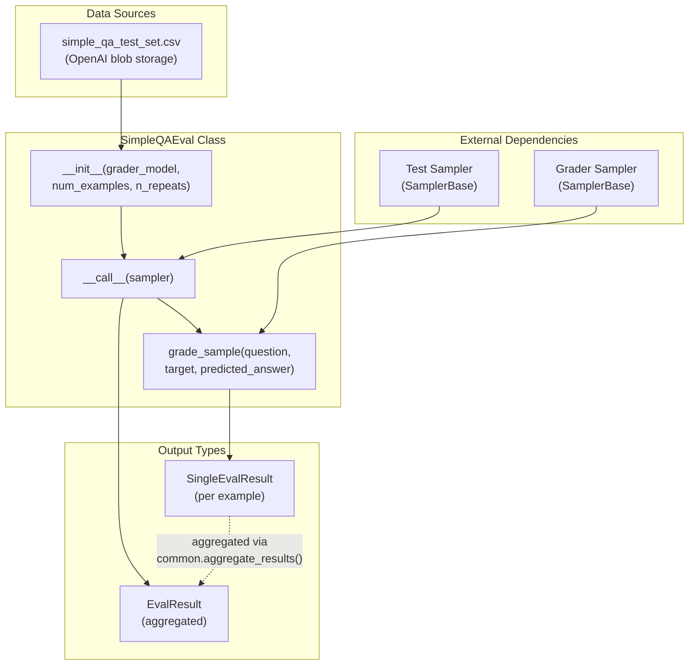
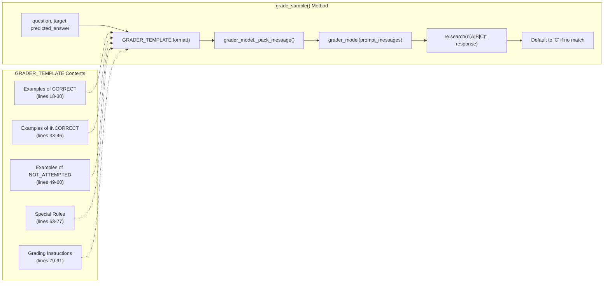
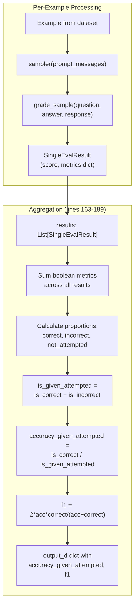

<!-- source: DeepWiki mcp.deepwiki.com · repo openai/simple-evals · extra page SimpleQA: Factuality Evaluation · fetched 2026-10-26 -->

# SimpleQA: Factuality Evaluation

<details>
<summary>Relevant source files</summary>

The following files were used as context for generating this wiki page:

- [simpleqa_eval.py](simpleqa_eval.py)

</details>


SimpleQA is a benchmark for measuring short-form factuality in large language models. Based on the paper "SimpleQA: Measuring short-form factuality in large language models" by Wei et al., this evaluation tests a model's ability to provide factually correct answers to simple, direct questions. SimpleQA is one of three actively maintained reference implementations in the simple-evals repository (alongside BrowseComp and HealthBench).

## Overview

SimpleQA evaluates factual correctness by posing straightforward questions and using a grader model to assess whether responses are correct, incorrect, or not attempted. Unlike self-grading benchmarks that use regex or exact matching, SimpleQA employs LLM-as-a-judge evaluation, where a separate grader model (typically `gpt-4.1`) evaluates the semantic correctness of responses.

The evaluation framework integrates with the simple-evals architecture through the standard interfaces:

**SimpleQA Evaluation Architecture**



Sources: [simpleqa_eval.py:1-11](), [simpleqa_eval.py:99-111](), [simpleqa_eval.py:112-126](), [simpleqa_eval.py:128-194]()

## Implementation Architecture

The `SimpleQAEval` class implements the `Eval` interface and requires two model samplers: one for generating responses (`sampler`) and one for grading them (`grader_model`).

### Initialization Parameters

The `SimpleQAEval.__init__()` method accepts:

| Parameter | Type | Default | Description |
|-----------|------|---------|-------------|
| `grader_model` | `SamplerBase` | Required | Model sampler used to grade responses (typically `gpt-4.1`) |
| `num_examples` | `int \| None` | `None` | Number of examples to evaluate (if None, uses all examples) |
| `n_repeats` | `int` | `1` | Number of times to repeat the entire dataset (only supported when `num_examples=None`) |

### Dataset Loading

The evaluation loads its dataset from a CSV file hosted at:
```
https://openaipublic.blob.core.windows.net/simple-evals/simple_qa_test_set.csv
```

Each row in the dataset contains a `problem` field (the question) and an `answer` field (the gold target). When `num_examples` is specified, the dataset is randomly sampled using `random.Random(0)` for reproducibility.

**SimpleQAEval Class Structure**

```mermaid
classDiagram
    class SimpleQAEval {
        +list examples
        +SamplerBase grader_model
        +__init__(grader_model, num_examples, n_repeats)
        +grade_sample(question, target, predicted_answer) str
        +__call__(sampler) EvalResult
    }
    
    class SamplerBase {
        <<interface>>
        +__call__(messages) SamplerResponse
        +_pack_message(content, role) dict
    }
    
    class SingleEvalResult {
        +str html
        +float score
        +list convo
        +dict metrics
    }
    
    class EvalResult {
        +float score
        +dict metrics
        +list htmls
        +list convos
    }
    
    SimpleQAEval ..> SamplerBase : "requires 2 instances:\ntest & grader"
    SimpleQAEval ..> SingleEvalResult : "produces per example"
    SimpleQAEval ..> EvalResult : "returns aggregated"
```

Sources: [simpleqa_eval.py:99-111](), [simpleqa_eval.py:112-126](), [simpleqa_eval.py:128-194]()

## Three-Tier Grading System

SimpleQA uses a sophisticated LLM-based grading mechanism that categorizes responses into three classes:

### Grading Categories

1. **CORRECT (Grade A)** - Answer fully contains the important information from the gold target without contradictions. Hedging and guessing are permissible as long as the gold target is included and no incorrect information is present.

2. **INCORRECT (Grade B)** - Answer contains factual statements that contradict the gold target. Even hedged incorrect statements (e.g., "it's possible that...", "I think...") are considered incorrect.

3. **NOT_ATTEMPTED (Grade C)** - Answer doesn't include the important information from the gold target but also doesn't contradict it. This includes responses like "I don't know" or partial answers that miss key information.

### Grading Template Structure

The `GRADER_TEMPLATE` constant (lines 13-92) defines a comprehensive prompt that guides the grader model through the evaluation process. The template includes:

- **Example-based instruction**: Multiple examples of CORRECT, INCORRECT, and NOT_ATTEMPTED responses to establish clear boundaries
- **Special grading rules**: 
  - Numeric answers must be correct to the last significant figure
  - Information clearly inferred from the question need not be repeated
  - Typos in names are permissible if the name is clearly identifiable
  - Gold targets may contain more information than necessary to answer the question
- **Response format**: The grader must respond with just the letter A, B, or C

**Grading Process Flow**



Sources: [simpleqa_eval.py:13-92](), [simpleqa_eval.py:112-126]()

### Grade Mapping

The system maintains two parallel representations of grades:

```python
CHOICE_LETTERS = ["A", "B", "C"]
CHOICE_STRINGS = ["CORRECT", "INCORRECT", "NOT_ATTEMPTED"]
CHOICE_LETTER_TO_STRING = dict(zip(CHOICE_LETTERS, CHOICE_STRINGS))
```

The `grade_sample()` method extracts the letter grade using regex and defaults to "C" (NOT_ATTEMPTED) if no valid grade is found, ensuring robust error handling.

Sources: [simpleqa_eval.py:95-97](), [simpleqa_eval.py:112-126]()

## Metrics Calculation

SimpleQA computes both per-example and aggregated metrics to assess model factuality.

### Per-Example Metrics

Each `SingleEvalResult` includes a `metrics` dictionary with boolean flags:

```python
metrics = {
    "is_correct": is_correct,        # True if grade_letter == "A"
    "is_incorrect": is_incorrect,    # True if grade_letter == "B"
    "is_not_attempted": is_not_attempted  # True if grade_letter == "C"
}
```

The `score` field is set to `1.0` if the response is correct, `0.0` otherwise.

Sources: [simpleqa_eval.py:138-158]()

### Aggregated Metrics

The evaluation computes aggregate statistics across all examples:

| Metric | Calculation | Description |
|--------|-------------|-------------|
| `is_correct` | `sum(is_correct) / len(results)` | Proportion of responses graded as CORRECT |
| `is_incorrect` | `sum(is_incorrect) / len(results)` | Proportion of responses graded as INCORRECT |
| `is_not_attempted` | `sum(is_not_attempted) / len(results)` | Proportion of responses graded as NOT_ATTEMPTED |
| `is_given_attempted` | `is_correct + is_incorrect` | Proportion of responses that were attempted |
| `accuracy_given_attempted` | `is_correct / is_given_attempted` | Accuracy among only attempted responses (excludes NOT_ATTEMPTED) |
| `f1` | `2 * acc * correct / (acc + correct)` | F1 score combining accuracy_given_attempted and is_correct |

The `accuracy_given_attempted` metric is particularly important as it isolates factual accuracy from the model's propensity to abstain. A model that frequently responds "I don't know" would have low `is_correct` but potentially high `accuracy_given_attempted`.

The F1 score balances precision (accuracy when attempting) with recall (willingness to attempt answers), providing a single metric that penalizes both excessive abstention and factual errors.

**Metrics Aggregation Flow**



Sources: [simpleqa_eval.py:162-193]()

## Evaluation Execution Flow

The `SimpleQAEval.__call__()` method orchestrates the complete evaluation process for a given model sampler.

**End-to-End Evaluation Pipeline**

```mermaid
flowchart TB
    subgraph "fn() - Inner Function (lines 129-158)"
        Row["row dict with<br/>'problem' and 'answer'"]
        PackMsg["sampler._pack_message(<br/>content=problem, role='user')"]
        CallSampler["sampler(prompt_messages)"]
        ExtractResp["response_text from<br/>SamplerResponse"]
        CallGrade["grade_sample(problem,<br/>answer, response_text)"]
        ParseGrade["Parse grade_letter:<br/>A/B/C"]
        CalcFlags["is_correct = (grade_letter == 'A')<br/>is_incorrect = (grade_letter == 'B')<br/>is_not_attempted = (grade_letter == 'C')"]
        CreateHTML["common.jinja_env.from_string(<br/>common.HTML_JINJA).render()"]
        ReturnSingle["SingleEvalResult(html, score,<br/>convo, metrics)"]
    end
    
    subgraph "Orchestration (__call__ method)"
        Examples["self.examples list"]
        MapProgress["common.map_with_progress(fn,<br/>self.examples)"]
        CollectResults["results: List[SingleEvalResult]"]
        AggMetrics["Aggregate metrics across results"]
        CalcOutput["Calculate output_d with<br/>accuracy_given_attempted, f1"]
        CallAggregate["common.aggregate_results(results)"]
        Return["Return EvalResult"]
    end
    
    Row --> PackMsg
    PackMsg --> CallSampler
    CallSampler --> ExtractResp
    ExtractResp --> CallGrade
    CallGrade --> ParseGrade
    ParseGrade --> CalcFlags
    CalcFlags --> CreateHTML
    CreateHTML --> ReturnSingle
    
    Examples --> MapProgress
    MapProgress --> CollectResults
    CollectResults --> AggMetrics
    AggMetrics --> CalcOutput
    CollectResults --> CallAggregate
    CallAggregate --> Return
```



Sources: [simpleqa_eval.py:128-194]()

### Key Implementation Details

1. **Prompt Construction**: The model is queried with just the question (from `row["problem"]`) as a user message, with no additional context or instructions.

2. **Parallel Processing**: `common.map_with_progress()` applies the inner `fn()` function to all examples, providing progress feedback during evaluation.

3. **HTML Generation**: Each result includes an HTML rendering using the `common.HTML_JINJA` template, showing the conversation, score, correct answer, and extracted answer.

4. **Conversation Logging**: The `convo` field preserves the complete message exchange, including the actual messages sent to the API (which may differ from the constructed messages due to sampler-specific transformations).

5. **Result Aggregation**: The final `EvalResult` is produced by `common.aggregate_results()`, which computes standard statistics (mean, std, bootstrap confidence intervals) in addition to the SimpleQA-specific metrics calculated in lines 164-189.

Sources: [simpleqa_eval.py:128-194]()

## Usage Examples

To run factual knowledge evaluations from the command line:

```bash
# Run all evaluations with default settings
python -m simple_evals

# Run a specific model on SimpleQA
python -m simple_evals --model gpt-4o --examples 10

# Debug mode with fewer examples
python -m simple_evals --debug
```

The evaluations can be configured in the `get_evals()` function in `simple_evals.py`. For example, SimpleQA requires a grader model, which is defined as:

```python
grading_sampler = ChatCompletionSampler(model="gpt-4o")
```

This is then used when initializing SimpleQA:

```python
SimpleQAEval(
    grader_model=grading_sampler,
    num_examples=10 if debug_mode else num_examples,
)
```

Sources: [simple_evals.py:127-167](), [simple_evals.py:22-128]()

## Summary

The factual knowledge evaluations in simple-evals provide a robust framework for testing different aspects of a model's factual knowledge capabilities:

| Evaluation | Format | Focus | Key Metrics |
|------------|--------|-------|-------------|
| SimpleQA | Open-ended QA | Short-form factuality | Accuracy given attempted, F1 |
| GPQA | Multiple-choice | Graduate-level knowledge | Accuracy |
| DROP | Reading comprehension | Reasoning over paragraphs | EM score, F1 score |

Each evaluation has been carefully designed to test specific aspects of factual knowledge, with different prompt formats, answer extraction mechanisms, and evaluation metrics appropriate to the task.

---

