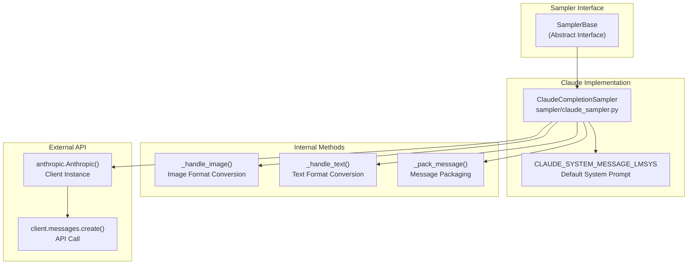
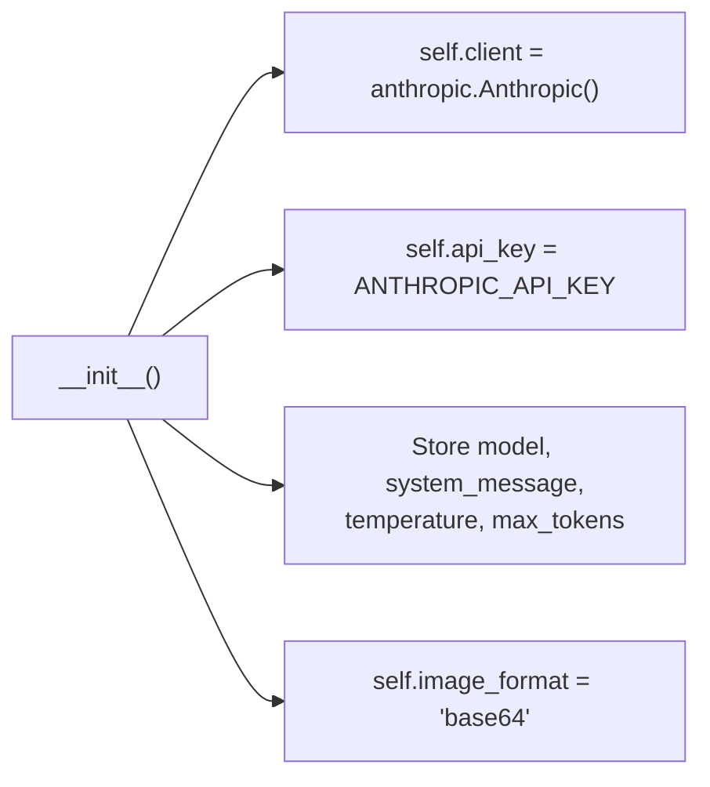
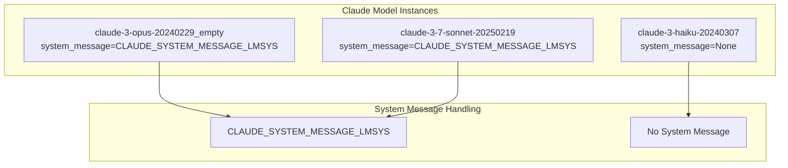
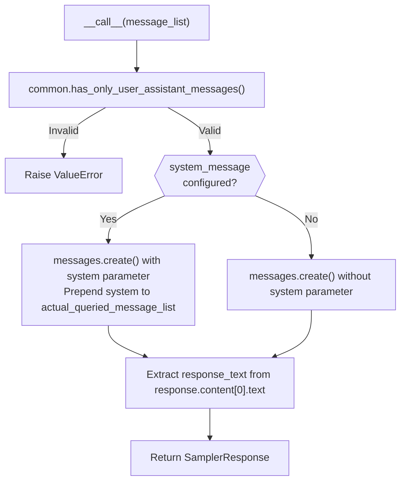
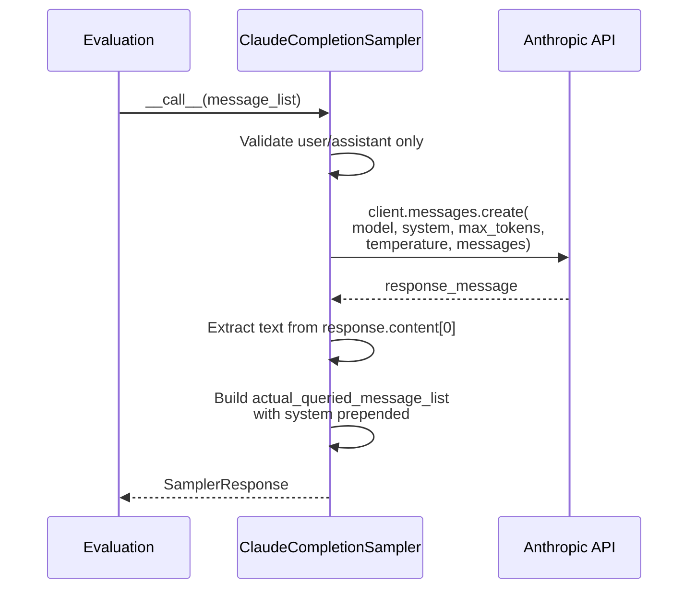
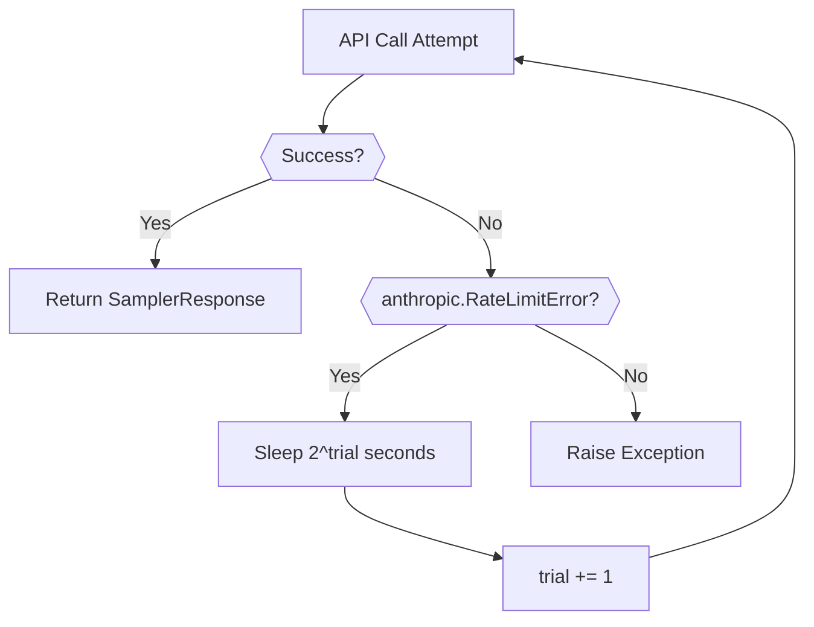
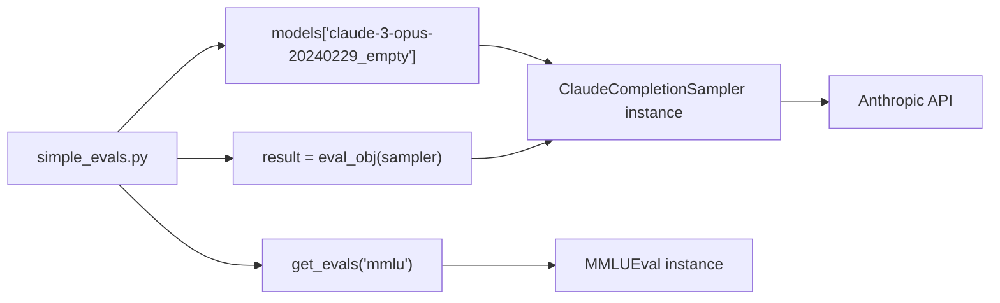
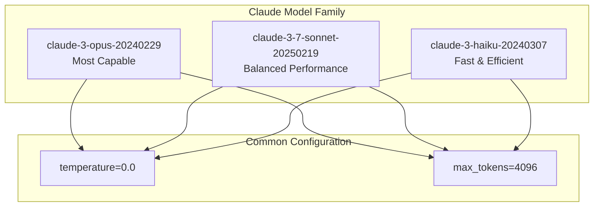

<!-- source: DeepWiki mcp.deepwiki.com · repo openai/simple-evals · extra page Claude Sampler · fetched 2026-10-26 -->

# Claude Sampler

Relevant source files

The following files were used as context for generating this wiki page:

- [run_multilingual_mmlu.py](run_multilingual_mmlu.py)
- [sampler/claude_sampler.py](sampler/claude_sampler.py)
- [simple_evals.py](simple_evals.py)

The Claude Sampler provides integration with Anthropic's Claude models through the `ClaudeCompletionSampler` class. This sampler implements the `SamplerBase` interface to enable Claude models to be used in any evaluation benchmark within the simple-evals framework.

For information about OpenAI model samplers, see [OpenAI Samplers](#3.2.1). For the base sampler interface definition, see [Type System and Interfaces](#3.1).

## Class Overview

The `ClaudeCompletionSampler` class is defined in [sampler/claude_sampler.py:26-103]() and serves as the adapter between the evaluation framework and Anthropic's API.

**Sources**: [sampler/claude_sampler.py:1-104]()

## Initialization Parameters

The `ClaudeCompletionSampler` constructor accepts the following parameters:

| Parameter | Type | Default | Description |
|-----------|------|---------|-------------|
| `model` | `str` | Required | Anthropic model identifier (e.g., "claude-3-opus-20240229") |
| `system_message` | `str \| None` | `None` | System prompt to set context and behavior |
| `temperature` | `float` | `0.0` | Sampling temperature for response generation |
| `max_tokens` | `int` | `4096` | Maximum tokens in the response |

The constructor initializes an Anthropic client instance and stores configuration parameters:

**Sources**: [sampler/claude_sampler.py:28-41]()

## System Message Configuration

The sampler provides a default system message constant `CLAUDE_SYSTEM_MESSAGE_LMSYS` that mimics the Claude prompt used in the LMSYS FastChat framework. This message is defined at [sampler/claude_sampler.py:9-22]() and includes:

- Identity as Claude by Anthropic
- Knowledge cutoff date (August 2023)
- Current date context (2024-04-01)
- Behavioral guidelines for response style

The system message is optional. When instantiating Claude models in [simple_evals.py:224-236](), different configurations are used:

**Sources**: [sampler/claude_sampler.py:9-22](), [simple_evals.py:224-236]()

## Message Processing

The Claude sampler enforces that message lists contain only `user` and `assistant` roles. This constraint is validated in the `__call__` method:

**Sources**: [sampler/claude_sampler.py:66-94]()

The sampler includes helper methods for message formatting:

- `_handle_image()` [sampler/claude_sampler.py:43-58](): Converts image data to Anthropic's format with base64 encoding
- `_handle_text()` [sampler/claude_sampler.py:60-61](): Wraps text content in proper structure
- `_pack_message()` [sampler/claude_sampler.py:63-64](): Packages role and content into message format

## API Communication

The core API interaction occurs in the `__call__` method, which handles two cases:

### With System Message

When `system_message` is set, the API call includes it as a separate parameter:

**Sources**: [sampler/claude_sampler.py:72-80]()

### Without System Message

When `system_message` is `None`, the system parameter is omitted from the API call:

**Sources**: [sampler/claude_sampler.py:81-88]()

## Error Handling

The sampler implements exponential backoff for rate limit errors:

The backoff calculation uses `exception_backoff = 2**trial`, resulting in wait times of 1, 2, 4, 8, 16... seconds on successive failures.

**Sources**: [sampler/claude_sampler.py:67-103]()

## Usage Examples

### Basic Instantiation

From [simple_evals.py:224-236]():

| Model Instance | Model ID | System Message | Configuration |
|----------------|----------|----------------|---------------|
| `claude-3-opus-20240229_empty` | claude-3-opus-20240229 | CLAUDE_SYSTEM_MESSAGE_LMSYS | Standard configuration |
| `claude-3-7-sonnet-20250219` | claude-3-7-sonnet-20250219 | CLAUDE_SYSTEM_MESSAGE_LMSYS | Standard configuration |
| `claude-3-haiku-20240307` | claude-3-haiku-20240307 | None (default) | No system message |

### Integration with Evaluations

The sampler is used like any other `SamplerBase` implementation:

**Sources**: [simple_evals.py:373-376]()

## Model Support

The Claude sampler supports all Anthropic Claude model variants. As configured in the simple-evals runner:

**Sources**: [simple_evals.py:224-236]()

## SamplerResponse Structure

The sampler returns a `SamplerResponse` object containing:

| Field | Description |
|-------|-------------|
| `response_text` | Extracted text from `response_message.content[0].text` |
| `response_metadata` | Empty dictionary (no metadata currently stored) |
| `actual_queried_message_list` | Full message list including system message if present |

The `actual_queried_message_list` field is important for debugging and logging, as it captures the exact messages sent to the API, including the system message when configured.

**Sources**: [sampler/claude_sampler.py:90-94]()

## Key Differences from OpenAI Samplers

Unlike OpenAI samplers which support system messages as part of the message list with role "system", Claude handles system messages as a separate API parameter. This architectural difference is handled transparently by the sampler:

- **OpenAI**: System messages are regular messages with role "system"
- **Claude**: System message is a separate `system` parameter in the API call

The validation check at [sampler/claude_sampler.py:70-71]() ensures that message lists only contain "user" and "assistant" roles, enforcing this API constraint.

**Sources**: [sampler/claude_sampler.py:66-94]()

---

