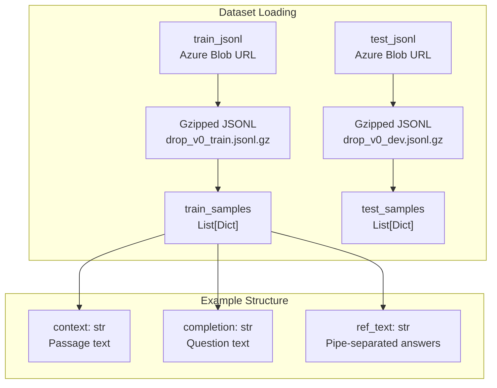
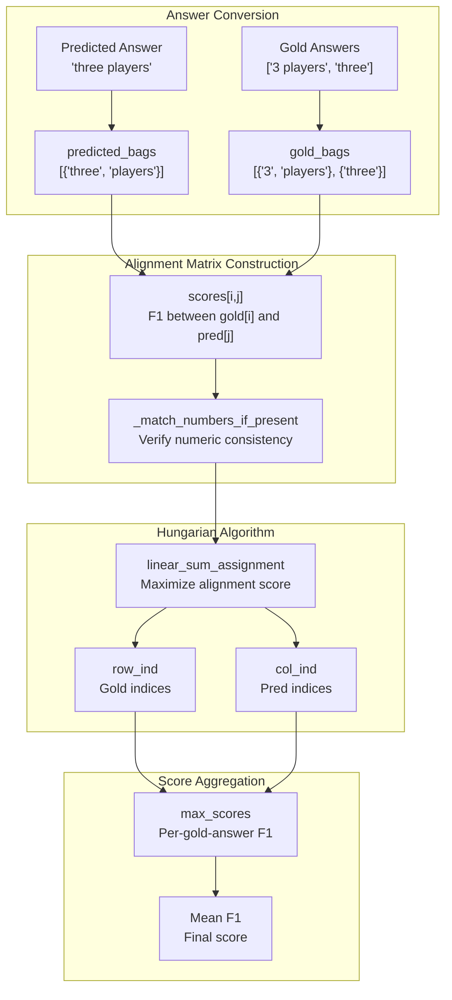
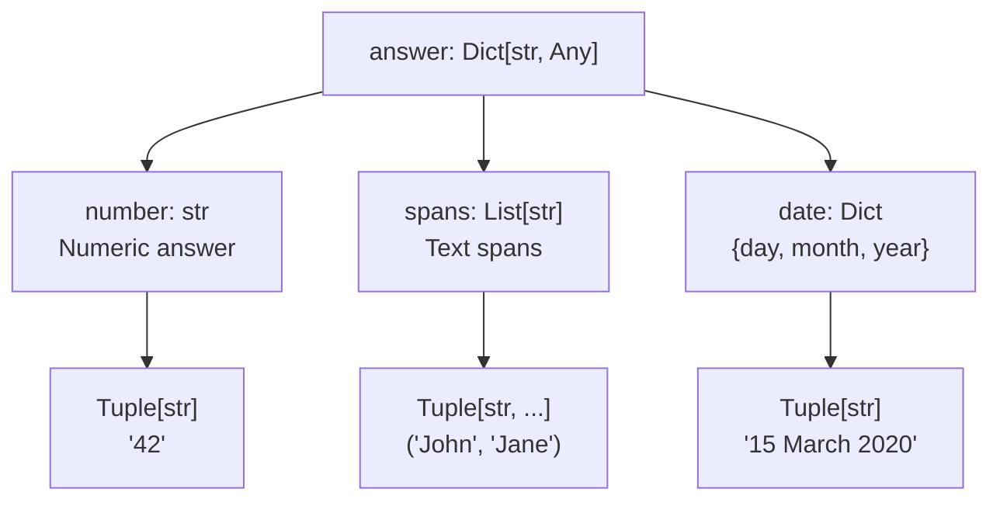
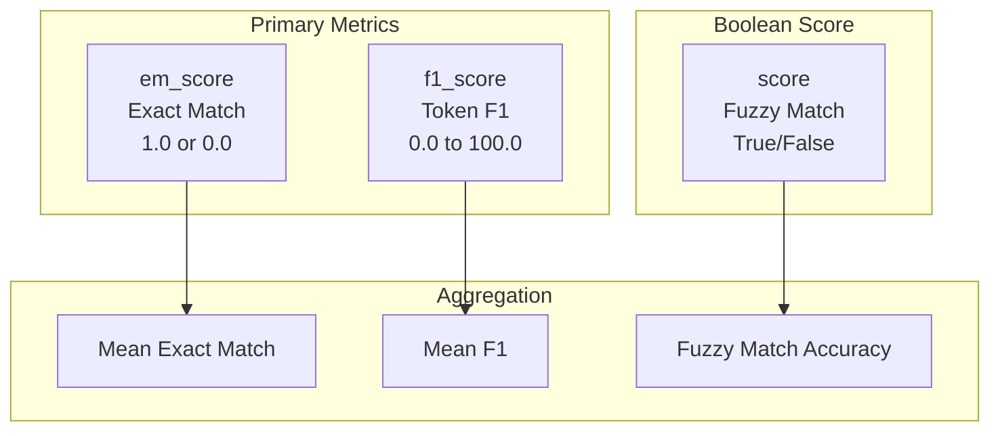
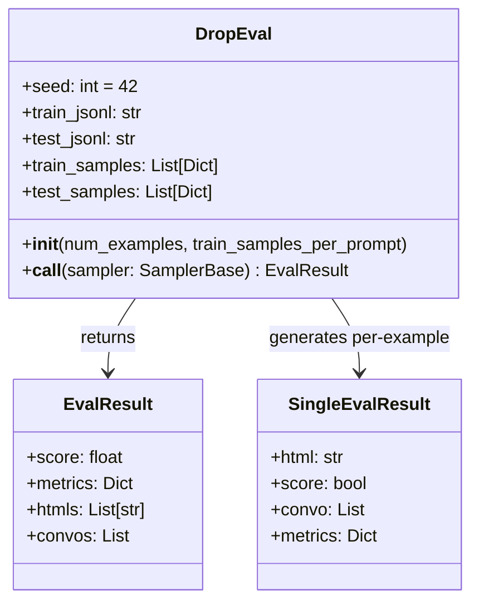

<!-- source: DeepWiki mcp.deepwiki.com · repo openai/simple-evals · extra page DROP: Reading Comprehension · fetched 2026-10-26 -->

# DROP: Reading Comprehension

<details>
<summary>Relevant source files</summary>

The following files were used as context for generating this wiki page:

- [drop_eval.py](drop_eval.py)

</details>


This page documents the DROP (Discrete Reasoning Over Paragraphs) evaluation benchmark, which assesses reading comprehension capabilities requiring discrete reasoning operations such as addition, counting, or sorting. DROP is implemented as a frozen benchmark (see [Overview](#1)) but remains available for evaluating models on complex question-answering tasks.

For information about other reading comprehension benchmarks, see the broader [Other Benchmarks](#4.4) section. For mathematical reasoning specifically, see [Mathematical Reasoning Benchmarks](#4.3).

## Overview

DROP evaluates a model's ability to answer questions that require understanding a passage and performing discrete reasoning operations. Questions may ask for numbers derived from arithmetic operations, dates constructed from text, or spans extracted from the passage. The benchmark uses a sophisticated grading methodology based on **token bag alignment** and **F1 scoring**, distinguishing it from simpler exact-match evaluations.

The implementation is based on the paper "DROP: A Reading Comprehension Benchmark Requiring Discrete Reasoning Over Paragraphs" by Dheeru Dua et al. ([arXiv:1903.00161](https://arxiv.org/abs/1903.00161)).

**Key Characteristics:**
- **Self-grading**: Uses deterministic token-level matching without LLM graders
- **Fuzzy matching**: Handles variations in answer formatting through normalization
- **Multi-answer support**: Compares against multiple valid reference answers
- **Few-shot prompting**: Uses 3 training examples per test prompt by default

Sources: [drop_eval.py:1-28]()

## Dataset Structure

DROP uses two datasets loaded from compressed JSONL files hosted on Azure blob storage:

| Dataset | URL | Purpose | Size |
|---------|-----|---------|------|
| Training | `drop_v0_train.jsonl.gz` | Few-shot examples | ~77,000 examples |
| Development | `drop_v0_dev.jsonl.gz` | Evaluation set | ~9,536 examples |

Each example contains:
- `context`: The passage to read
- `completion`: The question being asked
- `ref_text`: Pipe-separated reference answers (e.g., `"3\|three"`)



Sources: [drop_eval.py:237-254]()

## Evaluation Architecture

The DROP evaluation follows a multi-stage pipeline from prompt construction through grading:

```mermaid
graph LR
    subgraph "Prompt Construction"
        TestExample["Test Example"]
        TrainSamples["3 Random<br/>Train Examples"]
        PromptBuilder["Prompt Assembly"]
    end
    
    subgraph "Model Interaction"
        PromptMessages["prompt_messages<br/>MessageList"]
        Sampler["SamplerBase"]
        Response["sampler_response<br/>ResponseType"]
    end
    
    subgraph "Answer Extraction"
        ResponseText["response_text"]
        AnswerPattern["ANSWER_PATTERN<br/>Regex"]
        ExtractedAnswer["extracted_answer"]
    end
    
    subgraph "Grading Pipeline"
        Normalize["_normalize_answer"]
        ToBags["_answer_to_bags"]
        AlignBags["_align_bags<br/>Hungarian Algorithm"]
        ComputeF1["_compute_f1"]
        FuzzyMatch["fuzzy_match"]
    end
    
    subgraph "Output"
        EMScore["em_score: float"]
        F1Score["f1_score: float"]
        FuzzyScore["score: bool"]
    end
    
    TestExample --> PromptBuilder
    TrainSamples --> PromptBuilder
    PromptBuilder --> PromptMessages
    PromptMessages --> Sampler
    Sampler --> Response
    Response --> ResponseText
    ResponseText --> AnswerPattern
    AnswerPattern --> ExtractedAnswer
    
    ExtractedAnswer --> Normalize
    Normalize --> ToBags
    ToBags --> AlignBags
    AlignBags --> ComputeF1
    ComputeF1 --> F1Score
    ComputeF1 --> EMScore
    
    ExtractedAnswer --> FuzzyMatch
    FuzzyMatch --> FuzzyScore
```



Sources: [drop_eval.py:256-313]()

## Grading Methodology

DROP's grading methodology is notably sophisticated, using token bag alignment and F1 scoring rather than simple string matching. This allows it to handle variations in answer formatting while remaining deterministic.

### Text Normalization Pipeline

Before comparison, all text undergoes a multi-step normalization process:

```mermaid
graph LR
    Input["Raw Text"]
    Tokenize["_tokenize<br/>Split on space/hyphen"]
    Lower["_lower<br/>Lowercase"]
    RemovePunc["_remove_punc<br/>Strip punctuation"]
    NormalizeNum["_normalize_number<br/>Convert to float string"]
    RemoveArticles["_remove_articles<br/>Remove a/an/the"]
    WhitespaceFix["_white_space_fix<br/>Collapse spaces"]
    Output["Normalized Text"]
    
    Input --> Tokenize
    Tokenize --> Lower
    Lower --> RemovePunc
    RemovePunc --> NormalizeNum
    NormalizeNum --> RemoveArticles
    RemoveArticles --> WhitespaceFix
    WhitespaceFix --> Output
```



The normalization function `_normalize_answer` applies these transformations in sequence:

| Step | Function | Example Input | Example Output |
|------|----------|---------------|----------------|
| Tokenize | `_tokenize` | `"twenty-three"` | `["twenty", "three"]` |
| Lowercase | `_lower` | `"John"` | `"john"` |
| Remove punctuation | `_remove_punc` | `"3.14"` | `"3.14"` (numbers preserved) |
| Normalize numbers | `_normalize_number` | `"42"` | `"42.0"` |
| Remove articles | `_remove_articles` | `"the answer"` | `"answer"` |
| Fix whitespace | `_white_space_fix` | `"a  b  c"` | `"a b c"` |

**Important**: Numbers are detected before punctuation removal to preserve numeric values like `"3.14"`. The function `_is_number` checks if text can be converted to a float.

Sources: [drop_eval.py:31-83]()

### Token Bag Alignment

DROP converts both predicted and gold answers into "token bags" (sets of tokens) and uses the **Hungarian algorithm** (linear sum assignment) to find the optimal 1-1 alignment between them:



The alignment process ensures that if multiple valid answers exist (e.g., `"3"` and `"three"`), the prediction is compared optimally against all of them.

Sources: [drop_eval.py:85-116]()

### F1 Score Computation

For each aligned pair of token bags, DROP computes an F1 score:

```
precision = |predicted ∩ gold| / |predicted|
recall = |predicted ∩ gold| / |gold|
F1 = 2 × (precision × recall) / (precision + recall) × 100
```

Special cases:
- Empty predicted bag: `precision = 1.0`
- Empty gold bag: `recall = 1.0`
- Both zero: `F1 = 0.0`

**Example:**
- Predicted: `{"three", "players"}` 
- Gold: `{"3", "players"}`
- Intersection: `{"players"}` (size 1)
- Precision: 1/2 = 0.5
- Recall: 1/2 = 0.5  
- F1: 50.0

Sources: [drop_eval.py:119-134]()

### Number Matching

Before computing F1 scores, DROP verifies that predicted and gold bags have consistent numeric values. The function `_match_numbers_if_present` extracts all numbers from both bags:

- If gold has no numbers → match succeeds (numbers not relevant)
- If gold has numbers AND predicted shares at least one → match succeeds
- If gold has numbers AND predicted shares none → match fails (F1 = 0)

This prevents matches like:
- Gold: `{"3", "players"}` vs Predicted: `{"5", "players"}` (different numbers)

Sources: [drop_eval.py:137-148]()

## Answer Types

DROP supports three types of answers, defined in the JSON structure:



The function `answer_json_to_strings` converts these JSON structures into tuple representations:

| Answer Type | JSON Example | Converted Output | Type String |
|-------------|--------------|------------------|-------------|
| Number | `{"number": "42"}` | `("42",)` | `"number"` |
| Single span | `{"spans": ["John"]}` | `("John",)` | `"span"` |
| Multiple spans | `{"spans": ["John", "Jane"]}` | `("John", "Jane")` | `"spans"` |
| Date | `{"date": {"day": "15", "month": "March", "year": "2020"}}` | `("15 March 2020",)` | `"date"` |

Sources: [drop_eval.py:175-203]()

## Prompt Construction

The `DropEval` evaluation constructs few-shot prompts by sampling training examples:

```python
# Prompt template structure (simplified)
prompt = """You will be asked to read a passage and answer a question. 
Some examples of passages and Q&A are provided below.

# Examples
---
[Training Example 1: passage + question + answer]
---
[Training Example 2: passage + question + answer]
---
[Training Example 3: passage + question + answer]

# Your Task
---
[Test Example: passage + question]

Think step by step, then write a line of the form "Answer: $ANSWER" 
at the end of your response.
"""
```

**Configuration:**
- `train_samples_per_prompt`: Number of few-shot examples (default: 3)
- `seed`: Random seed for reproducible sampling (default: 42)

The prompt instructs the model to output answers in the format `"Answer: $ANSWER"`, which is then extracted using the regex pattern `ANSWER_PATTERN` from `common.py`.

Sources: [drop_eval.py:259-282]()

## Metrics and Scoring

For each test example, DROP computes three metrics:



### Exact Match (EM)

Exact match requires that:
1. The normalized predicted spans equal the normalized gold spans (as sets)
2. The counts match (same number of tokens)

```python
if set(predicted_bags[0]) == set(gold_bags[0]) and len(predicted_bags[0]) == len(gold_bags[0]):
    exact_match = 1.0
else:
    exact_match = 0.0
```

### F1 Score

The F1 score is computed using token bag alignment:
1. Convert predicted and gold answers to token bags
2. Compute F1 scores for all possible pairings
3. Use Hungarian algorithm to find optimal alignment
4. Average the aligned F1 scores

The final F1 is rounded to 2 decimal places.

### Fuzzy Match Score

The `score` field uses `fuzzy_match`, a simpler normalization that checks substring containment:
- Lowercase both strings
- Remove punctuation
- Remove articles (`a`, `an`, `the`)
- Check if one is a substring of the other

This provides a more lenient binary classification for HTML reporting.

Sources: [drop_eval.py:151-172](), [drop_eval.py:215-223](), [drop_eval.py:225-233](), [drop_eval.py:286-309]()

## Implementation Details

### Class Structure



### Initialization Parameters

| Parameter | Type | Default | Purpose |
|-----------|------|---------|---------|
| `num_examples` | `int \| None` | `None` | Limit test set size (uses full dev set if None) |
| `train_samples_per_prompt` | `int` | `3` | Number of few-shot examples per prompt |

### Key Functions

| Function | Location | Purpose |
|----------|----------|---------|
| `_normalize_answer` | [drop_eval.py:58-67]() | Normalize text for comparison |
| `_answer_to_bags` | [drop_eval.py:85-98]() | Convert answers to token bags |
| `_align_bags` | [drop_eval.py:101-116]() | Align predicted/gold bags with Hungarian algorithm |
| `_compute_f1` | [drop_eval.py:119-134]() | Compute F1 between token bags |
| `get_drop_metrics` | [drop_eval.py:151-172]() | Main metric computation function |
| `answer_json_to_strings` | [drop_eval.py:175-198]() | Convert DROP JSON to string tuples |

### Output Structure

Each `SingleEvalResult` contains:

```python
{
    "html": str,              # Rendered HTML for visualization
    "score": bool,            # Fuzzy match result
    "convo": List[Dict],      # Full conversation history
    "metrics": {
        "em_score": float,    # Exact match (0.0 or 1.0)
        "f1_score": float     # Token F1 (0.0 to 100.0)
    }
}
```

The aggregated `EvalResult` computes:
- Mean exact match across all examples
- Mean F1 score across all examples  
- Overall accuracy (fuzzy match)
- Standard deviation and confidence intervals

Sources: [drop_eval.py:236-313]()

## Usage Example

```python
from drop_eval import DropEval
from sampler.chat_completion_sampler import ChatCompletionSampler

# Initialize evaluation with 100 examples and 5 few-shot samples
eval = DropEval(num_examples=100, train_samples_per_prompt=5)

# Create sampler for GPT-4
sampler = ChatCompletionSampler(model="gpt-4")

# Run evaluation
result = eval(sampler)

# Access metrics
print(f"Mean F1: {result.metrics['f1_score']}")
print(f"Exact Match: {result.metrics['em_score']}")
print(f"Accuracy: {result.score}")
```

The evaluation automatically handles dataset loading, prompt construction, answer extraction, and metric computation using the sophisticated token bag alignment methodology.

Sources: [drop_eval.py:236-313]()

---

