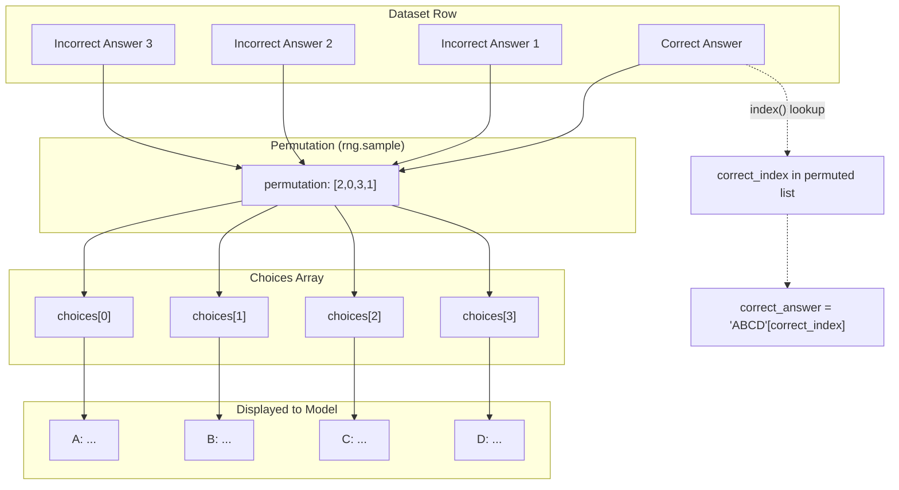
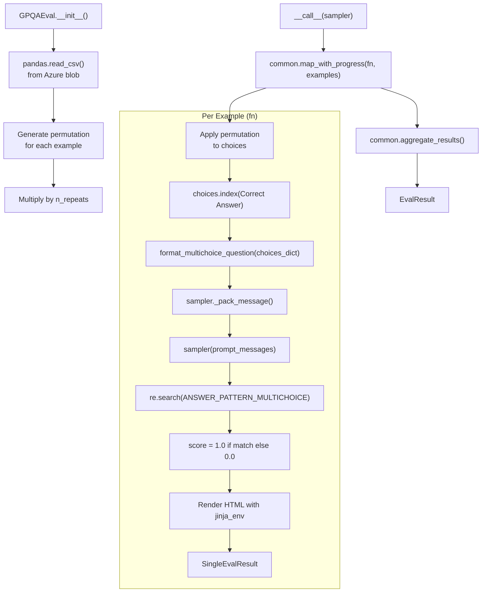
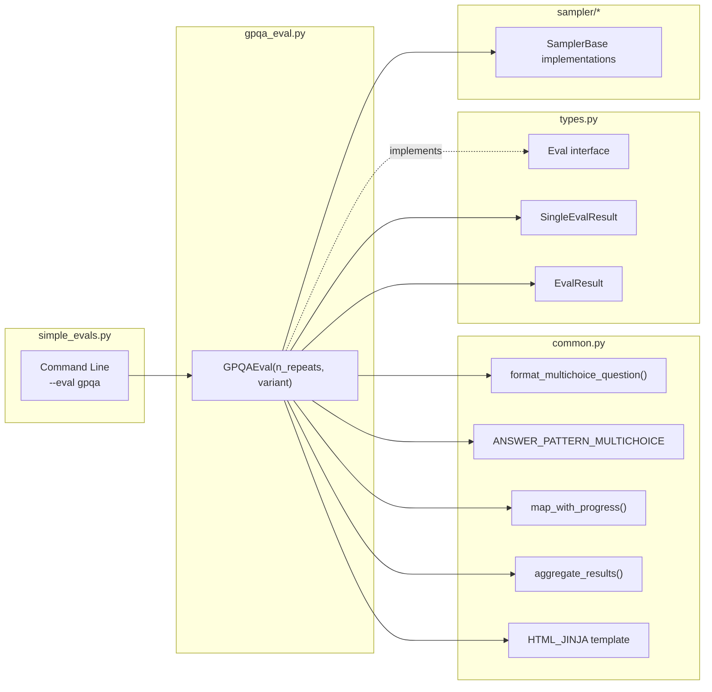

<!-- source: DeepWiki mcp.deepwiki.com · repo openai/simple-evals · extra page GPQA: Graduate-Level Q&A · fetched 2026-10-26 -->

# GPQA: Graduate-Level Q&A

<details>
<summary>Relevant source files</summary>

The following files were used as context for generating this wiki page:

- [gpqa_eval.py](gpqa_eval.py)

</details>


## Purpose and Scope

This page documents the GPQA (Graduate-Level Google-Proof Q&A) benchmark implementation, which evaluates models on challenging multiple-choice questions spanning physics, biology, and chemistry at a graduate level. GPQA is a self-grading benchmark that uses regex-based answer extraction and implements answer permutation to mitigate position bias in multiple-choice responses.

For multilingual language understanding evaluation, see [MMLU](#4.2.1). For mathematical reasoning benchmarks, see [Mathematical Reasoning Benchmarks](#4.3).

**Sources:** [gpqa_eval.py:1-5]()

## Dataset Structure and Variants

The `GPQAEval` class loads questions from a remote CSV file hosted on Azure blob storage. The benchmark supports different variants of the dataset, with "diamond" as the default variant:

```
https://openaipublic.blob.core.windows.net/simple-evals/gpqa_{variant}.csv
```

Each example in the dataset contains:
- `Question`: The graduate-level question text
- `Correct Answer`: The correct choice text
- `Incorrect Answer 1`, `Incorrect Answer 2`, `Incorrect Answer 3`: Three incorrect choices

The CSV is loaded and converted to a list of dictionaries, with each row representing one question example.

**Sources:** [gpqa_eval.py:24-27]()

## Answer Permutation Strategy

A distinguishing feature of GPQA is its **answer permutation mechanism** to mitigate position bias. When evaluating models, the order of answer choices (A, B, C, D) is randomly shuffled for each example, preventing models from exploiting patterns in answer positioning.



**Diagram: Answer Permutation Mechanism**

The permutation is generated once per example during initialization and stored in the example dictionary:

```python
examples = [example | {"permutation": rng.sample(range(4), 4)} for example in examples]
```

During evaluation, choices are reordered according to this permutation, and the correct answer letter is determined by finding where the correct choice ended up in the permuted list.

**Sources:** [gpqa_eval.py:33](), [gpqa_eval.py:39-47]()

## Evaluation Pipeline

The evaluation flow follows the standard `Eval` interface pattern with GPQA-specific prompt formatting and permutation handling:



**Diagram: GPQA Evaluation Pipeline with Code Entities**

The `fn` function within `__call__` processes each example through the complete evaluation cycle, from permutation through scoring.

**Sources:** [gpqa_eval.py:37-75]()

## Answer Extraction and Grading

### Multiple-Choice Formatting

GPQA uses the shared `format_multichoice_question` utility to create standardized multiple-choice prompts. The function receives a dictionary with keys `Question`, `A`, `B`, `C`, `D` and formats them into a prompt.

**Sources:** [gpqa_eval.py:48-54]()

### Regex-Based Answer Extraction

After receiving the model's response, GPQA extracts the answer using the `ANSWER_PATTERN_MULTICHOICE` regex pattern defined in `common.py`:

```python
match = re.search(ANSWER_PATTERN_MULTICHOICE, response_text)
extracted_answer = match.group(1) if match else None
```

This pattern is designed to recognize common answer formats like "The answer is (A)", "Answer: B", etc.

**Sources:** [gpqa_eval.py:59-60]()

### Grading Logic

GPQA implements deterministic self-grading by exact string comparison:

| Condition | Score |
|-----------|-------|
| `extracted_answer == correct_answer` | 1.0 |
| `extracted_answer != correct_answer` or `extracted_answer is None` | 0.0 |

The grading is binary - either the model selects the correct letter or it does not. No partial credit is awarded.

**Sources:** [gpqa_eval.py:61]()

## Configuration Options

The `GPQAEval` constructor accepts the following parameters:

| Parameter | Type | Default | Description |
|-----------|------|---------|-------------|
| `n_repeats` | `int` | `4` | Number of times to repeat each example with different permutations. Enables measuring variance due to answer ordering. |
| `variant` | `str` | `"diamond"` | Dataset variant to load. The default "diamond" variant contains the highest-quality expert-validated questions. |
| `num_examples` | `int \| None` | `None` | Restrict evaluation to a random subset of examples for debugging. When set, `n_repeats` must be 1. |

### Repeats and Permutation

Setting `n_repeats > 1` runs each question multiple times with different answer permutations generated by the seeded random number generator (`random.Random(0)`). This allows measuring model sensitivity to answer position:

```python
examples = examples * n_repeats
examples = [example | {"permutation": rng.sample(range(4), 4)} for example in examples]
```

Each repeat gets a fresh permutation, so the same question appears with answers in different orders.

**Sources:** [gpqa_eval.py:18-36]()

## Result Structure

Each example evaluation produces a `SingleEvalResult` containing:

| Field | Content |
|-------|---------|
| `html` | Rendered HTML showing the prompt, model response, correct answer, extracted answer, and score |
| `score` | Binary score (1.0 or 0.0) |
| `convo` | Complete conversation history including the prompt and assistant response |
| `metrics` | Dictionary with `{"chars": len(response_text)}` tracking response length |

These individual results are aggregated by `common.aggregate_results()` to compute overall accuracy statistics.

**Sources:** [gpqa_eval.py:62-72](), [gpqa_eval.py:74-75]()

## Integration with Simple-Evals



**Diagram: GPQA Integration with Simple-Evals Framework**

GPQA implements the `Eval` interface and leverages shared utilities from `common.py` for prompt formatting, answer extraction, progress tracking, and result aggregation. It works with any `SamplerBase` implementation, enabling evaluation across different model families.

**Sources:** [gpqa_eval.py:12-14](), [gpqa_eval.py:17](), [gpqa_eval.py:37]()

---

