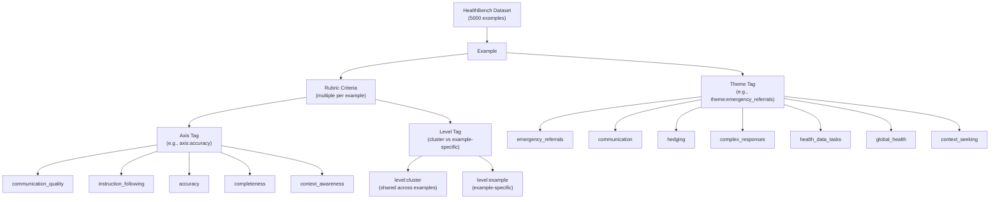
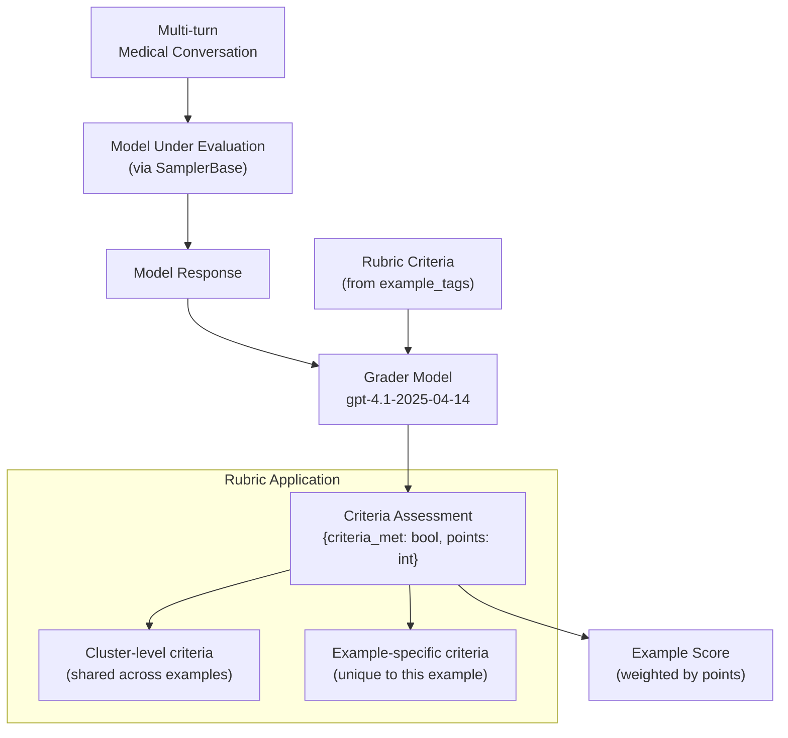
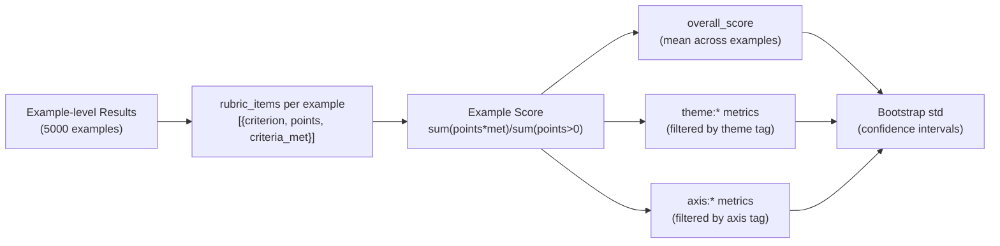

<!-- source: DeepWiki mcp.deepwiki.com · repo openai/simple-evals · extra page HealthBench: Medical Domain Evaluation · fetched 2026-10-26 -->

# HealthBench: Medical Domain Evaluation

<details>
<summary>Relevant source files</summary>

The following files were used as context for generating this wiki page:

- [healthbench_scripts/healthbench_analysis.ipynb](healthbench_scripts/healthbench_analysis.ipynb)
- [run_multilingual_mmlu.py](run_multilingual_mmlu.py)
- [simple_evals.py](simple_evals.py)

</details>


## Purpose and Scope

This page documents the HealthBench evaluation benchmark, one of three actively maintained reference implementations in the simple-evals framework. HealthBench evaluates language models on realistic medical domain scenarios using rubric-based grading. Unlike self-grading benchmarks (see [MMLU](#4.2.1), [GPQA](#4.2.2)), HealthBench uses a grader LLM (GPT-4.1) to assess open-ended medical responses against detailed rubric criteria organized by themes and evaluation axes.

For information about the other reference implementations, see [SimpleQA](#4.1.1) and [BrowseComp](#4.1.2). For general evaluation framework concepts, see [Evaluation Framework](#3.3).

Sources: [simple_evals.py:1-429]()

## Dataset Organization

### Example Structure

HealthBench examples consist of multi-turn medical conversations with associated rubric criteria. The dataset is organized hierarchically:



Sources: [healthbench_scripts/healthbench_analysis.ipynb:188-238](), [healthbench_scripts/healthbench_analysis.ipynb:248-365]()

### Themes and Axes

The evaluation organizes examples and criteria along two dimensions:

| Dimension | Description | Examples |
|-----------|-------------|----------|
| **Theme** | Clinical scenario category | Emergency referrals, Communication, Hedging behavior, Response depth, Health data tasks, Global health, Context seeking |
| **Axis** | Quality dimension being evaluated | Communication quality, Instruction following, Accuracy, Completeness, Context awareness |

Each example has exactly one theme tag, while rubric criteria are tagged with one axis. Criteria are further categorized by level (cluster-level vs example-specific).

Sources: [healthbench_scripts/healthbench_analysis.ipynb:188-238](), [healthbench_scripts/healthbench_analysis.ipynb:319-364]()

### Rubric Structure

Each rubric criterion has the following structure:

```json
{
  "criterion": "Description of what is being evaluated",
  "points": 1,
  "criteria_met": true,
  "tags": ["axis:accuracy", "level:cluster"]
}
```

**Scoring Formula:**
```
score = sum(points where criteria_met) / sum(points where points > 0)
```

The dataset contains approximately:
- **5,000 examples** across 7 themes
- **Multiple rubric criteria per example** (cluster-level and example-specific)
- **Multi-turn conversations** with varying context requirements

Sources: [healthbench_scripts/healthbench_analysis.ipynb:1052-1063](), [healthbench_scripts/healthbench_analysis.ipynb:319-364]()

## Evaluation Variants

### Main Evaluation

The full HealthBench dataset evaluates models across all 5,000 examples and all themes/axes.

```python
# Instantiation in simple_evals.py
HealthBenchEval(
    grader_model=grading_sampler,  # gpt-4.1
    num_examples=num_examples,     # None for full dataset
    n_repeats=1,                   # Number of sampling repeats
    n_threads=1,                   # Parallel grading threads
    subset_name=None               # Full dataset
)
```

Sources: [simple_evals.py:302-309]()

### Hard Subset

A filtered subset focusing on examples where models struggle. Accessed via `subset_name="hard"`.

```python
HealthBenchEval(
    grader_model=grading_sampler,
    num_examples=10 if debug_mode else num_examples,
    n_repeats=args.n_repeats or 1,
    n_threads=args.n_threads or 1,
    subset_name="hard"
)
```

Sources: [simple_evals.py:310-317]()

### Consensus Subset

A curated subset with physician consensus on evaluation criteria. Accessed via `subset_name="consensus"`.

The consensus subset includes additional prompt taxonomy tags:
- User expertise level (health-professional vs not-health-professional)
- Required response detail (detailed vs simple)
- Context availability (enough-context vs not-enough-context)
- Emergency level (emergent, conditionally-emergent, non-emergent)
- Uncertainty type (no-uncertainty, only-irreducible-uncertainty, any-reducible-uncertainty)

Sources: [simple_evals.py:318-325](), [healthbench_scripts/healthbench_analysis.ipynb:908-946]()

### Meta-Evaluation

A separate evaluation (`HealthBenchMetaEval`) that assesses grader model agreement with physician judgments.

```python
HealthBenchMetaEval(
    grader_model=grading_sampler,
    num_examples=10 if debug_mode else num_examples,
    n_repeats=args.n_repeats or 1,
    n_threads=args.n_threads or 1,
)
```

Meta-eval examples are tuples of `(rubric_criterion, conversation, response, physician_grade)` used to compute pairwise agreement metrics between the grader model and physicians.

Sources: [simple_evals.py:326-332](), [healthbench_scripts/healthbench_analysis.ipynb:517-531]()

## Grading Methodology

### LLM-Based Rubric Grading



Sources: [simple_evals.py:254-258](), [healthbench_scripts/healthbench_analysis.ipynb:1052-1063]()

### Grader Model Configuration

The grader uses a specific GPT-4.1 configuration:

```python
grading_sampler = ChatCompletionSampler(
    model="gpt-4.1-2025-04-14",
    system_message=OPENAI_SYSTEM_MESSAGE_API,
    max_tokens=2048,
)
```

This configuration ensures:
- Consistent rubric interpretation
- Structured assessment output
- Reproducible scoring across runs

Sources: [simple_evals.py:254-258]()

## Running HealthBench Evaluations

### Command-Line Interface

Run the main evaluation:
```bash
python -m simple_evals.simple_evals --model gpt-4.1 --eval healthbench
```

Run with multiple repeats (for variability analysis):
```bash
python -m simple_evals.simple_evals \
    --model gpt-4.1 \
    --eval healthbench \
    --n-repeats 10
```

Run hard subset:
```bash
python -m simple_evals.simple_evals \
    --model gpt-4.1 \
    --eval healthbench_hard
```

Run with parallel grading:
```bash
python -m simple_evals.simple_evals \
    --model gpt-4.1 \
    --eval healthbench \
    --n-threads 120
```

Sources: [simple_evals.py:30-62](), [simple_evals.py:302-332]()

### Configuration Parameters

| Parameter | Type | Default | Description |
|-----------|------|---------|-------------|
| `grader_model` | `SamplerBase` | Required | LLM sampler for rubric grading (typically gpt-4.1) |
| `num_examples` | `int \| None` | `None` | Limit dataset size (None = full dataset) |
| `n_repeats` | `int` | `1` | Number of sampling repeats per example |
| `n_threads` | `int` | `1` | Parallel threads for grading (max 120) |
| `subset_name` | `str \| None` | `None` | Subset filter ("hard", "consensus", or None) |

Sources: [simple_evals.py:302-332]()

### Output Files

HealthBench generates three output files per run:

1. **Metrics JSON** (`healthbench_{model}_{datetime}.json`):
   ```json
   {
     "overall_score": 0.8234,
     "theme:emergency_referrals": 0.7891,
     "theme:communication": 0.8456,
     "axis:accuracy": 0.8123,
     "axis:completeness": 0.7934,
     "overall_score:bootstrap_std": 0.0234,
     "theme:emergency_referrals:n_samples": 1234
   }
   ```

2. **HTML Report** (`healthbench_{model}_{datetime}.html`): Human-readable report with example-level details

3. **Full Results JSON** (`healthbench_{model}_{datetime}_allresults.json`): Complete trace including `example_level_metadata` with per-example rubric items and usage statistics

Sources: [simple_evals.py:377-404]()

## Result Aggregation and Metrics

### Metric Computation



### Aggregated Metrics

The evaluation computes the following metric categories:

**Overall Score:**
- `overall_score`: Mean score across all examples
- `overall_score:bootstrap_std`: Bootstrap standard deviation
- `overall_score:n_samples`: Number of examples evaluated

**Theme-level Scores:** (7 themes)
- `theme:emergency_referrals`
- `theme:communication`
- `theme:hedging`
- `theme:complex_responses`
- `theme:health_data_tasks`
- `theme:global_health`
- `theme:context_seeking`

**Axis-level Scores:** (5 axes)
- `axis:communication_quality`
- `axis:instruction_following`
- `axis:accuracy`
- `axis:completeness`
- `axis:context_awareness`

Each metric includes `:bootstrap_std` and `:n_samples` variants for uncertainty quantification.

Sources: [healthbench_scripts/healthbench_analysis.ipynb:573-604]()

## Analysis Notebook

### Overview

The analysis notebook (`healthbench_scripts/healthbench_analysis.ipynb`) provides comprehensive result analysis capabilities. It loads results from the output JSON files and generates publication-ready visualizations and statistics.

Sources: [healthbench_scripts/healthbench_analysis.ipynb:1-14]()

### Key Analysis Functions

#### Dataset Descriptive Statistics

```python
# Load main evaluation states from JSONL
main_eval_states = []
with bf.BlobFile(fp_main_eval, 'r') as f:
    for line in f:
        main_eval_states.append(json.loads(line))

# Generate example summary table
df_examples = get_example_summary(main_eval_states)

# Generate rubric criteria summary
df_rubric_criteria = get_rubric_criteria_summary(main_eval_states)
```

These functions generate LaTeX-formatted tables showing:
- Theme distribution across examples
- Physician-agreed category breakdown
- Rubric criteria counts by axis and level

Sources: [healthbench_scripts/healthbench_analysis.ipynb:253-365](), [healthbench_scripts/healthbench_analysis.ipynb:373-400]()

#### Clustered Bar Plots

```python
def clustered_bar_plot(
    results_by_model: dict,
    theme_or_axis: Literal["theme", "axis"],
    ylabel: str,
    title: str,
    sort_order: list[str] | None = None,
    cluster_sort_order: list[str] | None = None,
    error_as_yaxis: bool = False,
) -> pd.DataFrame:
```

Generates grouped bar charts comparing models across themes or axes. Features:
- Bootstrap error bars
- Horizontal line showing overall model score
- Customizable sort orders
- Canonical name mapping for display

Sources: [healthbench_scripts/healthbench_analysis.ipynb:622-773]()

#### Worst-at-K Analysis

```python
def precompute_comb_indices(N):
    """
    Return a dict: k -> (n_subsets, k) array containing
    every length-k subset of {0, 1, 2, ..., N-1}.
    """
    combination_indices = {}
    for k in range(1, N + 1):
        combination_indices[k] = np.array(
            list(itertools.combinations(range(N), k))
        )
    return combination_indices
```

Computes the worst-case score when taking the minimum over k repeated samples. This analysis requires running evaluations with `n_repeats > 1`.

**Analysis Process:**
1. Pivot results by `prompt_id` to group repeated samples
2. For each k from 1 to N, compute all k-subsets
3. Take minimum score within each subset
4. Average across all subsets

This reveals model reliability: how often does sampling produce poor results?

Sources: [healthbench_scripts/healthbench_analysis.ipynb:1710-1760]()

#### Meta-Evaluation Agreement Analysis

```python
def plot_model_physician_agreement(
    metrics, 
    individual_physician_agreement_metrics, 
    overall_model_agreement_metrics
) -> pd.DataFrame:
```

Compares grader model agreement with physician judgments using pairwise F1 metrics. Visualizes:
- Individual physician agreement scores (scatter with jitter)
- Weighted physician average (star marker)
- Grader model agreement (triangle marker)
- Model percentile among physicians

Sources: [healthbench_scripts/healthbench_analysis.ipynb:1390-1557]()

#### Cost-Performance Analysis

```python
def plot_dollar_cost_scatter(
    entries,
    title,
    x_label,
    y_label,
    *,
    alpha: float = 0.8,
    scale: str = "linear",
    model_families: list[list[str]] | None = None,
):
```

Plots cost vs. performance with model family groupings:
- Each family shares a color
- Within-family ranking by cost (x, square, diamond markers)
- Lines connecting family members
- Support for log-scale cost axis

**Cost Calculation:**
```python
cost_per_example = (
    avg_input_tokens * model_input_price_per_1M +
    avg_output_tokens * model_output_price_per_1M
) / 1e6
```

Sources: [healthbench_scripts/healthbench_analysis.ipynb:2249-2421](), [healthbench_scripts/healthbench_analysis.ipynb:2430-2500]()

### Configuration and Setup

The notebook requires configuration of file paths:

```python
# Source data files
fp_main_eval = 'az://openaipublic/simple-evals/healthbench/...'
fp_meta_eval = 'az://openaipublic/simple-evals/healthbench/...'

# Working directories
tmp_dir = '/path/to/results/'      # Results loaded from here
results_dir = '/path/to/output/'   # Analysis output saved here

# Result filenames (from running evaluations)
main_filename_list = """
healthbench_gpt-3.5-turbo-0125_20250507_0653.json
healthbench_gpt-4.1_20250507_0653.json
""".splitlines()
```

The notebook uses canonical name mapping for display:

```python
models_to_canonical_name = {
    'gpt-4.1': "GPT-4.1",
    'gpt-4.1-mini': "GPT-4.1 mini",
    'o3': "o3",
    # ... etc
}
```

Sources: [healthbench_scripts/healthbench_analysis.ipynb:76-97](), [healthbench_scripts/healthbench_analysis.ipynb:145-179]()

### Analysis Workflow

Typical analysis workflow:

1. **Run evaluations** to generate result files:
   ```bash
   python -m simple_evals.simple_evals \
       --model gpt-4.1,o3,o1 \
       --eval healthbench \
       --n-repeats 16 \
       --n-threads 120
   ```

2. **Copy result files** to `tmp_dir` and update notebook configuration

3. **Run descriptive statistics** cells to understand dataset composition

4. **Generate comparison plots**:
   - Theme-based bar plots
   - Axis-based bar plots
   - Hard/consensus subset analysis

5. **Analyze reliability**:
   - Worst-at-k analysis (requires n_repeats > 1)
   - Inter-replicate variance
   - Length-adjusted win rates

6. **Cost analysis**:
   - Performance vs. cost scatter plots
   - Pareto frontier identification

Sources: [healthbench_scripts/healthbench_analysis.ipynb:1-14]()

## Human Baseline Evaluation

### Physician Response Evaluation

HealthBench includes human baseline evaluations comparing physician-written responses against model-generated responses:

**Evaluation Conditions:**
- `apr_2025_reference_humanbaseline`: Physicians with April 2025 model references
- `aug_2024_reference_humanbaseline`: Physicians with September 2024 model references
- `no_reference_humanbaseline`: Physicians without any model reference
- `*_referencecompletions`: The model reference responses themselves

Analysis reveals:
- Distribution of physician vs. reference score differences
- Response length distributions across conditions
- Paired comparison of human and model performance

Sources: [healthbench_scripts/healthbench_analysis.ipynb:88-93](), [healthbench_scripts/healthbench_analysis.ipynb:1080-1131]()

## Advanced Analyses

### Length-Adjusted Win Rates

Compares model pairwise performance while controlling for response length:

```python
def compare_model_results_per_problem(
    results_modela, 
    results_modelb, 
    length_control: float | None = None
):
    # Filter pairs where length difference exceeds threshold
    symmetric_pct_diff = abs(length_a - length_b) / ((length_a + length_b) / 2)
    if symmetric_pct_diff > length_control:
        continue
```

When `length_control=0.1`, only compares response pairs where lengths differ by <10% (symmetric percentage difference). This isolates quality improvements from length effects.

Sources: [healthbench_scripts/healthbench_analysis.ipynb:1865-1894](), [healthbench_scripts/healthbench_analysis.ipynb:1902-1933]()

### Evaluation Variability Analysis

For models run with multiple repeats, compute run-to-run variability:

```python
scores_by_eval_run_by_model = defaultdict(list)
for model_name, instances_per_problem in results_worst_at_k_pivoted.items():
    results_by_eval_run = list(zip(*instances_per_problem))
    for results_per_eval_run in results_by_eval_run:
        problem_level_scores = [
            rubric_accuracy_per_instance(instance) 
            for instance in results_per_eval_run
        ]
        overall_score = np.mean(problem_level_scores)
        scores_by_eval_run_by_model[model_name].append(overall_score)
```

Outputs mean, std, min, max across evaluation runs to quantify sampling variance.

Sources: [healthbench_scripts/healthbench_analysis.ipynb:1793-1829]()

### Correlation Analyses

The notebook includes scatter plots with OLS trendlines and Pearson/Spearman correlations:

- **Response length vs. score**: Does longer = better?
- **CoT length vs. score**: For reasoning models, does thinking time help?
- **Response length vs. CoT length**: Are they correlated?

```python
def plot_lista_vs_listb(
    list_pairs_with_labels,
    x_label,
    y_label,
    title,
    alpha: float | None = None,
    clipx: tuple[float | None, float | None] | None = None,
    clipy: tuple[float | None, float | None] | None = None,
    show_trendline=True,
):
```

Sources: [healthbench_scripts/healthbench_analysis.ipynb:2073-2133](), [healthbench_scripts/healthbench_analysis.ipynb:2142-2238]()

## Data Format Reference

### Example-Level Metadata Structure

The `example_level_metadata` in full results JSON contains:

```python
{
    "prompt_id": "unique_identifier",
    "prompt": [...],  # Multi-turn conversation
    "completion": [{"role": "assistant", "content": "..."}],
    "rubric_items": [
        {
            "criterion": "...",
            "points": 1,
            "criteria_met": true,
            "tags": ["axis:accuracy", "level:cluster"]
        }
    ],
    "usage": {
        "input_tokens": 1234,
        "output_tokens": 567,
        "output_reasoning_tokens": 234  # For reasoning models
    },
    "example_tags": ["theme:emergency_referrals", ...]
}
```

Sources: [healthbench_scripts/healthbench_analysis.ipynb:1052-1063](), [healthbench_scripts/healthbench_analysis.ipynb:1696-1701]()

### Consensus Subset Additional Fields

Consensus subset results include prompt taxonomy metadata:

```python
{
    "cluster:{cluster_name}_{taxonomy_category}_{criterion}": 0.8234,
    # Example:
    "cluster:emergency_referrals_health-professional_accuracy": 0.8456
}
```

Taxonomy categories from [healthbench_scripts/healthbench_analysis.ipynb:908-926]():
- User type: `health-professional`, `not-health-professional`
- Response type: `detailed`, `simple`
- Context: `enough-context`, `not-enough-context`
- Emergency level: `emergent`, `conditionally-emergent`, `non-emergent`
- Uncertainty: `no-uncertainty`, `only-irreducible-uncertainty`, `any-reducible-uncertainty`

Sources: [healthbench_scripts/healthbench_analysis.ipynb:908-971]()

---

