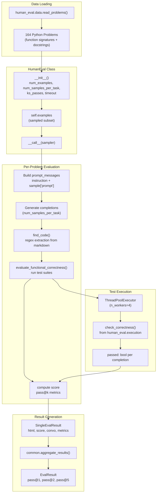
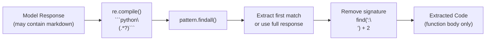
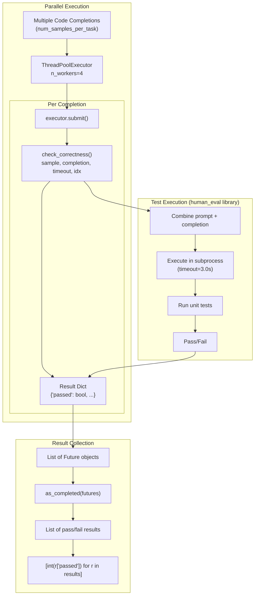
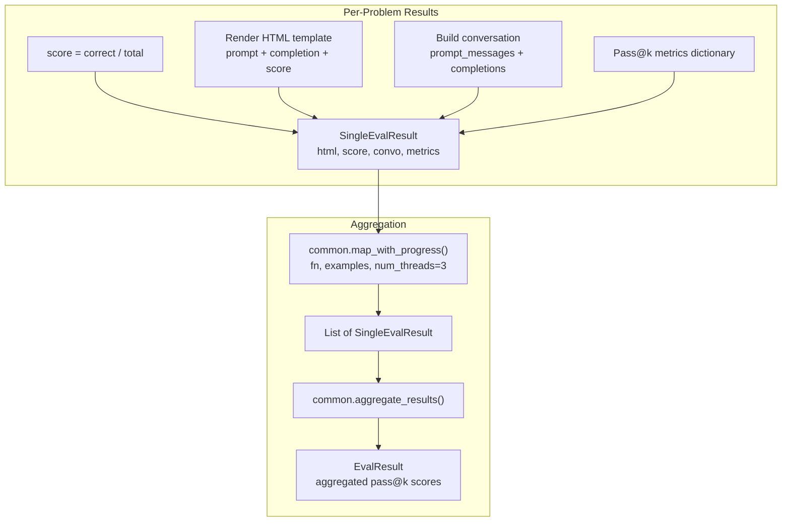

<!-- source: DeepWiki mcp.deepwiki.com · repo openai/simple-evals · extra page HumanEval: Code Generation · fetched 2026-10-26 -->

# HumanEval: Code Generation

<details>
<summary>Relevant source files</summary>

The following files were used as context for generating this wiki page:

- [humaneval_eval.py](humaneval_eval.py)

</details>


## Purpose and Scope

This document describes the HumanEval benchmark implementation for evaluating code generation capabilities of language models. HumanEval tests whether models can complete Python function implementations given function signatures and docstrings. The benchmark executes generated code against test suites to verify functional correctness and computes pass@k metrics.

HumanEval is one of the frozen benchmarks in simple-evals (no new results added after July 2025). For other code-related evaluations or actively maintained benchmarks, see the Reference Implementations section [4.1](#4.1).

**Sources:** [humaneval_eval.py:1-5]()

## Overview

HumanEval is a code generation benchmark originally published by OpenAI in "Evaluating Large Language Models Trained on Code" (Chen et al., 2021). The benchmark consists of 164 programming problems where models must complete Python function implementations. Each problem includes:

- A function signature
- A docstring describing the function's behavior
- Unit tests to verify correctness (hidden from the model)

The evaluation generates multiple code samples per problem and measures the percentage that pass all test cases. This differs from most other benchmarks in simple-evals by using **code execution** rather than text matching or LLM grading.

**Sources:** [humaneval_eval.py:1-5](), [humaneval_eval.py:46-64]()

## Evaluation Architecture



**Diagram: HumanEval evaluation pipeline from data loading to final metrics**

**Sources:** [humaneval_eval.py:46-114]()

## Configuration Parameters

The `HumanEval` class accepts the following configuration parameters:

| Parameter | Type | Default | Description |
|-----------|------|---------|-------------|
| `num_examples` | `int` | 250 | Number of problems to evaluate (subset of 164 total). Set to restrict evaluation size for debugging. |
| `num_samples_per_task` | `int` | 5 | Number of code completions to generate per problem. Used for pass@k calculation. |
| `ks_passes` | `list[int]` | `[1, 2, 5]` | Values of k for which to compute pass@k metrics. |
| `timeout` | `int` | 120 | Maximum execution time (seconds) per test case. |

The class uses a fixed seed (`self.seed = 0`) for reproducible problem sampling.

**Sources:** [humaneval_eval.py:47-63]()

## Prompt Construction

HumanEval uses a simple, single-turn instruction format:

```python
instruction = "Read the following function signature and docstring, and fully implement the function described. Your response should only contain the code for this function.\n"
```

The prompt combines this instruction with the problem's function signature and docstring:

```python
prompt_messages = [
    sampler._pack_message(
        role="user", content=instruction + sample["prompt"]
    )
]
```

Each problem in the dataset includes a `"prompt"` field containing the function signature and docstring. The model must generate the function body.

**Sources:** [humaneval_eval.py:66-82]()

## Code Extraction

Generated responses are processed to extract Python code from markdown formatting:



**Diagram: Code extraction pipeline removing markdown and function signatures**

The extraction logic in `find_code()`:

1. Searches for Python code blocks delimited by triple backticks
2. Takes the first match if found, otherwise uses the entire response
3. Strips the function signature by finding `":\n    "` and taking everything after

This handles cases where models format their output as markdown or include the signature in their response.

**Sources:** [humaneval_eval.py:68-75]()

## Test Execution and Correctness Checking



**Diagram: Parallel test execution architecture using ThreadPoolExecutor and human_eval library**

The `evaluate_functional_correctness()` function orchestrates parallel test execution:

1. Creates a `ThreadPoolExecutor` with 4 worker threads
2. Submits each completion to `check_correctness()` from the `human_eval.execution` module
3. Waits for all futures to complete using `as_completed()`
4. Returns a list of integer pass/fail results (1 = passed, 0 = failed)

The `check_correctness()` function (from the external library) executes each completion in a subprocess with the problem's test suite and enforces the timeout.

**Sources:** [humaneval_eval.py:20-43]()

## Metrics and Scoring

HumanEval computes two types of scores:

### Per-Problem Score
The fraction of generated completions that pass all tests:

```python
score = sum(results) / len(results)
```

This provides a simple correctness measure for each individual problem.

### Pass@k Metrics
The probability that at least one of k samples passes all tests, computed using the unbiased estimator from the HumanEval paper:

```python
metrics={
    f"pass@{k}": estimate_pass_at_k([total], [correct], k)
    for k in self._ks_passes
    if total >= k
}
```

The `estimate_pass_at_k()` function (from `human_eval.evaluation`) implements the formula:

$$\text{pass@k} = \mathbb{E}_{Problems}\left[1 - \frac{\binom{n-c}{k}}{\binom{n}{k}}\right]$$

where $n$ is the total samples per problem and $c$ is the number of correct samples.

Pass@k metrics are computed for each value in `ks_passes` (default: 1, 2, 5) and aggregated across all problems.

**Sources:** [humaneval_eval.py:88-110]()

## Result Generation



**Diagram: Result generation and aggregation flow**

Each problem evaluation returns a `SingleEvalResult` containing:

- **html**: Rendered HTML showing the prompt, first completion, and pass/fail status
- **score**: Per-problem accuracy (fraction of completions that passed)
- **convo**: Full conversation including all generated completions
- **metrics**: Pass@k values for this problem

The evaluation uses `common.map_with_progress()` with 3 threads to process problems in parallel (separate from the test execution parallelism). Results are then aggregated using `common.aggregate_results()` to compute overall pass@k statistics across all problems.

**Sources:** [humaneval_eval.py:91-114]()

## HTML Rendering

The HTML output for each problem uses the common Jinja template:

```python
html = common.jinja_env.from_string(HTML_JINJA).render(
    prompt_messages=prompt_messages,
    next_message=dict(content=completions[0], role="assistant"),
    score=score,
    correct_answer=[1] * len(results),
    extracted_answer=results,
)
```

This renders:
- The instruction and problem prompt
- The first generated completion
- The per-problem score
- Pass/fail status for each generated completion

**Sources:** [humaneval_eval.py:91-97]()

## Integration with Evaluation Framework

HumanEval follows the standard `Eval` interface:

| Method | Return Type | Description |
|--------|-------------|-------------|
| `__init__()` | `None` | Loads problems from `human_eval.data` and samples subset |
| `__call__(sampler)` | `EvalResult` | Runs evaluation using provided sampler |

The evaluation is thread-safe and can be parallelized at two levels:
1. **Problem-level parallelism**: 3 threads process different problems simultaneously
2. **Test execution parallelism**: 4 worker threads execute test suites for different completions

**Sources:** [humaneval_eval.py:46-114]()

## Dependencies

HumanEval requires the `human-eval` library, which provides:

- `human_eval.data.read_problems()`: Loads the 164 problem dataset
- `human_eval.execution.check_correctness()`: Executes code with test suites in subprocess
- `human_eval.evaluation.estimate_pass_at_k()`: Computes unbiased pass@k estimator

These functions handle the low-level details of code execution, sandboxing, and metric calculation.

**Sources:** [humaneval_eval.py:11-13]()

## Usage Example

```python
from humaneval_eval import HumanEval
from sampler.chat_completion_sampler import ChatCompletionSampler

# Initialize benchmark with custom parameters
evaluator = HumanEval(
    num_examples=100,           # Evaluate on 100 problems
    num_samples_per_task=10,    # Generate 10 completions per problem
    ks_passes=[1, 5, 10],       # Compute pass@1, pass@5, pass@10
    timeout=60                  # 60 second timeout per test
)

# Run evaluation with a sampler
sampler = ChatCompletionSampler(model="gpt-4")
result = evaluator(sampler)

# Access aggregated metrics
print(f"Pass@1: {result.metrics['pass@1']}")
print(f"Pass@5: {result.metrics['pass@5']}")
print(f"Pass@10: {result.metrics['pass@10']}")
```

**Sources:** [humaneval_eval.py:46-114]()

---

