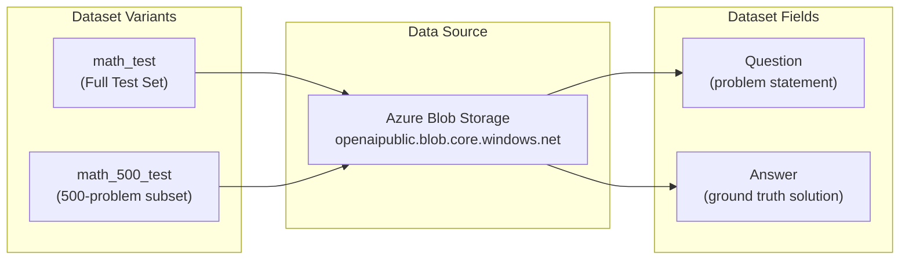
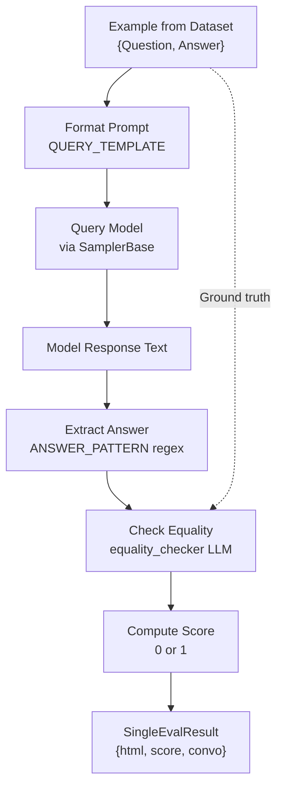
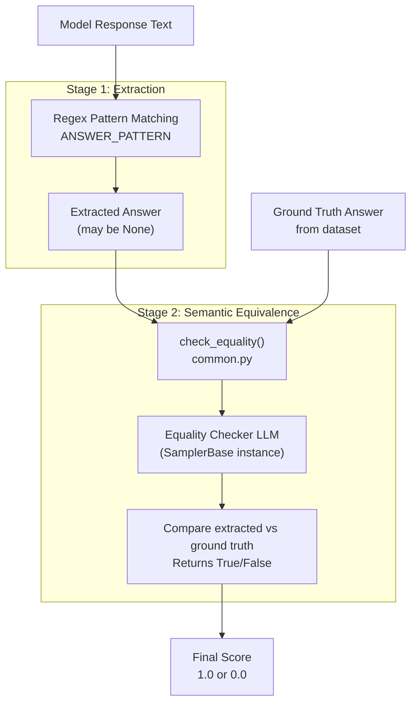
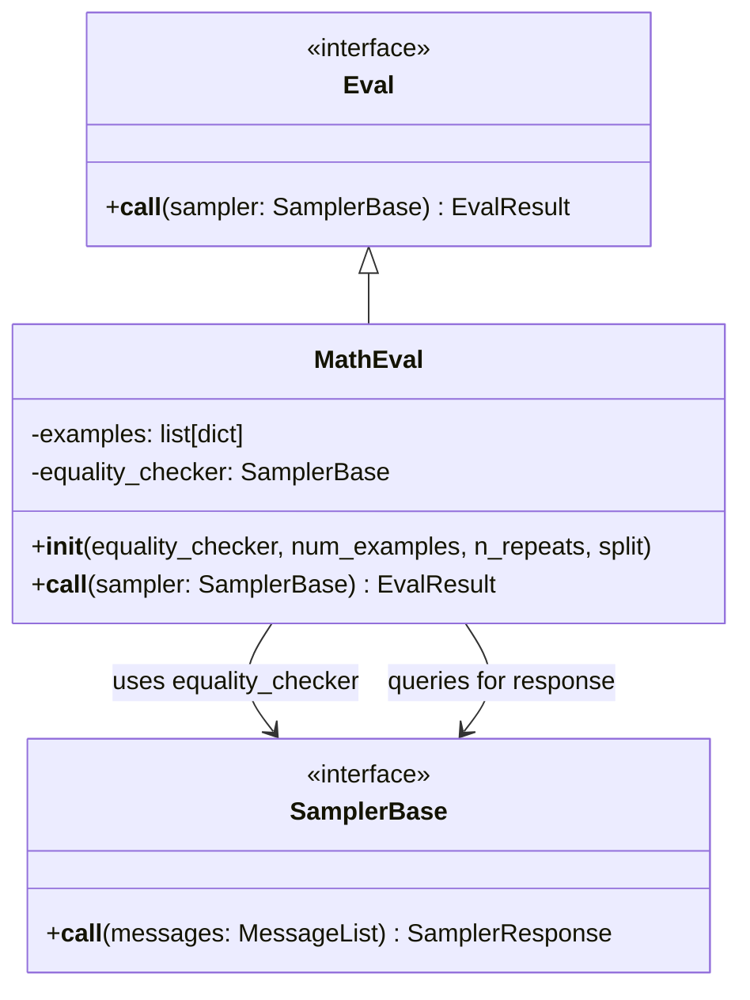
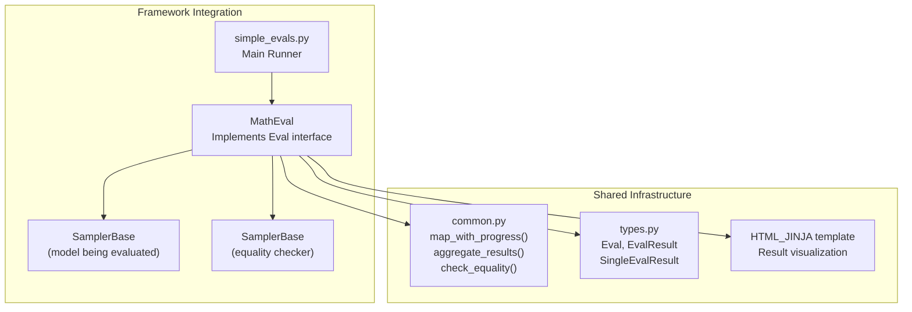

<!-- source: DeepWiki mcp.deepwiki.com · repo openai/simple-evals · extra page MATH Benchmark · fetched 2026-10-26 -->

# MATH Benchmark

<details>
<summary>Relevant source files</summary>

The following files were used as context for generating this wiki page:

- [math_eval.py](math_eval.py)

</details>


## Purpose and Scope

This page documents the MATH benchmark implementation for evaluating mathematical problem solving capabilities of language models. MATH tests models on challenging mathematics problems spanning topics from algebra to number theory. For multilingual grade school mathematics, see [MGSM: Multilingual Grade School Math](#4.3.2). For general mathematical reasoning evaluation approaches, see [Mathematical Reasoning Benchmarks](#4.3).

The MATH benchmark is a frozen component (no new models after July 2025) but remains available as a reference implementation for mathematical reasoning evaluation.

**Sources:** [math_eval.py:1-6]()

## Overview

The MATH benchmark evaluates models on mathematical problem solving using the dataset from "Measuring Mathematical Problem Solving With the MATH Dataset" (Hendrycks et al., 2021). Unlike simpler mathematical benchmarks, MATH requires multi-step reasoning and covers advanced topics including algebra, calculus, geometry, number theory, and probability.

### Key Characteristics

| Characteristic | Description |
|---------------|-------------|
| **Task Type** | Free-form mathematical problem solving |
| **Grading Strategy** | Hybrid: Regex extraction + LLM-based semantic equivalence |
| **Dataset Variants** | `math_test` (full test set), `math_500_test` (500-problem subset) |
| **Answer Format** | Text-based final answer (not multiple choice) |
| **Evaluation Metric** | Accuracy (0 or 1 per problem) |

The distinguishing feature of MATH evaluation is its two-stage grading approach: answers are first extracted using regex patterns, then an LLM equality checker determines if the extracted answer is semantically equivalent to the ground truth. This handles cases where mathematically equivalent expressions may be formatted differently (e.g., "1/2" vs "0.5").

**Sources:** [math_eval.py:1-15]()

## Dataset Structure and Variants

MATH provides two dataset variants hosted on Azure blob storage:



**Dataset Variants:**

- **`math_test`**: The complete MATH test set, containing the full range of problems across all difficulty levels and topics
- **`math_500_test`**: A 500-problem subset designed for evaluating newer models more efficiently while maintaining coverage across problem types

Both variants are CSV files with the same structure:
- `Question`: The problem statement
- `Answer`: The ground truth answer

The dataset is loaded directly from the URL at evaluation time without requiring local storage.

**Sources:** [math_eval.py:34-42]()

## Evaluation Pipeline

The MATH evaluation follows a multi-stage pipeline that combines deterministic answer extraction with LLM-based semantic equivalence checking:



**Pipeline Stages:**

1. **Prompt Formatting**: The question is inserted into `QUERY_TEMPLATE` with instructions for step-by-step solving
2. **Model Querying**: The formatted prompt is sent to the model via the sampler interface
3. **Answer Extraction**: A regex pattern (`ANSWER_PATTERN`) extracts the final answer from "Answer: ..." line
4. **Semantic Equivalence**: The `equality_checker` LLM determines if the extracted answer equals the ground truth
5. **Scoring**: Binary score (1.0 if equivalent, 0.0 otherwise)
6. **Result Packaging**: Creates `SingleEvalResult` with HTML visualization, score, and conversation history

**Sources:** [math_eval.py:45-67]()

## Prompt Format

MATH uses a structured prompt template that instructs models to provide step-by-step solutions followed by a final answer in a specific format:

```
Solve the following math problem step by step. The last line of your response should be of the form Answer: $ANSWER (without quotes) where $ANSWER is the answer to the problem.

{Question}

Remember to put your answer on its own line after "Answer:", and you do not need to use a \boxed command.
```

**Design Rationale:**

- **Step-by-step requirement**: Encourages chain-of-thought reasoning, improving model performance on complex problems
- **Structured output format**: The "Answer: ..." format enables reliable regex-based extraction
- **No `\boxed` command**: Simplifies extraction by avoiding LaTeX formatting conventions commonly used in math competitions
- **Final line emphasis**: Repeated instruction ensures models follow the format even after lengthy reasoning chains

The template is applied to each example using Python string formatting: `QUERY_TEMPLATE.format(**row)` where `row` contains the `Question` field.

**Sources:** [math_eval.py:17-23]()

## Answer Extraction and Grading

MATH employs a two-stage grading methodology that distinguishes it from purely regex-based benchmarks:



### Stage 1: Regex Extraction

The system searches for answers using the `ANSWER_PATTERN` from `common.py`:

```python
match = re.search(ANSWER_PATTERN, response_text)
extracted_answer = match.group(1) if match else None
```

If no match is found, `extracted_answer` is `None`, which will fail the equality check.

### Stage 2: LLM-Based Equality Checking

The `check_equality()` function uses a separate LLM (the `equality_checker` sampler) to determine semantic equivalence:

```python
score = float(check_equality(self.equality_checker, row["Answer"], extracted_answer))
```

**Why LLM-Based Equality?**

Mathematical answers can be expressed in many equivalent forms:
- Fractions: "1/2" vs "2/4" vs "0.5"
- Algebraic expressions: "x^2 - 1" vs "(x-1)(x+1)"
- Geometric answers: "90 degrees" vs "π/2 radians"
- Simplification: "√4" vs "2"

A deterministic string comparison would fail on these variations. The LLM equality checker evaluates mathematical equivalence, providing robustness to formatting differences while maintaining correctness.

**Trade-offs:**

| Aspect | Benefit | Cost |
|--------|---------|------|
| **Robustness** | Accepts any mathematically correct form | Additional LLM API calls |
| **Accuracy** | Fewer false negatives on correct answers | Dependency on grader quality |
| **Flexibility** | Handles diverse mathematical notation | Slower evaluation time |

**Sources:** [math_eval.py:53-55](), [common.py (referenced)]()

## Implementation Details

The `MathEval` class implements the `Eval` interface from the type system:



### Class Structure

**`MathEval` Class** [math_eval.py:26-67]()

**Constructor Parameters:**
- `equality_checker: SamplerBase` - LLM sampler used for semantic equivalence checking (required)
- `num_examples: int | None` - Number of examples to sample (default: None = use all)
- `n_repeats: int` - Number of times to repeat each example (default: 16)
- `split: Literal["math_test", "math_500_test"]` - Dataset variant to use (default: "math_test")

**Instance Variables:**
- `self.examples: list[dict]` - List of problem dictionaries, potentially repeated `n_repeats` times
- `self.equality_checker: SamplerBase` - Stored equality checker for grading

### Evaluation Execution

The `__call__` method implements the evaluation loop:

1. **Map Function Definition** [math_eval.py:46-64](): Defines `fn(row)` that processes each example
2. **Parallel Execution** [math_eval.py:66](): Uses `common.map_with_progress()` for progress tracking
3. **Result Aggregation** [math_eval.py:67](): Aggregates individual results with `common.aggregate_results()`

**Sources:** [math_eval.py:26-67]()

## Configuration Options

### Example Sampling

```python
# Use all examples with 16 repeats (default)
MathEval(equality_checker=checker)

# Sample 100 examples, no repeats
MathEval(equality_checker=checker, num_examples=100, n_repeats=1)
```

**Constraint:** When `num_examples` is specified, `n_repeats` must be 1. This prevents accidental creation of massive evaluation sets.

### Dataset Variant Selection

```python
# Full test set (default)
MathEval(equality_checker=checker, split="math_test")

# 500-problem subset for faster evaluation
MathEval(equality_checker=checker, split="math_500_test")
```

The `math_500_test` variant is recommended for:
- Rapid prototyping and iteration
- Evaluating new models where full coverage is not yet needed
- Resource-constrained environments where API costs matter

### Repeat Strategy

The `n_repeats` parameter enables statistical robustness:

```python
# Default: 16 repeats for comprehensive statistics
examples = examples * n_repeats  # List multiplication
```

Repeating examples allows computation of:
- Variance in model performance
- Bootstrap confidence intervals
- Identification of inconsistent problem-solving behavior

**Note:** Repeats are only supported when using the full dataset (`num_examples=None`).

**Sources:** [math_eval.py:27-43]()

## Integration with Evaluation Framework

MATH integrates with the broader simple-evals framework through standard interfaces:



**Key Integration Points:**

1. **Type System**: Implements `Eval` protocol, returns `EvalResult`, produces `SingleEvalResult` per example
2. **Common Utilities**: 
   - `map_with_progress()` for parallel execution with progress bars
   - `aggregate_results()` for computing statistics
   - `check_equality()` for LLM-based answer comparison
   - `HTML_JINJA` for rendering evaluation results
3. **Sampler Abstraction**: Works with any `SamplerBase` implementation (ChatCompletionSampler, ResponsesSampler, etc.)

### Unique Requirement

Unlike most other benchmarks, MATH requires **two samplers**:
- One for the model being evaluated (`sampler` parameter to `__call__`)
- One for the equality checker (`equality_checker` parameter to `__init__`)

This allows using a more capable model (e.g., gpt-4) as the equality checker while evaluating a weaker model.

**Sources:** [math_eval.py:13-15](), [math_eval.py:45-67]()

---

