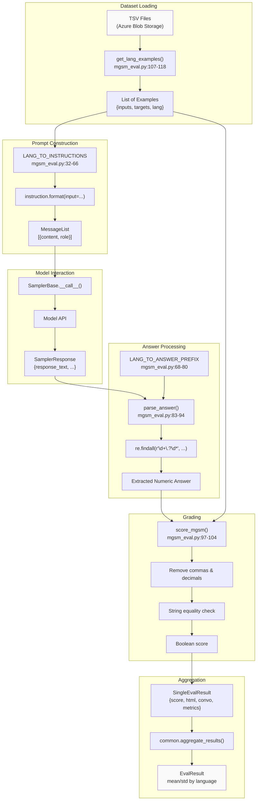
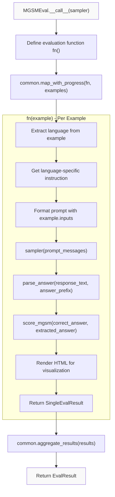
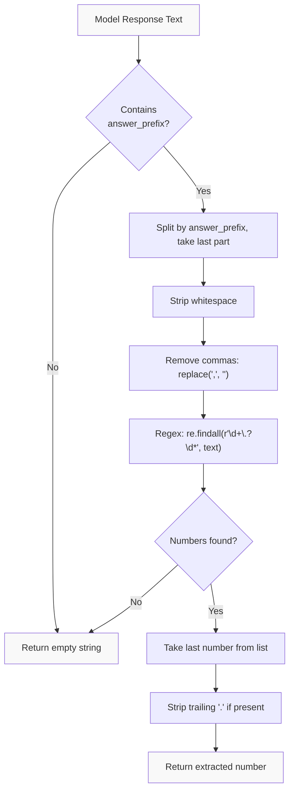
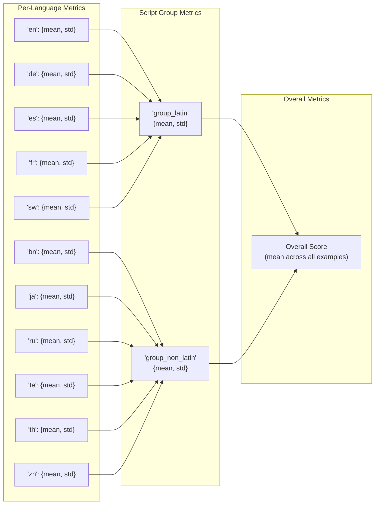

<!-- source: DeepWiki mcp.deepwiki.com · repo openai/simple-evals · extra page MGSM: Multilingual Grade School Math · fetched 2026-10-26 -->

# MGSM: Multilingual Grade School Math

<details>
<summary>Relevant source files</summary>

The following files were used as context for generating this wiki page:

- [mgsm_eval.py](mgsm_eval.py)

</details>


## Purpose and Scope

This document describes the **MGSM (Multilingual Grade School Math)** benchmark implementation in simple-evals. MGSM evaluates language models on grade-school level math problems across 11 languages, testing both mathematical reasoning and multilingual capabilities.

MGSM is a **frozen benchmark** as of July 2025 and is no longer actively maintained. For information about other mathematical reasoning evaluations, see [MATH Benchmark](#4.3.1). For multilingual evaluation capabilities more broadly, see [Multilingual Evaluation](#5).

This page covers:
- Dataset structure and language coverage
- Language-specific prompt templates and answer extraction
- Numeric answer grading methodology
- Result aggregation by language and script group

**Sources:** [mgsm_eval.py:1-7]()

---

## Benchmark Overview

MGSM (Multilingual Grade School Math) is a benchmark of grade-school math problems translated across multiple languages. It originates from the paper "Language Models are Multilingual Chain-of-Thought Reasoners" by Shi et al. (2022).

The benchmark evaluates models on their ability to:
1. Understand math problems in different languages
2. Perform multi-step arithmetic reasoning
3. Express answers in the expected format with language-specific prefixes

Unlike MATH benchmark which uses LLM-based equality checking, MGSM uses **simple numeric comparison** for grading, making it a self-grading benchmark with deterministic scoring.

**Key characteristics:**
- **250 problems per language** (total of 2,750 problems across all languages)
- **11 supported languages** spanning Latin and non-Latin scripts
- **Integer-only answers** (no decimals in ground truth)
- **Chain-of-thought prompting** encouraged in instructions
- **Self-grading** via exact numeric match

**Sources:** [mgsm_eval.py:1-7](), [mgsm_eval.py:15-31]()

---

## Supported Languages and Dataset Structure

### Language Coverage

MGSM supports 11 languages divided into two script groups:

| Language Code | Language | Script Group | File URL |
|--------------|----------|--------------|----------|
| `bn` | Bengali | Non-Latin | `mgsm_bn.tsv` |
| `de` | German | Latin | `mgsm_de.tsv` |
| `en` | English | Latin | `mgsm_en.tsv` |
| `es` | Spanish | Latin | `mgsm_es.tsv` |
| `fr` | French | Latin | `mgsm_fr.tsv` |
| `ja` | Japanese | Non-Latin | `mgsm_ja.tsv` |
| `ru` | Russian | Non-Latin | `mgsm_ru.tsv` |
| `sw` | Swahili | Latin | `mgsm_sw.tsv` |
| `te` | Telugu | Non-Latin | `mgsm_te.tsv` |
| `th` | Thai | Non-Latin | `mgsm_th.tsv` |
| `zh` | Chinese | Non-Latin | `mgsm_zh.tsv` |

**Sources:** [mgsm_eval.py:15-31]()

### Language Grouping

The implementation defines two script-based groups for aggregated metrics:

```python
LATIN_LANGUAGES = ["de", "en", "es", "fr", "sw"]
NON_LATIN_LANGUAGES = ["bn", "ja", "ru", "te", "th", "zh"]
```

These groups enable comparison of model performance across script types.

**Sources:** [mgsm_eval.py:15-17]()

### Dataset Format

Each language's dataset is stored as a TSV (tab-separated values) file hosted on Azure blob storage. The format is:

```
[problem_text]\t[numeric_answer]
```

Example structure:
- **Column 1:** Math problem text in the target language
- **Column 2:** Integer answer (may include commas as thousands separators)

The `get_lang_examples()` function loads and parses these files:

**Sources:** [mgsm_eval.py:107-118]()

---

## MGSM Evaluation Data Flow



**Sources:** [mgsm_eval.py:83-193]()

---

## MGSMEval Class Structure

The `MGSMEval` class implements the `Eval` interface and orchestrates the evaluation pipeline.

### Class Initialization

```python
class MGSMEval(Eval):
    def __init__(
        self,
        num_examples_per_lang: int = 250,
        languages: Optional[list[str]] = ALL_LANGUAGES,
    ):
```

**Constructor parameters:**
- `num_examples_per_lang`: Number of examples to evaluate per language (default 250, full dataset)
- `languages`: List of language codes to evaluate (default: all 11 languages)

The constructor validates language codes and loads examples for selected languages.

**Sources:** [mgsm_eval.py:130-152]()

### Evaluation Method

The `__call__()` method implements the main evaluation loop:



**Sources:** [mgsm_eval.py:154-192]()

---

## Language-Specific Prompt Templates

Each language has a tailored instruction template that:
1. Asks the model to solve the math problem
2. Requests reasoning steps (chain-of-thought)
3. Specifies the answer format with language-specific prefix
4. Instructs to provide only the integer answer after the prefix

### Template Structure

All templates follow this pattern (shown for English):

```
Solve this math problem. Give the reasoning steps before giving the final answer 
on the last line by itself in the format of "Answer:". Do not add anything other 
than the integer answer after "Answer:".

{input}
```

The `{input}` placeholder is replaced with the actual math problem text.

**Sources:** [mgsm_eval.py:32-66]()

### Language-Specific Answer Prefixes

The model is expected to use a language-specific prefix before the final answer:

| Language | Answer Prefix (English) | Native Script |
|----------|------------------------|---------------|
| English | Answer | Answer |
| Bengali | Answer | উত্তর |
| German | Answer | Antwort |
| Spanish | Answer | Respuesta |
| French | Answer | Réponse |
| Japanese | Answer | 答え |
| Russian | Answer | Ответ |
| Swahili | Answer | Jibu |
| Telugu | Answer | సమాధానం |
| Thai | Answer | คำตอบ |
| Chinese | Answer | 答案 |

These prefixes are stored in `LANG_TO_ANSWER_PREFIX` and used during answer extraction.

**Sources:** [mgsm_eval.py:68-80]()

---

## Answer Extraction and Grading

### Answer Parsing Logic

The `parse_answer()` function extracts numeric answers from model responses:



**Key implementation details:**
1. **Splits on answer prefix**: Extracts text after the language-specific prefix (e.g., "Answer:", "答案:", etc.)
2. **Removes commas**: Handles thousands separators in both prediction and target
3. **Regex extraction**: Finds all numeric values using `\d+\.?\d*` pattern (integers and decimals)
4. **Takes last number**: If multiple numbers appear after the prefix, uses the last one
5. **Strips trailing decimal points**: Normalizes "42." to "42"

**Sources:** [mgsm_eval.py:83-94]()

### Grading Logic

The `score_mgsm()` function performs exact string matching after normalization:

```python
def score_mgsm(target: str, prediction: str) -> bool:
    if "." in prediction:
        prediction = prediction.rstrip("0").rstrip(".")
    
    target = target.replace(",", "")
    prediction = prediction.replace(",", "")
    
    return target == prediction
```

**Normalization steps:**
1. **Remove trailing zeros after decimal**: "42.00" → "42."
2. **Remove trailing decimal point**: "42." → "42"
3. **Remove commas**: "1,000" → "1000"
4. **Exact string comparison**: No semantic equivalence checking

This approach is simpler than MATH benchmark's LLM-based equality checking because MGSM ground truth values are always integers.

**Sources:** [mgsm_eval.py:97-104]()

---

## Result Metrics and Aggregation

### Per-Example Metrics

Each example produces a `SingleEvalResult` with:

```python
SingleEvalResult(
    html=html,                    # Rendered visualization
    score=score,                  # Boolean: 0 or 1
    convo=convo,                  # Full conversation history
    metrics={
        language: score,          # e.g., "en": 1, "zh": 0
        latin_group: score        # "group_latin" or "group_non_latin"
    }
)
```

**Sources:** [mgsm_eval.py:184-189]()

### Aggregated Metrics

The `common.aggregate_results()` function computes statistics across examples:



**Computed statistics:**
- **Per-language accuracy**: Mean score for each individual language
- **Script group accuracy**: Mean score for Latin vs. Non-Latin scripts
- **Overall accuracy**: Mean score across all examples
- **Standard deviations**: For all above metrics

This multi-level aggregation enables analysis of:
- Which languages are easier or harder for the model
- Whether script type (Latin vs. Non-Latin) affects performance
- Overall multilingual math reasoning capability

**Sources:** [mgsm_eval.py:191-192](), [mgsm_eval.py:157-158](), [mgsm_eval.py:188]()

---

## Implementation Details

### Dataset Loading

The `get_lang_examples()` function loads TSV files from Azure blob storage:

**Process:**
1. Uses `common.url_to_fileobj()` to stream the remote TSV file
2. Decodes UTF-8 encoded lines
3. Splits each line on tab character to extract problem and answer
4. Validates that targets contain no decimal points
5. Constructs example dictionaries with `inputs`, `targets`, and `lang` keys

**Sources:** [mgsm_eval.py:107-118]()

### Error Handling

The evaluation function includes exception handling for model API failures:

```python
try:
    sampler_response = sampler(prompt_messages)
    response_text = sampler_response.response_text
    actual_queried_prompt_messages = sampler_response.actual_queried_message_list
except Exception as e:
    response_text = ""
```

When sampling fails, an empty response is recorded, resulting in a score of 0 for that example.

**Sources:** [mgsm_eval.py:165-170]()

### HTML Visualization

The evaluation generates HTML reports using the same Jinja template as MMLU:

```python
html = common.jinja_env.from_string(HTML_JINJA).render(
    prompt_messages=actual_queried_prompt_messages,
    next_message=dict(content=response_text, role="assistant"),
    score=score,
    correct_answer=correct_answer,
    extracted_answer=extracted_answer or None,
)
```

The HTML includes:
- Original prompt (problem statement)
- Model's full response (including reasoning)
- Extracted answer
- Correct answer
- Score indicator

**Sources:** [mgsm_eval.py:176-182](), [mgsm_eval.py:12]()

---

## Usage Example

### Running MGSM Evaluation

From the command line:

```bash
# Evaluate all languages (default)
python simple_evals.py --model gpt-4 --eval mgsm

# Evaluate specific languages
python simple_evals.py --model gpt-4 --eval mgsm --languages en,es,zh

# Limit examples per language for quick testing
python simple_evals.py --model gpt-4 --eval mgsm --examples 50
```

### Programmatic Usage

```python
from mgsm_eval import MGSMEval
from sampler.chat_completion_sampler import ChatCompletionSampler

# Initialize evaluation with subset of languages
eval = MGSMEval(
    num_examples_per_lang=100,
    languages=["en", "es", "zh"]  # English, Spanish, Chinese only
)

# Create sampler
sampler = ChatCompletionSampler(model="gpt-4")

# Run evaluation
result = eval(sampler)

# Access results
print(f"Overall accuracy: {result.score:.2%}")
print(f"English accuracy: {result.metrics['en']['mean']:.2%}")
print(f"Spanish accuracy: {result.metrics['es']['mean']:.2%}")
print(f"Chinese accuracy: {result.metrics['zh']['mean']:.2%}")
```

**Sources:** [mgsm_eval.py:130-192]()

---

## Limitations and Considerations

### Integer-Only Answers
MGSM only contains problems with integer answers. The dataset validation explicitly checks for decimal points in targets and raises an error if found. This limits the types of math problems that can be included.

**Sources:** [mgsm_eval.py:114-115]()

### Exact String Matching
Unlike MATH benchmark which uses LLM-based semantic equivalence, MGSM uses exact string matching after normalization. This means:
- Equivalent forms like "1000" vs "1,000" are handled by comma removal
- Different representations (e.g., "1e3" vs "1000") would be marked incorrect
- No tolerance for minor formatting variations

**Sources:** [mgsm_eval.py:97-104]()

### Language-Specific Challenges
The answer extraction relies on the model using the correct language-specific answer prefix. Models that:
- Use the wrong language's prefix
- Translate the prefix to English
- Omit the prefix entirely

...will have their answers fail extraction, resulting in score of 0 even if the numeric value is correct.

**Sources:** [mgsm_eval.py:83-94](), [mgsm_eval.py:172-173]()

### Fixed Dataset Size
Each language has exactly 250 problems. The full evaluation requires 2,750 model queries (250 × 11 languages), which can be expensive for large models.

**Sources:** [mgsm_eval.py:133]()

---

## Related Components

- **Sampler abstraction**: See [Model Samplers](#3.2) for details on how different model APIs are accessed
- **Result aggregation**: See [Common Utilities and Result Aggregation](#3.4) for details on metrics computation
- **Type definitions**: See [Type System and Interfaces](#3.1) for `Eval`, `EvalResult`, and `SingleEvalResult` specifications
- **Multilingual capabilities**: See [Multilingual Evaluation](#5) for broader discussion of multilingual benchmarks

**Sources:** [mgsm_eval.py:1-193]()

---

