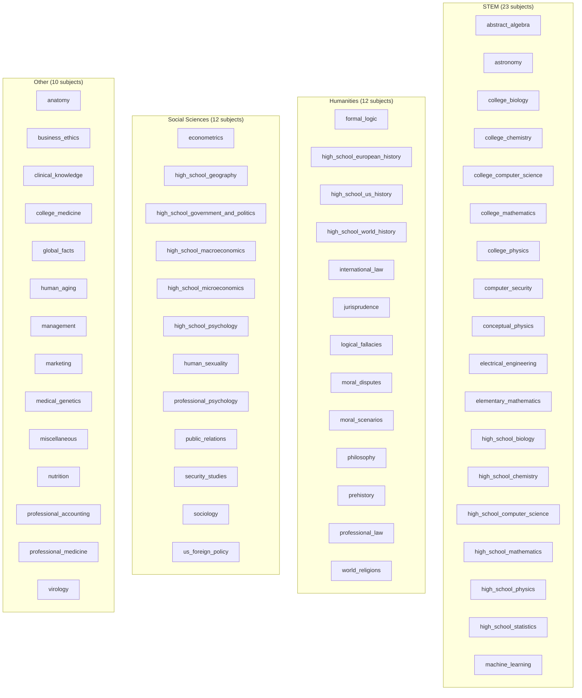
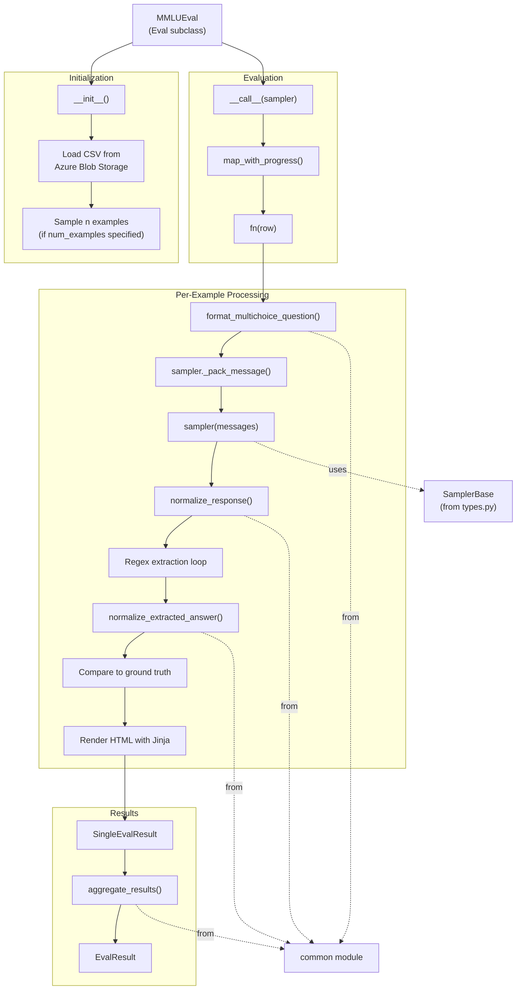
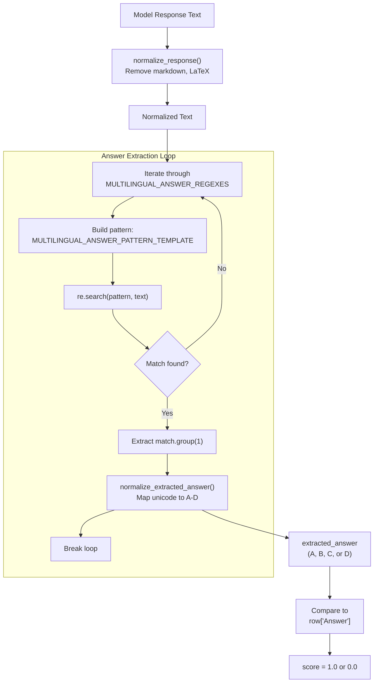
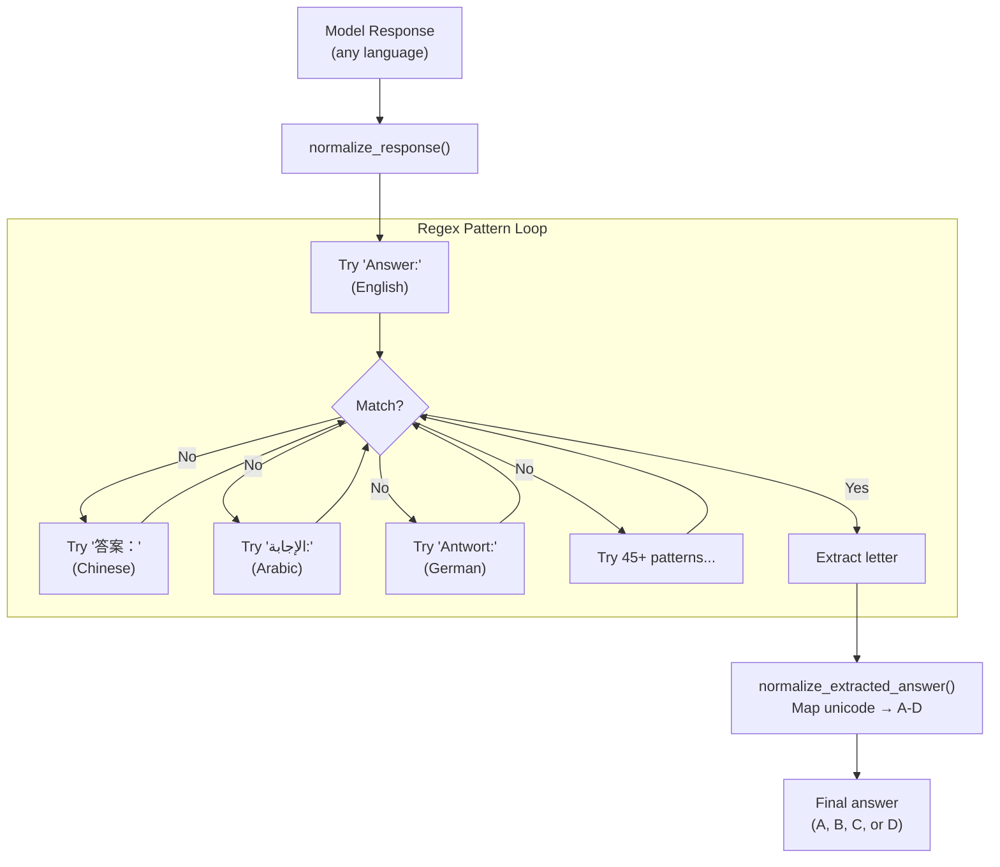
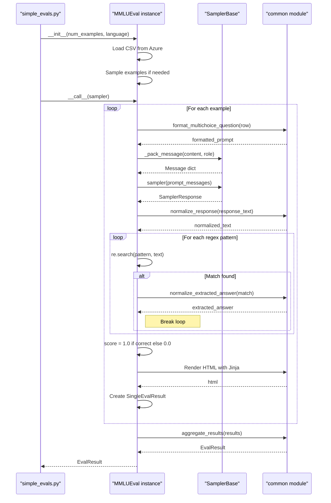

<!-- source: DeepWiki mcp.deepwiki.com · repo openai/simple-evals · extra page MMLU: Massive Multitask Language Understanding · fetched 2026-10-26 -->

# MMLU: Massive Multitask Language Understanding

<details>
<summary>Relevant source files</summary>

The following files were used as context for generating this wiki page:

- [common.py](common.py)
- [mmlu_eval.py](mmlu_eval.py)

</details>


**Purpose**: This document describes the implementation of the MMLU (Massive Multitask Language Understanding) benchmark in simple-evals, which evaluates language models on multiple-choice questions spanning 57 academic subjects. This page covers dataset structure, subject categorization, prompt formatting, regex-based answer extraction, and multilingual evaluation support.

**Scope**: This document focuses on the `MMLUEval` class implementation. For multilingual evaluation runners, see [Multilingual Evaluation](#5). For other language understanding benchmarks, see [GPQA](#4.2.2).

---

## Overview

The MMLU benchmark evaluates language models on their ability to answer multiple-choice questions across diverse academic disciplines. The implementation in simple-evals provides:

- **57 academic subjects** organized into 4 categories
- **Multiple-choice format** with 4 options (A, B, C, D)
- **Self-grading** using regex-based answer extraction
- **Multilingual support** with human translations for 14 languages
- **Deterministic scoring** without requiring additional LLM grading

The benchmark is implemented in the `MMLUEval` class, which follows the standard `Eval` interface defined in `types.py`.

**Sources**: [mmlu_eval.py:1-130]()

---

## Dataset Structure and Subject Categories

### Data Loading

The MMLU dataset is loaded from Azure Blob Storage as a CSV file. For English evaluations, the dataset is fetched from:
```
https://openaipublic.blob.core.windows.net/simple-evals/mmlu.csv
```

For other languages, the URL pattern is:
```
https://openaipublic.blob.core.windows.net/simple-evals/mmlu_{language}.csv
```

Each row in the CSV contains:
- `Question`: The question text
- `A`, `B`, `C`, `D`: The four answer options
- `Answer`: The correct answer letter (A, B, C, or D)
- `Subject`: The academic subject (e.g., "abstract_algebra", "college_chemistry")

**Sources**: [mmlu_eval.py:85-94]()

### Subject Categorization

MMLU organizes 57 academic subjects into 4 high-level categories for metric aggregation:



The mapping is defined in the `subject2category` dictionary, which returns category scores for result aggregation.

**Sources**: [mmlu_eval.py:23-81]()

---

## Implementation Architecture

### Class Structure



**Sources**: [mmlu_eval.py:84-130](), [common.py:153-409]()

---

## Question Formatting and Prompting

### Multiple Choice Template

Questions are formatted using the `QUERY_TEMPLATE_MULTICHOICE` template from `common.py`:

```
Answer the following multiple choice question. The last line of your response 
should be of the following format: 'Answer: $LETTER' (without quotes) where 
LETTER is one of ABCD. Think step by step before answering.

{Question}

A) {A}
B) {B}
C) {C}
D) {D}
```

This template:
1. Instructs the model to use a specific answer format
2. Encourages step-by-step reasoning
3. Presents all four options with clear labels

**Sources**: [common.py:15-24]()

### Prompt Construction Flow

```mermaid
flowchart LR
    Row["CSV Row<br/>Question, A, B, C, D"]
    Format["format_multichoice_question()<br/>common.py:153"]
    FormattedPrompt["Formatted String<br/>with template"]
    PackMessage["sampler._pack_message()<br/>role='user'"]
    MessageList["List[Message]<br/>prompt_messages"]
    Sampler["sampler(prompt_messages)"]
    Response["SamplerResponse<br/>response_text"]
    
    Row --> Format
    Format --> FormattedPrompt
    FormattedPrompt --> PackMessage
    PackMessage --> MessageList
    MessageList --> Sampler
    Sampler --> Response
```



The `_pack_message` method on the sampler handles model-specific message formatting (system prompts, message structure, etc.).

**Sources**: [mmlu_eval.py:98-103](), [common.py:153-154]()

---

## Answer Extraction and Grading

### Extraction Pipeline

MMLU uses a deterministic, regex-based approach to extract answers from model responses:



**Sources**: [mmlu_eval.py:106-114](), [common.py:355-396]()

### Response Normalization

The `normalize_response()` function removes formatting that could interfere with pattern matching:

| Removed Pattern | Purpose |
|----------------|---------|
| `**` | Markdown bold |
| `$\boxed{`, `}$` | LaTeX boxed answers |
| `\$`, `$` | LaTeX delimiters |
| `$\text{`, `\mathrm{`, `\mathbf{` | LaTeX text formatting |
| `\(`, `\{`, `\boxed` | LaTeX structural elements |
| `{` | Generic braces |

**Sources**: [common.py:355-374]()

### Extracted Answer Normalization

The `normalize_extracted_answer()` function handles unicode characters used in multilingual MMLU:

| Unicode Character | Language | Maps To |
|------------------|----------|---------|
| `أ`, `ب`, `ج`, `د` | Arabic | A, B, C, D |
| `অ`, `ব`, `ড`, `ঢ` | Bengali | A, B, C, D |
| `Ａ`, `Ｂ`, `Ｃ`, `Ｄ` | Japanese (fullwidth) | A, B, C, D |

**Sources**: [common.py:377-395]()

### Answer Regex Patterns

The primary English pattern is:
```python
ANSWER_PATTERN_MULTICHOICE = r"(?i)Answer[ \t]*:[ \t]*\$?([A-D])\$?"
```

For multilingual support, 45+ language-specific answer patterns are defined in `MULTILINGUAL_ANSWER_REGEXES`, including:
- English: `"Answer\s*:"`
- Arabic: `"الإجابة:"`, `"الجواب:"`
- Chinese: `"答案\s*："`, `"答\s*："`
- German: `"Antwort\s*:"`
- Korean: `"답변\s*:"`, `"정답\s*:"`
- Spanish: `"Respuesta\s*:"`
- And many more...

**Sources**: [common.py:26-75]()

---

## Multilingual Support

### Language Selection

The `MMLUEval` constructor accepts a `language` parameter that determines which dataset to load:

```python
def __init__(self, num_examples: int | None = None, language: str = "EN-US"):
    if language != "EN-US":
        url = f"https://openaipublic.blob.core.windows.net/simple-evals/mmlu_{language}.csv"
    else:
        url = "https://openaipublic.blob.core.windows.net/simple-evals/mmlu.csv"
```

Supported languages are loaded as human-translated datasets, not machine-translated versions. The implementation uses the same answer extraction logic across all languages via the multilingual regex patterns.

**Sources**: [mmlu_eval.py:85-90]()

### Multilingual Answer Detection



This approach allows models to respond in any language while still extracting answers consistently.

**Sources**: [mmlu_eval.py:108-113](), [common.py:28-75]()

---

## Evaluation Flow

### Complete Execution Path



**Sources**: [mmlu_eval.py:96-129]()

---

## Result Aggregation and Metrics

### Per-Example Results

Each question produces a `SingleEvalResult` containing:

| Field | Description |
|-------|-------------|
| `html` | Rendered HTML showing prompt, response, extracted answer, correct answer, and score |
| `score` | Binary score (1.0 for correct, 0.0 for incorrect) |
| `metrics` | Dictionary with category score: `{category: score}` |
| `convo` | Full conversation history including prompt and response |

The `category` is determined by the `subject2category` mapping, enabling per-category accuracy computation.

**Sources**: [mmlu_eval.py:123-126]()

### Aggregated Metrics

The `aggregate_results()` function computes statistics across all examples:

| Metric | Description |
|--------|-------------|
| `score` | Overall accuracy (mean of all binary scores) |
| `stem` | Accuracy on STEM subjects |
| `humanities` | Accuracy on humanities subjects |
| `social_sciences` | Accuracy on social sciences subjects |
| `other` | Accuracy on other subjects |

Additional statistics (std, min, max, bootstrap_std) can be computed for each metric.

**Sources**: [common.py:183-216](), [mmlu_eval.py:129]()

---

## Code Entity Reference

### Key Classes and Functions

| Entity | Location | Purpose |
|--------|----------|---------|
| `MMLUEval` | [mmlu_eval.py:84-130]() | Main evaluation class |
| `subject2category` | [mmlu_eval.py:23-81]() | Subject to category mapping |
| `format_multichoice_question` | [common.py:153-154]() | Format question with template |
| `QUERY_TEMPLATE_MULTICHOICE` | [common.py:15-24]() | Multiple choice prompt template |
| `ANSWER_PATTERN_MULTICHOICE` | [common.py:26]() | English answer extraction regex |
| `MULTILINGUAL_ANSWER_REGEXES` | [common.py:32-75]() | 45+ multilingual answer patterns |
| `MULTILINGUAL_ANSWER_PATTERN_TEMPLATE` | [common.py:28-30]() | Template for building regex patterns |
| `normalize_response` | [common.py:355-374]() | Remove markdown/LaTeX formatting |
| `normalize_extracted_answer` | [common.py:377-395]() | Map unicode letters to A-D |
| `aggregate_results` | [common.py:183-216]() | Compute statistics across examples |

**Sources**: [mmlu_eval.py:1-130](), [common.py:1-409]()

---

## Usage Example

From the command line:

```bash
# Evaluate on full MMLU dataset (English)
python simple_evals.py --model gpt-4 --eval mmlu

# Evaluate on 100 random examples
python simple_evals.py --model gpt-4 --eval mmlu --examples 100

# Evaluate on German MMLU
python run_multilingual_mmlu.py --model gpt-4 --language DE
```

From code:

```python
from mmlu_eval import MMLUEval
from sampler.chat_completion_sampler import ChatCompletionSampler

# Initialize evaluation
mmlu = MMLUEval(num_examples=100, language="EN-US")

# Create sampler
sampler = ChatCompletionSampler(model="gpt-4")

# Run evaluation
result = mmlu(sampler)

print(f"Overall Accuracy: {result.score}")
print(f"STEM Accuracy: {result.metrics['stem']}")
print(f"Humanities Accuracy: {result.metrics['humanities']}")
```

**Sources**: [mmlu_eval.py:84-130]()

---

