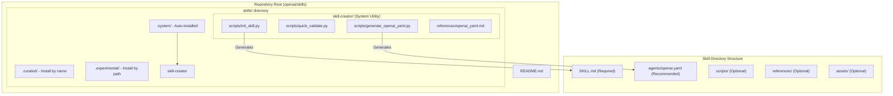
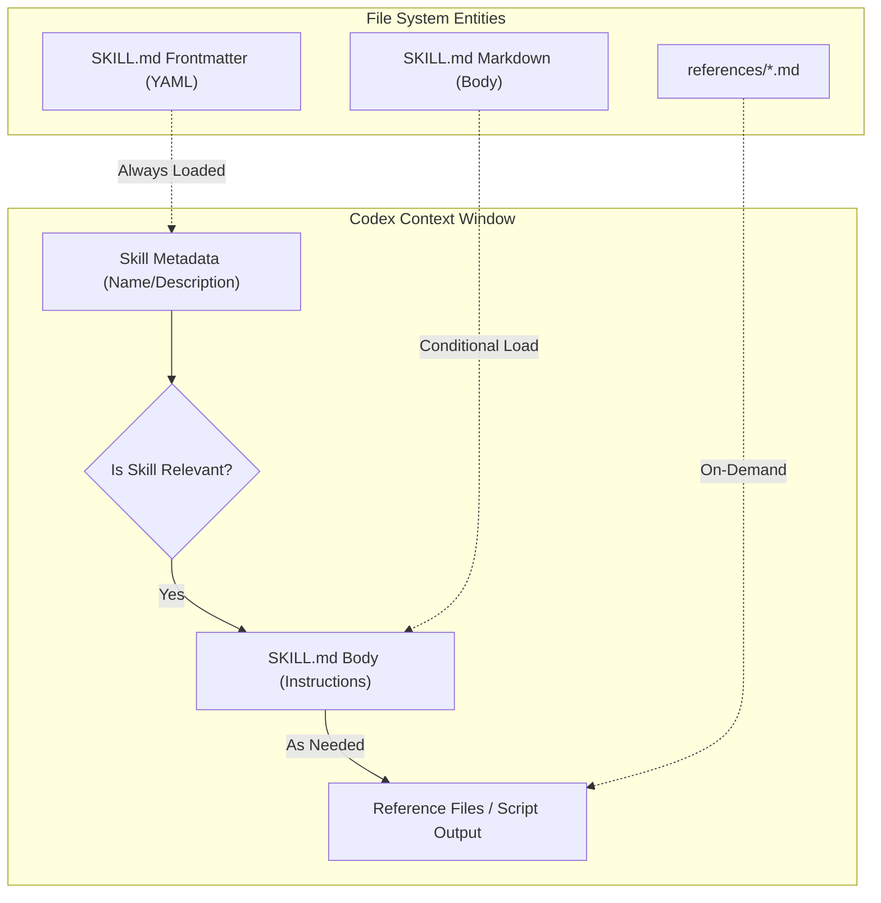

<!-- source: DeepWiki mcp.deepwiki.com · repo openai/skills · page 1 Overview · fetched 2026-10-30 -->

# Overview

Relevant source files

The following files were used as context for generating this wiki page:

- [.gitignore](.gitignore)
- [README.md](README.md)
- [skills/.system/skill-creator/SKILL.md](skills/.system/skill-creator/SKILL.md)
- [skills/.system/skill-creator/references/openai_yaml.md](skills/.system/skill-creator/references/openai_yaml.md)
- [skills/.system/skill-creator/scripts/generate_openai_yaml.py](skills/.system/skill-creator/scripts/generate_openai_yaml.py)
- [skills/.system/skill-creator/scripts/init_skill.py](skills/.system/skill-creator/scripts/init_skill.py)
- [skills/.system/skill-creator/scripts/quick_validate.py](skills/.system/skill-creator/scripts/quick_validate.py)

This document provides an introduction to the Agent Skills repository, explaining its purpose as a system for packaging and distributing AI agent capabilities. It covers the high-level architecture, repository organization, and the three-tier skill organization system (`.system`, `.curated`, `.experimental`).

## What are Agent Skills?

Agent Skills are folders of instructions, scripts, and resources that AI agents can discover and use to perform specific tasks [README.md:3-3](). Each skill packages a reusable capability following a "write once, use everywhere" philosophy [README.md:3-3]().

The Codex platform uses skills to package capabilities that teams and individuals can use to complete specific tasks in a repeatable way [README.md:5-5](). Skills provide:

- **Specialized Workflows**: Multi-step procedures for specific domains [skills/.system/skill-creator/SKILL.md:21-21]().
- **Tool Integrations**: Instructions for working with specific APIs or file formats [skills/.system/skill-creator/SKILL.md:22-22]().
- **Bundled Resources**: Executable scripts, reference documentation, and assets (templates/icons) [skills/.system/skill-creator/SKILL.md:61-64]().
- **Standardized Metadata**: YAML frontmatter in `SKILL.md` and UI-facing metadata in `agents/openai.yaml` [skills/.system/skill-creator/SKILL.md:54-60]().

**Sources:** [README.md:1-10](), [skills/.system/skill-creator/SKILL.md:12-25]()

## Repository Structure

The repository is organized around a three-tier skill categorization system and provides meta-tooling for skill management.

### Skill Hierarchy and Code Entities

The following diagram maps the logical organization of the repository to the specific code entities and scripts responsible for managing them.

**Repository Mapping: Natural Language to Code Entity Space**

**Sources:** [README.md:12-36](), [skills/.system/skill-creator/SKILL.md:48-65](), [skills/.system/skill-creator/scripts/init_skill.py:1-22]()

## The Three-Tier Skill System

Skills are organized into three categories based on maturity, distribution method, and installation requirements:

| Tier | Directory | Installation Method | Characteristics |
|------|-----------|-------------------|-----------------|
| **System** | `skills/.system/` | Automatic (bundled with Codex) | Core utilities; no user action required to install [README.md:14-14](). |
| **Curated** | `skills/.curated/` | By name: `$skill-installer <name>` | Production-ready skills; vetted and indexed [README.md:18-22](). |
| **Experimental** | `skills/.experimental/` | By path/URL: `$skill-installer <path/url>` | Developmental skills; require explicit path/URL [README.md:24-34](). |

### System Skills (`.system/`)
System skills provide foundational tooling. These are automatically installed in the latest version of Codex [README.md:14-14](). A primary example is `skill-creator`, which contains the logic for initializing new skills [skills/.system/skill-creator/scripts/init_skill.py:1-6]() and validating existing ones [skills/.system/skill-creator/scripts/quick_validate.py:15-15]().

### Curated Skills (`.curated/`)
Curated skills are stable capabilities available in the `skills/.curated` directory. They can be installed simply by providing the skill name to the `$skill-installer` [README.md:18-22]().

### Experimental Skills (`.experimental/`)
Experimental skills allow for rapid iteration. Users can install them by pointing the `$skill-installer` to the `.experimental` folder path or a direct GitHub directory URL [README.md:24-34]().

**Sources:** [README.md:12-36](), [skills/.system/skill-creator/SKILL.md:1-6]()

## Progressive Disclosure Design Principle

Skills are designed to be context-efficient using a three-level loading system [skills/.system/skill-creator/SKILL.md:127-133]():

1.  **Level 1: Metadata**: Only the `name` and `description` from the `SKILL.md` frontmatter are initially loaded into the context window to allow Codex to decide if the skill is relevant [skills/.system/skill-creator/SKILL.md:71-72]().
2.  **Level 2: Skill Body**: The markdown instructions in the body of `SKILL.md` are loaded only after the skill is triggered [skills/.system/skill-creator/SKILL.md:72-72]().
3.  **Level 3: Resources**: Detailed documentation in `references/` or logic in `scripts/` are loaded or executed only as needed, preventing the context window from being overwhelmed [skills/.system/skill-creator/SKILL.md:102-104]().

**Data Flow: Skill Discovery and Loading**

**Sources:** [skills/.system/skill-creator/SKILL.md:28-35](), [skills/.system/skill-creator/SKILL.md:71-73](), [skills/.system/skill-creator/SKILL.md:127-133]()

## Key Implementation Scripts

The repository includes several Python scripts within the `skill-creator` system skill to automate lifecycle tasks:

| Script | Purpose | Key Function |
|--------|---------|--------------|
| `init_skill.py` | Scaffolds a new skill directory with templates [skills/.system/skill-creator/scripts/init_skill.py:3-6](). | `write_openai_yaml` [skills/.system/skill-creator/scripts/init_skill.py:21-21]() |
| `quick_validate.py` | Validates `SKILL.md` format, name length, and YAML keys [skills/.system/skill-creator/scripts/quick_validate.py:15-15](). | `validate_skill` [skills/.system/skill-creator/scripts/quick_validate.py:15-15]() |
| `generate_openai_yaml.py` | Generates UI metadata in `agents/openai.yaml` [skills/.system/skill-creator/scripts/generate_openai_yaml.py:3-4](). | `format_display_name` [skills/.system/skill-creator/scripts/generate_openai_yaml.py:57-57]() |

**Sources:** [skills/.system/skill-creator/scripts/init_skill.py:1-21](), [skills/.system/skill-creator/scripts/quick_validate.py:1-15](), [skills/.system/skill-creator/scripts/generate_openai_yaml.py:1-57]()

## Licensing

The license for individual skills is located within each skill's directory in a `LICENSE.txt` file [README.md:40-40](). This allows individual skills to maintain specific licensing terms while the repository serves as a general catalog.

**Sources:** [README.md:38-41]()

---

