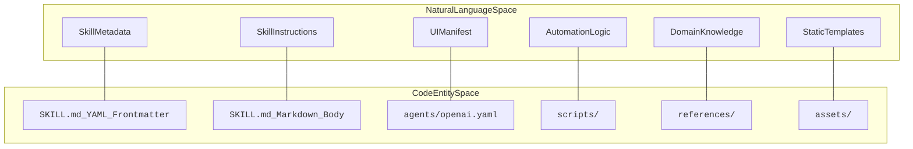
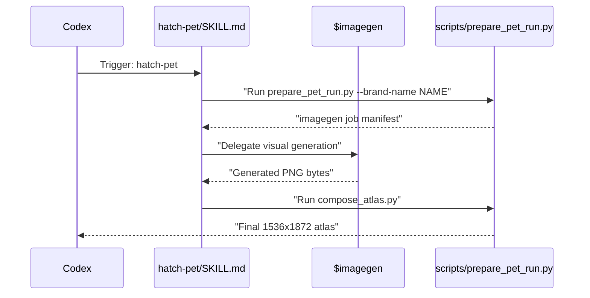

<!-- source: DeepWiki mcp.deepwiki.com · repo openai/skills · page 10 Glossary · fetched 2026-10-30 -->

# Glossary

Relevant source files

The following files were used as context for generating this wiki page:

- [.gitignore](.gitignore)
- [README.md](README.md)
- [skills/.curated/chatgpt-apps/LICENSE.txt](skills/.curated/chatgpt-apps/LICENSE.txt)
- [skills/.curated/chatgpt-apps/SKILL.md](skills/.curated/chatgpt-apps/SKILL.md)
- [skills/.curated/chatgpt-apps/agents/openai.yaml](skills/.curated/chatgpt-apps/agents/openai.yaml)
- [skills/.curated/chatgpt-apps/references/app-archetypes.md](skills/.curated/chatgpt-apps/references/app-archetypes.md)
- [skills/.curated/chatgpt-apps/references/apps-sdk-docs-workflow.md](skills/.curated/chatgpt-apps/references/apps-sdk-docs-workflow.md)
- [skills/.curated/chatgpt-apps/references/interactive-state-sync-patterns.md](skills/.curated/chatgpt-apps/references/interactive-state-sync-patterns.md)
- [skills/.curated/chatgpt-apps/references/repo-contract-and-validation.md](skills/.curated/chatgpt-apps/references/repo-contract-and-validation.md)
- [skills/.curated/chatgpt-apps/references/search-fetch-standard.md](skills/.curated/chatgpt-apps/references/search-fetch-standard.md)
- [skills/.curated/chatgpt-apps/references/upstream-example-workflow.md](skills/.curated/chatgpt-apps/references/upstream-example-workflow.md)
- [skills/.curated/chatgpt-apps/references/window-openai-patterns.md](skills/.curated/chatgpt-apps/references/window-openai-patterns.md)
- [skills/.curated/chatgpt-apps/scripts/scaffold_node_ext_apps.mjs](skills/.curated/chatgpt-apps/scripts/scaffold_node_ext_apps.mjs)
- [skills/.curated/figma-code-connect-components/SKILL.md](skills/.curated/figma-code-connect-components/SKILL.md)
- [skills/.curated/figma-create-design-system-rules/SKILL.md](skills/.curated/figma-create-design-system-rules/SKILL.md)
- [skills/.curated/figma-implement-design/SKILL.md](skills/.curated/figma-implement-design/SKILL.md)
- [skills/.curated/hatch-pet/SKILL.md](skills/.curated/hatch-pet/SKILL.md)
- [skills/.curated/hatch-pet/agents/openai.yaml](skills/.curated/hatch-pet/agents/openai.yaml)
- [skills/.curated/hatch-pet/references/animation-rows.md](skills/.curated/hatch-pet/references/animation-rows.md)
- [skills/.curated/hatch-pet/references/qa-rubric.md](skills/.curated/hatch-pet/references/qa-rubric.md)
- [skills/.curated/hatch-pet/scripts/compose_atlas.py](skills/.curated/hatch-pet/scripts/compose_atlas.py)
- [skills/.curated/hatch-pet/scripts/derive_running_left_from_running_right.py](skills/.curated/hatch-pet/scripts/derive_running_left_from_running_right.py)
- [skills/.curated/hatch-pet/scripts/extract_strip_frames.py](skills/.curated/hatch-pet/scripts/extract_strip_frames.py)
- [skills/.curated/hatch-pet/scripts/inspect_frames.py](skills/.curated/hatch-pet/scripts/inspect_frames.py)
- [skills/.curated/hatch-pet/scripts/prepare_pet_run.py](skills/.curated/hatch-pet/scripts/prepare_pet_run.py)
- [skills/.curated/migrate-to-codex/LICENSE.txt](skills/.curated/migrate-to-codex/LICENSE.txt)
- [skills/.curated/migrate-to-codex/SKILL.md](skills/.curated/migrate-to-codex/SKILL.md)
- [skills/.curated/migrate-to-codex/agents/openai.yaml](skills/.curated/migrate-to-codex/agents/openai.yaml)
- [skills/.curated/migrate-to-codex/references/differences.md](skills/.curated/migrate-to-codex/references/differences.md)
- [skills/.curated/migrate-to-codex/scripts/cli.py](skills/.curated/migrate-to-codex/scripts/cli.py)
- [skills/.curated/migrate-to-codex/scripts/migrate-to-codex.py](skills/.curated/migrate-to-codex/scripts/migrate-to-codex.py)
- [skills/.curated/migrate-to-codex/scripts/migrate/__init__.py](skills/.curated/migrate-to-codex/scripts/migrate/__init__.py)
- [skills/.curated/migrate-to-codex/scripts/migrate/agents.py](skills/.curated/migrate-to-codex/scripts/migrate/agents.py)
- [skills/.curated/migrate-to-codex/scripts/migrate/codex_config.py](skills/.curated/migrate-to-codex/scripts/migrate/codex_config.py)
- [skills/.curated/migrate-to-codex/scripts/migrate/common.py](skills/.curated/migrate-to-codex/scripts/migrate/common.py)
- [skills/.curated/migrate-to-codex/scripts/migrate/hooks.py](skills/.curated/migrate-to-codex/scripts/migrate/hooks.py)
- [skills/.curated/notion-knowledge-capture/SKILL.md](skills/.curated/notion-knowledge-capture/SKILL.md)
- [skills/.curated/notion-meeting-intelligence/SKILL.md](skills/.curated/notion-meeting-intelligence/SKILL.md)
- [skills/.curated/notion-research-documentation/SKILL.md](skills/.curated/notion-research-documentation/SKILL.md)
- [skills/.curated/notion-spec-to-implementation/SKILL.md](skills/.curated/notion-spec-to-implementation/SKILL.md)
- [skills/.system/openai-docs/SKILL.md](skills/.system/openai-docs/SKILL.md)
- [skills/.system/openai-docs/references/prompting-guide.md](skills/.system/openai-docs/references/prompting-guide.md)
- [skills/.system/openai-docs/references/upgrade-guide.md](skills/.system/openai-docs/references/upgrade-guide.md)
- [skills/.system/openai-docs/scripts/resolve-latest-model-info.js](skills/.system/openai-docs/scripts/resolve-latest-model-info.js)
- [skills/.system/skill-creator/SKILL.md](skills/.system/skill-creator/SKILL.md)
- [skills/.system/skill-creator/references/openai_yaml.md](skills/.system/skill-creator/references/openai_yaml.md)
- [skills/.system/skill-creator/scripts/generate_openai_yaml.py](skills/.system/skill-creator/scripts/generate_openai_yaml.py)
- [skills/.system/skill-creator/scripts/init_skill.py](skills/.system/skill-creator/scripts/init_skill.py)
- [skills/.system/skill-creator/scripts/quick_validate.py](skills/.system/skill-creator/scripts/quick_validate.py)

This glossary defines codebase-specific terms, architectural concepts, and domain jargon used throughout the Agent Skills repository. It is intended to help onboarding engineers navigate the three-tier skill system and understand the data flow between Codex and external integrations.

## Core Concepts

### Skill
A modular, self-contained directory that extends Codex's capabilities with specialized knowledge, workflows, or tool integrations [skills/.system/skill-creator/SKILL.md:14-17](). Skills are "onboarding guides" for AI agents, providing procedural knowledge that models may not possess natively [skills/.system/skill-creator/SKILL.md:15-17]().

### Three-Tier System
Skills are organized into three distinct tiers based on their stability and distribution method:
*   **.system**: Core capabilities automatically installed with Codex (e.g., `skill-creator`, `imagegen`, `openai-docs`) [README.md:14-14]().
*   **.curated**: Stable, reviewed skills available for installation by name via `$skill-installer` (e.g., `gh-address-comments`, `hatch-pet`, `chatgpt-apps`) [README.md:18-22]().
*   **.experimental**: High-velocity or user-created skills installed via local path or GitHub URL [README.md:24-34]().

### Progressive Disclosure
A context-efficiency design principle where information is loaded into the model's context window only as needed [skills/.system/skill-creator/SKILL.md:127-133]().

| Level | Content | Context Cost | Trigger |
| :--- | :--- | :--- | :--- |
| **Level 1** | Metadata (`name`, `description`) | ~100 words | Always loaded in frontmatter [skills/.system/skill-creator/SKILL.md:131-131]() |
| **Level 2** | `SKILL.md` body | <5k words | When skill name/description matches intent [skills/.system/skill-creator/SKILL.md:132-132]() |
| **Level 3** | Resources (`references/`) | Variable | When explicitly requested by the agent [skills/.system/skill-creator/SKILL.md:133-133]() |

Sources: [skills/.system/skill-creator/SKILL.md:127-133](), [README.md:14-34]()

## Code Entity Mapping

The following diagrams bridge Natural Language concepts to specific files and functions within the codebase.

### Skill Anatomy to File Mapping

Sources: [skills/.system/skill-creator/SKILL.md:48-65](), [skills/.system/skill-creator/scripts/init_skill.py:26-29]()

### Execution Flow: Hatch Pet
This diagram maps the steps of the `hatch-pet` workflow, showing how it delegates visual generation to the system-tier `$imagegen` skill and uses local scripts for deterministic atlas assembly.

Sources: [skills/.curated/hatch-pet/SKILL.md:14-28](), [skills/.curated/hatch-pet/scripts/prepare_pet_run.py:1-31](), [skills/.curated/hatch-pet/references/animation-rows.md:3-15]()

## Technical Terms

### MCP (Model Context Protocol)
A protocol used to connect Codex to external data sources and tools.
*   **openaiDeveloperDocs**: A remote MCP server used by the `openai-docs` skill to fetch authoritative guidance [skills/.system/openai-docs/SKILL.md:7-9]().
*   **mcp__openaiDeveloperDocs__search_openai_docs**: A specific tool call for finding relevant documentation pages [skills/.system/openai-docs/SKILL.md:19-19]().

### Bundled Resources
Optional directories within a skill folder that provide extra utility:
*   **scripts/**: Executable code for deterministic tasks (e.g., `init_skill.py`, `prepare_pet_run.py`) [skills/.system/skill-creator/scripts/init_skill.py:1-6](), [skills/.curated/hatch-pet/scripts/prepare_pet_run.py:1-2]()
*   **references/**: Documentation loaded into context only when Level 3 triggers (e.g., `animation-rows.md`, `window-openai-patterns.md`) [skills/.curated/hatch-pet/references/animation-rows.md:1-3](), [skills/.curated/chatgpt-apps/references/window-openai-patterns.md:1-3]().
*   **assets/**: Static files (templates, icons, fonts) used in output but never loaded into context [skills/.system/skill-creator/SKILL.md:106-114]().

### Skill Creator Utilities
A set of scripts located in `.system/skill-creator/scripts/` used for skill maintenance:
*   `init_skill.py`: Scaffolds a new skill directory with templates [skills/.system/skill-creator/scripts/init_skill.py:1-14]().
*   `generate_openai_yaml.py`: Creates the `agents/openai.yaml` UI manifest [skills/.system/skill-creator/SKILL.md:79]().
*   `quick_validate.py`: Validates `SKILL.md` formatting and naming conventions.

### Window.openai
A global JavaScript surface used by ChatGPT Apps to interact with the host environment [skills/.curated/chatgpt-apps/references/window-openai-patterns.md:11-12]().
*   `window.openai.callTool(name, args)`: Calls another MCP tool from a widget [skills/.curated/chatgpt-apps/references/window-openai-patterns.md:23-23]().
*   `window.openai.setWidgetState(state)`: Persists widget-local snapshots [skills/.curated/chatgpt-apps/references/window-openai-patterns.md:19-19]().
*   `window.openai.toolInput`: Accesses tool arguments supplied by the host [skills/.curated/chatgpt-apps/references/window-openai-patterns.md:15-15]().

### Migration Concepts
Terms related to the `migrate-to-codex` utility for moving from Claude Code to Codex:
*   **Surface**: A specific category of configuration being migrated (e.g., `instructions`, `hooks`, `skills`, `config`, `subagents`) [skills/.curated/migrate-to-codex/SKILL.md:33-40]().
*   **Self-Healing Loop**: The iterative process of running migration, fixing manual blocks, and validating until the report is clean [skills/.curated/migrate-to-codex/SKILL.md:69-79]().
*   **--doctor**: A CLI flag that summarizes readiness, manual-review work, and validation risks [skills/.curated/migrate-to-codex/SKILL.md:31-31]().

### Pet Generation (Hatch Pet)
*   **Atlas**: A fixed-dimension image (1536x1872) containing 8 columns and 9 rows of animation frames [skills/.curated/hatch-pet/scripts/prepare_pet_run.py:17-19]().
*   **Chroma Key**: A flat background color (e.g., neon green) used during generation to allow for clean transparent extraction of the pet silhouette [skills/.curated/hatch-pet/scripts/prepare_pet_run.py:62-62]().
*   **Pet-Safe Style**: Art that is readable at small sizes (192x208) and consistent across all animation rows [skills/.curated/hatch-pet/references/qa-rubric.md:22-28]().

Sources: [skills/.system/skill-creator/SKILL.md:48-114](), [skills/.curated/chatgpt-apps/references/window-openai-patterns.md:1-32](), [skills/.curated/migrate-to-codex/SKILL.md:33-79](), [skills/.curated/hatch-pet/SKILL.md:10-40](), [skills/.curated/hatch-pet/scripts/prepare_pet_run.py:17-43]()