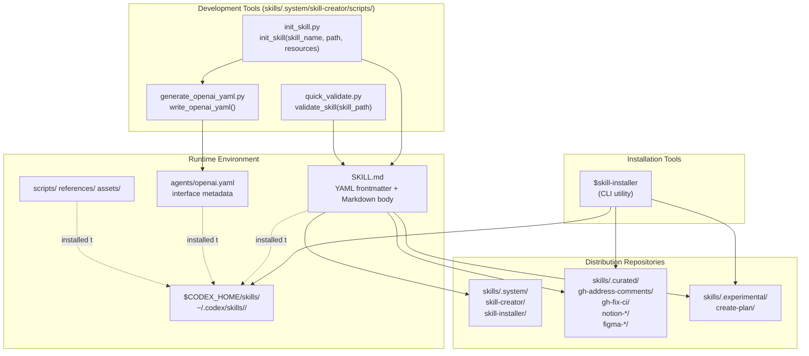
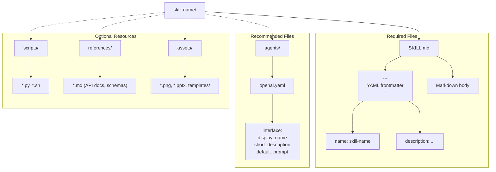
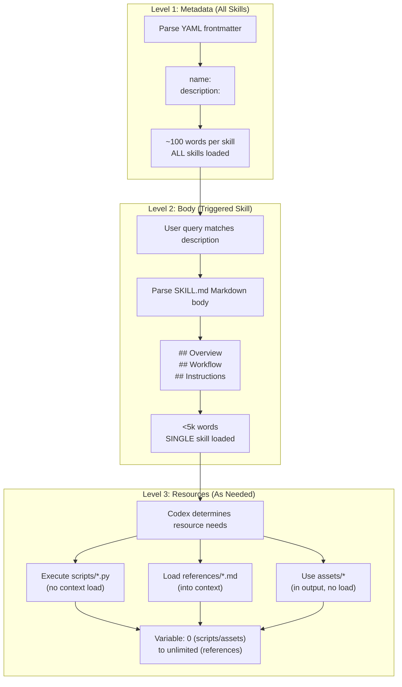
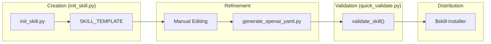
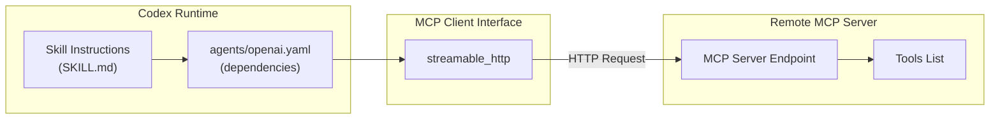

<!-- source: DeepWiki mcp.deepwiki.com · repo openai/skills · page 2 Architecture · fetched 2026-10-30 -->

# Architecture

Relevant source files

The following files were used as context for generating this wiki page:

- [.gitignore](.gitignore)
- [README.md](README.md)
- [skills/.system/skill-creator/SKILL.md](skills/.system/skill-creator/SKILL.md)
- [skills/.system/skill-creator/references/openai_yaml.md](skills/.system/skill-creator/references/openai_yaml.md)
- [skills/.system/skill-creator/scripts/generate_openai_yaml.py](skills/.system/skill-creator/scripts/generate_openai_yaml.py)
- [skills/.system/skill-creator/scripts/init_skill.py](skills/.system/skill-creator/scripts/init_skill.py)
- [skills/.system/skill-creator/scripts/quick_validate.py](skills/.system/skill-creator/scripts/quick_validate.py)

## Purpose and Scope

This document explains the architectural design of the Agent Skills system, including the three-tier skill organization (`.system/`, `.curated/`, `.experimental/`), the progressive disclosure loading model, and the complete skill lifecycle from development to runtime execution. The architecture optimizes for context window efficiency while enabling modular capability distribution.

For detailed information on specific subsystems, see:
- Three-tier categorization and installation methods: [Three-Tier Skill System](#2.1)
- Context window optimization strategy: [Progressive Disclosure Model](#2.2)
- Complete skill journey from creation to execution: [Skill Lifecycle](#2.3)
- MCP-based external service connections: [MCP Integration Pattern](#2.4)

## High-Level System Architecture

The Agent Skills repository implements a modular capability distribution system organized into four functional layers: development tooling, distribution repositories, installation utilities, and runtime execution.

**System Architecture: Development to Runtime**

**Directory Structure and Installation Methods**

| Directory Path | Purpose | Installation Command | Auto-Installed |
|---------------|---------|---------------------|----------------|
| `skills/.system/` | Core system skills and development tools | N/A | Yes [README.md:14-14]() |
| `skills/.curated/` | Production-ready, reviewed skills | `$skill-installer <skill-name>` | No [README.md:18-22]() |
| `skills/.experimental/` | Development/testing skills | `$skill-installer install ... --path ...` | No [README.md:24-34]() |

**Sources**: [README.md:12-36](), [skills/.system/skill-creator/SKILL.md:48-64](), [skills/.system/skill-creator/scripts/init_skill.py:1-14]()

## Skill Structure and Format

Every skill is a directory containing a mandatory `SKILL.md` file and optional bundled resources. The structure is validated by the `validate_skill()` function in `quick_validate.py`.

**Skill Directory Structure (skill-name/)**

**Frontmatter Validation Rules (validate_skill())**

The `validate_skill()` function at [skills/.system/skill-creator/scripts/quick_validate.py:15-91]() enforces these constraints:

| Field | Validation Rule | Code Reference |
|-------|----------------|----------------|
| `name` | Required, `^[a-z0-9-]+$`, no leading/trailing/consecutive hyphens, ≤64 chars | [skills/.system/skill-creator/scripts/quick_validate.py:51-76]() |
| `description` | Required, no `<>` characters, ≤1024 chars | [skills/.system/skill-creator/scripts/quick_validate.py:53-89]() |
| Allowed properties | `name`, `description`, `license`, `allowed-tools`, `metadata` | [skills/.system/skill-creator/scripts/quick_validate.py:40-49]() |

**Resource Directory Creation (init_skill())**

The `init_skill.py` script creates resource directories based on the `--resources` argument:

| Directory | Creation Flag | Token Impact | Purpose |
|-----------|-----------|-------------|---------|
| `scripts/` | `--resources scripts` | 0 (executed, not loaded to context) | Executable code (Python, Bash, etc.) [skills/.system/skill-creator/SKILL.md:86-93]() |
| `references/` | `--resources references` | Variable (loaded as needed) | Documentation for context injection [skills/.system/skill-creator/SKILL.md:95-104]() |
| `assets/` | `--resources assets` | 0 (used in output, never loaded) | Templates, images, fonts, boilerplate [skills/.system/skill-creator/SKILL.md:106-113]() |

**Sources**: [skills/.system/skill-creator/SKILL.md:48-65](), [skills/.system/skill-creator/scripts/init_skill.py:23-24](), [skills/.system/skill-creator/scripts/quick_validate.py:15-91]()

## Progressive Disclosure Loading Model

The system implements a three-level progressive disclosure model to optimize context window usage. Each level loads progressively more content as needed, minimizing token overhead across dozens of installed skills.

**Three-Level Loading Strategy**

**Level-by-Level Loading Characteristics**

| Level | Content Loaded | Scope | Token Cost | Loading Condition |
|-------|---------------|-------|------------|------------------|
| 1 | `name`, `description` (YAML frontmatter) | All installed skills | ~100 words × N | Codex startup [skills/.system/skill-creator/SKILL.md:131-131]() |
| 2 | Markdown body (below frontmatter) | Single triggered skill | <5k words | Description matches query [skills/.system/skill-creator/SKILL.md:132-132]() |
| 3 | `scripts/`, `references/`, `assets/` | As determined by Codex | 0 (scripts/assets), variable (references) | Workflow execution [skills/.system/skill-creator/SKILL.md:133-133]() |

For details, see [Progressive Disclosure Model](#2.2).

**Sources**: [skills/.system/skill-creator/SKILL.md:127-133](), [skills/.system/skill-creator/scripts/init_skill.py:73-110]()

## Skill Lifecycle

The complete skill lifecycle from creation to runtime execution follows a standardized process involving initialization, validation, and distribution.

**Development and Distribution Pipeline**

| Phase | Key Tool | Primary Action | Code Reference |
|-------|----------|----------------|----------------|
| **Creation** | `init_skill.py` | Scaffold directory structure and `SKILL.md` | [skills/.system/skill-creator/scripts/init_skill.py:25-111]() |
| **Refinement** | `generate_openai_yaml.py` | Create `agents/openai.yaml` interface metadata | [skills/.system/skill-creator/scripts/generate_openai_yaml.py:155-186]() |
| **Validation** | `quick_validate.py` | Verify frontmatter and naming constraints | [skills/.system/skill-creator/scripts/quick_validate.py:15-91]() |
| **Distribution** | `$skill-installer` | Download and extract to local skills directory | [README.md:12-36]() |

For details, see [Skill Lifecycle](#2.3).

**Sources**: [skills/.system/skill-creator/scripts/init_skill.py:1-111](), [skills/.system/skill-creator/scripts/quick_validate.py:1-102](), [README.md:12-36]()

## MCP Integration Pattern

Skills connect to external services (like Figma, Notion, or Linear) using the Model Context Protocol (MCP). This pattern uses `streamable_http` transport to allow Codex to invoke tools hosted on remote servers.

**MCP Tool Architecture**

**Key Integration Entities**

| Entity | Role | Code Reference |
|--------|------|----------------|
| `dependencies.tools` | Defines the MCP server type, value, and URL in `openai.yaml` | [skills/.system/skill-creator/references/openai_yaml.md:16-23]() |
| `streamable_http` | The transport protocol used for remote MCP connections | [skills/.system/skill-creator/references/openai_yaml.md:21-21]() |
| `interface.default_prompt` | Snippet mentioning `$skill-name` to trigger usage | [skills/.system/skill-creator/references/openai_yaml.md:31-31]() |

For details, see [MCP Integration Pattern](#2.4).

**Sources**: [skills/.system/skill-creator/references/openai_yaml.md:1-44]()

---

