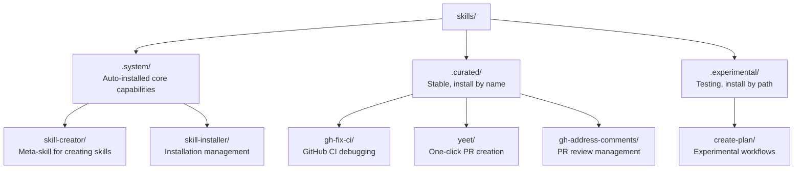
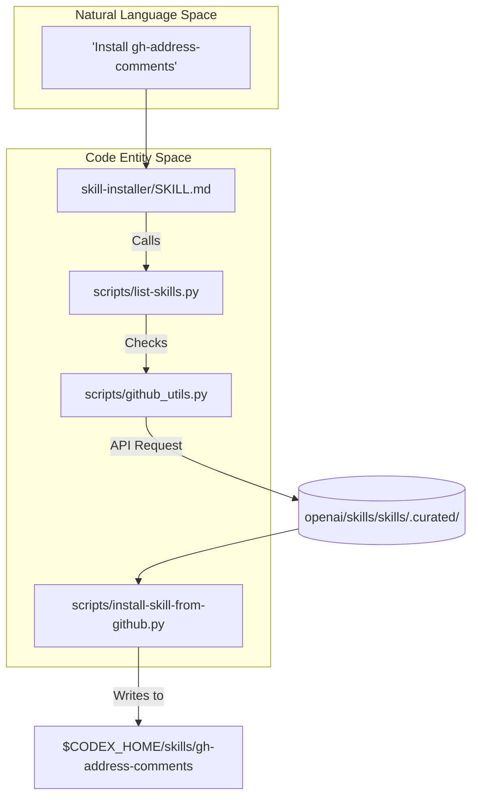
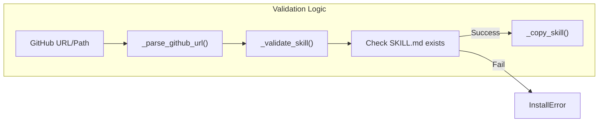

<!-- source: DeepWiki mcp.deepwiki.com · repo openai/skills · page 2.1 Three-Tier Skill System · fetched 2026-10-30 -->

# Three-Tier Skill System

<details>
<summary>Relevant source files</summary>

The following files were used as context for generating this wiki page:

- [.gitignore](.gitignore)
- [README.md](README.md)
- [skills/.system/skill-installer/LICENSE.txt](skills/.system/skill-installer/LICENSE.txt)
- [skills/.system/skill-installer/SKILL.md](skills/.system/skill-installer/SKILL.md)
- [skills/.system/skill-installer/scripts/github_utils.py](skills/.system/skill-installer/scripts/github_utils.py)
- [skills/.system/skill-installer/scripts/install-skill-from-github.py](skills/.system/skill-installer/scripts/install-skill-from-github.py)
- [skills/.system/skill-installer/scripts/list-skills.py](skills/.system/skill-installer/scripts/list-skills.py)

</details>


## Purpose and Scope

This document explains the three-tier organizational structure used to categorize skills based on their maturity, stability, and distribution method. The three tiers—`.system`, `.curated`, and `.experimental`—determine how skills are discovered, installed, and loaded by Codex agents. 

The system is managed primarily by the `skill-installer` utility, which facilitates discovery and installation from the [openai/skills](https://github.com/openai/skills) repository.

**Sources:** [README.md:1-41](), [skills/.system/skill-installer/SKILL.md:1-15]()

## Overview

Skills are organized into three directories within the repository, each representing a different tier of maturity and distribution strategy:

Title: Repository Organization


**Sources:** [README.md:14-34](), [skills/.system/skill-installer/SKILL.md:8-15]()

## Tier Characteristics

The following table summarizes the key differences between the three tiers as implemented in the `skill-installer` logic:

| Characteristic | `.system` | `.curated` | `.experimental` |
|---|---|---|---|
| **Installation** | Automatic (Pre-installed) | By name (default) | By path/URL |
| **Discovery** | Hidden from install list | `list-skills.py` (default) | `list-skills.py --path ...` |
| **Stability** | Core Infrastructure | Stable & Reviewed | Active Development |
| **Source Path** | `skills/.system` | `skills/.curated` | `skills/.experimental` |
| **Typical Use** | Essential tools | Production workflows | Testing new patterns |

**Sources:** [README.md:14-36](), [skills/.system/skill-installer/SKILL.md:36-58](), [skills/.system/skill-installer/scripts/list-skills.py:14-16]()

## Tier 1: `.system` (Auto-installed)

### Characteristics

The `.system` tier contains foundational skills that are automatically installed with every Codex instance. These skills provide core capabilities that the platform depends on for proper operation. The `skill-installer` explicitly notes that these are preinstalled and generally do not need manual installation [skills/.system/skill-installer/SKILL.md:56-57]().

**Directory:** `skills/.system/`

**Key Implementation Details:**
- **Pre-installation:** Handled by the Codex environment setup.
- **Home Directory:** Skills are located in `$CODEX_HOME/skills` (defaults to `~/.codex/skills`) [skills/.system/skill-installer/scripts/list-skills.py:34-36]().
- **Overwriting:** If a user insists on installing a system skill, the installer can download and overwrite the existing version [skills/.system/skill-installer/SKILL.md:57-57]().

### Current System Skills

The `.system` directory includes critical utilities for the skill ecosystem itself.

| Skill | Purpose |
|---|---|
| `skill-creator` | Meta-skill for creating and managing other skills. |
| `skill-installer` | Utility for discovering and adding new skills from curated or experimental sources [skills/.system/skill-installer/SKILL.md:2-3](). |
| `imagegen` | System-tier skill for generating and editing images. |
| `openai-docs` | Referencing official OpenAI developer documentation via MCP. |
| `plugin-creator` | Scaffolding Codex plugin directories and marketplace metadata. |

**Sources:** [skills/.system/skill-installer/SKILL.md:1-6](), [README.md:14-15](), [skills/.system/skill-installer/SKILL.md:56-57]()

## Tier 2: `.curated` (Install by Name)

### Characteristics

The `.curated` tier contains stable, reviewed skills. The `skill-installer` defaults to this directory when a user asks to list or install skills without specifying a full path [skills/.system/skill-installer/scripts/list-skills.py:15-15]().

**Directory:** `skills/.curated/`

**Installation method:**
The `list-skills.py` script defaults to `skills/.curated` for its listing [skills/.system/skill-installer/scripts/list-skills.py:15-15]().

```bash
# To install a curated skill by name
$skill-installer gh-address-comments
```

### Installation Logic (Natural Language to Code)

When a user requests a curated skill, the `skill-installer` maps the name to the repository structure:

Title: Installation Data Flow


**Sources:** [skills/.system/skill-installer/SKILL.md:36-41](), [skills/.system/skill-installer/scripts/list-skills.py:14-16](), [skills/.system/skill-installer/scripts/install-skill-from-github.py:45-47]()

## Tier 3: `.experimental` (Install by Path)

### Characteristics

The `.experimental` tier contains skills under active development. These require explicit path or URL references, preventing accidental use of unstable features.

**Directory:** `skills/.experimental/`

**Discovery:**
To see experimental skills, the `--path` flag must be used with the listing script:
`scripts/list-skills.py --path skills/.experimental` [skills/.system/skill-installer/SKILL.md:38-38]().

**Installation methods:**
1. **By relative path:** `$skill-installer install ... from the .experimental folder` [README.md:27-28]().
2. **By GitHub URL:** `$skill-installer install https://github.com/openai/skills/tree/main/skills/.experimental/create-plan` [README.md:33-34]().

### Path Resolution and Validation

The `install-skill-from-github.py` script performs strict validation on experimental paths to ensure they contain a valid `SKILL.md` before registration.

Title: Validation and Extraction Logic


**Sources:** [skills/.system/skill-installer/scripts/install-skill-from-github.py:59-77](), [skills/.system/skill-installer/scripts/install-skill-from-github.py:164-170]()

## Installation Lifecycle

Regardless of the tier, the installation process follows a standard flow:

1.  **Discovery:** Using `scripts/list-skills.py` to identify available skills and check if they are `(already installed)` by scanning `$CODEX_HOME/skills` [skills/.system/skill-installer/scripts/list-skills.py:38-47]().
2.  **Download:** Fetching the skill folder via ZIP download or `git sparse-checkout`. The `_prepare_repo` function handles the logic for choosing the download method, falling back from direct download to git if auth errors occur [skills/.system/skill-installer/scripts/install-skill-from-github.py:187-206](), [skills/.system/skill-installer/SKILL.md:45-46]().
3.  **Persistence:** Copying the contents to the local skill directory using `_copy_skill`. It aborts if the destination already exists [skills/.system/skill-installer/scripts/install-skill-from-github.py:172-176](), [skills/.system/skill-installer/SKILL.md:47-47]().
4.  **Activation:** The user is instructed to **Restart Codex** to pick up the new skills [README.md:36](), [skills/.system/skill-installer/SKILL.md:30-30]().

**Sources:** [README.md:36](), [skills/.system/skill-installer/SKILL.md:10-32](), [skills/.system/skill-installer/scripts/list-skills.py:89-100](), [skills/.system/skill-installer/scripts/install-skill-from-github.py:187-206]()

---

