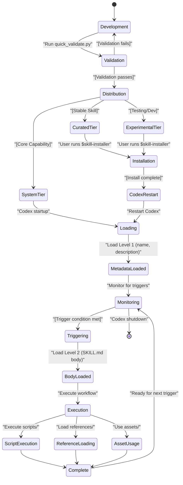
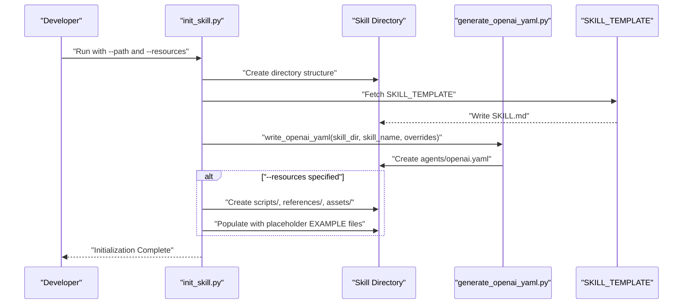
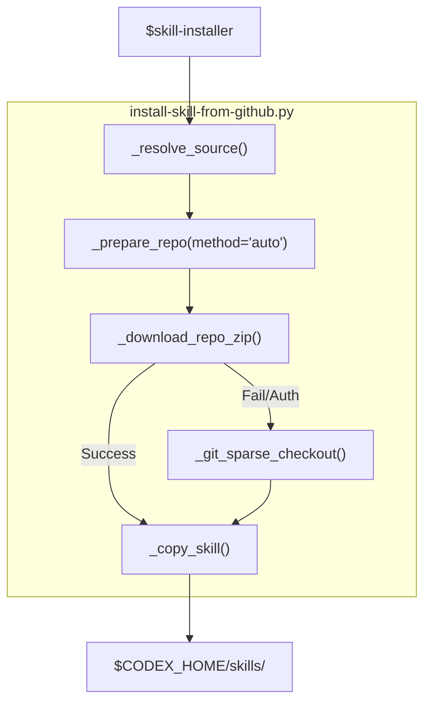

<!-- source: DeepWiki mcp.deepwiki.com · repo openai/skills · page 2.3 Skill Lifecycle · fetched 2026-10-30 -->

# Skill Lifecycle

<details>
<summary>Relevant source files</summary>

The following files were used as context for generating this wiki page:

- [skills/.system/skill-creator/SKILL.md](skills/.system/skill-creator/SKILL.md)
- [skills/.system/skill-creator/references/openai_yaml.md](skills/.system/skill-creator/references/openai_yaml.md)
- [skills/.system/skill-creator/scripts/generate_openai_yaml.py](skills/.system/skill-creator/scripts/generate_openai_yaml.py)
- [skills/.system/skill-creator/scripts/init_skill.py](skills/.system/skill-creator/scripts/init_skill.py)
- [skills/.system/skill-creator/scripts/quick_validate.py](skills/.system/skill-creator/scripts/quick_validate.py)
- [skills/.system/skill-installer/LICENSE.txt](skills/.system/skill-installer/LICENSE.txt)
- [skills/.system/skill-installer/SKILL.md](skills/.system/skill-installer/SKILL.md)
- [skills/.system/skill-installer/scripts/github_utils.py](skills/.system/skill-installer/scripts/github_utils.py)
- [skills/.system/skill-installer/scripts/install-skill-from-github.py](skills/.system/skill-installer/scripts/install-skill-from-github.py)
- [skills/.system/skill-installer/scripts/list-skills.py](skills/.system/skill-installer/scripts/list-skills.py)

</details>


This page traces the complete lifecycle of a skill from initial creation through distribution, installation, loading, and execution. It provides a technical overview of how skills move through each stage and the key code entities involved at each step.

For detailed information about creating skills, see [Creating Skills](). For installation procedures, see [Installing Skills](). For the progressive disclosure loading strategy, see [Progressive Disclosure Model]().

## Overview

A skill progresses through six distinct lifecycle stages:

| Stage | Key Actions | Primary Tools/Files |
|-------|-------------|---------------------|
| **Development** | Initialize, edit, add resources | `init_skill.py`, `SKILL.md`, resource directories |
| **Validation** | Check format and naming | `quick_validate.py` |
| **Distribution** | Choose tier, publish | `.system/`, `.curated/`, `.experimental/` |
| **Installation** | Install to Codex config | `$skill-installer` utility |
| **Loading** | Load metadata and body | Progressive disclosure (3 levels) |
| **Execution** | Trigger, execute, load resources | Codex agent runtime |

Sources: [skills/.system/skill-creator/SKILL.md:48-65](), [skills/.system/skill-installer/SKILL.md:1-6]()

## Lifecycle Flow Diagram

The following diagram illustrates the transition between Natural Language intent and Code Entity execution.



Sources: [skills/.system/skill-creator/SKILL.md:127-145](), [skills/.system/skill-installer/SKILL.md:30-31]()

## Development Phase

The development phase begins when a developer initializes a new skill and ends when the skill is ready for validation. This phase involves creating the skill structure, writing instructions, and adding bundled resources.

### Skill Initialization

Skills are initialized using the `init_skill.py` script, which creates the required directory structure and template files.

**Script Invocation Pattern:**

```bash
init_skill.py <skill-name> --path <path> [--resources scripts,references,assets] [--examples] [--interface key=value]
```

**Key Code Entities:**

| Entity | File Location | Purpose |
|----------|---------------|---------|
| `init_skill.py` | [skills/.system/skill-creator/scripts/init_skill.py:1-14]() | CLI entry point for skill scaffolding |
| `SKILL_TEMPLATE` | [skills/.system/skill-creator/scripts/init_skill.py:26-111]() | Base content for new SKILL.md files |
| `write_openai_yaml` | [skills/.system/skill-creator/scripts/generate_openai_yaml.py:155-186]() | Logic for generating `agents/openai.yaml` |
| `ALLOWED_RESOURCES` | [skills/.system/skill-creator/scripts/init_skill.py:24-24]() | Defines valid subdirectories (`scripts`, `references`, `assets`) |

**Initialization Sequence:**



Sources: [skills/.system/skill-creator/scripts/init_skill.py:1-14](), [skills/.system/skill-creator/scripts/init_skill.py:25-111](), [skills/.system/skill-creator/scripts/generate_openai_yaml.py:155-186]()

### SKILL.md Structure Creation

The initialization creates a `SKILL.md` file with required frontmatter and a template body.

**Required Frontmatter Fields:**

| Field | Type | Constraints | Purpose |
|-------|------|-------------|---------|
| `name` | string | Hyphen-case, max 64 chars | Unique identifier for triggering |
| `description` | string | Max 1024 chars | Primary trigger evaluation text |

Sources: [skills/.system/skill-creator/scripts/quick_validate.py:51-91](), [skills/.system/skill-creator/SKILL.md:67-72]()

### UI Metadata Generation

The `generate_openai_yaml.py` script creates the `agents/openai.yaml` file with user-facing metadata used for UI chips and lists.

**Generation Logic:**

*   **`format_display_name`**: Converts hyphen-case names to Title Case, preserving acronyms like "API", "MCP", and "CI" [skills/.system/skill-creator/scripts/generate_openai_yaml.py:57-73]().
*   **`generate_short_description`**: Produces a string between 25-64 characters suitable for UI blurbs [skills/.system/skill-creator/scripts/generate_openai_yaml.py:76-103]().
*   **`write_openai_yaml`**: Orchestrates the writing of the `interface:` block in the YAML file [skills/.system/skill-creator/scripts/generate_openai_yaml.py:155-186]().

Sources: [skills/.system/skill-creator/scripts/generate_openai_yaml.py:57-186](), [skills/.system/skill-creator/references/openai_yaml.md:1-44]()

## Validation Phase

Before distribution, skills are validated using the `quick_validate.py` script to catch structural and formatting issues.

### Validation Checks

The `validate_skill(skill_path)` function performs the following technical checks:

1.  **Existence**: Verifies `SKILL.md` exists [skills/.system/skill-creator/scripts/quick_validate.py:19-21]().
2.  **Frontmatter**: Ensures valid YAML frontmatter between `---` delimiters [skills/.system/skill-creator/scripts/quick_validate.py:24-38]().
3.  **Allowed Keys**: Restricts frontmatter to `name`, `description`, `license`, `allowed-tools`, and `metadata` [skills/.system/skill-creator/scripts/quick_validate.py:40-49]().
4.  **Name Constraints**: Enforces hyphen-case regex `^[a-z0-9-]+$` and a `MAX_SKILL_NAME_LENGTH` of 64 [skills/.system/skill-creator/scripts/quick_validate.py:56-76]().
5.  **Description Constraints**: Enforces a 1024 character limit and forbids angle brackets (`<`, `>`) to prevent injection/formatting issues [skills/.system/skill-creator/scripts/quick_validate.py:78-89]().

Sources: [skills/.system/skill-creator/scripts/quick_validate.py:15-101]()

## Distribution and Installation Phase

Skills are distributed via the repository's tier system and installed into the user's local environment.

### Tiered Distribution

*   **.system**: Preinstalled core skills. No user installation required [skills/.system/skill-installer/SKILL.md:57-57]().
*   **.curated**: Stable skills available for installation by name [skills/.system/skill-installer/SKILL.md:10-10]().
*   **.experimental**: Testing skills available for installation by path or URL [skills/.system/skill-installer/SKILL.md:13-13]().

### Installation Mechanics

The `$skill-installer` utility (implemented via `install-skill-from-github.py`) manages the transfer of skill directories to `$CODEX_HOME/skills` (defaulting to `~/.codex/skills`) [skills/.system/skill-installer/SKILL.md:48-48]().

**Installation Logic Flow:**



**Key Scripts:**
*   `list-skills.py`: Queries the GitHub API via `github_api_contents_url` to list available skills and checks against `_installed_skills()` locally [skills/.system/skill-installer/scripts/list-skills.py:38-65]().
*   `install-skill-from-github.py`: Handles ZIP downloads (`_download_repo_zip`) or Git sparse checkouts (`_git_sparse_checkout`) for public and private repositories [skills/.system/skill-installer/scripts/install-skill-from-github.py:80-162]().

Sources: [skills/.system/skill-installer/SKILL.md:32-52](), [skills/.system/skill-installer/scripts/list-skills.py:38-65](), [skills/.system/skill-installer/scripts/install-skill-from-github.py:45-178](), [skills/.system/skill-installer/scripts/github_utils.py:20-21]()

## Loading and Execution Phase

Once installed, skills are loaded into the Codex runtime following the **Progressive Disclosure** model.

### Loading Levels

1.  **Level 1 (Metadata)**: The `name` and `description` from `SKILL.md` frontmatter are always in context. This is used by Codex to determine if a skill should trigger [skills/.system/skill-creator/SKILL.md:71-72]().
2.  **Level 2 (Body)**: The Markdown body of `SKILL.md` is loaded only after the skill triggers [skills/.system/skill-creator/SKILL.md:72-72]().
3.  **Level 3 (Resources)**: Supplemental materials are loaded or executed as needed.

### Execution of Resources

During execution, the agent interacts with the `scripts/`, `references/`, and `assets/` directories:

*   **Scripts (`scripts/`)**: Executable code for deterministic reliability. These may be executed without loading their source into the context window [skills/.system/skill-creator/SKILL.md:86-93]().
*   **References (`references/`)**: Documentation loaded into context to inform the process. If files are large, the skill should provide grep search patterns in `SKILL.md` [skills/.system/skill-creator/SKILL.md:96-104]().
*   **Assets (`assets/`)**: Files like templates or icons that are used in the output but never loaded into the context window [skills/.system/skill-creator/SKILL.md:107-113]().

**Post-Installation Requirement**: Users must restart Codex to pick up new skills after installation [skills/.system/skill-installer/SKILL.md:30-30]().

Sources: [skills/.system/skill-creator/SKILL.md:86-113](), [skills/.system/skill-creator/SKILL.md:129-134](), [skills/.system/skill-installer/SKILL.md:30-30]()

---

