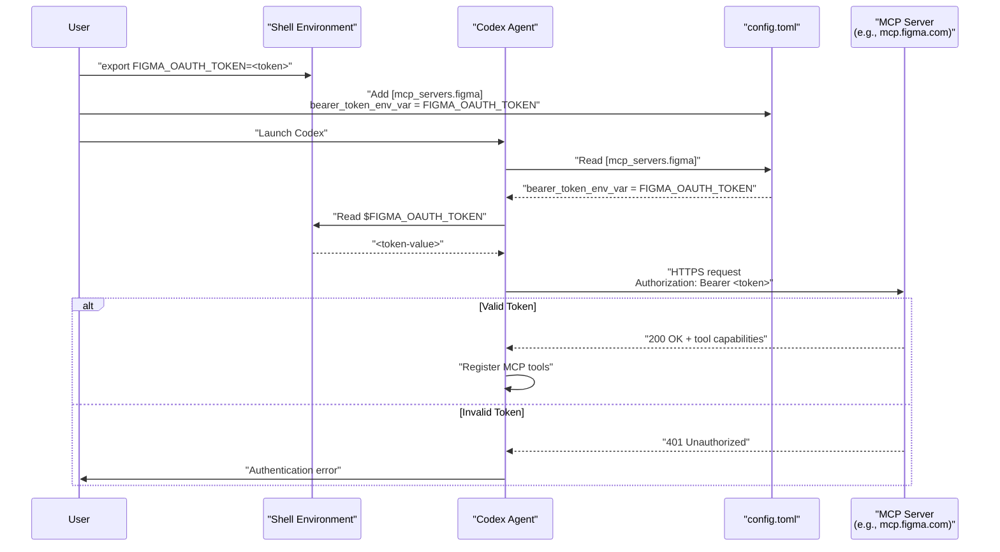
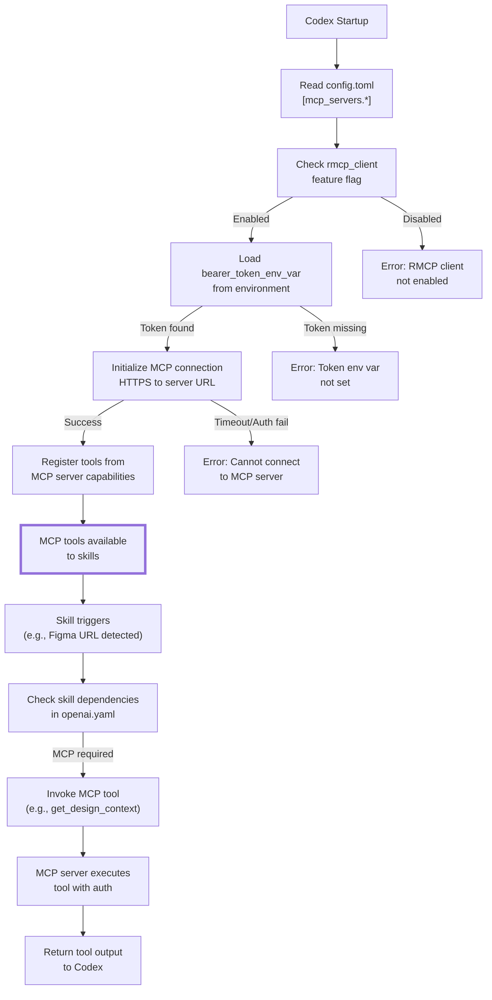

<!-- source: DeepWiki mcp.deepwiki.com · repo openai/skills · page 2.4 MCP Integration Pattern · fetched 2026-10-30 -->

# MCP Integration Pattern

<details>
<summary>Relevant source files</summary>

The following files were used as context for generating this wiki page:

- [skills/.curated/figma-code-connect-components/SKILL.md](skills/.curated/figma-code-connect-components/SKILL.md)
- [skills/.curated/figma-create-design-system-rules/SKILL.md](skills/.curated/figma-create-design-system-rules/SKILL.md)
- [skills/.curated/figma-implement-design/SKILL.md](skills/.curated/figma-implement-design/SKILL.md)
- [skills/.curated/figma/SKILL.md](skills/.curated/figma/SKILL.md)
- [skills/.curated/figma/agents/openai.yaml](skills/.curated/figma/agents/openai.yaml)
- [skills/.curated/figma/assets/figma-small.svg](skills/.curated/figma/assets/figma-small.svg)
- [skills/.curated/figma/assets/figma.png](skills/.curated/figma/assets/figma.png)
- [skills/.curated/figma/assets/icon.svg](skills/.curated/figma/assets/icon.svg)
- [skills/.curated/figma/references/figma-mcp-config.md](skills/.curated/figma/references/figma-mcp-config.md)
- [skills/.curated/figma/references/figma-tools-and-prompts.md](skills/.curated/figma/references/figma-tools-and-prompts.md)
- [skills/.curated/notion-knowledge-capture/SKILL.md](skills/.curated/notion-knowledge-capture/SKILL.md)
- [skills/.curated/notion-meeting-intelligence/SKILL.md](skills/.curated/notion-meeting-intelligence/SKILL.md)
- [skills/.curated/notion-research-documentation/SKILL.md](skills/.curated/notion-research-documentation/SKILL.md)
- [skills/.curated/notion-spec-to-implementation/SKILL.md](skills/.curated/notion-spec-to-implementation/SKILL.md)

</details>


This document explains the Model Context Protocol (MCP) integration pattern used by skills to connect to external services such as Figma, Notion, and Linear. It covers how skills declare MCP dependencies, configuration requirements in `config.toml`, authentication mechanisms, and runtime behavior.

For details on specific MCP-enabled skills, see [Figma Integration](#5.2), [Notion Integration Skills](#5.3), and [Linear Integration](#5.4). For the overall architecture of skills, see [Architecture](#2).

## What is MCP Integration

MCP (Model Context Protocol) is a standardized protocol that allows Codex to interact with external platforms through remote servers. Skills declare MCP dependencies in their `agents/openai.yaml` file, and users configure the corresponding MCP servers in `config.toml` with authentication credentials. At runtime, Codex establishes authenticated HTTPS connections to these servers using the `streamable_http` transport, enabling skills to invoke platform-specific tools. [skills/.curated/figma/agents/openai.yaml:10-14](), [skills/.curated/figma/references/figma-mcp-config.md:15-16]()

The MCP pattern provides:
- **Standardized tool invocation**: Skills call tools by name (e.g., `get_design_context`, `notion-search`) without managing HTTP details. [skills/.curated/figma/references/figma-tools-and-prompts.md:6-16](), [skills/.curated/notion-spec-to-implementation/SKILL.md:13-17]()
- **OAuth-based authentication**: Servers authenticate via bearer tokens stored in environment variables and mapped in configuration. [skills/.curated/figma/references/figma-mcp-config.md:13-15]()
- **Remote execution**: MCP servers run on external infrastructure provided by the service (e.g., `https://mcp.figma.com/mcp`). [skills/.curated/figma/agents/openai.yaml:14-14]()
- **Declarative dependencies**: Skills explicitly state which MCP servers they require to function. [skills/.curated/figma/agents/openai.yaml:10-14]()

**Sources:**
- [skills/.curated/figma/references/figma-mcp-config.md:1-17]()
- [skills/.curated/figma/agents/openai.yaml:8-15]()
- [skills/.curated/notion-spec-to-implementation/SKILL.md:12-17]()

## Dependency Declaration

Skills declare MCP dependencies in the `dependencies.tools` section of their `agents/openai.yaml` file. Each dependency specifies the MCP server name, transport type, and URL. [skills/.curated/figma/agents/openai.yaml:8-15]()

### openai.yaml Dependency Schema

```yaml
dependencies:
  tools:
    - type: "mcp"
      value: "<server-name>"
      description: "<human-readable description>"
      transport: "streamable_http"
      url: "<mcp-server-url>"
```

**Field Definitions:**

| Field | Required | Description |
|-------|----------|-------------|
| `type` | Yes | Must be `"mcp"`. |
| `value` | Yes | Server identifier matching `[mcp_servers.<value>]` in `config.toml`. |
| `description` | Yes | Human-readable description of the server's purpose. |
| `transport` | Yes | Must be `"streamable_http"` for remote MCP servers. |
| `url` | Yes | HTTPS endpoint of the MCP server. |

### Figma MCP Dependency Example
[skills/.curated/figma/agents/openai.yaml:8-15]()
```yaml
dependencies:
  tools:
    - type: "mcp"
      value: "figma"
      description: "Figma MCP server"
      transport: "streamable_http"
      url: "https://mcp.figma.com/mcp"
```

**Sources:**
- [skills/.curated/figma/agents/openai.yaml:8-15]()

## Configuration Requirements

Users must configure MCP servers in `~/.codex/config.toml` before skills can use them. Each server requires a `[mcp_servers.<name>]` section with the server URL, authentication credentials, and optional headers. [skills/.curated/figma/references/figma-mcp-config.md:1-11]()

### config.toml MCP Server Schema
[skills/.curated/figma/references/figma-mcp-config.md:5-10]()
```toml
[mcp_servers.<server-name>]
url = "<mcp-server-url>"
bearer_token_env_var = "<ENV_VAR_NAME>"
http_headers = { "<header-name>" = "<header-value>" }
```

**Configuration Fields:**

| Field | Required | Description |
|-------|----------|-------------|
| `url` | Yes | HTTPS endpoint matching the skill's dependency declaration. |
| `bearer_token_env_var` | Yes | Environment variable name containing the OAuth bearer token. |
| `http_headers` | No | Additional HTTP headers sent with each request (e.g., `X-Figma-Region`). |

### RMCP Client Feature Flag
MCP integration requires the RMCP (Remote Model Context Protocol) client feature to be enabled in `config.toml`:
[skills/.curated/figma/references/figma-mcp-config.md:15-15]()
```toml
[features]
rmcp_client = true
```

**Sources:**
- [skills/.curated/figma/references/figma-mcp-config.md:1-17]()
- [skills/.curated/notion-spec-to-implementation/SKILL.md:24-25]()

## Authentication Flow

MCP servers authenticate requests using OAuth bearer tokens provided through environment variables. The authentication flow ensures that Codex can securely connect to external platforms. [skills/.curated/figma/references/figma-mcp-config.md:13-15]()

### Authentication Sequence



**Sources:**
- [skills/.curated/figma/references/figma-mcp-config.md:13-22]()
- [skills/.curated/figma/references/figma-mcp-config.md:28-32]()

## Runtime Behavior

At runtime, Codex establishes connections to MCP servers and exposes their tools to skills. The connection lifecycle includes server initialization, tool registration, and invocation. [skills/.curated/figma/references/figma-mcp-config.md:23-27]()

### Connection Lifecycle



### Best-Practice Execution Flow
For design-to-code tasks, skills follow a specific tool-calling sequence to ensure context accuracy:
1.  `get_design_context`: Fetch structured representation of the node. [skills/.curated/figma-implement-design/SKILL.md:62-68]()
2.  `get_metadata`: Used if the initial context is too large or truncated to map child nodes. [skills/.curated/figma-implement-design/SKILL.md:78-81]()
3.  `get_screenshot`: Capture visual reference for parity validation. [skills/.curated/figma-implement-design/SKILL.md:84-88]()

**Sources:**
- [skills/.curated/figma-implement-design/SKILL.md:29-91]()
- [skills/.curated/figma/references/figma-mcp-config.md:23-27]()

## MCP-Enabled Skills Overview

The following table summarizes curated skills that utilize the MCP integration pattern:

| Skill | MCP Server Name | Default URL | Auth Env Var |
|-------|----------------|-------------|--------------|
| `figma` | `figma` | `https://mcp.figma.com/mcp` | `FIGMA_OAUTH_TOKEN` |
| `notion-knowledge-capture` | `notion` | `https://mcp.notion.com/mcp` | `NOTION_OAUTH_TOKEN` |
| `notion-meeting-intelligence` | `notion` | `https://mcp.notion.com/mcp` | `NOTION_OAUTH_TOKEN` |
| `notion-research-documentation` | `notion` | `https://mcp.notion.com/mcp` | `NOTION_OAUTH_TOKEN` |
| `notion-spec-to-implementation` | `notion` | `https://mcp.notion.com/mcp` | `NOTION_OAUTH_TOKEN` |

**Sources:**
- [skills/.curated/figma/agents/openai.yaml:10-14]()
- [skills/.curated/notion-spec-to-implementation/SKILL.md:22-26]()
- [skills/.curated/notion-meeting-intelligence/SKILL.md:21-26]()

## Troubleshooting MCP Connections

Common issues when configuring or using MCP integration:

### Token and Environment Issues
- **Token not picked up:** Export `FIGMA_OAUTH_TOKEN` (or equivalent) in the same shell that launches Codex, or add it to your shell profile and restart. [skills/.curated/figma/references/figma-mcp-config.md:29-30]()
- **OAuth errors:** Verify `rmcp_client = true` is set in `config.toml` and the bearer token is valid without surrounding quotes. [skills/.curated/figma/references/figma-mcp-config.md:30-31]()

### Connection Failures
- **Restart Requirement:** Codex must be restarted after updating `config.toml` or environment variables for changes to take effect. [skills/.curated/notion-spec-to-implementation/SKILL.md:28-29]()
- **Timeout:** Optional per-server timeouts (`startup_timeout_sec`, `tool_timeout_sec`) can be adjusted inside the `[mcp_servers.X]` block. [skills/.curated/figma/references/figma-mcp-config.md:16-16]()

**Sources:**
- [skills/.curated/figma/references/figma-mcp-config.md:28-32]()
- [skills/.curated/notion-spec-to-implementation/SKILL.md:28-29]()

---

