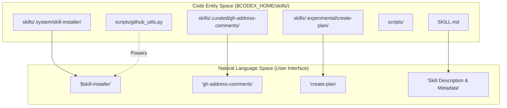
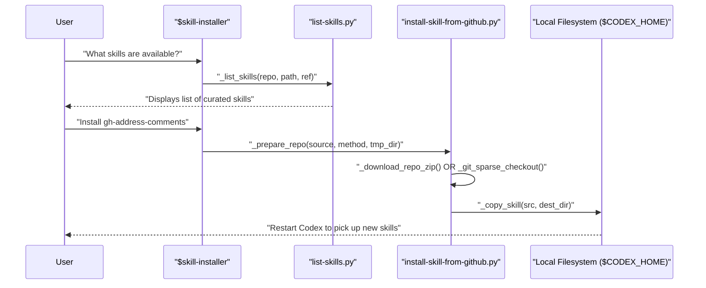

<!-- source: DeepWiki mcp.deepwiki.com · repo openai/skills · page 3 Getting Started with Skills · fetched 2026-10-30 -->

# Getting Started with Skills

<details>
<summary>Relevant source files</summary>

The following files were used as context for generating this wiki page:

- [.gitignore](.gitignore)
- [README.md](README.md)
- [skills/.system/skill-installer/LICENSE.txt](skills/.system/skill-installer/LICENSE.txt)
- [skills/.system/skill-installer/SKILL.md](skills/.system/skill-installer/SKILL.md)
- [skills/.system/skill-installer/scripts/github_utils.py](skills/.system/skill-installer/scripts/github_utils.py)
- [skills/.system/skill-installer/scripts/install-skill-from-github.py](skills/.system/skill-installer/scripts/install-skill-from-github.py)
- [skills/.system/skill-installer/scripts/list-skills.py](skills/.system/skill-installer/scripts/list-skills.py)

</details>


This page provides a practical guide for users who want to install and use skills in their Codex environment. It covers the prerequisites, basic workflow, and installation methods needed to get productive with the Agent Skills ecosystem.

For detailed installation instructions and command options, see [Installing Skills](#3.1). For information on how Codex discovers and triggers skills during runtime, see [Using Installed Skills](#3.2). For creating new skills, see [Creating Skills](#4).

---

## Prerequisites

Before installing and using skills, ensure the following requirements are met:

| Requirement | Description | Verification |
|-------------|-------------|--------------|
| **Codex Platform** | Latest version of Codex with skills support | Skills are automatically discoverable in compatible Codex versions |
| **$CODEX_HOME** | Environment variable pointing to Codex home directory | Defaults to `~/.codex/` if not set [skills/.system/skill-installer/scripts/list-skills.py:35]() |
| **$skill-installer** | System skill for installing additional skills | Auto-installed in `.system/` tier with Codex [README.md:14-16]() |
| **Network Access** | Internet connectivity for downloading skills from GitHub | Required for installation scripts [skills/.system/skill-installer/SKILL.md:34]() |

The `.system/` tier skills, including `skill-installer` and `skill-creator`, are automatically installed with Codex and require no manual setup [README.md:14-16](). Skills are installed to the `$CODEX_HOME/skills/` directory [skills/.system/skill-installer/scripts/install-skill-from-github.py:45-46]().

**Sources:** [README.md:14-16](), [skills/.system/skill-installer/scripts/install-skill-from-github.py:45-46](), [skills/.system/skill-installer/SKILL.md:34](), [skills/.system/skill-installer/scripts/list-skills.py:35]()

---

## Understanding Skills Structure

A skill is a directory containing a `SKILL.md` file and optional bundled resources. After installation, skills reside in `$CODEX_HOME/skills/` organized by their directory names.

### Code Entity to Natural Language Mapping
The following diagram bridges the physical file structure (Code Entity Space) to how they are perceived by the user (Natural Language Space).



**Skill Directory Layout:**
```
$CODEX_HOME/skills/
├── .system/
│   ├── skill-installer/
│   │   ├── SKILL.md
│   │   └── scripts/
│   │       ├── list-skills.py
│   │       └── install-skill-from-github.py
│   └── skill-creator/
│       ├── SKILL.md
│       └── scripts/
│           ├── init_skill.py
│           └── package_skill.py
├── gh-address-comments/
│   ├── SKILL.md
│   └── scripts/
│       └── fetch_comments.py
└── create-plan/
    └── SKILL.md
```

**Sources:** [README.md:13-35](), [skills/.system/skill-installer/SKILL.md:48](), [skills/.system/skill-installer/scripts/list-skills.py:38-47]()

---

## Quick Start Workflow

The typical workflow for getting started with skills involves three steps:

### Skill Lifecycle Diagram
This diagram shows how system scripts interact with the filesystem to move a skill from a remote repository to a local executable state.



**Sources:** [README.md:11-35](), [skills/.system/skill-installer/SKILL.md:1-57](), [skills/.system/skill-installer/scripts/list-skills.py:50-65](), [skills/.system/skill-installer/scripts/install-skill-from-github.py:187-206]()

---

## Installation Methods Overview

The `$skill-installer` skill supports three installation methods based on the skill's tier and accessibility:

### Installation Method Comparison

| Method | Use Case | Example | Skill Tier |
|--------|----------|---------|------------|
| **By Name** | Installing curated skills | `$skill-installer gh-address-comments` | `.curated/` |
| **By Path** | Installing experimental skills from same repo | `$skill-installer install create-plan from .experimental folder` | `.experimental/` |
| **By URL** | Installing from specific GitHub location | `$skill-installer install https://github.com/openai/skills/tree/main/skills/.experimental/create-plan` | Any tier, any repo |

**Key Implementation Details:**

- **List skills:** `scripts/list-skills.py` queries GitHub via `github_api_contents_url` [skills/.system/skill-installer/scripts/list-skills.py:51]() and marks those already in `$CODEX_HOME/skills` [skills/.system/skill-installer/scripts/list-skills.py:90-99]().
- **Install skill:** `scripts/install-skill-from-github.py` handles the logic, including URL parsing [skills/.system/skill-installer/scripts/install-skill-from-github.py:59-77]().
- **Default behavior:** Public repos use direct ZIP download [skills/.system/skill-installer/scripts/install-skill-from-github.py:190](); if that fails with auth errors (401, 403, 404), it falls back to git sparse checkout [skills/.system/skill-installer/SKILL.md:43-46](), [skills/.system/skill-installer/scripts/install-skill-from-github.py:195-206]().
- **Installation target:** Always `$CODEX_HOME/skills/[skill-name]`, aborting if the destination directory already exists [skills/.system/skill-installer/scripts/install-skill-from-github.py:172-176]().

**Sources:** [README.md:15-33](), [skills/.system/skill-installer/SKILL.md:36-49](), [skills/.system/skill-installer/scripts/list-skills.py:38-47](), [skills/.system/skill-installer/scripts/install-skill-from-github.py:172-176](), [skills/.system/skill-installer/scripts/install-skill-from-github.py:190-206]()

---

## Installation Examples

### Example 1: Installing a Curated Skill
To install the `gh-address-comments` skill by name [README.md:21]():
```
$skill-installer gh-address-comments
```

### Example 2: Installing an Experimental Skill
To install the `create-plan` skill from the `.experimental/` folder [README.md:27-33]():
```
$skill-installer install the create-plan skill from the .experimental folder
```

### Example 3: Listing Available Skills
To see all available curated skills and their installation status [skills/.system/skill-installer/SKILL.md:13]():
```
$skill-installer
```

**Sources:** [README.md:21-33](), [skills/.system/skill-installer/SKILL.md:13]()

---

## After Installation

### Activating Installed Skills
Skills are not immediately available after installation. Codex must be restarted to discover and load new skills [README.md:36]().

1. **Exit Codex** completely.
2. **Restart Codex** to trigger skill discovery.
3. **Verify activation** by checking that queries matching the skill's description trigger the skill.

**Sources:** [README.md:36](), [skills/.system/skill-installer/SKILL.md:30]()

---

## Command Reference

### skill-installer Scripts

The `$skill-installer` skill provides access to two primary scripts [skills/.system/skill-installer/SKILL.md:32-42]():

| Script | Purpose | Key Parameters |
|--------|---------|----------------|
| `list-skills.py` | List installable skills with status | `--path`, `--format json` |
| `install-skill-from-github.py` | Install skills from GitHub | `--repo`, `--path`, `--url`, `--ref`, `--method` |

**Sources:** [skills/.system/skill-installer/SKILL.md:32-42]()

---

## Next Steps

- **To install specific skills:** See detailed installation instructions in [Installing Skills](#3.1)
- **To use installed skills:** Learn about skill triggering and execution in [Using Installed Skills](#3.2)
- **To create your own skills:** Follow the comprehensive guide in [Creating Skills](#4)
- **To explore available skills:** Browse the curated skills catalog in [Curated Skills Reference](#5)

**Sources:** [README.md:1-40]()

---

