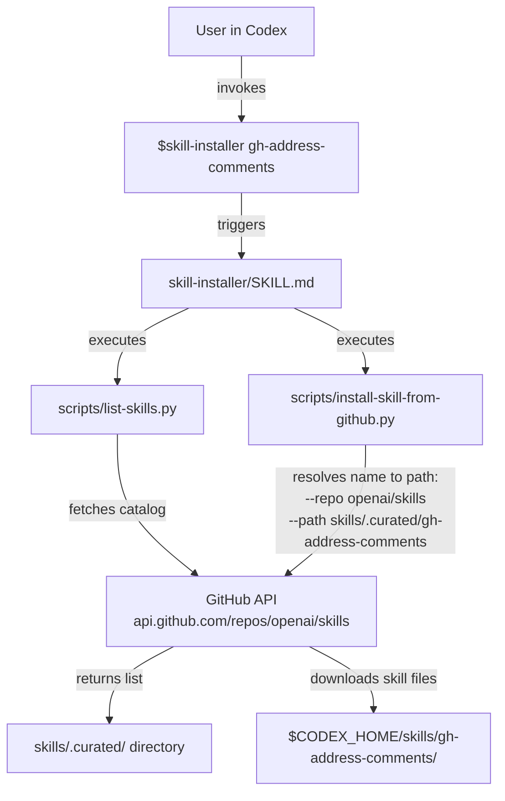
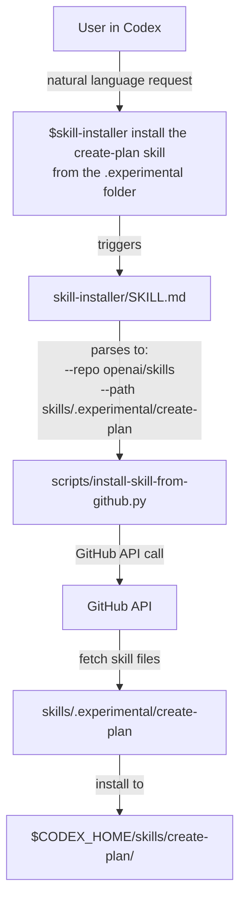
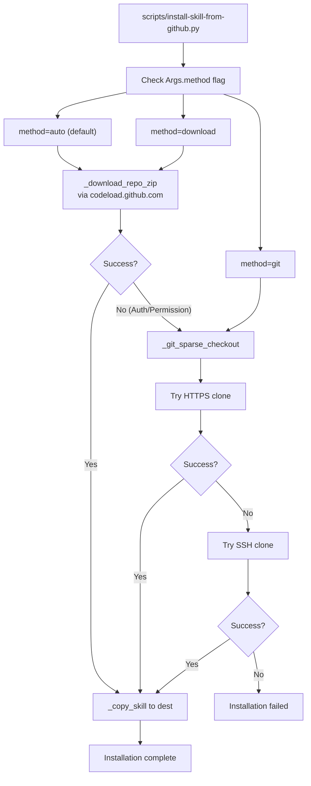

<!-- source: DeepWiki mcp.deepwiki.com · repo openai/skills · page 3.1 Installing Skills · fetched 2026-10-30 -->

# Installing Skills

<details>
<summary>Relevant source files</summary>

The following files were used as context for generating this wiki page:

- [.gitignore](.gitignore)
- [README.md](README.md)
- [skills/.system/skill-installer/LICENSE.txt](skills/.system/skill-installer/LICENSE.txt)
- [skills/.system/skill-installer/SKILL.md](skills/.system/skill-installer/SKILL.md)
- [skills/.system/skill-installer/scripts/github_utils.py](skills/.system/skill-installer/scripts/github_utils.py)
- [skills/.system/skill-installer/scripts/install-skill-from-github.py](skills/.system/skill-installer/scripts/install-skill-from-github.py)
- [skills/.system/skill-installer/scripts/list-skills.py](skills/.system/skill-installer/scripts/list-skills.py)

</details>


This page provides detailed instructions for installing skills into your Codex environment using the `skill-installer` system skill. It covers the primary installation methods: by skill name (for curated skills), by path (for experimental skills), and by URL (for any GitHub-hosted skill).

**Sources**: [skills/.system/skill-installer/SKILL.md:1-15]()

---

## Prerequisites

Before installing skills, ensure you have:

| Requirement | Description | How to Verify |
|------------|-------------|---------------|
| **Codex Installation** | Skills are loaded by the Codex platform | Check that `$CODEX_HOME` environment variable is set |
| **System Skills** | `skill-installer` is auto-installed in `.system/` | The `skill-installer` command should be available in Codex |
| **Network Access** | Installation scripts fetch skills from GitHub | Scripts require network permissions (sandbox escalation is needed) |
| **Git (Optional)** | Required for private repositories or fallback method | Run `git --version` to verify installation |

### Authentication for Private Repositories

If you need to install skills from private repositories, configure authentication:

- **GitHub Token**: Set `GITHUB_TOKEN` or `GH_TOKEN` environment variables. [skills/.system/skill-installer/scripts/github_utils.py:12-14]()
- **Git Credentials**: Configure git credentials for sparse checkout fallback (HTTPS or SSH). [skills/.system/skill-installer/SKILL.md:55-56]()

**Sources**: [skills/.system/skill-installer/SKILL.md:34-34](), [skills/.system/skill-installer/SKILL.md:52-56](), [skills/.system/skill-installer/scripts/github_utils.py:10-17]()

---

## Installation Location

All skills are installed to the skills directory in your Codex home:

```
$CODEX_HOME/skills/
└── <skill-name>/
    ├── SKILL.md
    ├── scripts/
    ├── references/
    └── assets/
```

Default location: `~/.codex/skills/`. [skills/.system/skill-installer/SKILL.md:48]()

**Important**: Installation aborts if a skill directory already exists at the destination. To reinstall, remove the existing directory first. [skills/.system/skill-installer/SKILL.md:47]()

**Sources**: [skills/.system/skill-installer/SKILL.md:46-48](), [skills/.system/skill-installer/scripts/list-skills.py:34-47]()

---

## Installation Methods

### Method 1: Installing Curated Skills by Name

**Installation Method Flow - Curated Skills**



**Usage**:

Curated skills from `skills/.curated/` can be installed by name alone. The `skill-installer` uses `scripts/list-skills.py` to identify available curated skills. [skills/.system/skill-installer/SKILL.md:13-14]()

```
$skill-installer gh-address-comments
```

This command:
1. Resolves the skill name to the path `skills/.curated/gh-address-comments`.
2. Invokes `scripts/install-skill-from-github.py` with parameters:
   - `--repo openai/skills`
   - `--path skills/.curated/gh-address-comments`
   - `--ref main` (default). [skills/.system/skill-installer/SKILL.md:39-41]()

**Sources**: [skills/.system/skill-installer/SKILL.md:10-15](), [skills/.system/skill-installer/SKILL.md:36-41](), [skills/.system/skill-installer/scripts/list-skills.py:14-15]()

---

### Method 2: Installing Experimental Skills by Path

**Installation Method Flow - Experimental Skills**



**Usage**:

Experimental skills require specifying the folder path or providing the skill name when the context is set to experimental. [skills/.system/skill-installer/SKILL.md:13](), [skills/.system/skill-installer/SKILL.md:38]()

```
$skill-installer install the create-plan skill from the .experimental folder
```

The `skill-installer` translates this to:
```bash
scripts/install-skill-from-github.py \
  --repo openai/skills \
  --path skills/.experimental/create-plan
```

**Sources**: [skills/.system/skill-installer/SKILL.md:13](), [skills/.system/skill-installer/SKILL.md:38](), [skills/.system/skill-installer/SKILL.md:41]()

---

### Method 3: Installing Skills by URL

**Installation Method Flow - URL-Based**

```mermaid
graph LR
    User["User"]
    URLCommand["$skill-installer install<br/>https://github.com/openai/skills/tree/main/skills/.experimental/create-plan"]
    InstallScript["scripts/install-skill-from-github.py"]
    
    URLParser["_parse_github_url<br/>(Extracts owner, repo, ref, path)"]
    
    User -->|"provides GitHub tree URL"| URLCommand
    URLCommand -->|"--url parameter"| InstallScript
    InstallScript -->|"parse URL"| URLParser
    
    URLParser -->|"owner=openai<br/>repo=skills<br/>ref=main<br/>path=skills/.experimental/create-plan"| Download["Download Process"]
    
    Download -->|"installed to"| Dest["$CODEX_HOME/skills/create-plan/"]
```



**Usage**:

Any skill can be installed by providing its GitHub tree URL. [skills/.system/skill-installer/SKILL.md:40]()

```
$skill-installer install https://github.com/openai/skills/tree/main/skills/.experimental/create-plan
```

The `install-skill-from-github.py` script includes a `_parse_github_url` function that extracts the repository owner, name, reference (branch/tag), and the internal path to the skill. [skills/.system/skill-installer/scripts/install-skill-from-github.py:59-77]()

**Sources**: [skills/.system/skill-installer/SKILL.md:40](), [skills/.system/skill-installer/scripts/install-skill-from-github.py:59-77]()

---

## Installation Process Details

### Fallback Strategy

The installation system implements a fallback strategy to handle different repository types and permission levels. [skills/.system/skill-installer/SKILL.md:45](), [skills/.system/skill-installer/SKILL.md:53]()

**Installation Method Selection**



| Method | Implementation | Use Case |
|--------|----------------|----------|
| **Download** | `_download_repo_zip` | Public repos; uses `urllib` to fetch ZIP from `codeload.github.com`. [skills/.system/skill-installer/scripts/install-skill-from-github.py:80-96]() |
| **Git Sparse** | `_git_sparse_checkout` | Private repos or fallback; uses `git clone --sparse`. [skills/.system/skill-installer/scripts/install-skill-from-github.py:128-161]() |

**Sources**: [skills/.system/skill-installer/SKILL.md:43-45](), [skills/.system/skill-installer/SKILL.md:52-54](), [skills/.system/skill-installer/scripts/install-skill-from-github.py:80-96](), [skills/.system/skill-installer/scripts/install-skill-from-github.py:128-161](), [skills/.system/skill-installer/scripts/install-skill-from-github.py:187-206]()

---

### Advanced Options

The `install-skill-from-github.py` script supports the following CLI arguments defined in the `Args` dataclass: [skills/.system/skill-installer/scripts/install-skill-from-github.py:21-29]()

| Option | Description | Default |
|--------|-------------|---------|
| `--ref <ref>` | Branch, tag, or commit to install from | `main` |
| `--dest <path>` | Custom installation directory | `$CODEX_HOME/skills` |
| `--method <auto\|download\|git>` | Force specific installation method | `auto` |
| `--name <name>` | Override skill directory name | Basename of path |

**Sources**: [skills/.system/skill-installer/SKILL.md:49-50](), [skills/.system/skill-installer/scripts/install-skill-from-github.py:21-29]()

---

## Post-Installation Steps

### Required: Restart Codex

After installing any skill, you must restart Codex to load the new skill. [skills/.system/skill-installer/SKILL.md:30]()

> "Restart Codex to pick up new skills."

Codex scans the `$CODEX_HOME/skills` directory at startup to register available capabilities.

**Sources**: [skills/.system/skill-installer/SKILL.md:30](), [skills/.system/skill-installer/SKILL.md:48]()

---

### Verifying Installation

**List Installed Skills**

Use `scripts/list-skills.py` to see which skills are currently installed. [skills/.system/skill-installer/SKILL.md:36]()

**Output format**:
```text
Skills from openai/skills (.curated):
1. gh-address-comments (already installed)
2. gh-fix-ci
3. notion-knowledge-capture (already installed)
```

The `_installed_skills()` function in the list script scans the local filesystem (defined by `_codex_home()`) to determine the `(already installed)` status. [skills/.system/skill-installer/scripts/list-skills.py:34-47](), [skills/.system/skill-installer/scripts/list-skills.py:98]()

**Sources**: [skills/.system/skill-installer/SKILL.md:21-28](), [skills/.system/skill-installer/SKILL.md:36-37](), [skills/.system/skill-installer/SKILL.md:58](), [skills/.system/skill-installer/scripts/list-skills.py:34-47](), [skills/.system/skill-installer/scripts/list-skills.py:89-100]()

---

## System Skills Note

Skills in the `.system/` tier (e.g., `skill-installer`) are preinstalled and should not be manually installed by users. If a user requests to install a system skill, the installer should explain this. [skills/.system/skill-installer/SKILL.md:57]()

**Sources**: [skills/.system/skill-installer/SKILL.md:57]()

---

