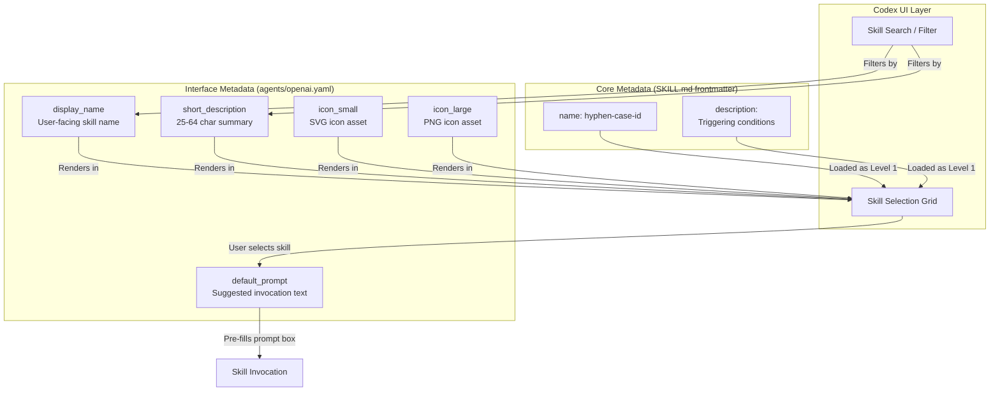
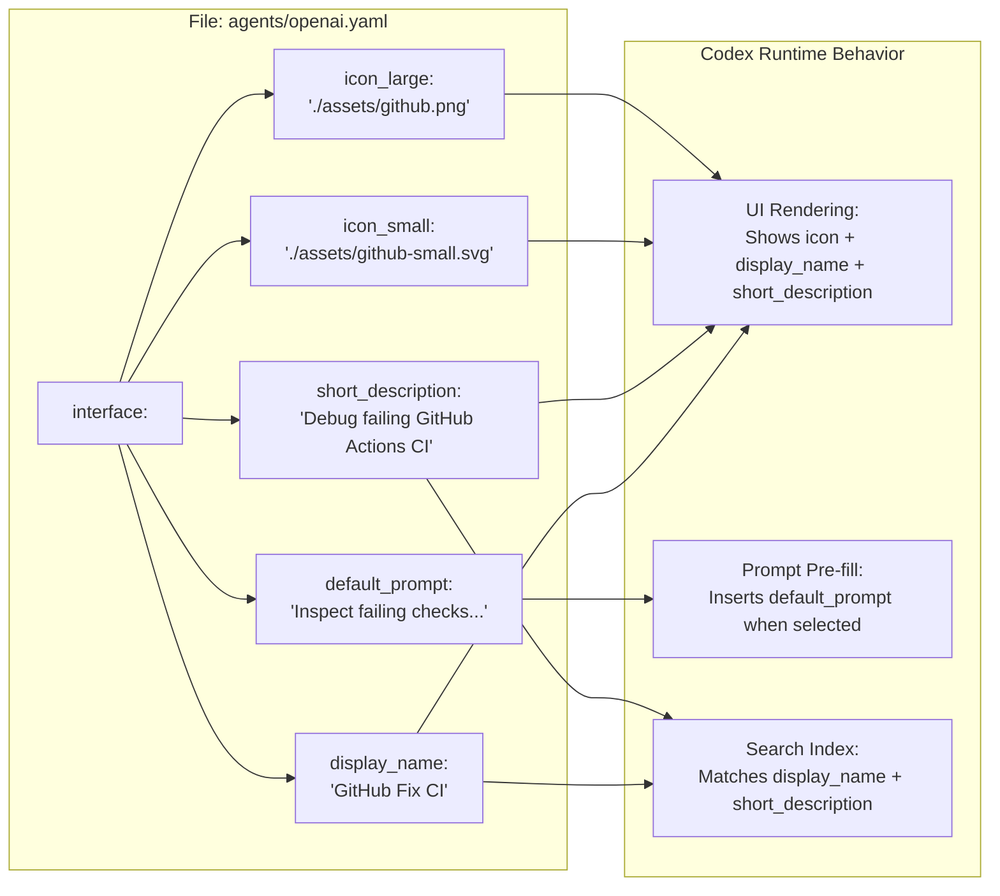

<!-- source: DeepWiki mcp.deepwiki.com · repo openai/skills · page 3.2 Using Installed Skills · fetched 2026-10-30 -->

# Using Installed Skills

<details>
<summary>Relevant source files</summary>

The following files were used as context for generating this wiki page:

- [skills/.curated/gh-address-comments/agents/openai.yaml](skills/.curated/gh-address-comments/agents/openai.yaml)
- [skills/.curated/gh-address-comments/assets/github-small.svg](skills/.curated/gh-address-comments/assets/github-small.svg)
- [skills/.curated/gh-address-comments/assets/github.png](skills/.curated/gh-address-comments/assets/github.png)
- [skills/.curated/gh-fix-ci/agents/openai.yaml](skills/.curated/gh-fix-ci/agents/openai.yaml)
- [skills/.curated/yeet/agents/openai.yaml](skills/.curated/yeet/agents/openai.yaml)
- [skills/.curated/yeet/assets/yeet-small.svg](skills/.curated/yeet/assets/yeet-small.svg)
- [skills/.curated/yeet/assets/yeet.png](skills/.curated/yeet/assets/yeet.png)
- [skills/.system/skill-creator/SKILL.md](skills/.system/skill-creator/SKILL.md)
- [skills/.system/skill-creator/agents/openai.yaml](skills/.system/skill-creator/agents/openai.yaml)
- [skills/.system/skill-creator/references/openai_yaml.md](skills/.system/skill-creator/references/openai_yaml.md)
- [skills/.system/skill-creator/scripts/generate_openai_yaml.py](skills/.system/skill-creator/scripts/generate_openai_yaml.py)
- [skills/.system/skill-creator/scripts/init_skill.py](skills/.system/skill-creator/scripts/init_skill.py)
- [skills/.system/skill-creator/scripts/quick_validate.py](skills/.system/skill-creator/scripts/quick_validate.py)
- [skills/.system/skill-installer/agents/openai.yaml](skills/.system/skill-installer/agents/openai.yaml)

</details>


This document explains how to invoke and interact with skills after they have been installed in Codex. It covers skill discovery through the interface layer, explicit and implicit invocation patterns, and the execution flow triggered by user prompts. For information about installing skills before use, see [3.1 Installing Skills]().

## Skill Discovery

Once installed and after restarting Codex, skills become discoverable through their interface metadata defined in `agents/openai.yaml` [skills/.system/skill-creator/SKILL.md:59-60](). Codex always loads Level 1 metadata (the `name` and `description` fields from `SKILL.md` frontmatter) for all installed skills to manage the context window efficiently [skills/.system/skill-creator/SKILL.md:129-131]().

The interface layer extends this metadata with user-facing presentation information defined in the `interface` block of `openai.yaml` [skills/.system/skill-creator/references/openai_yaml.md:8-14]():

| Interface Field | Purpose | Example |
|----------------|---------|---------|
| `display_name` | User-facing skill name shown in UI | "GitHub Fix CI" |
| `short_description` | 25-64 character summary for quick scanning | "Debug failing GitHub Actions CI" |
| `default_prompt` | Suggested prompt text when skill is selected | "Inspect failing GitHub Actions checks..." |
| `icon_small` | Path to SVG icon asset (relative to skill dir) | `./assets/github-small.svg` |
| `icon_large` | Path to PNG icon asset (relative to skill dir) | `./assets/github.png` |

### Skill Selection Grid

Codex renders installed skills in a selection interface using these presentation fields. The metadata is processed by scripts like `generate_openai_yaml.py` to ensure consistency, specifically enforcing the 25-64 character limit for short descriptions [skills/.system/skill-creator/scripts/generate_openai_yaml.py:163-168]().

**Skill Interface Rendering and Discovery**

Sources: [skills/.system/skill-creator/SKILL.md:74-82](), [skills/.system/skill-creator/scripts/generate_openai_yaml.py:42-49](), [skills/.system/skill-creator/references/openai_yaml.md:33-38]()

## Skill Invocation Methods

Skills can be invoked through two primary methods: explicit invocation by name or prompt, and implicit triggering based on context.

### Explicit Invocation

Users can explicitly invoke a skill by:
1. **Selecting from the UI**: Click a skill in the selection grid to pre-fill the `default_prompt` [skills/.system/skill-creator/references/openai_yaml.md:38]().
2. **Mentioning by display name**: Reference the skill's `display_name` (e.g., "Skill Creator") in a prompt [skills/.system/skill-creator/agents/openai.yaml:2]().
3. **Using the skill name**: Reference the `name` field from `SKILL.md` frontmatter (e.g., `$skill-creator`) [skills/.system/skill-creator/SKILL.md:71](), [skills/.system/skill-creator/references/openai_yaml.md:31]().

**Example explicit invocations:**
- "Use the GitHub Fix CI skill to debug the failing tests"
- "Run gh-fix-ci on this repository"
- "Skill Creator, read my repository and create a skill for API testing"

### Implicit Triggering

Codex decides to trigger a skill implicitly when the conversation context matches conditions described in the skill's `description` field. The `description` is part of Level 1 metadata, always loaded for all skills, allowing Codex to evaluate triggering conditions without loading the full skill content [skills/.system/skill-creator/SKILL.md:71-72]().

**Example triggering patterns:**

| Skill | Trigger Condition (from description) | Example Prompt |
|-------|--------------------------------------|----------------|
| `skill-creator` | User wants to create/update a skill [skills/.system/skill-creator/SKILL.md:3]() | "Help me build a new skill for AWS" |
| `gh-fix-ci` | GitHub CI failures mentioned [skills/.curated/gh-fix-ci/agents/openai.yaml:3]() | "The tests are failing in CI" |
| `yeet` | User wants to stage/commit/PR [skills/.curated/yeet/agents/openai.yaml:3]() | "Open a PR for these changes" |

Sources: [skills/.system/skill-creator/SKILL.md:1-6](), [skills/.curated/gh-fix-ci/agents/openai.yaml:1-6](), [skills/.curated/yeet/agents/openai.yaml:1-6]()

## Interface Structure Mapping

The `openai.yaml` file defines the complete interface contract between a skill and the Codex UI. The `generate_openai_yaml.py` script enforces these fields and formats them deterministically using functions like `format_display_name` and `generate_short_description` [skills/.system/skill-creator/scripts/generate_openai_yaml.py:155-168]().

**openai.yaml Interface to Runtime Behavior Mapping**

Sources: [skills/.system/skill-creator/references/openai_yaml.md:1-14](), [skills/.system/skill-creator/scripts/generate_openai_yaml.py:160-161](), [skills/.curated/gh-fix-ci/agents/openai.yaml:1-6]()

## Skill Execution Flow

When a skill is invoked, Codex follows a progressive disclosure pattern to manage the context window [skills/.system/skill-creator/SKILL.md:127-133]().

**Progressive Skill Loading and Execution**
```mermaid
sequenceDiagram
    participant User
    participant Codex["Codex Agent"]
    participant Level1["Level 1 Metadata<br/>(Always Loaded)"]
    participant Level2["Level 2: SKILL.md Body<br/>(Triggered)"]
    participant Level3["Level 3: Resources<br/>(On-demand)"]
    participant External["External Systems<br/>(MCP servers)"]
    
    Note over Codex,Level1: At Startup
    Codex->>Level1: Load name + description (~100 words)
    
    Note over User,Level2: During Conversation
    User->>Codex: "Inspect failing GitHub Actions checks"
    
    Codex->>Level1: Evaluate trigger conditions
    Level1-->>Codex: gh-fix-ci matches
    
    Codex->>Level2: Load SKILL.md body instructions
    Level2-->>Codex: Detailed workflow steps
    
    Note over Codex,External: Execute Workflow
    Codex->>External: Call MCP Tool (e.g. GitHub)
    External-->>Codex: Tool results
    
    alt References needed
        Codex->>Level3: Load references/api_docs.md
        Level3-->>Codex: Detailed documentation
    end
    
    alt Scripts needed
        Codex->>Level3: Execute scripts/helper.py
        Level3-->>Codex: Deterministic output
    end
    
    Codex->>User: Final response
```

### Loading Stages

1.  **Stage 1: Metadata (Level 1)**: Always in context. Includes `name` and `description` from `SKILL.md` frontmatter [skills/.system/skill-creator/SKILL.md:131]().
2.  **Stage 2: Instructions (Level 2)**: Loaded only when the skill triggers. Includes the full Markdown body of `SKILL.md` [skills/.system/skill-creator/SKILL.md:132]().
3.  **Stage 3: Resources (Level 3)**: Loaded as needed. Includes `scripts/` for deterministic tasks [skills/.system/skill-creator/SKILL.md:86-93]() and `references/` for detailed documentation [skills/.system/skill-creator/SKILL.md:95-104]().

Sources: [skills/.system/skill-creator/SKILL.md:127-133](), [skills/.system/skill-creator/SKILL.md:48-65]()

## Invocation Patterns by Skill Type

### System Skills (skill-creator, skill-installer)
**Trigger conditions**: User intent to manage the skill library itself.
- `skill-creator`: Triggered when users want to create or update a skill [skills/.system/skill-creator/SKILL.md:1-6]().
- `skill-installer`: Triggered when users want to install new capabilities.

### Curated Integration Skills (GitHub, Yeet)
**Trigger conditions**: Repository context, CI failures, or PR management.
- `gh-fix-ci`: "Inspect failing GitHub Actions checks in this repo, summarize root cause, and propose a focused fix plan." [skills/.curated/gh-fix-ci/agents/openai.yaml:6]().
- `yeet`: "Prepare this branch for review: stage intended changes, write a focused commit, and open a PR." [skills/.curated/yeet/agents/openai.yaml:6]().

Sources: [skills/.system/skill-creator/agents/openai.yaml:1-4](), [skills/.curated/gh-fix-ci/agents/openai.yaml:1-6](), [skills/.curated/yeet/agents/openai.yaml:1-6]()

## Post-Installation Restart Requirement

Skills are loaded during Codex startup. After using `$skill-installer` to add new skills, you must restart Codex for the skills to appear in the selection grid and for their Level 1 metadata to become available for trigger evaluation. This ensures that the skill metadata is properly indexed and available in Codex's context window allocation strategy [skills/.system/skill-creator/SKILL.md:127-133]().

---

