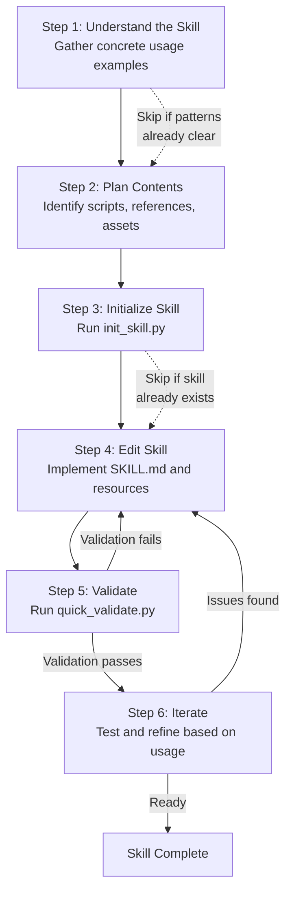
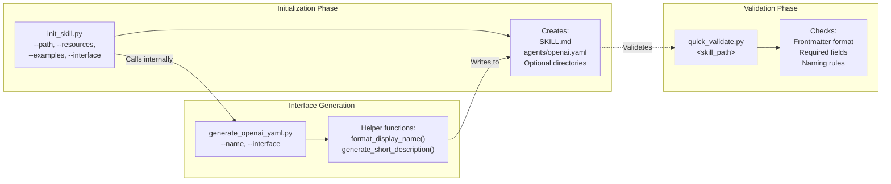
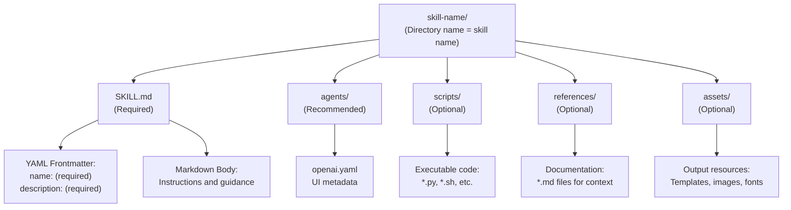
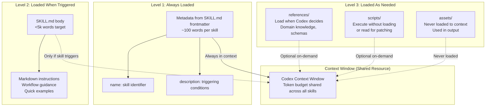
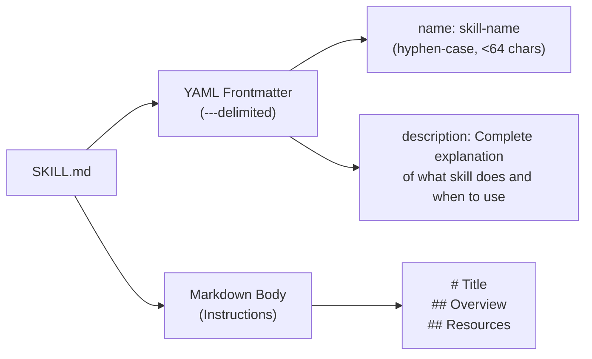
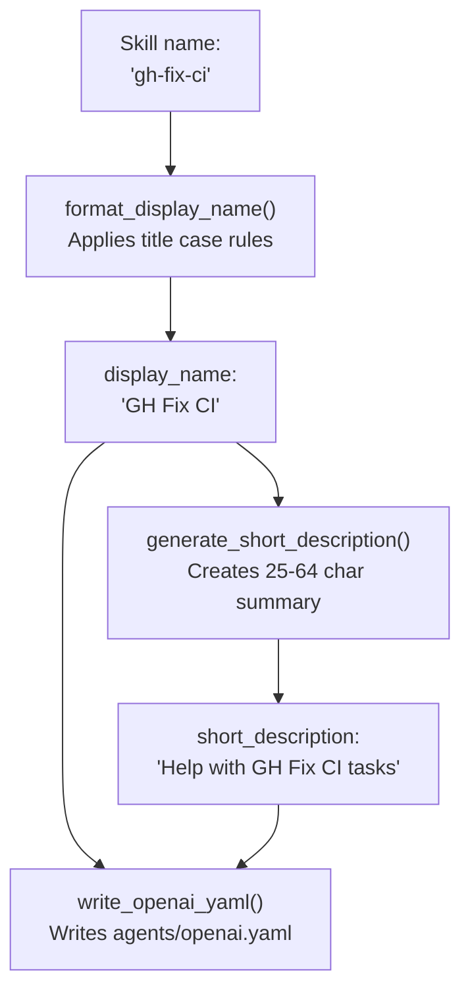

<!-- source: DeepWiki mcp.deepwiki.com · repo openai/skills · page 4 Creating Skills · fetched 2026-10-30 -->

# Creating Skills

Relevant source files

The following files were used as context for generating this wiki page:

- [skills/.system/skill-creator/SKILL.md](skills/.system/skill-creator/SKILL.md)
- [skills/.system/skill-creator/references/openai_yaml.md](skills/.system/skill-creator/references/openai_yaml.md)
- [skills/.system/skill-creator/scripts/generate_openai_yaml.py](skills/.system/skill-creator/scripts/generate_openai_yaml.py)
- [skills/.system/skill-creator/scripts/init_skill.py](skills/.system/skill-creator/scripts/init_skill.py)
- [skills/.system/skill-creator/scripts/quick_validate.py](skills/.system/skill-creator/scripts/quick_validate.py)

This document provides a comprehensive guide to developing custom skills for Codex agents. It covers the complete development lifecycle from conceptualization through validation and packaging, including the tools, file structures, and workflows used by the skill-creator system.

For information about using existing skills, see [Getting Started with Skills](#3). For detailed anatomy of skill components, see [Skill Anatomy](#4.3). For catalog of available skills, see [Curated Skills Reference](#5).

## Purpose and Scope

Skills are modular, self-contained directories that extend Codex's capabilities by providing specialized knowledge, workflows, and tool integrations. This page documents the end-to-end process of creating new skills, including:

- The six-step skill creation workflow
- Development tools (`init_skill.py`, `quick_validate.py`, `generate_openai_yaml.py`)
- Required file structures and formats (`SKILL.md`, `agents/openai.yaml`)
- Progressive disclosure design patterns
- Best practices for resource organization

The skill-creator system itself is a meta-skill (`.system/skill-creator`) that provides scaffolding, validation, and guidance for building effective skills.

Sources: [skills/.system/skill-creator/SKILL.md:8-17]()

## Six-Step Development Workflow

The skill creation process follows a structured workflow designed to ensure skills are well-designed and implementable:

**Workflow details:**

| Step | Key Activities | Primary Output | Can Skip? |
|------|---------------|----------------|-----------|
| 1. Understand | Ask questions, gather examples | Concrete usage patterns | Only if patterns already clear |
| 2. Plan | Analyze examples, identify reusable components | List of scripts/references/assets | No |
| 3. Initialize | Run `init_skill.py` with appropriate flags | Skill directory structure | Only if skill exists |
| 4. Edit | Write `SKILL.md`, implement resources, generate interface | Complete skill implementation | No |
| 5. Validate | Run `quick_validate.py` | Validation report | No |
| 6. Iterate | Test on real tasks, collect feedback | Refined skill | No |

For details, see [Skill Development Principles](#4.1).

Sources: [skills/.system/skill-creator/SKILL.md:215-227](), [skills/.system/skill-creator/SKILL.md:236-378]()

## Development Tool Chain

The skill-creator provides Python scripts that handle initialization, validation, and interface generation:

### Script Details

| Script | Purpose | Key Functions/Constants | Usage Pattern |
|--------|---------|------------------------|---------------|
| `init_skill.py` | Create skill scaffolding | `SKILL_TEMPLATE`, `MAX_SKILL_NAME_LENGTH=64` | `init_skill.py <name> --path <dir> [--resources scripts,references,assets] [--examples]` |
| `generate_openai_yaml.py` | Generate UI metadata | `format_display_name()`, `generate_short_description()`, `write_openai_yaml()`, `ACRONYMS`, `BRANDS` | `generate_openai_yaml.py <skill_dir> [--name <name>] [--interface key=value]` |
| `quick_validate.py` | Validate skill format | `validate_skill()`, `MAX_SKILL_NAME_LENGTH=64` | `quick_validate.py <skill_path>` |

For details, see [Initializing a New Skill](#4.2) and [Validating and Packaging Skills](#4.4).

Sources: [skills/.system/skill-creator/scripts/init_skill.py:1-111](), [skills/.system/skill-creator/scripts/generate_openai_yaml.py:1-226](), [skills/.system/skill-creator/scripts/quick_validate.py:1-102]()

## Skill Directory Structure

Every skill follows a standardized directory layout with required and optional components:

### File Structure Table

| Path | Required? | Purpose | Size Guidelines |
|------|-----------|---------|-----------------|
| `SKILL.md` | Yes | Core skill definition and instructions | Keep body <5k words target; metadata always loaded (~100 words) |
| `agents/openai.yaml` | Recommended | UI metadata (display_name, icons, prompts) | Generated by `generate_openai_yaml.py` |
| `scripts/` | Optional | Executable code for deterministic tasks | Token-efficient; may execute without loading to context |
| `references/` | Optional | Documentation loaded as needed | Keep individual files <10k words; move detailed info here from `SKILL.md` |
| `assets/` | Optional | Files used in output (not loaded to context) | Templates, images, fonts; used in final output |

For details, see [Skill Anatomy](#4.3).

Sources: [skills/.system/skill-creator/SKILL.md:48-114](), [skills/.system/skill-creator/scripts/init_skill.py:1-14]()

## Progressive Disclosure Architecture

Skills use a three-level loading strategy to optimize context window usage:

### Loading Behavior by Component

| Component | When Loaded | Size Budget | Description |
|-----------|-------------|-------------|-------------|
| Frontmatter (`name`, `description`) | Always (all skills) | ~100 words | Used by Codex to determine when to trigger the skill |
| `SKILL.md` body | After skill triggers | <5k words | Instructions and guidance for using the skill |
| `scripts/*.py` | On demand or execution | Token-efficient | Executable code for tasks requiring deterministic reliability |
| `references/*.md` | When Codex needs them | <10k words each | Documentation loaded into context to inform thinking |
| `assets/*` | Never | Unlimited | Used within output Codex produces (templates, images) |

**Design principle:** Keep `SKILL.md` focused on essential procedural knowledge. Move detailed information to `references/` files that are loaded only when needed.

Sources: [skills/.system/skill-creator/SKILL.md:127-133](), [skills/.system/skill-creator/SKILL.md:67-114]()

## SKILL.md Format Requirements

The `SKILL.md` file consists of YAML frontmatter followed by Markdown instructions:

### Frontmatter Validation Rules

The `quick_validate.py` script enforces these constraints:

| Field | Required | Type | Constraints | Validation Logic |
|-------|----------|------|-------------|------------------|
| `name` | Yes | string | Hyphen-case only (`^[a-z0-9-]+$`), no leading/trailing hyphens, ≤64 chars | [skills/.system/skill-creator/scripts/quick_validate.py:56-77]() |
| `description` | Yes | string | No angle brackets (`<` or `>`), ≤1024 chars | [skills/.system/skill-creator/scripts/quick_validate.py:78-89]() |
| `allowed-tools` | No | list | Optional tool restrictions | [skills/.system/skill-creator/scripts/quick_validate.py:40]() |
| `metadata` | No | dict | Optional extended metadata | [skills/.system/skill-creator/scripts/quick_validate.py:40]() |

Sources: [skills/.system/skill-creator/scripts/quick_validate.py:15-92](), [skills/.system/skill-creator/SKILL.md:71-73]()

## Interface Metadata Generation

The `agents/openai.yaml` file provides UI-facing metadata generated from skill content:

### Interface Field Generation

| Function | Input | Logic | Output Example |
|----------|-------|-------|----------------|
| `format_display_name()` | `"gh-fix-ci"` | Title case with ACRONYMS (`GH`, `CI`, `API`, etc.) and BRANDS (`GitHub`, `OpenAI`) | `"GH Fix CI"` |
| `generate_short_description()` | `"GH Fix CI"` | Template: `"Help with {name} tasks"`, adjusted to 25-64 chars | `"Help with GH Fix CI tasks and workflows"` |

**Constraints enforced:**

- `short_description` must be 25-64 characters (checked at [skills/.system/skill-creator/scripts/generate_openai_yaml.py:163-168]())
- `interface.default_prompt` must explicitly mention the skill as `$skill-name` (specified in [skills/.system/skill-creator/references/openai_yaml.md:31]())

Sources: [skills/.system/skill-creator/scripts/generate_openai_yaml.py:16-104](), [skills/.system/skill-creator/references/openai_yaml.md:1-44]()

## Resource Organization Patterns

Skills bundle three types of optional resources:

- **scripts/**: Executable code (Python/Bash) for deterministic tasks or complex operations.
- **references/**: Documentation (Markdown) loaded into context as needed for domain knowledge or schemas.
- **assets/**: Files used in final output (templates, images, fonts) that are never loaded into context.

Sources: [skills/.system/skill-creator/SKILL.md:84-114](), [skills/.system/skill-creator/scripts/init_skill.py:73-111]()

## Development Principles

Three core principles guide effective skill design:

### 1. Conciseness
**Context window is a shared resource.** Only add context Codex doesn't already have. Prefer concise examples over verbose explanations.

### 2. Appropriate Degrees of Freedom
Match specificity to task fragility:
- **High freedom**: Text-based instructions for context-dependent decisions.
- **Medium freedom**: Pseudocode or scripts with parameters for preferred patterns.
- **Low freedom**: Specific scripts for fragile or consistency-critical operations.

### 3. Progressive Disclosure
Keep `SKILL.md` lean. Use `references/` for detailed info, and `scripts/` or `assets/` to offload logic and resources from the main instruction file.

For details, see [Skill Development Principles](#4.1).

Sources: [skills/.system/skill-creator/SKILL.md:26-47](), [skills/.system/skill-creator/SKILL.md:127-133]()

## Next Steps

For detailed information about each development phase:
- [Skill Development Principles](#4.1) — Detailed workflow and design philosophy.
- [Initializing a New Skill](#4.2) — Using `init_skill.py` for scaffolding.
- [Skill Anatomy](#4.3) — Complete structure of `SKILL.md` and resource directories.
- [Validating and Packaging Skills](#4.4) — Using `quick_validate.py` and `package_skill.py`.

---

