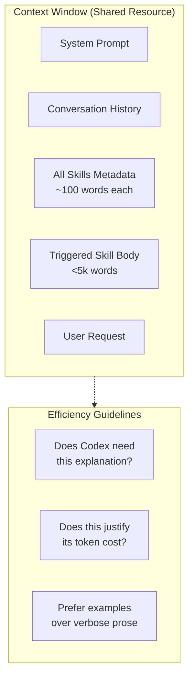
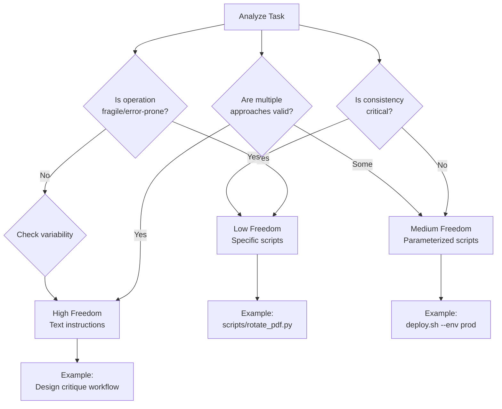
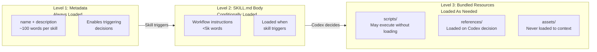
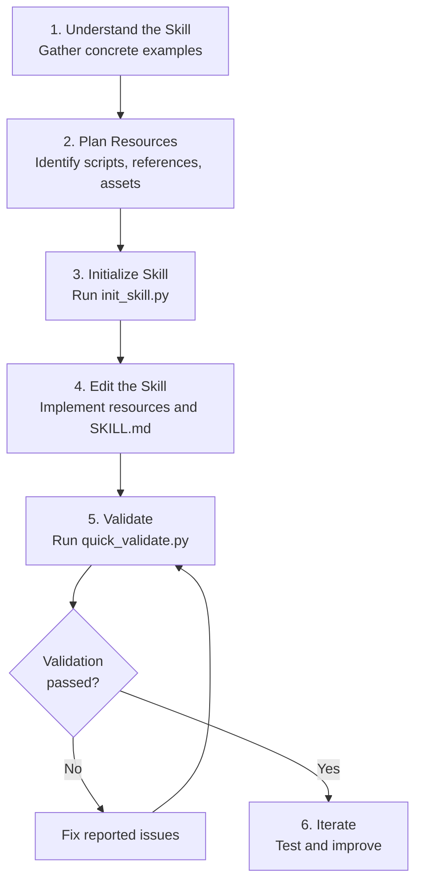

<!-- source: DeepWiki mcp.deepwiki.com · repo openai/skills · page 4.1 Skill Development Principles · fetched 2026-10-30 -->

# Skill Development Principles

<details>
<summary>Relevant source files</summary>

The following files were used as context for generating this wiki page:

- [skills/.system/skill-creator/SKILL.md](skills/.system/skill-creator/SKILL.md)
- [skills/.system/skill-creator/references/openai_yaml.md](skills/.system/skill-creator/references/openai_yaml.md)
- [skills/.system/skill-creator/scripts/generate_openai_yaml.py](skills/.system/skill-creator/scripts/generate_openai_yaml.py)
- [skills/.system/skill-creator/scripts/init_skill.py](skills/.system/skill-creator/scripts/init_skill.py)
- [skills/.system/skill-creator/scripts/quick_validate.py](skills/.system/skill-creator/scripts/quick_validate.py)

</details>


This page outlines the foundational principles that guide effective skill development in the Agent Skills repository. These principles ensure skills are context-efficient, appropriately structured, and follow consistent patterns that maximize their utility for Codex agents.

For detailed information about skill file structure and components, see **4.3 Skill Anatomy**. For hands-on guidance on creating a new skill, see **4.2 Initializing a New Skill**.

## Purpose of Skills

Skills are modular, self-contained folders that extend Codex's capabilities by providing specialized knowledge, workflows, and tools. They function as "onboarding guides" for specific domains or tasks, transforming Codex from a general-purpose agent into a specialized agent equipped with procedural knowledge that no model can fully possess. [skills/.system/skill-creator/SKILL.md:12-17]()

### What Skills Provide

| Capability | Description | Examples |
|------------|-------------|----------|
| **Specialized workflows** | Multi-step procedures for specific domains | Design-to-code implementation, CI debugging processes |
| **Tool integrations** | Instructions for working with specific formats or APIs | PDF manipulation, GitHub API usage, MCP server connections |
| **Domain expertise** | Company-specific knowledge, schemas, business logic | Database schemas, brand guidelines, compliance policies |
| **Bundled resources** | Scripts, references, and assets for complex tasks | Reusable Python scripts, API documentation, template files |

**Sources:** [skills/.system/skill-creator/SKILL.md:19-24]()

## Core Development Principles

### Context Efficiency (Concise is Key)

The context window is a shared resource. Skills compete for context space with system prompts, conversation history, other skills' metadata, and user requests. [skills/.system/skill-creator/SKILL.md:28-30]()

**Default assumption: Codex is already very smart.** Only add context Codex doesn't already have. Challenge each piece of information:
- "Does Codex really need this explanation?" [skills/.system/skill-creator/SKILL.md:32-32]()
- "Does this paragraph justify its token cost?" [skills/.system/skill-creator/SKILL.md:32-32]()

**Prefer concise examples over verbose explanations.** [skills/.system/skill-creator/SKILL.md:34-34]()

Title: Context Window as a Public Good

**Sources:** [skills/.system/skill-creator/SKILL.md:28-34]()

### Setting Appropriate Degrees of Freedom

Match the level of specificity to the task's fragility and variability. Think of Codex as exploring a path: a narrow bridge with cliffs needs specific guardrails (low freedom), while an open field allows many routes (high freedom). [skills/.system/skill-creator/SKILL.md:36-46]()

| Freedom Level | When to Use | Implementation Approach | Example Use Cases |
|--------------|-------------|------------------------|-------------------|
| **High freedom** | Multiple approaches are valid; decisions depend on context; heuristics guide approach | Text-based instructions | Content generation, design critique, exploratory analysis |
| **Medium freedom** | A preferred pattern exists; some variation acceptable; configuration affects behavior | Pseudocode or scripts with parameters | Deployment with environment options, query construction |
| **Low freedom** | Operations are fragile and error-prone; consistency is critical; specific sequence required | Specific scripts with few parameters | PDF form filling, CI log parsing, OAuth flows |

**Sources:** [skills/.system/skill-creator/SKILL.md:36-46]()

Title: Degrees of Freedom Decision Tree

**Sources:** [skills/.system/skill-creator/SKILL.md:36-46]()

### Progressive Disclosure Design Principle

Skills use a three-level loading system to manage context efficiently. This ensures that Codex always has access to skill metadata for triggering decisions, but only loads detailed content when necessary. [skills/.system/skill-creator/SKILL.md:127-134]()

Title: Progressive Disclosure Levels

**Sources:** [skills/.system/skill-creator/SKILL.md:127-134]()

#### Progressive Disclosure Patterns

Keep `SKILL.md` body under 500 lines to minimize context bloat. When approaching this limit, split content into separate files in `references/` with clear descriptions in `SKILL.md` explaining when to read them. [skills/.system/skill-creator/SKILL.md:104-104]()

**Pattern 1: High-level guide with references**
Codex loads reference files only when it determines they are needed for the specific task. [skills/.system/skill-creator/SKILL.md:102-102]()

**Pattern 2: Domain-specific organization**
For skills with multiple domains, organize content by domain (e.g., `references/finance.md`, `references/sales.md`) so Codex only reads relevant files. [skills/.system/skill-creator/SKILL.md:100-101]()

**Important guidelines:**
- **Avoid duplication**: Information should live in either `SKILL.md` or reference files, not both. [skills/.system/skill-creator/SKILL.md:104-104]()
- **Structure longer reference files**: If files are large (>10k words), include grep search patterns in `SKILL.md`. [skills/.system/skill-creator/SKILL.md:103-103]()

**Sources:** [skills/.system/skill-creator/SKILL.md:95-105]()

## Six-Step Creation Workflow

Skill creation follows a structured process defined in the system's meta-skills. [skills/.system/skill-creator/SKILL.md:215-225]()

Title: Six-Step Skill Creation Process

**Sources:** [skills/.system/skill-creator/SKILL.md:215-225]()

### Step 1: Understanding the Skill with Concrete Examples
Gather concrete examples of how the skill will be used to understand the functionality it should support. [skills/.system/skill-creator/SKILL.md:236-251]()

### Step 2: Planning Reusable Skill Contents
Identify what scripts, references, and assets would be helpful for executing the skill repeatedly. [skills/.system/skill-creator/SKILL.md:253-275]()

### Step 3: Initializing the Skill
Use `init_skill.py` to generate the template directory. This script handles the creation of the `SKILL.md` template and the `agents/openai.yaml` interface metadata. [skills/.system/skill-creator/scripts/init_skill.py:1-14]()

```bash
# Example initialization
init_skill.py my-new-skill --path skills/public --resources scripts,references
```

### Step 4: Editing the Skill
- **Bundled Resources**: Implement logic in `scripts/`, documentation in `references/`, and templates in `assets/`. [skills/.system/skill-creator/SKILL.md:84-114]()
- **SKILL.md**: Define the `name` and `description` in frontmatter. The description is the primary triggering mechanism. [skills/.system/skill-creator/SKILL.md:71-72]()
- **openai.yaml**: Generate UI metadata using `generate_openai_yaml.py`. This script ensures that `display_name` and `short_description` adhere to character limits and formatting rules. [skills/.system/skill-creator/scripts/generate_openai_yaml.py:155-186]()

### Step 5: Validating the Skill
Run `quick_validate.py` to ensure the skill meets format and naming requirements. This script checks for valid YAML frontmatter, character limits, and naming conventions. [skills/.system/skill-creator/scripts/quick_validate.py:15-91]()

### Step 6: Iteration
Test the skill on real tasks and refine instructions or resources based on performance. [skills/.system/skill-creator/SKILL.md:368-378]()

## Skill Naming Conventions

Skills follow strict naming conventions enforced by the system validation logic. [skills/.system/skill-creator/scripts/quick_validate.py:61-76]()

| Rule | Description | Valid Examples |
|------|-------------|----------------|
| **Character set** | Lowercase letters, digits, hyphens only | `pdf-editor`, `gh-fix-ci` |
| **Length** | Maximum 64 characters | `notion-meeting-intelligence` |
| **Format** | No leading/trailing hyphens, no consecutive hyphens | `linear-address-issue` |

**Sources:** [skills/.system/skill-creator/scripts/init_skill.py:23](), [skills/.system/skill-creator/scripts/quick_validate.py:12, 61-76]()

## What NOT to Include in a Skill

Skills should only contain essential files for the AI agent. Do NOT include: [skills/.system/skill-creator/SKILL.md:115-125]()
- `README.md`
- `INSTALLATION_GUIDE.md`
- `QUICK_REFERENCE.md`
- `CHANGELOG.md`

These files add context clutter and are not used by the agent. [skills/.system/skill-creator/SKILL.md:125-126]()

## Code Entity Reference

Title: Skill Creation Code Utilities
```mermaid
classDiagram
    class "init_skill.py" {
        +MAX_SKILL_NAME_LENGTH: 64
        +ALLOWED_RESOURCES: set
        +write_openai_yaml()
    }
    class "quick_validate.py" {
        +validate_skill(skill_path)
        +MAX_SKILL_NAME_LENGTH: 64
    }
    class "generate_openai_yaml.py" {
        +format_display_name(skill_name)
        +generate_short_description(display_name)
        +write_openai_yaml(skill_dir, skill_name, raw_overrides)
    }
```
**Sources:** [skills/.system/skill-creator/scripts/init_skill.py](), [skills/.system/skill-creator/scripts/quick_validate.py](), [skills/.system/skill-creator/scripts/generate_openai_yaml.py]()

---

