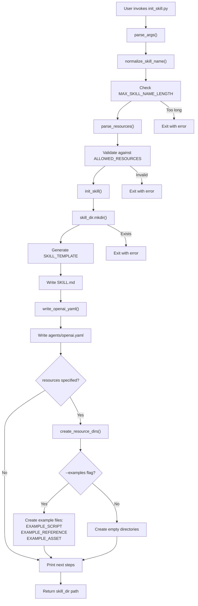
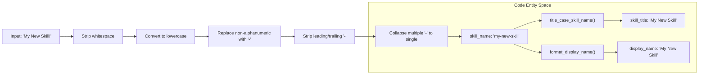

<!-- source: DeepWiki mcp.deepwiki.com · repo openai/skills · page 4.2 Initializing a New Skill · fetched 2026-10-30 -->

# Initializing a New Skill

<details>
<summary>Relevant source files</summary>

The following files were used as context for generating this wiki page:

- [skills/.system/skill-creator/SKILL.md](skills/.system/skill-creator/SKILL.md)
- [skills/.system/skill-creator/references/openai_yaml.md](skills/.system/skill-creator/references/openai_yaml.md)
- [skills/.system/skill-creator/scripts/generate_openai_yaml.py](skills/.system/skill-creator/scripts/generate_openai_yaml.py)
- [skills/.system/skill-creator/scripts/init_skill.py](skills/.system/skill-creator/scripts/init_skill.py)
- [skills/.system/skill-creator/scripts/quick_validate.py](skills/.system/skill-creator/scripts/quick_validate.py)

</details>


This page documents the skill initialization process using `init_skill.py`, which scaffolds a new skill directory with template files, metadata, and optional resource directories. This is the first hands-on step in creating a new skill after planning its contents.

For the overall skill development principles and workflow, see [Skill Development Principles](4.1). For detailed information about the generated components, see [Skill Anatomy](4.3). For validation after initialization, see [Validating and Packaging Skills](4.4).

## Purpose and Scope

The `init_skill.py` script automates the creation of a properly structured skill directory, eliminating manual file creation and ensuring consistency across all skills. It generates:

- A `SKILL.md` file with proper YAML frontmatter and structured guidance [skills/.system/skill-creator/scripts/init_skill.py:26-111]().
- An `agents/openai.yaml` file containing UI-facing metadata [skills/.system/skill-creator/scripts/init_skill.py:307-307]().
- Optional resource directories (`scripts/`, `references/`, `assets/`) [skills/.system/skill-creator/scripts/init_skill.py:309-317]().
- Optional example files within resource directories [skills/.system/skill-creator/scripts/init_skill.py:113-191]().
- Proper naming and directory structure [skills/.system/skill-creator/scripts/init_skill.py:270-271]().

This script should be run once per new skill, before manual editing begins.

**Sources:** [skills/.system/skill-creator/scripts/init_skill.py:1-14](), [skills/.system/skill-creator/SKILL.md:48-65]()

## Script Location and Invocation

The initialization script is located at `skills/.system/skill-creator/scripts/init_skill.py` and is part of the `skill-creator` system skill.

Basic invocation pattern:

```bash
init_skill.py <skill-name> --path <output-directory> [--resources <comma-separated-list>] [--examples] [--interface key=value]
```

**Sources:** [skills/.system/skill-creator/scripts/init_skill.py:1-14]()

## Initialization Process Flow

The following diagram illustrates how the `init_skill.py` script processes input arguments and generates the skill scaffolding.

**Skill Scaffolding Logic**


**Sources:** [skills/.system/skill-creator/scripts/init_skill.py:255-317](), [skills/.system/skill-creator/scripts/init_skill.py:320-378]()

## Command-Line Arguments

| Argument | Required | Type | Description |
|----------|----------|------|-------------|
| `skill_name` | Yes | Positional | The name of the skill (normalized to hyphen-case) |
| `--path` | Yes | Flag | Output directory where the skill directory will be created |
| `--resources` | No | Flag | Comma-separated list of resource directories to create: `scripts`, `references`, `assets` |
| `--examples` | No | Flag | When set, creates example files inside the selected resource directories |
| `--interface` | No | Flag | Key=value pairs for `agents/openai.yaml` (e.g., `short_description="My label"`) |

**Sources:** [skills/.system/skill-creator/scripts/init_skill.py:320-336](), [skills/.system/skill-creator/scripts/init_skill.py:13-14]()

### Example Invocations

```bash
# Minimal skill with no resources
init_skill.py my-new-skill --path skills/public

# Skill with scripts and references directories
init_skill.py my-new-skill --path skills/public --resources scripts,references

# Skill with all resources, example files, and custom UI description
init_skill.py my-api-helper --path skills/private --resources scripts,references,assets --examples --interface short_description="Helper for API tasks"
```

**Sources:** [skills/.system/skill-creator/scripts/init_skill.py:8-14](), [skills/.system/skill-creator/SKILL.md:79-81]()

## Name Normalization and Title Generation

The script normalizes skill names for consistency and generates human-readable titles for documentation.

**From CLI Input to Code Entities**


**Normalization Rules:**
1. Convert to lowercase [skills/.system/skill-creator/scripts/init_skill.py:196-196]().
2. Replace non-alphanumeric sequences with a single hyphen [skills/.system/skill-creator/scripts/init_skill.py:198-198]().
3. Strip leading/trailing hyphens [skills/.system/skill-creator/scripts/init_skill.py:200-200]().
4. Verify length ≤ 64 characters (`MAX_SKILL_NAME_LENGTH`) [skills/.system/skill-creator/scripts/init_skill.py:202-205]().

**Sources:** [skills/.system/skill-creator/scripts/init_skill.py:194-205](), [skills/.system/skill-creator/scripts/generate_openai_yaml.py:57-73]()

## Metadata Generation (`agents/openai.yaml`)

`init_skill.py` calls `write_openai_yaml` from `generate_openai_yaml.py` to create UI-facing metadata [skills/.system/skill-creator/scripts/init_skill.py:307-307]().

- **Display Name**: Generated by `format_display_name()`, which handles acronyms like `API`, `GH`, `MCP` [skills/.system/skill-creator/scripts/generate_openai_yaml.py:16-28]() and brands like `GitHub` or `OpenAI` [skills/.system/skill-creator/scripts/generate_openai_yaml.py:30-38]() specially.
- **Short Description**: Generated by `generate_short_description()`. It must be between 25 and 64 characters [skills/.system/skill-creator/scripts/generate_openai_yaml.py:163-168]().
- **Interface Overrides**: Users can provide custom values via `--interface`. Supported keys include `display_name`, `short_description`, `icon_small`, `icon_large`, `brand_color`, and `default_prompt` [skills/.system/skill-creator/scripts/generate_openai_yaml.py:42-49]().

**Sources:** [skills/.system/skill-creator/scripts/generate_openai_yaml.py:16-49](), [skills/.system/skill-creator/scripts/generate_openai_yaml.py:155-186]()

## Generated Directory Structure

The initialization process creates the following structure:

```
<path>/<skill-name>/
├── SKILL.md                    # Core instructions (SKILL_TEMPLATE)
├── agents/
│   └── openai.yaml             # UI metadata (via write_openai_yaml)
└── [resource directories]      # Optional, based on --resources flag
    ├── scripts/               # Executable code
    │   └── example.py         # If --examples flag set
    ├── references/            # Context documentation
    │   └── api_reference.md   # If --examples flag set
    └── assets/                # Output files/templates
        └── example_asset.txt  # If --examples flag set
```

**Sources:** [skills/.system/skill-creator/scripts/init_skill.py:255-317](), [skills/.system/skill-creator/SKILL.md:52-65]()

## SKILL.md Template Structure

The `SKILL_TEMPLATE` defines the markdown structure for the AI agent [skills/.system/skill-creator/scripts/init_skill.py:26-111]().

| Section | Content |
|---------|---------|
| **Frontmatter** | YAML containing `name` and `description` [skills/.system/skill-creator/scripts/init_skill.py:26-29](). |
| **Overview** | 1-2 sentence explanation of the skill [skills/.system/skill-creator/scripts/init_skill.py:33-35](). |
| **Structuring Guidance** | Advice on patterns: Workflow-Based, Task-Based, Reference-Based, or Capabilities-Based [skills/.system/skill-creator/scripts/init_skill.py:37-63](). |
| **Resources** | Guidance on when to use `scripts/`, `references/`, and `assets/` [skills/.system/skill-creator/scripts/init_skill.py:73-111](). |

**Sources:** [skills/.system/skill-creator/scripts/init_skill.py:26-111]()

## Example File Templates

When `--examples` is specified, the script populates resource directories with functional templates:

- **`scripts/example.py`**: A Python 3 template with `main()` and executable permissions (`0o755`) [skills/.system/skill-creator/scripts/init_skill.py:113-132]().
- **`references/api_reference.md`**: A guide on structuring API documentation and complex workflows [skills/.system/skill-creator/scripts/init_skill.py:134-168]().
- **`assets/example_asset.txt`**: A placeholder file explaining that assets are for output, not for context [skills/.system/skill-creator/scripts/init_skill.py:170-191]().

**Sources:** [skills/.system/skill-creator/scripts/init_skill.py:113-191](), [skills/.system/skill-creator/scripts/init_skill.py:227-252]()

## Error Handling

The script performs strict validation:
- **Name Validation**: Rejects names starting/ending with hyphens or containing consecutive hyphens [skills/.system/skill-creator/scripts/quick_validate.py:66-70]().
- **Resource Validation**: Only `scripts`, `references`, and `assets` are allowed [skills/.system/skill-creator/scripts/init_skill.py:24]().
- **Length Constraints**: Skill names are capped at 64 characters [skills/.system/skill-creator/scripts/quick_validate.py:71-76](); descriptions in `openai.yaml` must be 25-64 characters [skills/.system/skill-creator/scripts/generate_openai_yaml.py:163-168]().

**Sources:** [skills/.system/skill-creator/scripts/init_skill.py:20-21](), [skills/.system/skill-creator/scripts/quick_validate.py:61-76](), [skills/.system/skill-creator/scripts/generate_openai_yaml.py:163-168]()

---

