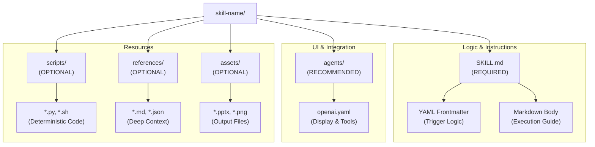
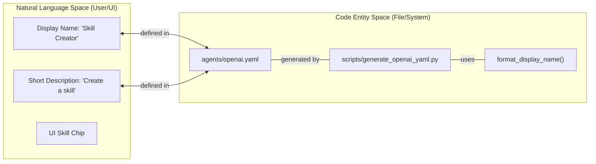
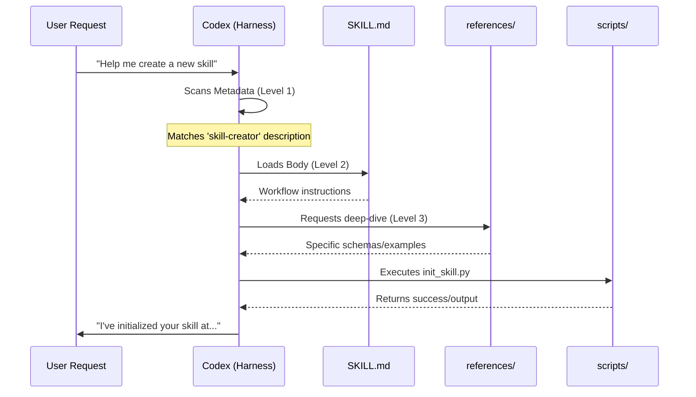

<!-- source: DeepWiki mcp.deepwiki.com · repo openai/skills · page 4.3 Skill Anatomy · fetched 2026-10-30 -->

# Skill Anatomy

<details>
<summary>Relevant source files</summary>

The following files were used as context for generating this wiki page:

- [skills/.curated/gh-address-comments/agents/openai.yaml](skills/.curated/gh-address-comments/agents/openai.yaml)
- [skills/.curated/gh-address-comments/assets/github-small.svg](skills/.curated/gh-address-comments/assets/github-small.svg)
- [skills/.curated/gh-address-comments/assets/github.png](skills/.curated/gh-address-comments/assets/github.png)
- [skills/.curated/gh-fix-ci/agents/openai.yaml](skills/.curated/gh-fix-ci/agents/openai.yaml)
- [skills/.curated/yeet/agents/openai.yaml](skills/.curated/yeet/agents/openai.yaml)
- [skills/.curated/yeet/assets/yeet-small.svg](skills/.curated/yeet/assets/yeet-small.svg)
- [skills/.curated/yeet/assets/yeet.png](skills/.curated/yeet/assets/yeet.png)
- [skills/.system/skill-creator/SKILL.md](skills/.system/skill-creator/SKILL.md)
- [skills/.system/skill-creator/agents/openai.yaml](skills/.system/skill-creator/agents/openai.yaml)
- [skills/.system/skill-creator/references/openai_yaml.md](skills/.system/skill-creator/references/openai_yaml.md)
- [skills/.system/skill-creator/scripts/generate_openai_yaml.py](skills/.system/skill-creator/scripts/generate_openai_yaml.py)
- [skills/.system/skill-creator/scripts/init_skill.py](skills/.system/skill-creator/scripts/init_skill.py)
- [skills/.system/skill-creator/scripts/quick_validate.py](skills/.system/skill-creator/scripts/quick_validate.py)
- [skills/.system/skill-installer/agents/openai.yaml](skills/.system/skill-installer/agents/openai.yaml)

</details>


## Purpose and Scope

This document details the complete structure and organization of skill packages, including the required `SKILL.md` file with its mandatory frontmatter, the recommended `agents/openai.yaml` for UI integration, and the optional bundled resource directories (`scripts/`, `references/`, `assets/`).

A skill is a modular, self-contained directory that transforms a general-purpose agent into a specialized one by providing procedural knowledge, specialized workflows, and tool integrations [skills/.system/skill-creator/SKILL.md:14-24](). Every skill follows a consistent structure designed for **Progressive Disclosure**, ensuring the agent's context window is used efficiently by loading only what is necessary at each stage of interaction [skills/.system/skill-creator/SKILL.md:127-133]().

## Directory Structure Overview

The canonical skill directory structure consists of two key files and three optional resource directories:

```text
skill-name/
├── SKILL.md              (required)
├── agents/               (recommended)
│   └── openai.yaml       (UI metadata)
├── scripts/              (optional)
├── references/           (optional)
└── assets/               (optional)
```

**Skill Component Relationship**



Sources: [skills/.system/skill-creator/SKILL.md:48-65](), [skills/.system/skill-creator/scripts/init_skill.py:23-111]()

## SKILL.md: The Core Interface

The `SKILL.md` file is the primary interface between the repository and the AI agent. It is split into YAML frontmatter (read during the "Trigger" phase) and a Markdown body (read during the "Execution" phase) [skills/.system/skill-creator/SKILL.md:67-73]().

### YAML Frontmatter

The frontmatter contains the metadata used by the system to determine when a skill should be activated.

| Field | Type | Validation Rule | Purpose |
|-------|------|-----------------|---------|
| `name` | string | hyphen-case, max 64 chars | Unique identifier for the skill [skills/.system/skill-creator/scripts/quick_validate.py:56-76]() |
| `description` | string | Max 1024 chars | Detailed explanation of **when** to trigger the skill [skills/.system/skill-creator/scripts/quick_validate.py:78-89]() |
| `metadata` | dict | Optional | Additional structured data like `short-description` [skills/.system/skill-creator/SKILL.md:4-5]() |

**Example:**
```yaml
---
name: skill-creator
description: Guide for creating effective skills. Use when users want to create a new skill or update an existing one.
---
```

### Markdown Body

The body provides the actual instructions. To maintain context efficiency, it should be concise and prefer examples over verbose explanations [skills/.system/skill-creator/SKILL.md:28-35]().

**Structural Patterns:**
*   **Workflow-Based:** Sequential steps (e.g., "Step 1: Read", "Step 2: Edit") [skills/.system/skill-creator/scripts/init_skill.py:41-44]().
*   **Task-Based:** Collection of operations (e.g., "Merge PDFs", "Split PDFs") [skills/.system/skill-creator/scripts/init_skill.py:46-49]().
*   **Reference/Guidelines:** Standards and specifications [skills/.system/skill-creator/scripts/init_skill.py:51-54]().

Sources: [skills/.system/skill-creator/SKILL.md:67-73](), [skills/.system/skill-creator/scripts/quick_validate.py:15-91](), [skills/.system/skill-creator/scripts/init_skill.py:37-61]()

## agents/openai.yaml: UI and Tooling

While `SKILL.md` is for the agent, `agents/openai.yaml` is for the UI harness. It defines how the skill appears to humans in lists and what external tools (like MCP servers) it requires [skills/.system/skill-creator/references/openai_yaml.md:1-4]().

### Interface Fields
*   `display_name`: Human-facing title (e.g., "GitHub Fix CI") [skills/.system/skill-creator/references/openai_yaml.md:33]().
*   `short_description`: Human-facing short UI blurb (25–64 chars) for quick scanning [skills/.system/skill-creator/references/openai_yaml.md:34]().
*   `default_prompt`: A starter prompt that explicitly mentions the skill as `$skill-name` [skills/.system/skill-creator/references/openai_yaml.md:31]().

### Tool Dependencies
Skills often depend on **Model Context Protocol (MCP)** servers to interact with external APIs (GitHub, Figma, etc.) [skills/.system/skill-creator/references/openai_yaml.md:16-23]().

**Natural Language to Code Entity Mapping**



Sources: [skills/.system/skill-creator/references/openai_yaml.md:1-44](), [skills/.system/skill-creator/scripts/generate_openai_yaml.py:57-73]()

## Bundled Resource Directories

### scripts/ (Deterministic Logic)
Contains executable code (Python, Bash) for tasks that require high reliability or are too token-heavy to describe in text [skills/.system/skill-creator/SKILL.md:86-94]().
*   **Benefit:** Scripts can be executed without being fully loaded into the context window, saving tokens [skills/.system/skill-creator/SKILL.md:92]().
*   **Implementation:** Usually invoked by the agent via a shell or python interpreter tool.

### references/ (On-Demand Knowledge)
Documentation and reference material intended to be loaded into context as needed to inform Codex's process [skills/.system/skill-creator/SKILL.md:95-98]().
*   **Use Cases:** API documentation, database schemas, company policies, and detailed workflow guides [skills/.system/skill-creator/SKILL.md:101]().
*   **Best Practice:** If files are >10k words, include grep search patterns in `SKILL.md` to help the agent find specific sections [skills/.system/skill-creator/SKILL.md:103]().

### assets/ (Output Templates)
Files not intended for the agent to read, but for the agent to use as part of its output (e.g., `.pptx` templates, `.png` logos, or boilerplate code) [skills/.system/skill-creator/SKILL.md:106-114]().

Sources: [skills/.system/skill-creator/SKILL.md:84-114](), [skills/.system/skill-creator/scripts/init_skill.py:73-108]()

## Progressive Disclosure Implementation

The system uses a three-level loading strategy to manage the context window [skills/.system/skill-creator/SKILL.md:127-133]():

| Level | Content Loaded | Timing | Purpose |
| :--- | :--- | :--- | :--- |
| **1** | Metadata (`name`, `description`) | Always | Discovery & Triggering |
| **2** | `SKILL.md` Body | On Trigger | Core Instructions |
| **3** | Resources (`references/`, `scripts/`) | On Demand | Specialized Execution |

**Data Flow: Trigger to Execution**



Sources: [skills/.system/skill-creator/SKILL.md:127-133](), [skills/.system/skill-creator/scripts/init_skill.py:1-14]()

## Technical Reference: Key Utilities

The `skill-creator` system skill provides the following tools for managing skill anatomy:

*   `init_skill.py`: Scaffolds the directory structure and generates templates [skills/.system/skill-creator/scripts/init_skill.py:1-14]().
*   `quick_validate.py`: Checks `SKILL.md` for frontmatter validity, name length (max 64), and description length (max 1024) [skills/.system/skill-creator/scripts/quick_validate.py:15-91]().
*   `generate_openai_yaml.py`: Deterministically generates UI metadata using `format_display_name()` to handle acronyms (API, CLI, PDF, etc.) and brands (GitHub, OpenAI, PagerDuty) [skills/.system/skill-creator/scripts/generate_openai_yaml.py:16-73]().

Sources: [skills/.system/skill-creator/scripts/init_skill.py:1-25](), [skills/.system/skill-creator/scripts/quick_validate.py:1-13](), [skills/.system/skill-creator/scripts/generate_openai_yaml.py:1-50]()

---

