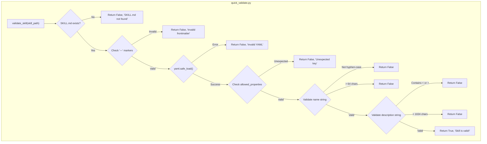
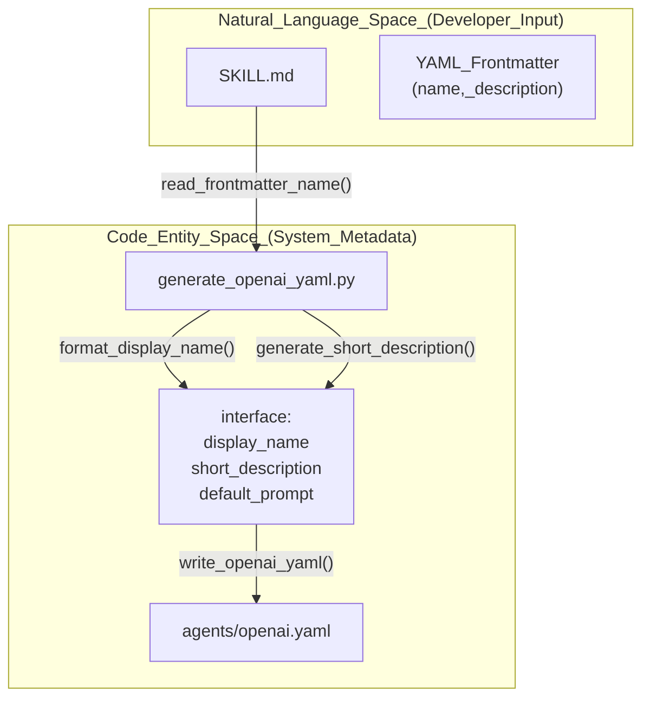

<!-- source: DeepWiki mcp.deepwiki.com · repo openai/skills · page 4.4 Validating and Packaging Skills · fetched 2026-10-30 -->

# Validating and Packaging Skills

Relevant source files

The following files were used as context for generating this wiki page:

- [skills/.system/skill-creator/SKILL.md](skills/.system/skill-creator/SKILL.md)
- [skills/.system/skill-creator/references/openai_yaml.md](skills/.system/skill-creator/references/openai_yaml.md)
- [skills/.system/skill-creator/scripts/generate_openai_yaml.py](skills/.system/skill-creator/scripts/generate_openai_yaml.py)
- [skills/.system/skill-creator/scripts/init_skill.py](skills/.system/skill-creator/scripts/init_skill.py)
- [skills/.system/skill-creator/scripts/quick_validate.py](skills/.system/skill-creator/scripts/quick_validate.py)

This document details the validation and packaging stages of skill development. It explains how to use `quick_validate.py` to enforce `SKILL.md` formatting and naming conventions, and how `generate_openai_yaml.py` (often called via `init_skill.py`) prepares a skill for distribution by creating the necessary UI metadata.

## Validation Overview

Validation ensures that skills conform to the required format and naming conventions before they are distributed or installed. The `quick_validate.py` script performs automated checks on `SKILL.md` frontmatter, name length, and description constraints.

**When to validate:**
- After initial skill creation with `init_skill.py` [[skills/.system/skill-creator/scripts/init_skill.py:1-13]]().
- After editing the `SKILL.md` body or frontmatter [[skills/.system/skill-creator/SKILL.md:71-73]]().
- Before generating or updating `agents/openai.yaml` [[skills/.system/skill-creator/SKILL.md:74-82]]().
- Prior to packaging a skill for distribution in the curated or experimental tiers.

**What validation checks:**
- **File Existence**: Presence of the required `SKILL.md` file [[skills/.system/skill-creator/scripts/quick_validate.py:19-21]]().
- **Frontmatter Structure**: Valid YAML delimited by `---` markers [[skills/.system/skill-creator/scripts/quick_validate.py:24-30]]().
- **Required Fields**: Presence of `name` and `description` [[skills/.system/skill-creator/scripts/quick_validate.py:51-54]]().
- **Allowed Keys**: Ensuring only supported keys (`name`, `description`, `license`, `allowed-tools`, `metadata`) exist in frontmatter [[skills/.system/skill-creator/scripts/quick_validate.py:40-49]]().
- **Naming Conventions**: Hyphen-case format, no consecutive hyphens, and length limits [[skills/.system/skill-creator/scripts/quick_validate.py:61-76]]().
- **Description Constraints**: Length limits and forbidden characters [[skills/.system/skill-creator/scripts/quick_validate.py:78-89]]().

Sources: [skills/.system/skill-creator/SKILL.md:67-73](), [skills/.system/skill-creator/scripts/quick_validate.py:1-102]()

## Validation Workflow

The following diagram illustrates the logical flow of the `validate_skill` function within `quick_validate.py`.

### Skill Validation Logic

Sources: [skills/.system/skill-creator/scripts/quick_validate.py:15-91]()

## SKILL.md Frontmatter Requirements

### Required Fields and Constraints

| Field | Type | Constraint | Purpose |
| :--- | :--- | :--- | :--- |
| `name` | String | Max 64 chars, `^[a-z0-9-]+$` | Unique identifier for the skill [[skills/.system/skill-creator/scripts/quick_validate.py:12, 61]](). |
| `description` | String | Max 1024 chars, no `<` or `>` | Used by Codex to determine when to trigger the skill [[skills/.system/skill-creator/scripts/quick_validate.py:84-89]](). |

Sources: [skills/.system/skill-creator/scripts/quick_validate.py:12-89]()

### Naming Convention Rules
1. **Hyphen-case only**: Must contain only lowercase letters, digits, and hyphens [[skills/.system/skill-creator/scripts/quick_validate.py:61-65]]().
2. **No leading/trailing hyphens**: Cannot start or end with `-` [[skills/.system/skill-creator/scripts/quick_validate.py:66-70]]().
3. **No consecutive hyphens**: Cannot contain `--` [[skills/.system/skill-creator/scripts/quick_validate.py:66-70]]().
4. **Length**: Maximum of 64 characters [[skills/.system/skill-creator/scripts/quick_validate.py:71-76]]().

## Packaging and Metadata Generation

Packaging involves preparing the skill for the UI by generating the `agents/openai.yaml` file. This file contains metadata that Codex uses for display names, short descriptions, and default prompts [[skills/.system/skill-creator/references/openai_yaml.md:1-23]]().

### Interface Metadata Generation
The `generate_openai_yaml.py` script (or `write_openai_yaml` function) automates the creation of `agents/openai.yaml`. It reads the `name` from `SKILL.md` and applies formatting rules to create human-readable strings [[skills/.system/skill-creator/scripts/generate_openai_yaml.py:155-187]]().

**Key Functions in `generate_openai_yaml.py`:**
- `format_display_name(skill_name)`: Converts hyphen-case names to Title Case, handling acronyms like "API" or "CI" and brands like "GitHub" [[skills/.system/skill-creator/scripts/generate_openai_yaml.py:57-73]]().
- `generate_short_description(display_name)`: Creates a UI-friendly blurb between 25 and 64 characters [[skills/.system/skill-creator/scripts/generate_openai_yaml.py:76-103]]().
- `write_openai_yaml(skill_dir, skill_name, raw_overrides)`: Writes the final `interface:` block to `agents/openai.yaml` [[skills/.system/skill-creator/scripts/generate_openai_yaml.py:155-187]]().

### Packaging Data Flow
The following diagram bridges the transition from the developer-written `SKILL.md` (Natural Language Space) to the structured `openai.yaml` used by the system (Code Entity Space).

Sources: [skills/.system/skill-creator/scripts/generate_openai_yaml.py:106-187](), [skills/.system/skill-creator/SKILL.md:74-82]()

## Summary of Field Constraints

| Field | Location | Constraint | Source |
| :--- | :--- | :--- | :--- |
| `name` | `SKILL.md` | Hyphen-case, max 64 chars | `quick_validate.py` [[skills/.system/skill-creator/scripts/quick_validate.py:12, 61]]() |
| `description` | `SKILL.md` | Max 1024 chars, no `<>` | `quick_validate.py` [[skills/.system/skill-creator/scripts/quick_validate.py:84, 88]]() |
| `short_description` | `openai.yaml` | 25–64 characters | `generate_openai_yaml.py` [[skills/.system/skill-creator/scripts/generate_openai_yaml.py:163]]() |
| `display_name` | `openai.yaml` | Title Case (auto-gen) | `generate_openai_yaml.py` [[skills/.system/skill-creator/scripts/generate_openai_yaml.py:57]]() |
| `default_prompt` | `openai.yaml` | Must include `$skill-name` | `openai_yaml.md` [[skills/.system/skill-creator/references/openai_yaml.md:31]]() |

Sources: [skills/.system/skill-creator/scripts/quick_validate.py:12-89](), [skills/.system/skill-creator/scripts/generate_openai_yaml.py:163-168](), [skills/.system/skill-creator/references/openai_yaml.md:25-44]()

---

