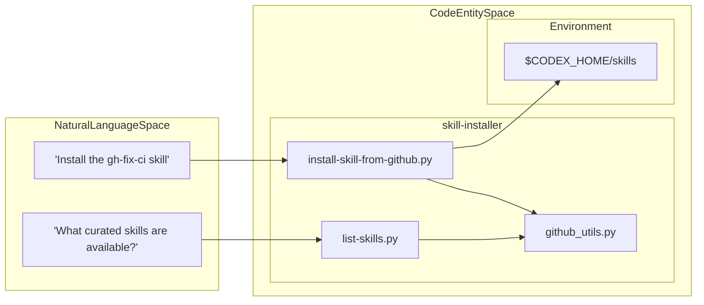
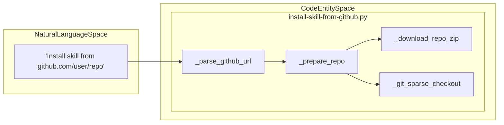

<!-- source: DeepWiki mcp.deepwiki.com · repo openai/skills · page 5 Curated Skills Reference · fetched 2026-10-30 -->

# Curated Skills Reference

Relevant source files

The following files were used as context for generating this wiki page:

- [.gitignore](.gitignore)
- [README.md](README.md)
- [skills/.system/skill-installer/LICENSE.txt](skills/.system/skill-installer/LICENSE.txt)
- [skills/.system/skill-installer/SKILL.md](skills/.system/skill-installer/SKILL.md)
- [skills/.system/skill-installer/scripts/github_utils.py](skills/.system/skill-installer/scripts/github_utils.py)
- [skills/.system/skill-installer/scripts/install-skill-from-github.py](skills/.system/skill-installer/scripts/install-skill-from-github.py)
- [skills/.system/skill-installer/scripts/list-skills.py](skills/.system/skill-installer/scripts/list-skills.py)

This document provides a high-level catalog of production-ready curated skills available in the `skills/.curated/` directory. Curated skills are stable, reviewed, and can be installed by name. They often bridge "Natural Language Space" (user intent) to "Code Entity Space" (specific scripts, CLIs, and API calls).

For detailed installation procedures, see [Installing Skills](#3.1). For information about creating new skills, see [Creating Skills](#4).

## Curated Skills Overview

Curated skills reside in [skills/.curated/]() and represent modular capabilities with the following characteristics:

-   **Name-based installation**: Install using `$skill-installer <skill-name>` (defaults to `skills/.curated`) [README.md:16-18]().
-   **Vetted quality**: Stable interfaces and validated `SKILL.md` structures.
-   **Progressive Disclosure**: Only metadata is loaded at startup; full instructions and resources are loaded only when the skill is triggered.

The `$skill-installer` utility, a system skill, facilitates the discovery and deployment of these curated capabilities [skills/.system/skill-installer/SKILL.md:1-6]().

**Sources:** [README.md:12-36](), [skills/.system/skill-installer/SKILL.md:1-6]()

## GitHub Integration Skills

GitHub skills automate PR management and CI debugging by wrapping the `gh` CLI.

-   **gh-fix-ci**: Debugs and fixes failing GitHub Actions. It uses `inspect_pr_checks.py` to parse logs and extract failure snippets.
-   **gh-address-comments**: Manages PR reviews. It utilizes `fetch_comments.py` to perform GraphQL queries for threads and comments.
-   **yeet**: Automates the `stage -> commit -> push -> PR` flow using the `gh` CLI.

For details, see [GitHub Integration Skills](#5.1).

**Sources:** [README.md:1-10](), [skills/.system/skill-installer/SKILL.md:12-15]()

## Figma Integration

The Figma skill enables design-to-code workflows via an MCP server connection.

-   **Figma MCP Server**: Provides tools like `get_design_context`, `get_metadata`, and `get_screenshot`.
-   **Workflows**: Includes `figma-implement-design`, which follows a multi-step process to achieve 1:1 visual parity.
-   **Figma Plugin API**: Skills like `figma-use` provide the foundation for direct design manipulation.

For details, see [Figma Integration](#5.2).

**Sources:** [README.md:1-10]()

## Notion Integration Skills

Notion skills facilitate document management and project planning via the Notion MCP server.

-   **notion-knowledge-capture**: Converts conversations into structured wiki pages.
-   **notion-meeting-intelligence**: Prepares meeting agendas and context.
-   **notion-research-documentation**: Generates sourced research briefs.
-   **notion-spec-to-implementation**: Transforms specs into actionable tasks.

For details, see [Notion Integration Skills](#5.3).

**Sources:** [README.md:1-10]()

## Linear Integration

The Linear skill provides issue tracking and project management capabilities via the Linear MCP server. It enables agents to `list_issues`, `create_issue`, and `update_issue` to manage backlogs and sprints directly from the conversation.

For details, see [Linear Integration](#5.4).

**Sources:** [README.md:1-10]()

## Deployment Tools

These skills provide CLI-based deployment workflows for popular cloud platforms.

-   **Vercel Deploy**: Uses `vercel deploy` for zero-configuration deployments.
-   **Netlify, Cloudflare, Render**: Platform-specific deployment logic using `netlify`, `wrangler`, and `render.yaml`.

For details, see [Deployment Tools](#5.5).

**Sources:** [README.md:1-10]()

## Content Generation Skills

Skills for generating media and documents using specialized APIs and libraries.

-   **Speech Generation**: Uses `text_to_speech.py` for narration via the OpenAI Audio API.
-   **PDF, Screenshot, and Transcribe**: Tools for programmatic PDF creation, OS-level screen capture, and audio transcription.

For details, see [Content Generation Skills](#5.6).

**Sources:** [README.md:1-10]()

## Development Tools

Specialized tools for engineering, browser automation, and CLI construction.

-   **Jupyter Notebook**: Creation of reproducible notebooks via `new_notebook.py`.
-   **Playwright**: CLI-based and interactive browser automation.
-   **CLI Creator**: Scaffolding for composable, durable CLIs from API docs or SDKs.

For details, see [Development Tools](#5.7).

**Sources:** [README.md:1-10]()

## Reference and Observability

Support skills for technical reference and system monitoring.

-   **OpenAI Docs**: Reference official developer documentation via MCP.
-   **Sentry**: Read-only observability and error tracking.

For details, see [Reference and Observability](#5.8).

**Sources:** [README.md:1-10]()

## Security Skills

Advanced security auditing and threat modeling tools.

-   **security-best-practices**: Language/framework security reviews.
-   **security-ownership-map**: Git-based ownership topology and bus factor analysis.
-   **security-threat-model**: Repository-grounded AppSec threat modeling.

For details, see [Security Skills](#5.9).

**Sources:** [README.md:1-10]()

## Platform-Specific App Skills

Skills designed for building applications on specific frameworks or platforms.

-   **ChatGPT Apps**: Scaffolding for applications combining MCP servers and widget UIs.
-   **ASP.NET Core**: Tools for building and refactoring .NET web applications.
-   **WinUI App**: Development of Windows desktop applications using C# and WinUI 3.

For details, see [Platform-Specific App Skills](#5.10).

**Sources:** [README.md:1-10]()

## Migration and Utility Skills

Utility skills for workflow migration and asset creation.

-   **migrate-to-codex**: Automated migration from Claude Code to Codex.
-   **hatch-pet**: Creating animated Codex pet spritesheets.
-   **define-goal**: Shaping user intentions into concrete, measurable goals.

For details, see [Migration and Utility Skills](#5.11).

**Sources:** [README.md:1-10]()

## Mapping Intent to Code Entities

The following diagrams illustrate how natural language requests bridge to specific code entities within curated and system skills.

### Diagram: Skill Discovery and Installation Flow

**Sources:** [skills/.system/skill-installer/scripts/list-skills.py:86-103](), [skills/.system/skill-installer/scripts/install-skill-from-github.py:209-220](), [skills/.system/skill-installer/scripts/github_utils.py:10-22]()

### Diagram: Remote Skill Resolution

**Sources:** [skills/.system/skill-installer/scripts/install-skill-from-github.py:59-77](), [skills/.system/skill-installer/scripts/install-skill-from-github.py:128-161](), [skills/.system/skill-installer/scripts/install-skill-from-github.py:187-207]()

## Curated Skills Reference Table

| Skill Name | Category | Primary Code Entity | Auth Requirement |
| :--- | :--- | :--- | :--- |
| `skill-installer` | System | `list-skills.py` | `GITHUB_TOKEN` (optional) |
| `gh-fix-ci` | GitHub | `inspect_pr_checks.py` | `gh auth login` |
| `gh-address-comments` | GitHub | `fetch_comments.py` | `gh auth login` |
| `yeet` | GitHub | `gh` CLI | `gh auth login` |

**Sources:** [skills/.system/skill-installer/SKILL.md:32-42](), [skills/.system/skill-installer/scripts/github_utils.py:12-14]()

---

