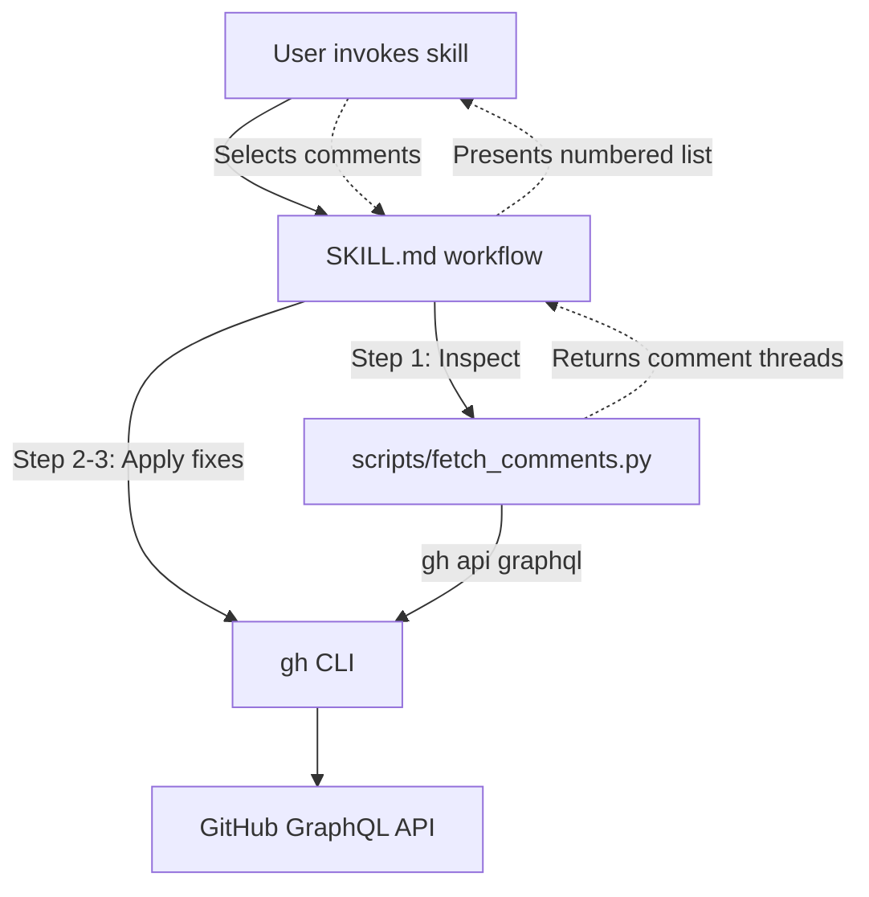
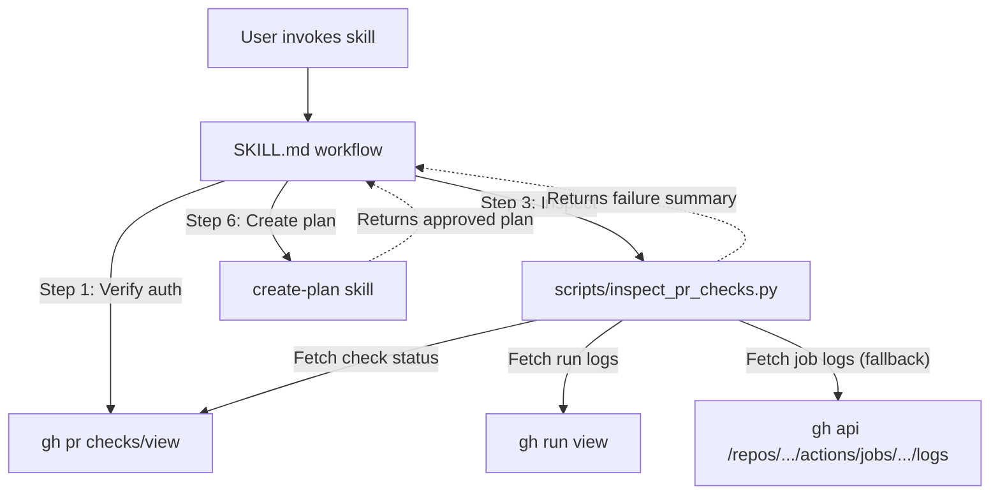
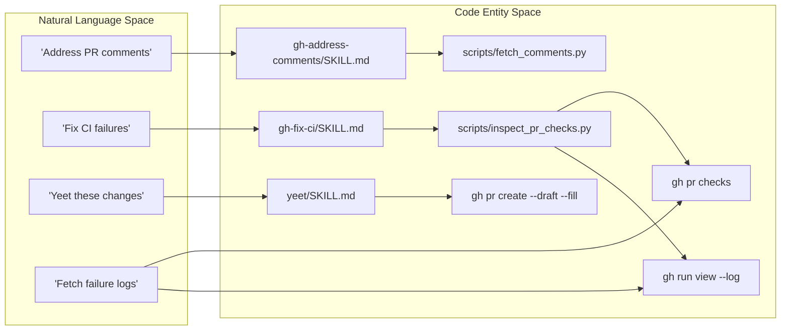
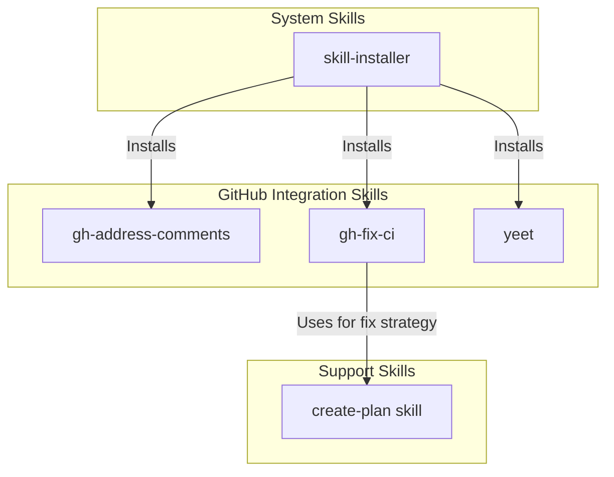

<!-- source: DeepWiki mcp.deepwiki.com · repo openai/skills · page 5.1 GitHub Integration Skills · fetched 2026-10-30 -->

# GitHub Integration Skills

Relevant source files

The following files were used as context for generating this wiki page:

- [skills/.curated/gh-address-comments/LICENSE.txt](skills/.curated/gh-address-comments/LICENSE.txt)
- [skills/.curated/gh-address-comments/SKILL.md](skills/.curated/gh-address-comments/SKILL.md)
- [skills/.curated/gh-address-comments/scripts/fetch_comments.py](skills/.curated/gh-address-comments/scripts/fetch_comments.py)
- [skills/.curated/gh-fix-ci/LICENSE.txt](skills/.curated/gh-fix-ci/LICENSE.txt)
- [skills/.curated/gh-fix-ci/SKILL.md](skills/.curated/gh-fix-ci/SKILL.md)
- [skills/.curated/gh-fix-ci/assets/github.png](skills/.curated/gh-fix-ci/assets/github.png)
- [skills/.curated/gh-fix-ci/scripts/inspect_pr_checks.py](skills/.curated/gh-fix-ci/scripts/inspect_pr_checks.py)
- [skills/.curated/pdf/SKILL.md](skills/.curated/pdf/SKILL.md)
- [skills/.curated/screenshot/SKILL.md](skills/.curated/screenshot/SKILL.md)
- [skills/.curated/speech/SKILL.md](skills/.curated/speech/SKILL.md)
- [skills/.curated/yeet/SKILL.md](skills/.curated/yeet/SKILL.md)

## Purpose and Scope

This document provides an overview of curated skills that integrate with GitHub for pull request and CI/CD workflow management. These skills use the `gh` CLI tool as a unified integration layer to interact with GitHub's REST and GraphQL APIs. The skills in this category enable automated PR creation, review response, and CI failure debugging workflows.

For detailed documentation of individual skills, see:
- [gh-fix-ci](#5.1.1) — Detail the gh-fix-ci skill for debugging and fixing GitHub Actions CI failures, including `inspect_pr_checks.py` script, log fetching strategies, and failure snippet extraction
- [gh-address-comments](#5.1.2) — Detail the gh-address-comments skill for managing PR review comments, including `fetch_comments.py` script, GraphQL queries for comments/reviews/threads, and the approval workflow
- [yeet](#5.1.3) — Detail the yeet skill for staging, committing, pushing, and opening a GitHub pull request in one automated flow using the gh CLI, including branch naming conventions and PR description format

---

## Shared Architecture

### gh CLI Integration Layer

GitHub integration skills use the `gh` CLI tool as their primary interface to GitHub. This architecture provides several benefits:

- **Unified Authentication**: Single authentication mechanism via `gh auth login` works for both REST and GraphQL operations. [skills/.curated/gh-fix-ci/SKILL.md:14-14]()
- **Built-in Token Management**: `gh` handles OAuth tokens and keychain storage automatically. [skills/.curated/gh-address-comments/SKILL.md:12-12]()
- **API Abstraction**: Skills avoid direct HTTP client implementation and API version management by using commands like `gh api graphql`. [skills/.curated/gh-address-comments/scripts/fetch_comments.py:147-167]()
- **Consistent Error Handling**: Standard `gh` error messages and exit codes across all operations, encapsulated in helper classes like `GhResult`. [skills/.curated/gh-fix-ci/scripts/inspect_pr_checks.py:51-55]()

Sources: [skills/.curated/gh-address-comments/SKILL.md:1-6](), [skills/.curated/gh-fix-ci/SKILL.md:1-4](), [skills/.curated/yeet/SKILL.md:1-4](), [skills/.curated/gh-fix-ci/scripts/inspect_pr_checks.py:51-65]()

### Authentication Requirements

All GitHub integration skills follow a mandatory authentication workflow:

1. **Initial Authentication**: User must run `gh auth login` once to establish credentials. [skills/.curated/yeet/SKILL.md:9-9]()
2. **Verification**: Skills run `gh auth status` to verify authentication state. [skills/.curated/gh-fix-ci/SKILL.md:30-30]()
3. **Scope Requirements**: Skills typically require `workflow` and `repo` scopes for accessing PR data and CI logs. [skills/.curated/gh-address-comments/SKILL.md:12-12]()
4. **Sandbox Permissions**: Commands may require `sandbox_permissions=require_escalated` to access network and keychain in restricted environments. [skills/.curated/gh-address-comments/SKILL.md:12-12]()

Sources: [skills/.curated/gh-address-comments/SKILL.md:12-12](), [skills/.curated/gh-fix-ci/SKILL.md:14-14](), [skills/.curated/yeet/SKILL.md:8-9]()

---

## Available Skills Overview

| Skill Name | Description | Primary Use Case | Bundled Scripts |
|------------|-------------|------------------|-----------------|
| `gh-fix-ci` | Debug and fix GitHub Actions CI failures | Diagnosing and resolving CI/CD issues | `scripts/inspect_pr_checks.py` |
| `gh-address-comments` | Address PR review comments and issue comments | Responding to code review feedback | `scripts/fetch_comments.py` |
| `yeet` | Automated stage, commit, push, and PR flow | Fast-tracking changes from local to PR | N/A (CLI-based) |

Sources: [skills/.curated/gh-fix-ci/SKILL.md:2-3](), [skills/.curated/gh-address-comments/SKILL.md:2-3](), [skills/.curated/yeet/SKILL.md:2-3]()

---

## Common Patterns

### Script-Based Workflows

Several skills include Python scripts that encapsulate complex GitHub API operations, particularly those involving GraphQL or log parsing.

**gh-address-comments Architecture:**

**Workflow: gh-address-comments**
Sources: [skills/.curated/gh-address-comments/SKILL.md:14-23](), [skills/.curated/gh-address-comments/scripts/fetch_comments.py:23-91]()

**gh-fix-ci Architecture:**

**Workflow: gh-fix-ci**
Sources: [skills/.curated/gh-fix-ci/SKILL.md:29-61](), [skills/.curated/gh-fix-ci/scripts/inspect_pr_checks.py:110-135]()

### Code Entity Mapping

The following diagram maps natural language concepts to specific code entities and commands used by the skills:

**Natural Language to Code Entity Mapping**
Sources: [skills/.curated/gh-address-comments/SKILL.md:15-15](), [skills/.curated/gh-fix-ci/SKILL.md:37-44](), [skills/.curated/yeet/SKILL.md:51-52]()

---

## Technical Implementation Details

### gh-address-comments Workflow
The `gh-address-comments` skill uses a Python script to fetch all PR conversation comments, reviews, and inline review threads via GraphQL. [skills/.curated/gh-address-comments/scripts/fetch_comments.py:23-91]() It parses the response into a structured format containing `conversation_comments`, `reviews`, and `review_threads`. [skills/.curated/gh-address-comments/scripts/fetch_comments.py:221-226]() It then presents a numbered list to the user to decide which feedback to address. [skills/.curated/gh-address-comments/SKILL.md:14-22]()

### gh-fix-ci Workflow
The `gh-fix-ci` skill automates the debugging of GitHub Actions. It resolves the PR for the current branch, identifies failing checks, and fetches logs. [skills/.curated/gh-fix-ci/SKILL.md:32-46]() It is designed to handle "field drift" in the `gh` CLI by attempting fallbacks if specific JSON fields are missing during `gh pr checks`. [skills/.curated/gh-fix-ci/scripts/inspect_pr_checks.py:182-215]() It specifically looks for failure conclusions such as `failure`, `cancelled`, or `timed_out`. [skills/.curated/gh-fix-ci/scripts/inspect_pr_checks.py:13-18]()

### yeet Workflow
The `yeet` skill provides a high-velocity workflow for pushing changes. It handles branch creation (using `{description}` naming), staging all changes (`git add -A`), committing, pushing, and opening a draft PR with an automated description. [skills/.curated/yeet/SKILL.md:11-55]() The skill supports repository-specific PR template discovery to ensure compliance with project standards. [skills/.curated/yeet/SKILL.md:17-37]() The PR creation command uses `GH_PROMPT_DISABLED=1` and `GIT_TERMINAL_PROMPT=0` to ensure non-interactive execution. [skills/.curated/yeet/SKILL.md:51-52]()

---

## Relationship to Other Skills

**Skill Dependencies**
Sources: [skills/.curated/gh-fix-ci/SKILL.md:54-54]()

---

