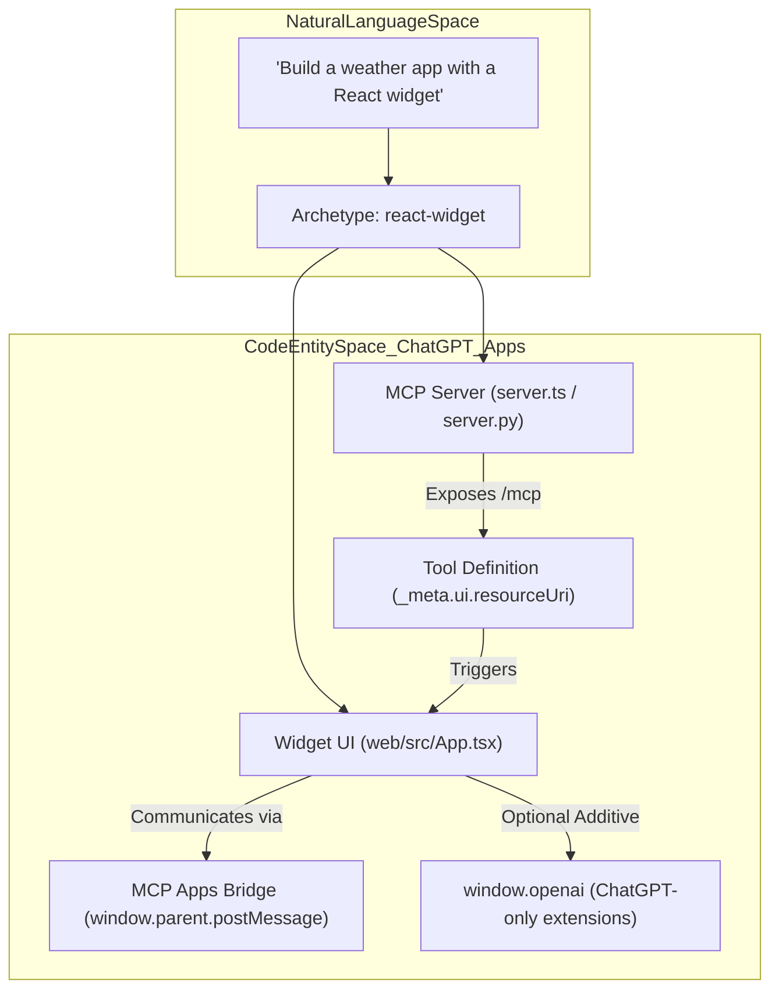
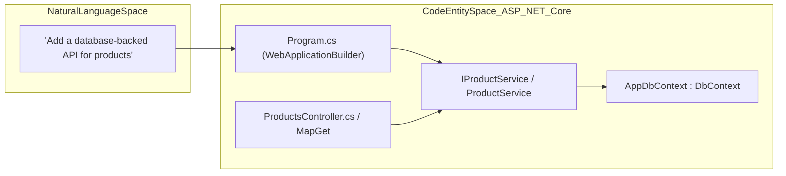

<!-- source: DeepWiki mcp.deepwiki.com · repo openai/skills · page 5.10 Platform-Specific App Skills · fetched 2026-10-30 -->

# Platform-Specific App Skills

Relevant source files

The following files were used as context for generating this wiki page:

- [skills/.curated/aspnet-core/LICENSE.txt](skills/.curated/aspnet-core/LICENSE.txt)
- [skills/.curated/aspnet-core/SKILL.md](skills/.curated/aspnet-core/SKILL.md)
- [skills/.curated/aspnet-core/agents/openai.yaml](skills/.curated/aspnet-core/agents/openai.yaml)
- [skills/.curated/aspnet-core/assets/dotnet-logo.png](skills/.curated/aspnet-core/assets/dotnet-logo.png)
- [skills/.curated/aspnet-core/references/_sections.md](skills/.curated/aspnet-core/references/_sections.md)
- [skills/.curated/aspnet-core/references/apis-minimal-and-controllers.md](skills/.curated/aspnet-core/references/apis-minimal-and-controllers.md)
- [skills/.curated/aspnet-core/references/data-state-and-services.md](skills/.curated/aspnet-core/references/data-state-and-services.md)
- [skills/.curated/aspnet-core/references/program-and-pipeline.md](skills/.curated/aspnet-core/references/program-and-pipeline.md)
- [skills/.curated/aspnet-core/references/realtime-grpc-and-background-work.md](skills/.curated/aspnet-core/references/realtime-grpc-and-background-work.md)
- [skills/.curated/aspnet-core/references/security-and-identity.md](skills/.curated/aspnet-core/references/security-and-identity.md)
- [skills/.curated/aspnet-core/references/source-map.md](skills/.curated/aspnet-core/references/source-map.md)
- [skills/.curated/chatgpt-apps/LICENSE.txt](skills/.curated/chatgpt-apps/LICENSE.txt)
- [skills/.curated/chatgpt-apps/SKILL.md](skills/.curated/chatgpt-apps/SKILL.md)
- [skills/.curated/chatgpt-apps/agents/openai.yaml](skills/.curated/chatgpt-apps/agents/openai.yaml)
- [skills/.curated/chatgpt-apps/references/app-archetypes.md](skills/.curated/chatgpt-apps/references/app-archetypes.md)
- [skills/.curated/chatgpt-apps/references/apps-sdk-docs-workflow.md](skills/.curated/chatgpt-apps/references/apps-sdk-docs-workflow.md)
- [skills/.curated/chatgpt-apps/references/interactive-state-sync-patterns.md](skills/.curated/chatgpt-apps/references/interactive-state-sync-patterns.md)
- [skills/.curated/chatgpt-apps/references/repo-contract-and-validation.md](skills/.curated/chatgpt-apps/references/repo-contract-and-validation.md)
- [skills/.curated/chatgpt-apps/references/search-fetch-standard.md](skills/.curated/chatgpt-apps/references/search-fetch-standard.md)
- [skills/.curated/chatgpt-apps/references/upstream-example-workflow.md](skills/.curated/chatgpt-apps/references/upstream-example-workflow.md)
- [skills/.curated/chatgpt-apps/references/window-openai-patterns.md](skills/.curated/chatgpt-apps/references/window-openai-patterns.md)
- [skills/.curated/chatgpt-apps/scripts/scaffold_node_ext_apps.mjs](skills/.curated/chatgpt-apps/scripts/scaffold_node_ext_apps.mjs)

This section documents specialized skills designed for building, refactoring, and maintaining applications on specific platforms and frameworks. These skills provide deep domain knowledge, boilerplate scaffolding, and validation logic tailored to the unique requirements of ChatGPT Apps, ASP.NET Core web applications, and Windows desktop applications using WinUI 3.

## Overview of App Skills

Platform-specific skills bridge the gap between general coding capabilities and the rigid requirements of specific SDKs. They often include "docs-first" workflows that fetch the latest API references before generating code to ensure compatibility with rapidly evolving platforms.

### Skill-to-Platform Mapping

| Skill Name | Target Platform | Primary Technologies | Key Capabilities |
| :--- | :--- | :--- | :--- |
| `chatgpt-apps` | ChatGPT Ecosystem | MCP, React/Vanilla JS, Node.js/Python | Scaffolding ChatGPT Apps with widget UIs and MCP servers. |
| `aspnet-core` | Web / Enterprise | C#, .NET 10, Blazor, Minimal APIs | Building and refactoring robust ASP.NET Core web apps. |
| `winui-app` | Windows Desktop | C#, WinUI 3, Windows App SDK | Bootstrapping native Windows desktop applications. |

Sources: [skills/.curated/chatgpt-apps/SKILL.md:1-22](), [skills/.curated/aspnet-core/SKILL.md:1-10]()

## ChatGPT Apps

The `chatgpt-apps` skill is used to build applications for the ChatGPT Apps SDK. These applications typically consist of two parts: a **Model Context Protocol (MCP) Server** (the backend logic/tools) and a **Widget UI** (the frontend displayed within the ChatGPT interface).

The skill follows a strict **Docs-First Workflow**, requiring the agent to fetch the latest documentation from the `openaiDeveloperDocs` MCP server before generating code [skills/.curated/chatgpt-apps/SKILL.md:24-49](). It categorizes every request into one of five archetypes (e.g., `tool-only`, `vanilla-widget`, `react-widget`, `interactive-decoupled`, `submission-ready`) to ensure the generated repository structure matches the user's intent [skills/.curated/chatgpt-apps/references/app-archetypes.md:11-124]().

### ChatGPT App Architecture

The following diagram illustrates how the `chatgpt-apps` skill bridges the Natural Language request to the specific code entities required by the SDK.

Sources: [skills/.curated/chatgpt-apps/references/app-archetypes.md:58-78](), [skills/.curated/chatgpt-apps/references/repo-contract-and-validation.md:16-40](), [skills/.curated/chatgpt-apps/scripts/scaffold_node_ext_apps.mjs:222-231](), [skills/.curated/chatgpt-apps/references/window-openai-patterns.md:5-9]()

For details, see [ChatGPT Apps](#5.10.1).

## ASP.NET Core

The `aspnet-core` skill provides a comprehensive reference-based workflow for building modern web applications on .NET 10. It covers the full spectrum of ASP.NET Core capabilities, including Blazor for interactive UIs, Minimal APIs for lightweight services, and Entity Framework (EF) Core for data persistence.

The skill emphasizes standard patterns such as constructor-based **Dependency Injection**, `IHttpClientFactory` for outbound calls, and `WebApplicationBuilder` for modern pipeline configuration [skills/.curated/aspnet-core/references/source-map.md:12-27]().

### ASP.NET Core System Integration

Sources: [skills/.curated/aspnet-core/references/source-map.md:12-27](), [skills/.curated/aspnet-core/references/data-state-and-services.md:1-28]()

For details, see [ASP.NET Core](#5.10.2).

## WinUI App

The `winui-app` skill is dedicated to bootstrapping and developing native Windows desktop applications using the Windows App SDK and WinUI 3. It manages the complexities of the Windows development environment by utilizing `winget` for configuration and `dotnet new winui` templates for scaffolding.

The skill includes a comprehensive reference library for WinUI controls, XAML patterns, and Windows-specific lifecycle management, ensuring that generated applications follow the latest Fluent Design and performance guidelines.

For details, see [WinUI App](#5.10.3).

---

