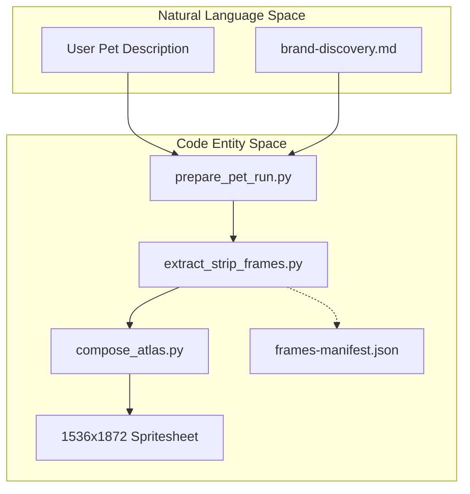
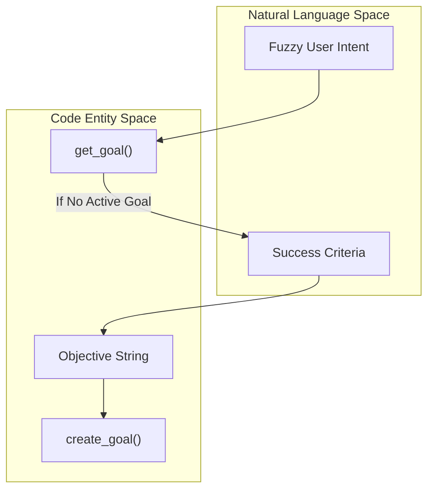

<!-- source: DeepWiki mcp.deepwiki.com · repo openai/skills · page 5.11 Migration and Utility Skills · fetched 2026-10-30 -->

# Migration and Utility Skills

Relevant source files

The following files were used as context for generating this wiki page:

- [skills/.curated/define-goal/LICENSE.txt](skills/.curated/define-goal/LICENSE.txt)
- [skills/.curated/define-goal/SKILL.md](skills/.curated/define-goal/SKILL.md)
- [skills/.curated/define-goal/agents/openai.yaml](skills/.curated/define-goal/agents/openai.yaml)
- [skills/.curated/hatch-pet/SKILL.md](skills/.curated/hatch-pet/SKILL.md)
- [skills/.curated/hatch-pet/agents/openai.yaml](skills/.curated/hatch-pet/agents/openai.yaml)
- [skills/.curated/hatch-pet/references/animation-rows.md](skills/.curated/hatch-pet/references/animation-rows.md)
- [skills/.curated/hatch-pet/references/qa-rubric.md](skills/.curated/hatch-pet/references/qa-rubric.md)
- [skills/.curated/hatch-pet/scripts/compose_atlas.py](skills/.curated/hatch-pet/scripts/compose_atlas.py)
- [skills/.curated/hatch-pet/scripts/derive_running_left_from_running_right.py](skills/.curated/hatch-pet/scripts/derive_running_left_from_running_right.py)
- [skills/.curated/hatch-pet/scripts/extract_strip_frames.py](skills/.curated/hatch-pet/scripts/extract_strip_frames.py)
- [skills/.curated/hatch-pet/scripts/inspect_frames.py](skills/.curated/hatch-pet/scripts/inspect_frames.py)
- [skills/.curated/hatch-pet/scripts/prepare_pet_run.py](skills/.curated/hatch-pet/scripts/prepare_pet_run.py)
- [skills/.curated/migrate-to-codex/LICENSE.txt](skills/.curated/migrate-to-codex/LICENSE.txt)
- [skills/.curated/migrate-to-codex/SKILL.md](skills/.curated/migrate-to-codex/SKILL.md)
- [skills/.curated/migrate-to-codex/agents/openai.yaml](skills/.curated/migrate-to-codex/agents/openai.yaml)
- [skills/.curated/migrate-to-codex/references/differences.md](skills/.curated/migrate-to-codex/references/differences.md)
- [skills/.curated/migrate-to-codex/scripts/cli.py](skills/.curated/migrate-to-codex/scripts/cli.py)
- [skills/.curated/migrate-to-codex/scripts/migrate-to-codex.py](skills/.curated/migrate-to-codex/scripts/migrate-to-codex.py)
- [skills/.curated/migrate-to-codex/scripts/migrate/__init__.py](skills/.curated/migrate-to-codex/scripts/migrate/__init__.py)
- [skills/.curated/migrate-to-codex/scripts/migrate/agents.py](skills/.curated/migrate-to-codex/scripts/migrate/agents.py)
- [skills/.curated/migrate-to-codex/scripts/migrate/codex_config.py](skills/.curated/migrate-to-codex/scripts/migrate/codex_config.py)
- [skills/.curated/migrate-to-codex/scripts/migrate/common.py](skills/.curated/migrate-to-codex/scripts/migrate/common.py)
- [skills/.curated/migrate-to-codex/scripts/migrate/hooks.py](skills/.curated/migrate-to-codex/scripts/migrate/hooks.py)

The **Migration and Utility Skills** category provides specialized tools for transitioning from legacy AI agent configurations to the Codex ecosystem, defining measurable work objectives, and creating specialized assets like animated pet spritesheets. These skills automate complex transformation logic, goal shaping, and asset generation pipelines that would otherwise require significant manual effort.

## migrate-to-codex

The `migrate-to-codex` skill is an automated pipeline designed to transition projects from Claude Code configurations to Codex. It scans for existing instruction files (`CLAUDE.md`), skills, subagents, and Model Context Protocol (MCP) settings, converting them into Codex-native formats while preserving logic through a "self-healing" validation loop [[skills/.curated/migrate-to-codex/SKILL.md:2-3]]().

### Migration Pipeline
The skill operates via a CLI script located at `scripts/migrate-to-codex.py` [[skills/.curated/migrate-to-codex/SKILL.md:87]](). The workflow follows a strict sequence to ensure data integrity:
1.  **Scan & Plan**: Inspects source surfaces (global or project) and stages artifacts using `--scan-only` or `--plan` [[skills/.curated/migrate-to-codex/SKILL.md:28-31]]().
2.  **Conversion**: Transforms Claude-specific entities (Slash commands, Hooks, MCP servers) into Codex equivalents [[skills/.curated/migrate-to-codex/SKILL.md:33-40]]().
3.  **Validation**: Runs a `--validate-target` check against generated files to ensure configuration compliance [[skills/.curated/migrate-to-codex/SKILL.md:47]]().
4.  **Reporting**: Generates a status table in the terminal and a detailed report at `.codex/migrate-to-codex-report.txt` [[skills/.curated/migrate-to-codex/SKILL.md:43-51]]().

### Technical Mappings
The migration logic handles several surface types with specific behavioral overrides:
*   **Instructions**: Maps `CLAUDE.md` / `AGENTS.md` to the Codex `AGENTS.md` format [[skills/.curated/migrate-to-codex/SKILL.md:34]]().
*   **Skills**: Converts Claude slash commands and command files into standard Codex skills under `.agents/skills/` [[skills/.curated/migrate-to-codex/SKILL.md:37]]().
*   **MCP Config**: Maps `.mcp.json` server definitions to `[mcp_servers]` blocks in `.codex/config.toml` [[skills/.curated/migrate-to-codex/SKILL.md:38]]().
*   **Hooks**: Rewrites supported Claude hooks into `.codex/hooks.json` [[skills/.curated/migrate-to-codex/SKILL.md:36]]().

**Claude-to-Codex Entity Mapping**
| Claude Entity | Codex Entity | Code Reference |
| :--- | :--- | :--- |
| `.claude/agents/*.md` | `.codex/agents/*.toml` | `[skills/.curated/migrate-to-codex/SKILL.md:39]()` |
| `.claude/commands/*.md` | `.agents/skills/<name>/SKILL.md` | `[skills/.curated/migrate-to-codex/SKILL.md:37]()` |
| `.mcp.json` | `.codex/config.toml` | `[skills/.curated/migrate-to-codex/SKILL.md:38]()` |
| `hooks` in `settings.json` | `.codex/hooks.json` | `[skills/.curated/migrate-to-codex/SKILL.md:36]()` |

For details, see [migrate-to-codex](#5.11.1).

---

## hatch-pet

The `hatch-pet` skill automates the creation of animated Codex pet spritesheets. It orchestrates image generation via `$imagegen`, background removal, and atlas composition to produce a standard 8x9 animation grid compatible with the Codex pet system [[skills/.curated/hatch-pet/SKILL.md:2-3]]().

### Animation Atlas Format
The skill enforces a strict geometry for the final output:
*   **Dimensions**: Exact `1536x1872` pixel atlas [[skills/.curated/hatch-pet/references/qa-rubric.md:7]]().
*   **Grid**: 8 columns by 9 rows [[skills/.curated/hatch-pet/references/qa-rubric.md:8]]().
*   **Cell Size**: Each frame must fit within a `192x208` cell [[skills/.curated/hatch-pet/scripts/extract_strip_frames.py:14-15]]().

### Generation Workflow
1.  **Discovery**: If a brand name is provided, a discovery subagent researches visual cues and personality traits [[skills/.curated/hatch-pet/SKILL.md:40-43]]().
2.  **Base Generation**: Delegates to the `$imagegen` skill to create a consistent character identity [[skills/.curated/hatch-pet/SKILL.md:16-18]]().
3.  **Row Generation**: Generates specific animation rows (Idle, Running, Waving, Jumping, etc.) defined in `scripts/prepare_pet_run.py` [[skills/.curated/hatch-pet/scripts/prepare_pet_run.py:21-31]]().
4.  **Extraction**: Uses `scripts/extract_strip_frames.py` to remove chroma backgrounds and center sprites in cells [[skills/.curated/hatch-pet/scripts/extract_strip_frames.py:66-100]]().
5.  **Composition**: Uses `scripts/compose_atlas.py` to stitch frames into the final grid [[skills/.curated/hatch-pet/scripts/compose_atlas.py:96-107]]().

**Pet Asset Pipeline**

Sources: `[skills/.curated/hatch-pet/scripts/prepare_pet_run.py:1-31]()`, `[skills/.curated/hatch-pet/scripts/extract_strip_frames.py:1-26]()`, `[skills/.curated/hatch-pet/scripts/compose_atlas.py:11-28]()`

For details, see [hatch-pet](#5.11.2).

---

## define-goal

The `define-goal` skill shapes fuzzy user intentions into concrete, measurable objectives before an agent begins work. It ensures that success is defined by quantitative outcomes rather than just activity [[skills/.curated/define-goal/SKILL.md:2-3]]().

### Workflow and Quality Bar
The skill follows a strict "Quality Bar" before committing to a goal:
*   **Quantification**: Prefers binary validators (pass/fail tests) or quality thresholds (latency, error rates) [[skills/.curated/define-goal/SKILL.md:29-35]]().
*   **Verification**: The objective must include the evidence that will prove completion [[skills/.curated/define-goal/SKILL.md:49]]().
*   **Tool Interface**: Interacts with the environment via `get_goal` to check active state and `create_goal` to set the objective [[skills/.curated/define-goal/SKILL.md:41-43]]().

**Goal Definition Logic**

Sources: `[skills/.curated/define-goal/SKILL.md:41-53]()`

For details, see [define-goal](#5.11.3).

---

## Integration and Utility Scripts

Both skills rely on shared utility patterns within the repository:
*   **CLI Orchestration**: Utility skills house Python logic in `scripts/` to manage deterministic multi-step processes [[skills/.curated/hatch-pet/scripts/compose_atlas.py:1-2]()].
*   **Metadata Management**: Skills utilize `openai.yaml` to define their interfaces (display names and default prompts) for the Codex runtime [[skills/.curated/hatch-pet/agents/openai.yaml:1-4](), [skills/.curated/define-goal/agents/openai.yaml:1-4]()].

Sources:
- `[skills/.curated/migrate-to-codex/SKILL.md]()`
- `[skills/.curated/hatch-pet/SKILL.md]()`
- `[skills/.curated/hatch-pet/scripts/prepare_pet_run.py]()`
- `[skills/.curated/hatch-pet/scripts/extract_strip_frames.py]()`
- `[skills/.curated/hatch-pet/scripts/compose_atlas.py]()`
- `[skills/.curated/hatch-pet/references/qa-rubric.md]()`
- `[skills/.curated/define-goal/SKILL.md]()`
- `[skills/.curated/define-goal/agents/openai.yaml]()`

---

