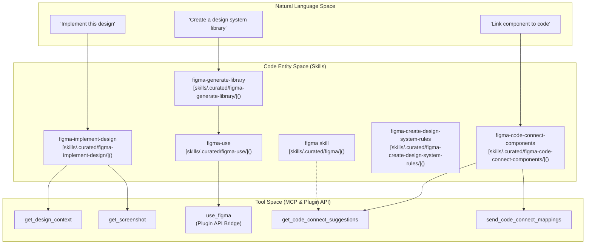
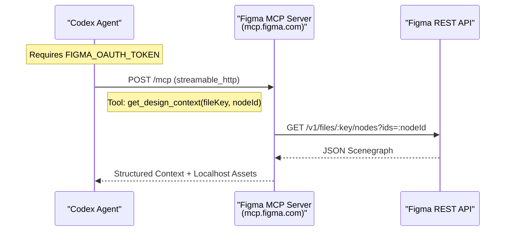

<!-- source: DeepWiki mcp.deepwiki.com · repo openai/skills · page 5.2 Figma Integration · fetched 2026-10-30 -->

# Figma Integration

Relevant source files

The following files were used as context for generating this wiki page:

- [skills/.curated/figma-code-connect-components/LICENSE.TXT](skills/.curated/figma-code-connect-components/LICENSE.TXT)
- [skills/.curated/figma-code-connect-components/SKILL.md](skills/.curated/figma-code-connect-components/SKILL.md)
- [skills/.curated/figma-create-design-system-rules/LICENSE.TXT](skills/.curated/figma-create-design-system-rules/LICENSE.TXT)
- [skills/.curated/figma-create-design-system-rules/SKILL.md](skills/.curated/figma-create-design-system-rules/SKILL.md)
- [skills/.curated/figma-create-new-file/LICENSE.TXT](skills/.curated/figma-create-new-file/LICENSE.TXT)
- [skills/.curated/figma-generate-design/LICENSE.TXT](skills/.curated/figma-generate-design/LICENSE.TXT)
- [skills/.curated/figma-generate-library/LICENSE.TXT](skills/.curated/figma-generate-library/LICENSE.TXT)
- [skills/.curated/figma-implement-design/LICENSE.txt](skills/.curated/figma-implement-design/LICENSE.txt)
- [skills/.curated/figma-implement-design/SKILL.md](skills/.curated/figma-implement-design/SKILL.md)
- [skills/.curated/figma-use/LICENSE.TXT](skills/.curated/figma-use/LICENSE.TXT)
- [skills/.curated/figma/LICENSE.txt](skills/.curated/figma/LICENSE.txt)
- [skills/.curated/notion-knowledge-capture/SKILL.md](skills/.curated/notion-knowledge-capture/SKILL.md)
- [skills/.curated/notion-meeting-intelligence/SKILL.md](skills/.curated/notion-meeting-intelligence/SKILL.md)
- [skills/.curated/notion-research-documentation/SKILL.md](skills/.curated/notion-research-documentation/SKILL.md)
- [skills/.curated/notion-spec-to-implementation/SKILL.md](skills/.curated/notion-spec-to-implementation/SKILL.md)

## Purpose and Scope

This document provides a high-level overview of the full suite of Figma integration capabilities within the Skills repository. These skills enable a bidirectional bridge between design and code, covering automated design-to-code implementation, design system rule generation, Code Connect orchestration, and programmatic Figma canvas manipulation via the Plugin API.

For detailed documentation on specific areas, see the child pages:
- [Figma MCP Server](#5.2.1) — Configuration and core tool reference.
- [Figma Design Implementation Workflows](#5.2.2) — Structured design-to-code processes including implementation and Code Connect.
- [Figma Plugin API Skills](#5.2.3) — Direct Figma canvas writes and screen generation.
- [Figma Design System Builder](#5.2.4) — Orchestrating large-scale design system creation from codebase foundations.

## Integration Architecture

The Figma integration leverages the Model Context Protocol (MCP) to provide agents with real-time access to Figma's design data and visual state. It bridges the "Natural Language Space" of user requests to the "Code Entity Space" of specific skill implementations.

Title: Figma Integration Entity Map

**Sources:** [skills/.curated/figma-implement-design/SKILL.md:1-20](), [skills/.curated/figma-code-connect-components/SKILL.md:1-18](), [skills/.curated/figma-create-design-system-rules/SKILL.md:1-10]()

## Core Skill Groups

### 1. Figma MCP Server (The `figma` Skill)
The foundational `figma` skill provides the base MCP integration. It allows agents to inspect designs, fetch metadata, and capture screenshots for visual grounding. It is a prerequisite for any workflow requiring design data extraction. It supports both remote MCP and `figma-desktop` for local selection-based prompting [skills/.curated/figma-implement-design/SKILL.md:54-59]().

For details, see [Figma MCP Server](#5.2.1).

### 2. Design Implementation Workflows
This group focuses on translating designs into production-ready code.
- **`figma-implement-design`**: A prescriptive 7-step workflow to achieve 1:1 visual fidelity using structured data from `get_design_context` and visual references from `get_screenshot` [skills/.curated/figma-implement-design/SKILL.md:31-140]().
- **`figma-create-design-system-rules`**: Generates project-specific `CLAUDE.md`, `AGENTS.md`, or `.cursor/rules/` to ensure AI agents follow local component and styling conventions [skills/.curated/figma-create-design-system-rules/SKILL.md:12-31]().
- **`figma-code-connect-components`**: Automates the mapping of Figma components to code implementations using `get_code_connect_suggestions` and `send_code_connect_mappings` [skills/.curated/figma-code-connect-components/SKILL.md:33-144]().

For details, see [Figma Design Implementation Workflows](#5.2.2).

### 3. Figma Plugin API Skills
While the MCP server is primarily read-only for design data, these skills enable **writing** to the Figma canvas via the Plugin API.
- **`figma-use`**: The mandatory interface for all `use_figma` tool calls. It provides the sandbox rules and constraints for executing Plugin API scripts [skills/.curated/figma-implement-design/SKILL.md:15-15]().
- **`figma-generate-design`**: Translates code or descriptions into Figma screens, utilizing existing design system components via the Plugin API.
- **`figma-create-new-file`**: Utility for creating blank Figma or FigJam files programmatically.

For details, see [Figma Plugin API Skills](#5.2.3).

### 4. Figma Design System Builder
The `figma-generate-library` skill is a high-orchestration capability designed to build professional-grade design systems from scratch. It follows a multi-phase workflow (Discovery, Foundations, File Structure, Components, Documentation) and involves a high volume of `use_figma` calls (often 20-100+) to construct complex libraries [skills/.curated/figma-generate-library/LICENSE.TXT:1-2]().

For details, see [Figma Design System Builder](#5.2.4).

## Technical Foundation: MCP Integration

All Figma skills rely on the Model Context Protocol to communicate with Figma. The implementation logic requires specific handling of `fileKey` and `nodeId` (converting URL hyphens to API colons) [skills/.curated/figma-code-connect-components/SKILL.md:52-62]().

Title: Figma MCP Authentication & Transport

**Sources:** [skills/.curated/figma-implement-design/SKILL.md:60-101](), [skills/.curated/figma-code-connect-components/SKILL.md:21-27]()

## Skill Selection Logic

Agents select the appropriate skill based on the user's intent and the required output (Code vs. Figma Canvas):

| User Intent | Recommended Skill | Output Target |
| :--- | :--- | :--- |
| "Implement this button in React" | `figma-implement-design` | Local Codebase |
| "Create a login screen in my Figma file" | `figma-generate-design` | Figma Canvas |
| "Link my local Card.tsx to the Figma Card" | `figma-code-connect-components` | Figma Code Connect |
| "Build a full design system library from my code" | `figma-generate-library` | Figma Canvas |
| "Setup my project rules for Figma" | `figma-create-design-system-rules` | `CLAUDE.md` / `AGENTS.md` |

**Sources:** [skills/.curated/figma-implement-design/SKILL.md:12-18](), [skills/.curated/figma-code-connect-components/SKILL.md:12-17](), [skills/.curated/figma-create-design-system-rules/SKILL.md:39-49]()

---

