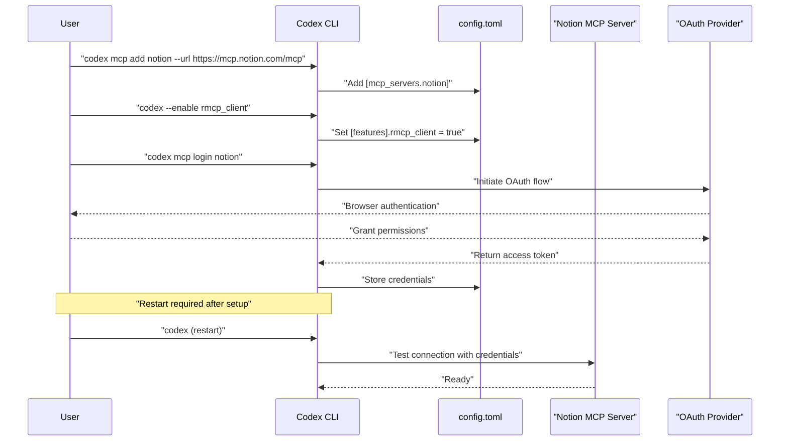
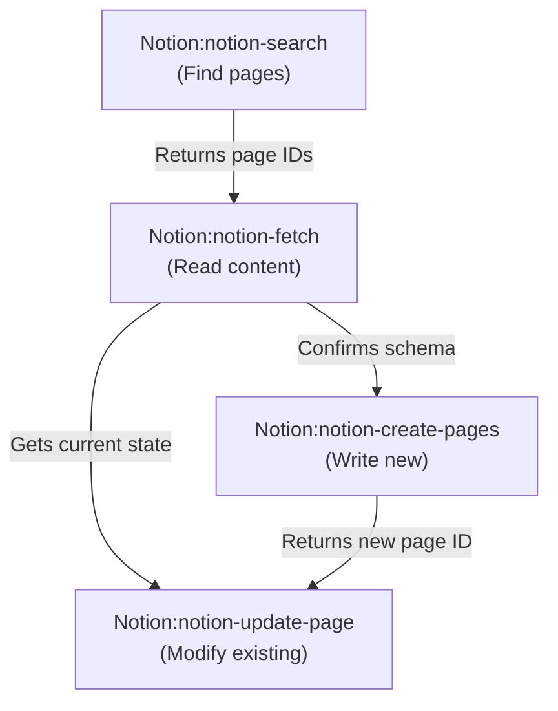
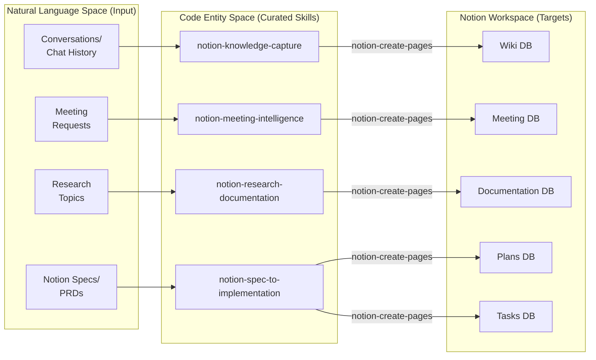

<!-- source: DeepWiki mcp.deepwiki.com · repo openai/skills · page 5.3 Notion Integration Skills · fetched 2026-10-30 -->

# Notion Integration Skills

Relevant source files

The following files were used as context for generating this wiki page:

- [skills/.curated/figma-code-connect-components/SKILL.md](skills/.curated/figma-code-connect-components/SKILL.md)
- [skills/.curated/figma-create-design-system-rules/SKILL.md](skills/.curated/figma-create-design-system-rules/SKILL.md)
- [skills/.curated/figma-implement-design/SKILL.md](skills/.curated/figma-implement-design/SKILL.md)
- [skills/.curated/notion-knowledge-capture/SKILL.md](skills/.curated/notion-knowledge-capture/SKILL.md)
- [skills/.curated/notion-knowledge-capture/agents/openai.yaml](skills/.curated/notion-knowledge-capture/agents/openai.yaml)
- [skills/.curated/notion-meeting-intelligence/SKILL.md](skills/.curated/notion-meeting-intelligence/SKILL.md)
- [skills/.curated/notion-meeting-intelligence/agents/openai.yaml](skills/.curated/notion-meeting-intelligence/agents/openai.yaml)
- [skills/.curated/notion-research-documentation/SKILL.md](skills/.curated/notion-research-documentation/SKILL.md)
- [skills/.curated/notion-research-documentation/agents/openai.yaml](skills/.curated/notion-research-documentation/agents/openai.yaml)
- [skills/.curated/notion-spec-to-implementation/SKILL.md](skills/.curated/notion-spec-to-implementation/SKILL.md)
- [skills/.curated/notion-spec-to-implementation/agents/openai.yaml](skills/.curated/notion-spec-to-implementation/agents/openai.yaml)
- [skills/.curated/sentry/agents/openai.yaml](skills/.curated/sentry/agents/openai.yaml)

## Purpose and Scope

This document details the four Notion integration skills available in the `.curated` tier that enable Codex to read, create, and update Notion pages via the Notion MCP (Model Context Protocol) server. These skills provide workflows for knowledge management, meeting preparation, research synthesis, and spec-to-implementation tracking.

For information about the general MCP integration pattern, see [MCP Integration Pattern](#2.4). For other platform integrations, see [Figma Integration](#5.2) and [Linear Integration](#5.4).

---

## MCP Setup and Configuration

All four Notion skills require the Notion MCP server to be configured before use. The setup is identical across all skills.

### Configuration Requirements

| Component | Value | Purpose |
|-----------|-------|---------|
| MCP Server URL | `https://mcp.notion.com/mcp` | Remote Notion MCP endpoint |
| Transport | `streamable_http` | OAuth-based HTTP transport |
| Feature Flag | `rmcp_client = true` | Enables remote MCP client in Codex |
| Authentication | OAuth via `codex mcp login notion` | Grants access to user's Notion workspace |

### Setup Workflow

The following diagram illustrates the initialization process for the Notion MCP connection, which is a prerequisite for all Notion-based skills.

Title: Notion MCP Setup Lifecycle

**Sources:** [skills/.curated/notion-knowledge-capture/SKILL.md:20-28](), [skills/.curated/notion-meeting-intelligence/SKILL.md:20-28](), [skills/.curated/notion-research-documentation/SKILL.md:20-28](), [skills/.curated/notion-spec-to-implementation/SKILL.md:21-29]()

All four skills implement this setup as "Step 0" in their workflows. If any MCP call fails due to missing configuration, the skill pauses and instructs the user to complete setup before continuing.

**Sources:** [skills/.curated/notion-knowledge-capture/agents/openai.yaml:8-14](), [skills/.curated/notion-meeting-intelligence/agents/openai.yaml:8-14](), [skills/.curated/notion-research-documentation/agents/openai.yaml:8-14](), [skills/.curated/notion-spec-to-implementation/agents/openai.yaml:8-14]()

---

## Common Notion MCP Tools

All Notion skills use the same set of MCP tools to interact with the Notion workspace.

### Core Tool Set

| Tool Name | Purpose | Key Parameters |
|-----------|---------|----------------|
| `Notion:notion-search` | Search for pages in workspace | Query string, filters |
| `Notion:notion-fetch` | Retrieve full page content | Page ID or URL |
| `Notion:notion-create-pages` | Create new pages | `data_source_id` (database ID), properties, content blocks |
| `Notion:notion-update-page` | Update existing page | Page ID, property updates, content updates |

### Tool Usage Pattern

This diagram maps natural language intent to the specific MCP tool entities defined in the skill interfaces.

Title: Natural Language to Notion MCP Tool Mapping

**Sources:** [skills/.curated/notion-knowledge-capture/SKILL.md:13-17](), [skills/.curated/notion-spec-to-implementation/SKILL.md:13-17]()

The typical workflow pattern is: **Search → Fetch → Create/Update**. Skills search for relevant pages first, fetch them to confirm structure and gather context, then create or update pages with structured content.

**Sources:** [skills/.curated/notion-meeting-intelligence/SKILL.md:32-33](), [skills/.curated/notion-research-documentation/SKILL.md:31-34]()

---

## The Four Notion Skills

### Overview

The following diagram bridges the user's high-level intent with the specific curated skill entities and their associated Notion database targets.

Title: Intent to Skill Entity Mapping

**Sources:** [skills/.curated/notion-knowledge-capture/SKILL.md:1-6](), [skills/.curated/notion-meeting-intelligence/SKILL.md:1-6](), [skills/.curated/notion-research-documentation/SKILL.md:1-6](), [skills/.curated/notion-spec-to-implementation/SKILL.md:1-6]()

---

### 5.3.1 notion-knowledge-capture

Converts conversations and decisions into structured, linkable Notion pages.

**Triggering Condition:** User requests to capture conversations/notes into wiki entries, how-tos, decisions, or FAQs.

**Interface Configuration:**
- **Display Name:** `Notion Knowledge Capture` [skills/.curated/notion-knowledge-capture/agents/openai.yaml:2-2]()
- **Short Description:** `Capture conversations into structured Notion pages` [skills/.curated/notion-knowledge-capture/agents/openai.yaml:3-3]()
- **Default Prompt:** `Capture this conversation into structured Notion pages with decisions, action items, and owners when known.` [skills/.curated/notion-knowledge-capture/agents/openai.yaml:6-6]()

For details, see [notion-knowledge-capture](#5.3.1).

---

### 5.3.2 notion-meeting-intelligence

Prepares meeting materials by pulling Notion context and tailoring agendas/pre-reads to attendees.

**Triggering Condition:** User requests help preparing meetings, gathering context, or drafting agendas.

**Interface Configuration:**
- **Display Name:** `Notion Meeting Intelligence` [skills/.curated/notion-meeting-intelligence/agents/openai.yaml:2-2]()
- **Short Description:** `Prep meetings with Notion context and tailored agendas` [skills/.curated/notion-meeting-intelligence/agents/openai.yaml:3-3]()
- **Default Prompt:** `Prepare this meeting from Notion context with a brief, agenda, decisions needed, and open questions.` [skills/.curated/notion-meeting-intelligence/agents/openai.yaml:6-6]()

For details, see [notion-meeting-intelligence](#5.3.2).

---

### 5.3.3 notion-research-documentation

Researches across Notion and synthesizes findings into structured documentation with citations.

**Triggering Condition:** User requests to gather information from multiple Notion sources to produce briefs, comparisons, or reports.

**Interface Configuration:**
- **Display Name:** `Notion Research & Documentation` [skills/.curated/notion-research-documentation/agents/openai.yaml:2-2]()
- **Short Description:** `Research Notion content and produce briefs/reports` [skills/.curated/notion-research-documentation/agents/openai.yaml:3-3]()
- **Default Prompt:** `Research this topic in Notion and produce a sourced brief with clear recommendations.` [skills/.curated/notion-research-documentation/agents/openai.yaml:6-6]()

For details, see [notion-research-documentation](#5.3.3).

---

### 5.3.4 notion-spec-to-implementation

Converts Notion specs into implementation plans, tasks, and progress tracking.

**Triggering Condition:** User requests to implement PRDs/feature specs and create Notion plans + tasks from them.

**Interface Configuration:**
- **Display Name:** `Notion Spec to Implementation` [skills/.curated/notion-spec-to-implementation/agents/openai.yaml:2-2]()
- **Short Description:** `Turn Notion specs into implementation plans, tasks, and progress tracking` [skills/.curated/notion-spec-to-implementation/agents/openai.yaml:3-3]()
- **Default Prompt:** `Turn this Notion spec into an implementation plan with milestones, tasks, and dependencies.` [skills/.curated/notion-spec-to-implementation/agents/openai.yaml:6-6]()

For details, see [notion-spec-to-implementation](#5.3.4).

---

## Common Patterns Across Skills

### Standardized Setup (Step 0)

All four skills implement identical MCP setup as "Step 0" in their workflows to ensure the environment is ready for tool calls.

**Sources:** [skills/.curated/notion-knowledge-capture/SKILL.md:20-28](), [skills/.curated/notion-meeting-intelligence/SKILL.md:20-28](), [skills/.curated/notion-research-documentation/SKILL.md:20-28](), [skills/.curated/notion-spec-to-implementation/SKILL.md:21-29]()

### Search-Fetch-Create/Update Pattern

All skills follow this MCP tool sequence to maintain data integrity and avoid duplication.

**Sources:** [skills/.curated/notion-knowledge-capture/SKILL.md:13-17](), [skills/.curated/notion-spec-to-implementation/SKILL.md:13-17]()

### Template-Driven Content

All skills use templates from their `reference/` directories to maintain consistency across the workspace.

| Skill | Template Purpose | Examples |
|-------|-----------------|----------|
| `notion-knowledge-capture` | Database schemas and content structure | `team-wiki-database.md`, `how-to-guide-database.md` |
| `notion-meeting-intelligence` | Meeting-type specific agendas | `status-update-template.md`, `decision-meeting-template.md` |
| `notion-research-documentation` | Output format templates | `research-summary-template.md`, `comparison-template.md` |
| `notion-spec-to-implementation` | Plan and task structures | `standard-implementation-plan.md`, `task-creation-template.md` |

**Sources:** [skills/.curated/notion-knowledge-capture/SKILL.md:54-56](), [skills/.curated/notion-meeting-intelligence/SKILL.md:58-60](), [skills/.curated/notion-research-documentation/SKILL.md:57-59](), [skills/.curated/notion-spec-to-implementation/SKILL.md:56-58]()

### Page Linking and Relations

All skills emphasize linking created pages back to source materials to create a dense knowledge graph in Notion.

**Sources:** [skills/.curated/notion-knowledge-capture/SKILL.md:49-52](), [skills/.curated/notion-meeting-intelligence/SKILL.md:44-48](), [skills/.curated/notion-research-documentation/SKILL.md:50](), [skills/.curated/notion-spec-to-implementation/SKILL.md:47-49]()

---

## Database Schema Discovery

All skills rely on discovering and respecting existing Notion database schemas rather than hardcoding properties. The `data_source_id` parameter in `notion-create-pages` specifies which database to create pages in. Skills fetch the database first to confirm available properties before creating pages.

**Sources:** [skills/.curated/notion-knowledge-capture/SKILL.md:35-37](), [skills/.curated/notion-spec-to-implementation/SKILL.md:42-45]()

---

