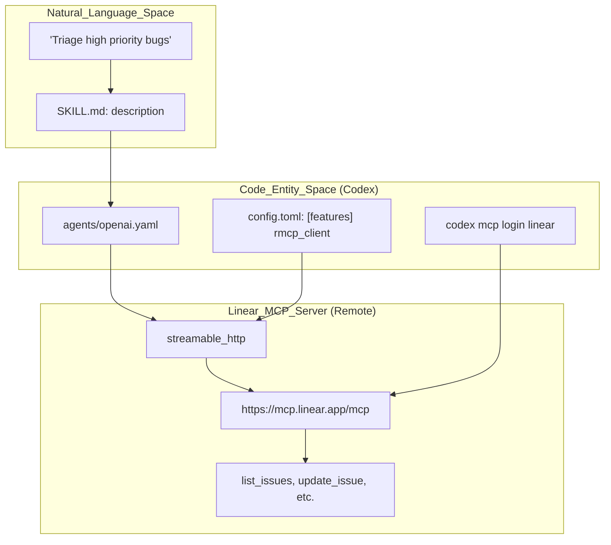
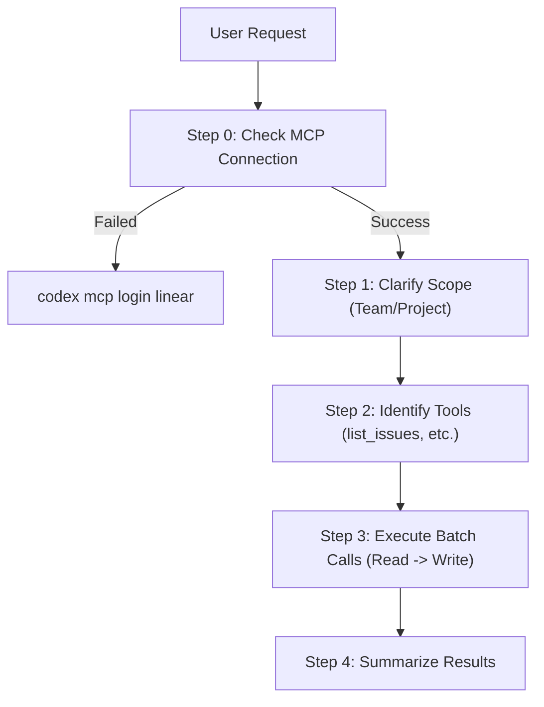

<!-- source: DeepWiki mcp.deepwiki.com · repo openai/skills · page 5.4 Linear Integration · fetched 2026-10-30 -->

# Linear Integration

Relevant source files

The following files were used as context for generating this wiki page:

- [skills/.curated/cloudflare-deploy/agents/openai.yaml](skills/.curated/cloudflare-deploy/agents/openai.yaml)
- [skills/.curated/linear/LICENSE.txt](skills/.curated/linear/LICENSE.txt)
- [skills/.curated/linear/SKILL.md](skills/.curated/linear/SKILL.md)
- [skills/.curated/linear/agents/openai.yaml](skills/.curated/linear/agents/openai.yaml)
- [skills/.curated/linear/assets/linear-small.svg](skills/.curated/linear/assets/linear-small.svg)
- [skills/.curated/linear/assets/linear.png](skills/.curated/linear/assets/linear.png)
- [skills/.curated/netlify-deploy/agents/openai.yaml](skills/.curated/netlify-deploy/agents/openai.yaml)

This page documents the `linear` skill, which provides structured workflows for managing issues, projects, and team collaboration in Linear via the Model Context Protocol (MCP). The skill enables natural-language project management operations including issue triage, sprint planning, documentation management, and team workload balancing.

## Overview

The Linear skill connects Codex to Linear's issue tracking platform through a remote MCP server hosted at `https://mcp.linear.app/mcp` [skills/.curated/linear/agents/openai.yaml:14-14](). It provides access to issue management, project planning, team collaboration, and documentation tools through OAuth-authenticated API calls [skills/.curated/linear/SKILL.md:15-16]().

**Key capabilities:**
- Issue lifecycle management (create, read, update, list) [skills/.curated/linear/SKILL.md:57-57]()
- Project and sprint planning [skills/.curated/linear/SKILL.md:65-65]()
- Team and user management [skills/.curated/linear/SKILL.md:59-60]()
- Documentation search and collaboration [skills/.curated/linear/SKILL.md:61-61]()
- Label and status management [skills/.curated/linear/SKILL.md:72-72]()

Sources: [skills/.curated/linear/SKILL.md:1-88](), [skills/.curated/linear/agents/openai.yaml:1-15]()

## MCP Server Configuration

### Connection Architecture

The following diagram bridges the Natural Language Space (User requests) to the Code Entity Space (MCP configuration and tools).

**Linear Integration Data Flow**

Sources: [skills/.curated/linear/SKILL.md:2-3](), [skills/.curated/linear/SKILL.md:22-31](), [skills/.curated/linear/agents/openai.yaml:10-14]()

### Setup Process

The Linear MCP server requires a specific configuration sequence [skills/.curated/linear/SKILL.md:22-33]():

1.  **Add the MCP server:**
    `codex mcp add linear --url https://mcp.linear.app/mcp` [skills/.curated/linear/SKILL.md:27-27]()
2.  **Enable remote MCP client:**
    Set `[features] rmcp_client = true` in `config.toml` or run `codex --enable rmcp_client` [skills/.curated/linear/SKILL.md:29-29]()
3.  **Log in with OAuth:**
    `codex mcp login linear` [skills/.curated/linear/SKILL.md:31-31]()

**Windows/WSL Note:** If connection errors occur on Windows, the Linear MCP can be configured to run via WSL using `npx -y mcp-remote` [skills/.curated/linear/SKILL.md:35-38]().

Sources: [skills/.curated/linear/SKILL.md:22-38]()

## Available Tools

The Linear MCP server exposes tools categorized by functional area [skills/.curated/linear/SKILL.md:55-62]():

| Category | Tools |
| :--- | :--- |
| **Issue Management** | `list_issues`, `get_issue`, `create_issue`, `update_issue`, `list_my_issues`, `list_issue_statuses`, `list_issue_labels`, `create_issue_label` |
| **Project & Team** | `list_projects`, `get_project`, `create_project`, `update_project`, `list_teams`, `get_team`, `list_users` |
| **Docs & Collab** | `list_documents`, `get_document`, `search_documentation`, `list_comments`, `create_comment`, `list_cycles` |

Sources: [skills/.curated/linear/SKILL.md:57-61]()

## Workflow Implementation

### Required Execution Steps

The skill enforces a 5-step workflow (Steps 0-4) to ensure consistency [skills/.curated/linear/SKILL.md:18-53]():

1.  **Step 0: Connection Check.** If MCP calls fail, provide setup commands and require a restart [skills/.curated/linear/SKILL.md:22-33]().
2.  **Step 1: Goal Clarification.** Confirm team, project, priority, and labels with the user [skills/.curated/linear/SKILL.md:40-41]().
3.  **Step 2: Workflow Selection.** Identify the appropriate practical workflow and required tool identifiers (Issue ID, Team Key) [skills/.curated/linear/SKILL.md:43-44]().
4.  **Step 3: Batch Execution.** Perform "Read" operations first (list/get) to build context, then "Create/Update" in logical batches [skills/.curated/linear/SKILL.md:46-50]().
5.  **Step 4: Summary.** Report results and propose next actions or blockers [skills/.curated/linear/SKILL.md:52-53]().

**Workflow Logic Diagram**

Sources: [skills/.curated/linear/SKILL.md:18-53]()

### Practical Workflows

The skill includes pre-defined patterns for common project management tasks [skills/.curated/linear/SKILL.md:63-73]():

*   **Sprint Planning:** Review open issues, pick by priority, and create/assign to a new cycle [skills/.curated/linear/SKILL.md:65-65]().
*   **Bug Triage:** List high-priority bugs and move top items to "In Progress" [skills/.curated/linear/SKILL.md:66-66]().
*   **Documentation Audit:** Search for gaps (e.g., "API auth") and open labeled issues for fixes [skills/.curated/linear/SKILL.md:67-67]().
*   **Team Workload Balance:** Group issues by assignee and suggest redistributions [skills/.curated/linear/SKILL.md:68-68]().
*   **Smart Labeling:** Analyze unlabeled issues and apply suggested categories [skills/.curated/linear/SKILL.md:72-72]().

Sources: [skills/.curated/linear/SKILL.md:63-73]()

## Technical Reference

### Interface Definition

The `openai.yaml` file defines the skill's identity and tool dependencies [skills/.curated/linear/agents/openai.yaml:1-15]():

*   **Display Name:** "Linear" [skills/.curated/linear/agents/openai.yaml:2-2]()
*   **Short Description:** "Manage Linear issues in Codex" [skills/.curated/linear/agents/openai.yaml:3-3]()
*   **Default Prompt:** "Use Linear context to triage or update relevant issues for this task, with clear next actions." [skills/.curated/linear/agents/openai.yaml:6-6]()
*   **Icons:** Located in `./assets/linear-small.svg` and `./assets/linear.png` [skills/.curated/linear/agents/openai.yaml:4-5]()
*   **Transport:** Uses `streamable_http` for the MCP connection [skills/.curated/linear/agents/openai.yaml:13-13]()

### Best Practices & Troubleshooting

*   **Batching:** Break large updates into smaller batches to avoid rate limits [skills/.curated/linear/SKILL.md:80-80]().
*   **Natural Language:** Use queries like "Show me what John is working on" [skills/.curated/linear/SKILL.md:78-78]().
*   **Authentication Errors:** Clear browser cookies or re-run OAuth if calls fail [skills/.curated/linear/SKILL.md:84-84]().
*   **Rate Limits:** Cache frequent queries and use specific filters to optimize performance [skills/.curated/linear/SKILL.md:87-87]().

Sources: [skills/.curated/linear/SKILL.md:75-88](), [skills/.curated/linear/agents/openai.yaml:1-15]()

---

