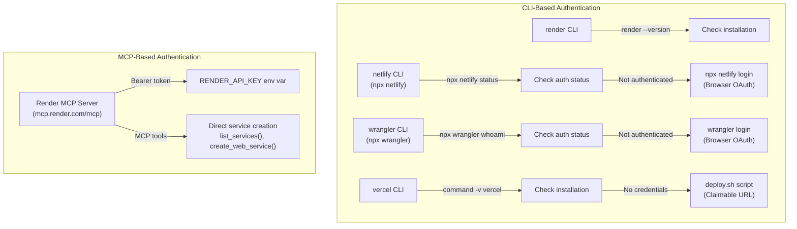
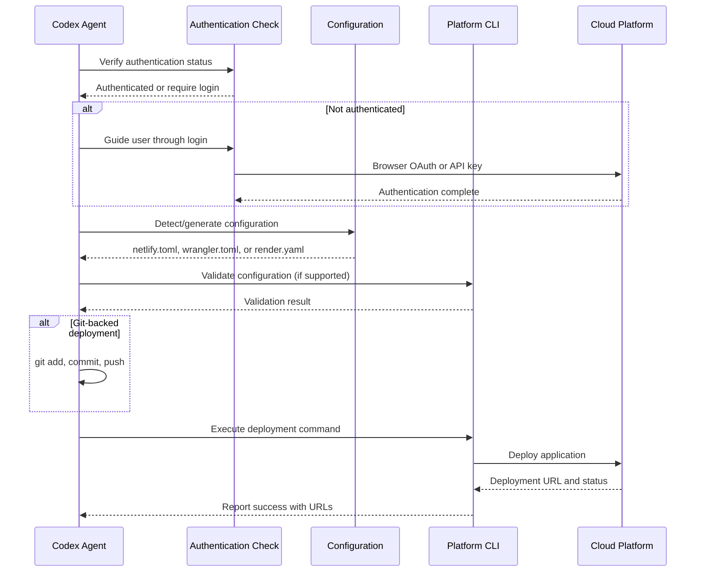
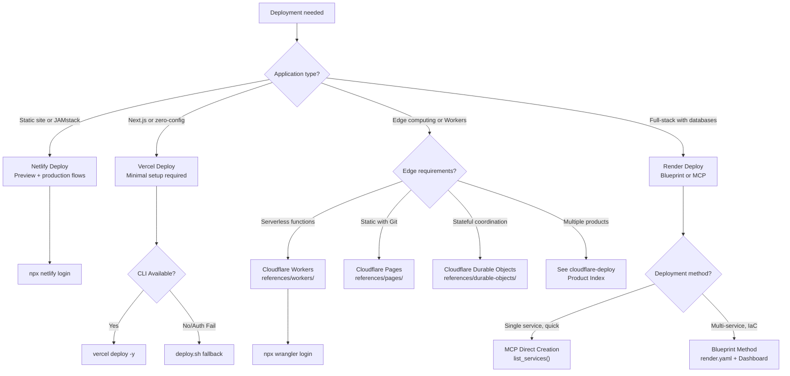

<!-- source: DeepWiki mcp.deepwiki.com · repo openai/skills · page 5.5 Deployment Tools · fetched 2026-10-30 -->

# Deployment Tools

Relevant source files

The following files were used as context for generating this wiki page:

- [skills/.curated/cloudflare-deploy/SKILL.md](skills/.curated/cloudflare-deploy/SKILL.md)
- [skills/.curated/netlify-deploy/SKILL.md](skills/.curated/netlify-deploy/SKILL.md)
- [skills/.curated/render-deploy/SKILL.md](skills/.curated/render-deploy/SKILL.md)
- [skills/.curated/vercel-deploy/SKILL.md](skills/.curated/vercel-deploy/SKILL.md)
- [skills/.curated/vercel-deploy/scripts/deploy.sh](skills/.curated/vercel-deploy/scripts/deploy.sh)

This page documents the curated deployment skills for cloud platforms: Netlify, Vercel, Cloudflare, and Render. Each skill automates the deployment workflow for its respective platform using CLI tools, platform-specific APIs, and specialized scripts.

For GitHub-specific deployment workflows (CI/CD debugging), see [GitHub Integration Skills](#5.1). For containerized deployments outside these platforms, see [Development Tools](#5.7).

## Purpose and Scope

The deployment tools skills provide:
- Automated authentication verification and setup.
- Platform-specific deployment workflows (Preview vs. Production).
- Configuration file generation and validation (e.g., `render.yaml`, `netlify.toml`).
- Framework detection for zero-config environments.
- Error handling and troubleshooting guidance for sandboxed execution.

All four skills are available in the `.curated` tier and can be installed by name using the `$skill-installer` utility (see [Installing Skills](#3.1)).

## Common Patterns

All deployment skills share these architectural patterns:

### Sandboxing and Network Access

All deployment skills require escalated network permissions when sandboxing blocks deployment API calls. When deployment fails due to network issues (timeouts, DNS errors, connection resets), the skills instruct the agent to rerun with `sandbox_permissions=require_escalated`.

**Sources:** [skills/.curated/netlify-deploy/SKILL.md:213-221](), [skills/.curated/cloudflare-deploy/SKILL.md:216-226](), [skills/.curated/render-deploy/SKILL.md:22-23](), [skills/.curated/vercel-deploy/SKILL.md:69-78]()

### Authentication Strategy

Each platform uses one of two authentication approaches:

**Sources:** [skills/.curated/netlify-deploy/SKILL.md:26-68](), [skills/.curated/cloudflare-deploy/SKILL.md:15-25](), [skills/.curated/render-deploy/SKILL.md:96-189](), [skills/.curated/vercel-deploy/SKILL.md:33-52]()

### Deployment Workflow Pattern

**Sources:** [skills/.curated/netlify-deploy/SKILL.md:38-150](), [skills/.curated/render-deploy/SKILL.md:228-372](), [skills/.curated/vercel-deploy/SKILL.md:16-31]()

## Platform Selection Guide

Choose deployment platforms based on application type and infrastructure needs:

| Platform | Best For | Configuration | Authentication |
|----------|----------|---------------|----------------|
| **Netlify** | Static sites, JAMstack apps, preview deployments | `netlify.toml` | `npx netlify login` or `NETLIFY_AUTH_TOKEN` |
| **Vercel** | Next.js apps, zero-config deployments, fast iteration | Auto-detected | CLI login or fallback `deploy.sh` |
| **Cloudflare** | Edge computing, Workers, global scale, complex infrastructure | `wrangler.toml` per product | `npx wrangler login` or `CLOUDFLARE_API_TOKEN` |
| **Render** | Full-stack apps, databases, multi-service deployments, IaC | `render.yaml` (Blueprint) or MCP tools | `render login`, API key, or MCP |

**Sources:** [skills/.curated/netlify-deploy/SKILL.md:1-10](), [skills/.curated/vercel-deploy/SKILL.md:1-10](), [skills/.curated/cloudflare-deploy/SKILL.md:1-8](), [skills/.curated/render-deploy/SKILL.md:1-18]()

### Decision Tree

**Sources:** [skills/.curated/netlify-deploy/SKILL.md:6-17](), [skills/.curated/cloudflare-deploy/SKILL.md:27-110](), [skills/.curated/render-deploy/SKILL.md:54-80](), [skills/.curated/vercel-deploy/SKILL.md:16-52]()

## Platform-Specific Details

Each deployment platform has unique characteristics and workflows documented in the following subsections:

- [Netlify Deploy](#5.5.1) — Detail Netlify deployment workflow using netlify CLI, including authentication via `npx netlify status` [skills/.curated/netlify-deploy/SKILL.md:40-50](), site linking/creation, preview vs production deploys, and `netlify.toml` configuration.
- [Vercel Deploy](#5.5.2) — Detail Vercel deployment with zero-configuration approach, CLI-based workflow, framework detection via `detect_framework` in `deploy.sh` [skills/.curated/vercel-deploy/scripts/deploy.sh:12-162](), and the fallback script-based deployment path for sandboxed environments [skills/.curated/vercel-deploy/SKILL.md:33-52]().
- [Cloudflare Deploy](#5.5.3) — Detail the comprehensive Cloudflare deployment skill using `wrangler` CLI for Workers, Pages, D1, KV, R2, Durable Objects, and the full suite of Cloudflare platform services [skills/.curated/cloudflare-deploy/SKILL.md:112-213]().
- [Render Deploy](#5.5.4) — Detail Render deployment with two methods: Blueprint (`render.yaml`) and Direct Creation (MCP tools like `list_services()`), including validation and dashboard workflows [skills/.curated/render-deploy/SKILL.md:53-112]().

**Sources:** [skills/.curated/netlify-deploy/SKILL.md:1-20](), [skills/.curated/vercel-deploy/scripts/deploy.sh:12-162](), [skills/.curated/cloudflare-deploy/SKILL.md:112-213](), [skills/.curated/render-deploy/SKILL.md:1-112]()

---

