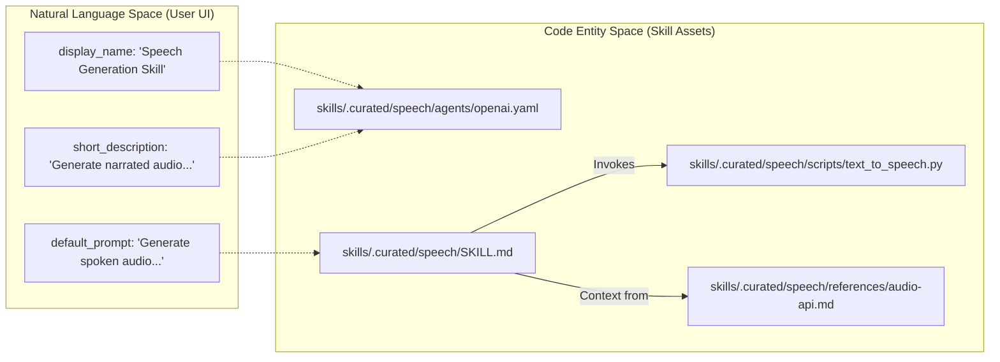
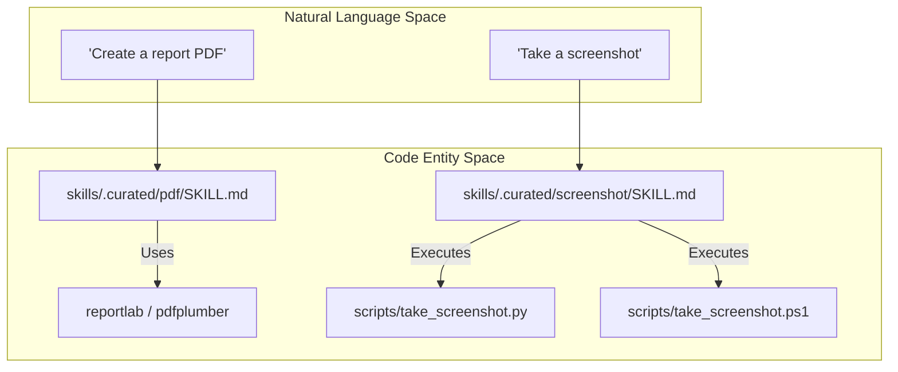

<!-- source: DeepWiki mcp.deepwiki.com · repo openai/skills · page 5.6 Content Generation Skills · fetched 2026-10-30 -->

# Content Generation Skills

<details>
<summary>Relevant source files</summary>

The following files were used as context for generating this wiki page:

- [skills/.curated/pdf/SKILL.md](skills/.curated/pdf/SKILL.md)
- [skills/.curated/pdf/agents/openai.yaml](skills/.curated/pdf/agents/openai.yaml)
- [skills/.curated/screenshot/SKILL.md](skills/.curated/screenshot/SKILL.md)
- [skills/.curated/screenshot/agents/openai.yaml](skills/.curated/screenshot/agents/openai.yaml)
- [skills/.curated/speech/SKILL.md](skills/.curated/speech/SKILL.md)
- [skills/.curated/speech/agents/openai.yaml](skills/.curated/speech/agents/openai.yaml)
- [skills/.curated/yeet/SKILL.md](skills/.curated/yeet/SKILL.md)

</details>


## Purpose and Scope

This page documents the content generation skills in the `.curated` tier, which enable Codex to create, edit, and manipulate various content formats including documents, media, and data files. These skills provide interfaces to OpenAI's content generation APIs (DALL-E, TTS, Transcribe) and document manipulation capabilities.

For development tools like Jupyter notebooks and Playwright browser automation, see [Development Tools](#5.7). For deployment-related skills, see [Deployment Tools](#5.5).

## Available Skills Overview

The following table lists the content generation skills available for installation by name using `$skill-installer`:

| Skill Name | Display Name | Primary Purpose | Output Format |
|------------|--------------|-----------------|---------------|
| `pdf` | PDF Skill | Create, edit, and review PDFs | `.pdf`, `.png` |
| `speech` | Speech Generation Skill | Generate narrated audio from text | Audio files |
| `imagegen` | Image Gen | Generate and edit images using DALL-E | Image files |
| `screenshot` | Screenshot Capture | Capture desktop or app screenshots | Image files |
| `transcribe` | Transcribe Skill | Audio-to-text with diarization | Text/JSON |
| `yeet` | yeet | Stage, commit, push, and open GitHub PRs | Git/PR |

**Sources:** [skills/.curated/pdf/agents/openai.yaml:1-6](), [skills/.curated/speech/agents/openai.yaml:1-6](), [skills/.curated/screenshot/agents/openai.yaml:1-6](), [skills/.curated/yeet/SKILL.md:1-4]()

## Interface Architecture

All content generation skills follow the standard `openai.yaml` interface pattern for skill metadata and UI presentation. This bridges the natural language intent to the specific code entities and scripts required for execution.

### Mapping Natural Language to Code Entities

The following diagram illustrates how the `openai.yaml` interface maps user-facing elements to the underlying skill assets and execution scripts for media generation.



**Sources:** [skills/.curated/speech/agents/openai.yaml:1-6](), [skills/.curated/speech/SKILL.md:1-9](), [skills/.curated/speech/SKILL.md:135-136]()

## Speech Generation

The `speech` skill provides a high-level interface for text-to-speech narration using the OpenAI Audio API. It defaults to the `gpt-4o-mini-tts-2025-12-15` model [skills/.curated/speech/SKILL.md:9]().

- **CLI-Driven**: Uses `scripts/text_to_speech.py` for deterministic audio generation [skills/.curated/speech/SKILL.md:67]().
- **Batch Processing**: Supports batch generation via JSONL files for high-volume tasks like IVR prompts [skills/.curated/speech/SKILL.md:22]().
- **Instruction Augmentation**: Supports a structured "Instruction Spec" (Affect, Tone, Pacing) to control voice characteristics [skills/.curated/speech/SKILL.md:77-87]().

For details, see [Speech Generation](#5.6.1).

**Sources:** [skills/.curated/speech/SKILL.md:1-115]()

## PDF, Screenshot, and Transcribe

These skills handle document generation, OS-level visual capture, and audio-to-text processing.

### Document and Visual Skills Mapping



### PDF Skill
Uses `reportlab` for generation and `pdfplumber` (or `pypdf`) for text extraction [skills/.curated/pdf/SKILL.md:18-19](). It prioritizes visual review by rendering PDF pages to PNGs using Poppler's `pdftoppm` [skills/.curated/pdf/SKILL.md:15-17]().

### Screenshot Skill
Captures desktop or window content across macOS, Linux, and Windows [skills/.curated/screenshot/SKILL.md:3](). It includes `scripts/take_screenshot.py` for macOS/Linux and `scripts/take_screenshot.ps1` for Windows to handle platform-specific capture APIs [skills/.curated/screenshot/SKILL.md:51-153]().

### Transcribe Skill
Converts audio to text using `gpt-4o-transcribe` models, supporting optional speaker diarization for multi-participant recordings.

For details, see [PDF, Screenshot, and Transcribe](#5.6.2).

**Sources:** [skills/.curated/pdf/SKILL.md:1-68](), [skills/.curated/screenshot/SKILL.md:1-115]()

## Automated Content Promotion (yeet)

The `yeet` skill is used for the final stage of content generation: promoting changes to a repository. It automates the `git` and `gh` CLI workflow to stage, commit, push, and create a Pull Request in one flow [skills/.curated/yeet/SKILL.md:2-3]().

- **Naming Conventions**: Automatically generates branch names, commit messages, and PR titles from the user's description [skills/.curated/yeet/SKILL.md:11-15]().
- **PR Generation**: Discovers repository PR templates (e.g., `.github/pull_request_template.md`) and uses `gh pr create --fill` with a detailed markdown body [skills/.curated/yeet/SKILL.md:25-34]().
- **Update Logic**: If a PR already exists for the current branch, `yeet` updates the existing PR rather than creating a duplicate [skills/.curated/yeet/SKILL.md:48-49]().

**Sources:** [skills/.curated/yeet/SKILL.md:1-120]()

## Installation

All content generation skills can be installed using the `$skill-installer` utility:

```bash
$skill-installer pdf
$skill-installer speech
$skill-installer screenshot
$skill-installer transcribe
$skill-installer yeet
```

After installation, restart Codex to load the skills. See [Installing Skills](#3.1) for detailed instructions.

**Sources:** [skills/.curated/yeet/SKILL.md:8-9](), [skills/.curated/speech/SKILL.md:34-44]()

---

