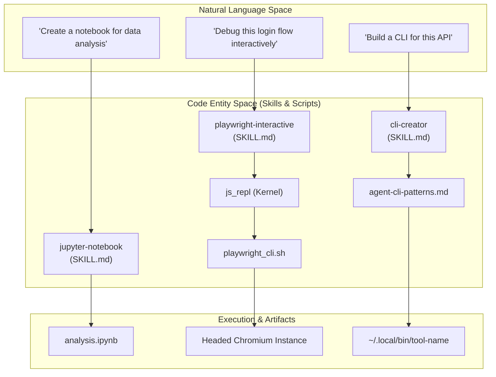
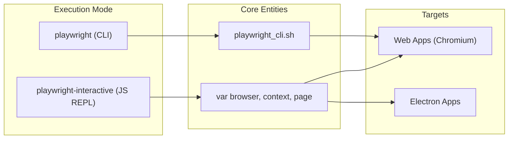

<!-- source: DeepWiki mcp.deepwiki.com · repo openai/skills · page 5.7 Development Tools · fetched 2026-10-30 -->

# Development Tools

Relevant source files

The following files were used as context for generating this wiki page:

- [skills/.curated/cli-creator/LICENSE.txt](skills/.curated/cli-creator/LICENSE.txt)
- [skills/.curated/cli-creator/SKILL.md](skills/.curated/cli-creator/SKILL.md)
- [skills/.curated/cli-creator/agents/openai.yaml](skills/.curated/cli-creator/agents/openai.yaml)
- [skills/.curated/cli-creator/references/agent-cli-patterns.md](skills/.curated/cli-creator/references/agent-cli-patterns.md)
- [skills/.curated/playwright-interactive/LICENSE.txt](skills/.curated/playwright-interactive/LICENSE.txt)
- [skills/.curated/playwright-interactive/NOTICE.txt](skills/.curated/playwright-interactive/NOTICE.txt)
- [skills/.curated/playwright-interactive/SKILL.md](skills/.curated/playwright-interactive/SKILL.md)
- [skills/.curated/playwright-interactive/agents/openai.yaml](skills/.curated/playwright-interactive/agents/openai.yaml)
- [skills/.curated/playwright-interactive/assets/playwright-small.svg](skills/.curated/playwright-interactive/assets/playwright-small.svg)
- [skills/.curated/playwright-interactive/assets/playwright.png](skills/.curated/playwright-interactive/assets/playwright.png)
- [skills/.curated/playwright/SKILL.md](skills/.curated/playwright/SKILL.md)
- [skills/.curated/playwright/scripts/playwright_cli.sh](skills/.curated/playwright/scripts/playwright_cli.sh)

## Purpose and Scope

This document covers development-focused skills in the `.curated` tier that support technical workflows including interactive experimentation (Jupyter Notebooks), browser automation (Playwright and Playwright Interactive), and custom tool building (CLI Creator). These tools are designed to bridge the gap between high-level natural language intent and low-level code execution environments.

For detailed technical implementation of specific tools, see the following child pages:
- [Jupyter Notebook](#5.7.1) — Detail the `jupyter-notebook` skill for creating reproducible experiment and tutorial notebooks.
- [Playwright and Browser Automation](#5.7.2) — Document both the `playwright` skill (CLI-based) and `playwright-interactive` skill (persistent `js_repl` sessions).
- [CLI Creator](#5.7.3) — Detail the `cli-creator` skill for building composable, durable CLIs for Codex.

## Overview

Development Tools skills provide specialized capabilities for technical users performing iterative development, testing, and documentation tasks. These skills emphasize:

- **Interactive Execution**: Jupyter Notebooks for experimental code with inline results.
- **Browser Automation**: Playwright for repeatable CLI-based browser workflows [skills/.curated/playwright/SKILL.md:7-10]() and Playwright Interactive for persistent debugging via `js_repl` [skills/.curated/playwright-interactive/SKILL.md:6-9]().
- **Tool Creation**: CLI Creator for building composable, durable command-line interfaces from API docs, OpenAPI specs, or SDKs [skills/.curated/cli-creator/SKILL.md:1-10]().

Sources: [skills/.curated/playwright/SKILL.md](), [skills/.curated/playwright-interactive/SKILL.md](), [skills/.curated/cli-creator/SKILL.md]()

## Development Tools Architecture

The following diagram illustrates how natural language requests map to specific code entities and execution environments within the development tools category.

### Natural Language to Code Entity Mapping

Sources: [skills/.curated/playwright/scripts/playwright_cli.sh:1-25](), [skills/.curated/playwright-interactive/SKILL.md:12-25](), [skills/.curated/cli-creator/SKILL.md:50-54](), [skills/.curated/cli-creator/references/agent-cli-patterns.md:1-155]()

## Jupyter Notebooks

The `jupyter-notebook` skill creates interactive `.ipynb` files for experiments and tutorials. It is designed for creating reproducible experiment and tutorial notebooks using the `new_notebook.py` helper script, templates, and reference patterns.

- **Structure**: Generates notebooks with clear sections, runnable cells, and concise takeaways.
- **Workflow**: Ideal for exploratory data analysis or step-by-step API tutorials.

For details, see [Jupyter Notebook](#5.7.1).

## Playwright and Browser Automation

This category includes two distinct skills for browser interaction, enabling both automated and interactive UI debugging.

- **Playwright (CLI)**: Focuses on terminal-based automation using the `playwright_cli.sh` wrapper script [skills/.curated/playwright/scripts/playwright_cli.sh:1-25](). It follows a "Snapshot-Interact-Snapshot" workflow to ensure stable element references [skills/.curated/playwright/SKILL.md:63-79]().
- **Playwright Interactive**: Uses a persistent `js_repl` session to keep browser handles (like `browser`, `context`, and `page`) alive across multiple cells [skills/.curated/playwright-interactive/SKILL.md:61-73](). This allows for fast iterative UI debugging and visual QA without restarting the toolchain [skills/.curated/playwright-interactive/SKILL.md:6-9]().

### Browser Automation Interaction Model

For details, see [Playwright and Browser Automation](#5.7.2).

Sources: [skills/.curated/playwright/SKILL.md:1-148](), [skills/.curated/playwright/scripts/playwright_cli.sh:1-25](), [skills/.curated/playwright-interactive/SKILL.md:1-89](), [skills/.curated/playwright-interactive/SKILL.md:61-73]()

## CLI Creator

The `cli-creator` skill is used to build real, durable CLIs that Codex can run from any directory [skills/.curated/cli-creator/SKILL.md:8-10](). It focuses on turning services, APIs, or scripts into composable primitives [skills/.curated/cli-creator/references/agent-cli-patterns.md:7-10]().

- **Runtimes**: Supports **Rust** (default for speed/binaries), **TypeScript** (for SDK/browser heavy tools), and **Python** (for data/admin tools) [skills/.curated/cli-creator/SKILL.md:32-43]().
- **Design Patterns**: Enforces a "Product Noun then Verb" command shape (e.g., `tool-name accounts list`) and requires a `--json` output flag for machine readability [skills/.curated/cli-creator/references/agent-cli-patterns.md:26-38](), [skills/.curated/cli-creator/references/agent-cli-patterns.md:84-86]().
- **Companion Skills**: Every CLI created should be paired with a companion skill that teaches Codex how to use the new tool [skills/.curated/cli-creator/SKILL.md:131-155]().

For details, see [CLI Creator](#5.7.3).

Sources: [skills/.curated/cli-creator/SKILL.md:1-105](), [skills/.curated/cli-creator/references/agent-cli-patterns.md:1-155](), [skills/.curated/cli-creator/agents/openai.yaml:1-5]()

## Summary of Tooling Entities

The following table maps the development tools to their primary execution mechanisms and core files.

| Skill Name | Primary Entity / Script | Interface File |
| :--- | :--- | :--- |
| **Playwright CLI** | `playwright_cli.sh` | [skills/.curated/playwright/SKILL.md]() |
| **Playwright Interactive** | `js_repl` / `chromium.launch` | [skills/.curated/playwright-interactive/agents/openai.yaml]() |
| **CLI Creator** | `agent-cli-patterns.md` | [skills/.curated/cli-creator/agents/openai.yaml]() |
| **Jupyter** | `new_notebook.py` | (See Jupyter Child Page) |

Sources: [skills/.curated/playwright/scripts/playwright_cli.sh:19](), [skills/.curated/playwright-interactive/SKILL.md:106](), [skills/.curated/cli-creator/SKILL.md:52](), [skills/.curated/cli-creator/agents/openai.yaml:1-5]()

---

