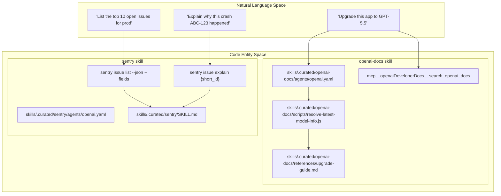
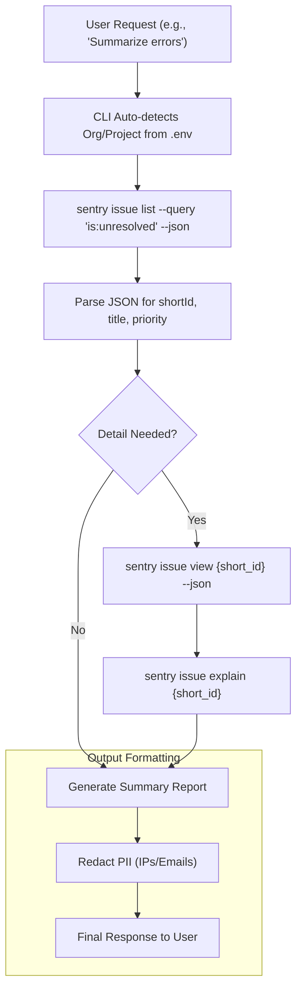

<!-- source: DeepWiki mcp.deepwiki.com · repo openai/skills · page 5.8 Reference and Observability · fetched 2026-10-30 -->

# Reference and Observability

Relevant source files

The following files were used as context for generating this wiki page:

- [skills/.curated/openai-docs/SKILL.md](skills/.curated/openai-docs/SKILL.md)
- [skills/.curated/openai-docs/agents/openai.yaml](skills/.curated/openai-docs/agents/openai.yaml)
- [skills/.curated/openai-docs/references/prompting-guide.md](skills/.curated/openai-docs/references/prompting-guide.md)
- [skills/.curated/openai-docs/references/upgrade-guide.md](skills/.curated/openai-docs/references/upgrade-guide.md)
- [skills/.curated/openai-docs/scripts/resolve-latest-model-info.js](skills/.curated/openai-docs/scripts/resolve-latest-model-info.js)
- [skills/.curated/sentry/SKILL.md](skills/.curated/sentry/SKILL.md)

This page documents support skills that provide reference documentation access and observability capabilities. These skills enable Codex to look up official documentation, perform model upgrades, and investigate production issues.

The skills covered here are:
- **openai-docs**: Reference official OpenAI Developer documentation via MCP and manage model migrations.
- **sentry**: Read-only access to Sentry observability data for issue investigation via the Sentry CLI.

---

## OpenAI Docs

The `openai-docs` skill provides direct access to official OpenAI Developer documentation through an MCP server connection. Beyond simple lookups, it acts as the authoritative owner for model selection, API model migration, and prompt-upgrade guidance [skills/.curated/openai-docs/SKILL.md:9]().

### Interface Configuration

The skill interface is defined in [skills/.curated/openai-docs/agents/openai.yaml:1-6]():

| Field | Value |
|-------|-------|
| `display_name` | "OpenAI Docs" |
| `short_description` | "Reference docs, choose models, and migrate OpenAI API integrations" |
| `default_prompt` | "Use OpenAI Docs for official docs lookup, model selection, model migration, and prompt-upgrade work." |

### MCP Server Dependency

The skill utilizes the `openaiDeveloperDocs` MCP server over `streamable_http` [skills/.curated/openai-docs/agents/openai.yaml:10-14](). If the MCP server is missing, Codex is instructed to attempt auto-installation via `codex mcp add openaiDeveloperDocs --url https://developers.openai.com/mcp` [skills/.curated/openai-docs/SKILL.md:35]().

### Model Upgrade and Migration Logic

A core capability of this skill is managing the transition to newer models (e.g., GPT-5.5). It uses a "Freshness Check" workflow to ensure guidance is current [skills/.curated/openai-docs/references/upgrade-guide.md:5-11]():

1.  **Freshness Check**: Runs `node scripts/resolve-latest-model-info.js` to determine the current `modelSlug` and migration URLs [skills/.curated/openai-docs/references/upgrade-guide.md:7]().
2.  **Resolution**: If the script returns a new model (e.g., `gpt-5p5`), it fetches remote `migrationGuideUrl` and `promptingGuideUrl` [skills/.curated/openai-docs/scripts/resolve-latest-model-info.js:125-126]().
3.  **Fallback**: If remote fetching fails, it falls back to bundled references: `references/upgrade-guide.md` and `references/prompting-guide.md` [skills/.curated/openai-docs/SKILL.md:64-65]().

### Upgrade Posture

The skill enforces a "narrowest safe change set" policy [skills/.curated/openai-docs/references/upgrade-guide.md:16]():
- Update the model string first [skills/.curated/openai-docs/references/upgrade-guide.md:18]().
- Update only prompts directly tied to that model [skills/.curated/openai-docs/references/upgrade-guide.md:19]().
- Mark as `blocked` if the upgrade requires API-surface changes or tool rewiring [skills/.curated/openai-docs/references/upgrade-guide.md:22]().

**Sources:** [skills/.curated/openai-docs/SKILL.md:1-83](), [skills/.curated/openai-docs/agents/openai.yaml:1-15](), [skills/.curated/openai-docs/references/upgrade-guide.md:1-60](), [skills/.curated/openai-docs/scripts/resolve-latest-model-info.js:122-128]()

---

## Sentry

The `sentry` skill provides read-only access to Sentry observability data using the `sentry` CLI [skills/.curated/sentry/SKILL.md:3](). It enables root cause analysis, impact assessment, and next-step recommendations based on error tracking data.

### Interface Configuration

The skill interface is defined in [skills/.curated/sentry/agents/openai.yaml:1-6]():

| Field | Value |
|-------|-------|
| `display_name` | "Sentry (Read-only Observability)" |
| `short_description` | "Read-only Sentry observability" |
| `icon_small` | "./assets/sentry-small.svg" |
| `icon_large` | "./assets/sentry.png" |
| `default_prompt` | "Investigate this issue in read-only Sentry data and report likely root cause, impact, and next steps." |

### Implementation and CLI Usage

The skill utilizes the `sentry` command-line tool for all queries [skills/.curated/sentry/SKILL.md:25](). It emphasizes machine-readable output by enforcing the `--json` flag [skills/.curated/sentry/SKILL.md:14, 25]().

Key operations include:
- **Listing Issues**: Uses `sentry issue list` with queries for unresolved production errors [skills/.curated/sentry/SKILL.md:30-35]().
- **Viewing Details**: Uses `sentry issue view {short_id}` using the short ID format (e.g., `ABC-123`) [skills/.curated/sentry/SKILL.md:49, 52]().
- **Root Cause Analysis**: Leverages `sentry issue explain {short_id}` for AI-powered analysis [skills/.curated/sentry/SKILL.md:75]().
- **Fix Planning**: Uses `sentry issue plan {short_id}` to generate a fix strategy [skills/.curated/sentry/SKILL.md:81]().
- **Schema Discovery**: Uses `sentry schema <resource>` to explore API endpoints [skills/.curated/sentry/SKILL.md:15, 91-93]().

### Authentication and Setup

The skill requires the Sentry CLI to be installed and authenticated. Users are instructed to run `sentry auth login` or set the `SENTRY_AUTH_TOKEN` environment variable [skills/.curated/sentry/SKILL.md:11, 19](). The CLI automatically detects organization and project slugs from local environment files (`.env`) or source code [skills/.curated/sentry/SKILL.md:12, 98]().

**Sources:** [skills/.curated/sentry/SKILL.md:1-121](), [skills/.curated/sentry/agents/openai.yaml:1-7]()

---

## Architecture: Reference and Observability Skills

### Skill Entity Mapping

This diagram bridges Natural Language intents to the specific Code Entities (files and configuration keys) that implement them.

**Sources:** [skills/.curated/openai-docs/SKILL.md:43-51](), [skills/.curated/sentry/SKILL.md:25-35](), [skills/.curated/sentry/SKILL.md:75](), [skills/.curated/openai-docs/references/upgrade-guide.md:7-11]()

### Sentry Read-Only Investigation Flow

This diagram details the data flow when Codex uses the Sentry CLI to investigate production errors.

**Sources:** [skills/.curated/sentry/SKILL.md:12-14](), [skills/.curated/sentry/SKILL.md:27-35](), [skills/.curated/sentry/SKILL.md:75](), [skills/.curated/sentry/SKILL.md:110]()

---

## Comparison of Reference and Observability Skills

| Aspect | openai-docs | sentry |
|--------|-------------|--------|
| **Primary Purpose** | Documentation & Model Migration | Error investigation |
| **Interface** | MCP Server & Node.js Scripts | Shell CLI |
| **Transport** | `streamable_http` | Local Process Execution |
| **Access Mode** | Read-only | Read-only [skills/.curated/sentry/SKILL.md:7]() |
| **Data Source** | OpenAI Developer Portal | Sentry API via CLI |
| **Key Operations** | `resolve-latest-model-info.js`, `search_openai_docs` | `sentry issue list`, `sentry issue explain` |

**Sources:** [skills/.curated/sentry/SKILL.md:3-4](), [skills/.curated/openai-docs/SKILL.md:9, 17](), [skills/.curated/openai-docs/agents/openai.yaml:1-15]()

---

