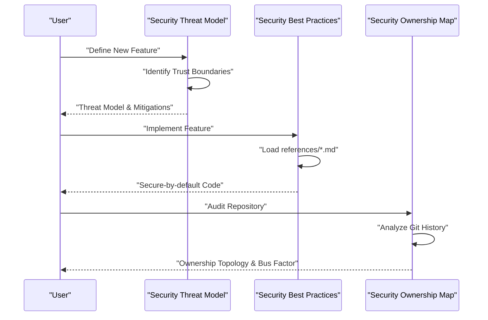

<!-- source: DeepWiki mcp.deepwiki.com · repo openai/skills · page 5.9 Security Skills · fetched 2026-10-30 -->

# Security Skills

<details>
<summary>Relevant source files</summary>

The following files were used as context for generating this wiki page:

- [skills/.curated/security-best-practices/LICENSE.txt](skills/.curated/security-best-practices/LICENSE.txt)
- [skills/.curated/security-best-practices/SKILL.md](skills/.curated/security-best-practices/SKILL.md)
- [skills/.curated/security-best-practices/agents/openai.yaml](skills/.curated/security-best-practices/agents/openai.yaml)
- [skills/.curated/security-best-practices/references/golang-general-backend-security.md](skills/.curated/security-best-practices/references/golang-general-backend-security.md)
- [skills/.curated/security-best-practices/references/javascript-express-web-server-security.md](skills/.curated/security-best-practices/references/javascript-express-web-server-security.md)
- [skills/.curated/security-best-practices/references/javascript-general-web-frontend-security.md](skills/.curated/security-best-practices/references/javascript-general-web-frontend-security.md)
- [skills/.curated/security-best-practices/references/javascript-jquery-web-frontend-security.md](skills/.curated/security-best-practices/references/javascript-jquery-web-frontend-security.md)
- [skills/.curated/security-best-practices/references/javascript-typescript-nextjs-web-server-security.md](skills/.curated/security-best-practices/references/javascript-typescript-nextjs-web-server-security.md)
- [skills/.curated/security-best-practices/references/javascript-typescript-react-web-frontend-security.md](skills/.curated/security-best-practices/references/javascript-typescript-react-web-frontend-security.md)
- [skills/.curated/security-best-practices/references/javascript-typescript-vue-web-frontend-security.md](skills/.curated/security-best-practices/references/javascript-typescript-vue-web-frontend-security.md)
- [skills/.curated/security-best-practices/references/python-django-web-server-security.md](skills/.curated/security-best-practices/references/python-django-web-server-security.md)

</details>


The **Security Skills** category provides a suite of modular capabilities designed to harden applications, analyze organizational risk, and perform professional-grade threat modeling. These skills leverage repository-grounded context to move beyond generic advice, providing actionable security engineering outputs.

### High-Level Capabilities

The security suite is organized into three distinct functional areas:

| Skill | Primary Purpose | Key Output |
| :--- | :--- | :--- |
| **Security Best Practices** | Language/Framework specific reviews. | `security_best_practices_report.md` |
| **Security Ownership Map** | Git-based topology and bus factor analysis. | Bipartite people-to-file graphs / Neo4j exports. |
| **Security Threat Model** | AppSec-grade architectural threat modeling. | 8-step structured threat model. |

**Sources:**
- [skills/.curated/security-best-practices/SKILL.md:1-13]()
- [skills/.curated/security-best-practices/agents/openai.yaml:1-5]()

---

## 5.9.1 Security Best Practices

The `security-best-practices` skill performs deep-dive security reviews based on the specific language and framework stack detected in the repository [skills/.curated/security-best-practices/SKILL.md:14-25](). It operates in three modes: **Generation** (writing secure code), **Passive Review** (flagging issues during development), and **Active Audit** (producing a comprehensive vulnerability report) [skills/.curated/security-best-practices/SKILL.md:26-33]().

### Supported Frameworks and References
The skill relies on a structured `references/` directory using the naming convention `<language>-<framework>-<stack>-security.md` [skills/.curated/security-best-practices/SKILL.md:18-21]().

*   **Python:** Includes deep specs for Django [skills/.curated/security-best-practices/references/python-django-web-server-security.md:1-10]().
*   **JavaScript/TypeScript:** Covers React [skills/.curated/security-best-practices/references/javascript-typescript-react-web-frontend-security.md:1-10](), Vue [skills/.curated/security-best-practices/references/javascript-typescript-vue-web-frontend-security.md:1-10](), Next.js [skills/.curated/security-best-practices/references/javascript-typescript-nextjs-web-server-security.md:1-10](), Express [skills/.curated/security-best-practices/references/javascript-express-web-server-security.md:1-10](), jQuery [skills/.curated/security-best-practices/references/javascript-jquery-web-frontend-security.md:1-10](), and general frontend JS [skills/.curated/security-best-practices/references/javascript-general-web-frontend-security.md:1-10]().
*   **Go:** Focuses on the standard library and `net/http` security [skills/.curated/security-best-practices/references/golang-general-backend-security.md:1-10]().

For details, see [Security Best Practices](#5.9.1).

**Sources:**
- [skills/.curated/security-best-practices/SKILL.md:14-33]()
- [skills/.curated/security-best-practices/references/python-django-web-server-security.md:1-10]()
- [skills/.curated/security-best-practices/references/golang-general-backend-security.md:1-10]()
- [skills/.curated/security-best-practices/references/javascript-jquery-web-frontend-security.md:1-10]()

---

## 5.9.2 Security Ownership Map

The `security-ownership-map` skill focuses on the "human" element of security. By analyzing git history, it builds a bipartite graph connecting contributors to specific code entities. This analysis is critical for identifying **orphaned code** (sensitive files with no active maintainers) and calculating the **bus factor** for critical security modules.

The skill can export these topologies to professional visualization tools like Neo4j or Gephi to help security leadership visualize ownership gaps across large organizations.

For details, see [Security Ownership Map](#5.9.2).

---

## 5.9.3 Security Threat Model

The `security-threat-model` skill automates AppSec-grade threat modeling. It follows a rigorous 8-step workflow that starts with scope extraction and ends with prioritized mitigation recommendations. Unlike generic LLM prompting, this skill is grounded in the repository's actual architecture, identifying specific entry points, trust boundaries, and data flows.

The output is governed by a strict `prompt-template.md` contract to ensure that every threat model includes:
1.  **System Description & Scope**
2.  **Trust Boundaries & Data Flows**
3.  **Threat Analysis (STRIDE/PASTA methodologies)**
4.  **Mitigation Roadmap**

For details, see [Security Threat Model](#5.9.3).

---

## Security Skill Architecture

The following diagram illustrates how the Security Skills bridge the gap between high-level security requirements and the actual code entities within a repository.

### Security Mapping: Requirements to Code Entities
```mermaid
graph TD
    subgraph "Natural Language Space"
        ["Requirement"] --> ["security-best-practices"]
        ["Requirement"] --> ["security-threat-model"]
        ["Requirement"] --> ["security-ownership-map"]
    end

    subgraph "Code Entity Space"
        ["security-best-practices"] -- "loads" --> ["references_dir"]
        ["references_dir"] -- "audits" --> ["req_params"]
        ["references_dir"] -- "validates" --> ["middleware_stack"]
        
        ["security-threat-model"] -- "identifies" --> ["route_handlers"]
        ["security-threat-model"] -- "traces" --> ["trust_boundaries"]
        
        ["security-ownership-map"] -- "analyzes" --> ["git_log"]
        ["git_log"] -- "maps" --> ["contributors"]
    end

    ["references_dir"]:::file
    ["req_params"]:::code
    ["middleware_stack"]:::code
    ["route_handlers"]:::code
    ["trust_boundaries"]:::logic
    ["git_log"]:::data
    ["contributors"]:::people

    classDef file stroke-dasharray: 5 5
    classDef code font-weight:bold
    classDef logic font-style:italic
```

**Sources:**
- [skills/.curated/security-best-practices/SKILL.md:14-25]()
- [skills/.curated/security-best-practices/references/javascript-express-web-server-security.md:67-81]()
- [skills/.curated/security-best-practices/references/golang-general-backend-security.md:40-54]()

### Workflow Integration
The security skills are designed to work together during the software development lifecycle (SDLC).



**Sources:**
- [skills/.curated/security-best-practices/SKILL.md:26-33]()
- [skills/.curated/security-best-practices/agents/openai.yaml:1-5]()

---

