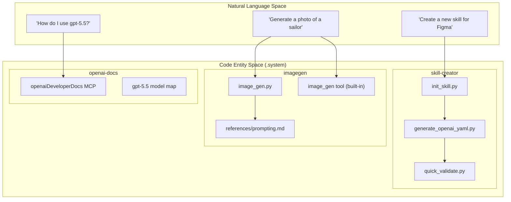
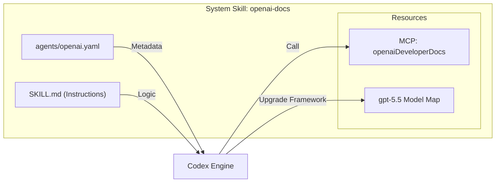

<!-- source: DeepWiki mcp.deepwiki.com · repo openai/skills · page 6 System Skills · fetched 2026-10-30 -->

# System Skills

Relevant source files

The following files were used as context for generating this wiki page:

- [skills/.system/imagegen/LICENSE.txt](skills/.system/imagegen/LICENSE.txt)
- [skills/.system/imagegen/SKILL.md](skills/.system/imagegen/SKILL.md)
- [skills/.system/imagegen/agents/openai.yaml](skills/.system/imagegen/agents/openai.yaml)
- [skills/.system/imagegen/assets/imagegen-small.svg](skills/.system/imagegen/assets/imagegen-small.svg)
- [skills/.system/imagegen/assets/imagegen.png](skills/.system/imagegen/assets/imagegen.png)
- [skills/.system/imagegen/references/cli.md](skills/.system/imagegen/references/cli.md)
- [skills/.system/imagegen/references/codex-network.md](skills/.system/imagegen/references/codex-network.md)
- [skills/.system/imagegen/references/image-api.md](skills/.system/imagegen/references/image-api.md)
- [skills/.system/imagegen/references/prompting.md](skills/.system/imagegen/references/prompting.md)
- [skills/.system/imagegen/references/sample-prompts.md](skills/.system/imagegen/references/sample-prompts.md)
- [skills/.system/imagegen/scripts/image_gen.py](skills/.system/imagegen/scripts/image_gen.py)
- [skills/.system/skill-creator/SKILL.md](skills/.system/skill-creator/SKILL.md)
- [skills/.system/skill-creator/references/openai_yaml.md](skills/.system/skill-creator/references/openai_yaml.md)
- [skills/.system/skill-creator/scripts/generate_openai_yaml.py](skills/.system/skill-creator/scripts/generate_openai_yaml.py)
- [skills/.system/skill-creator/scripts/init_skill.py](skills/.system/skill-creator/scripts/init_skill.py)
- [skills/.system/skill-creator/scripts/quick_validate.py](skills/.system/skill-creator/scripts/quick_validate.py)

## Purpose and Scope

This page documents the `.system` skills—core capabilities automatically installed with Codex that provide foundational functionality for the Agent Skills ecosystem. System skills enable users and agents to create, scaffold, and reference authoritative documentation and tools without manual installation.

For detailed documentation on individual system skills, see:
- [skill-creator](#6.1) — Detail the meta-skill for creating and managing other skills, including `init_skill.py`, `quick_validate.py`, `generate_openai_yaml.py`, and `package_skill.py` scripts.
- [imagegen (System)](#6.2) — Detail the system-tier imagegen skill for generating and editing images using GPT Image models, including the `image_gen.py` CLI and prompt augmentation.
- [openai-docs (System)](#6.3) — Detail the system-tier `openai-docs` skill for referencing official OpenAI developer documentation via the `openaiDeveloperDocs` MCP server.
- [plugin-creator (System)](#6.4) — Detail the system-tier `plugin-creator` skill for scaffolding Codex plugin directories and `marketplace.json` entries.

## What Are System Skills

System skills reside in the `.system/` directory and are foundational capabilities that extend Codex [skills/.system/skill-creator/SKILL.md:2-3](). Unlike curated or experimental skills, they are considered "onboarding guides" for the agent itself, transforming Codex from a general-purpose model into a specialized agent equipped with procedural knowledge [skills/.system/skill-creator/SKILL.md:14-17]().

| Skill | Purpose | Key Components |
|-------|---------|----------------|
| `skill-creator` | Meta-skill for building the ecosystem | `init_skill.py`, `SKILL.md` templates |
| `imagegen` | AI image generation and editing | `image_gen.py`, `prompting.md` |
| `openai-docs` | Authoritative product reference | `openaiDeveloperDocs` MCP |
| `plugin-creator` | Scaffolding for Codex plugins | `plugin.json` generation |

**Sources:** [skills/.system/skill-creator/SKILL.md:1-6](), [skills/.system/imagegen/SKILL.md:1-4]()

## System Skills Architecture

The following diagram bridges the **Natural Language Space** (User Requests) to the **Code Entity Space** (System Scripts and MCP Tools) within the system tier.

**System Skill Invocation Flow**

This diagram illustrates how user intent triggers specific Python scripts and tools within the system directory.

**Sources:** [skills/.system/skill-creator/scripts/init_skill.py:1-14](), [skills/.system/imagegen/SKILL.md:12-16]()

## skill-creator: The Meta-Skill

The `skill-creator` provides the tools necessary to extend Codex's capabilities. It enforces the **Progressive Disclosure** principle, ensuring that only metadata (name + description) is loaded initially, with the full `SKILL.md` body and resources loaded only when the skill triggers [skills/.system/skill-creator/SKILL.md:127-133]().

### Core Toolchain
- `init_skill.py`: Scaffolds a new skill directory with the required `SKILL.md` and optional `scripts/`, `references/`, and `assets/` folders [skills/.system/skill-creator/scripts/init_skill.py:5-14]().
- `quick_validate.py`: Validates that a skill follows naming conventions (hyphen-case), respects character limits (64 for names, 1024 for descriptions), and contains required YAML frontmatter [skills/.system/skill-creator/scripts/quick_validate.py:15-91]().
- `generate_openai_yaml.py`: Deterministically generates UI metadata in `agents/openai.yaml` by passing values as `--interface key=value` [skills/.system/skill-creator/SKILL.md:74-82]().

For details, see [skill-creator](#6.1).

**Sources:** [skills/.system/skill-creator/SKILL.md:48-65](), [skills/.system/skill-creator/scripts/init_skill.py:23-24](), [skills/.system/skill-creator/scripts/quick_validate.py:71-89]()

## imagegen: AI Image Generation

The `imagegen` skill provides a standardized workflow for generating and editing images using GPT Image models. It prefers a built-in `image_gen` tool but includes a fallback CLI for explicit requests [skills/.system/imagegen/SKILL.md:12-16]().

- **Prompt Augmentation**: Automatically enhances generic prompts with composition, lighting, and style cues [skills/.system/imagegen/references/prompting.md:32-39]().
- **Batch Processing**: Supports concurrent generation of multiple prompts via the `generate-batch` subcommand in the CLI [skills/.system/imagegen/references/cli.md:126-141]().
- **Model Support**: Targeted at GPT Image models such as `gpt-image-1.5`, `gpt-image-1`, and `gpt-image-1-mini` [skills/.system/imagegen/references/image-api.md:8-10]().

For details, see [imagegen (System)](#6.2).

**Sources:** [skills/.system/imagegen/references/cli.md:1-10](), [skills/.system/imagegen/references/prompting.md:22-25](), [skills/.system/imagegen/SKILL.md:10-22]()

## plugin-creator: Plugin Scaffolding

The `plugin-creator` skill is used to scaffold Codex plugin directories. It ensures all plugins follow the required structure, including the `.codex-plugin/plugin.json` manifest.

- **Marketplace Integration**: Manages `marketplace.json` entries for plugin ordering and availability metadata.
- **Scaffolding**: Supports optional plugin folders including `skills/`, `hooks/`, `scripts/`, `assets/`, `mcp/`, and `apps/`.

For details, see [plugin-creator (System)](#6.4).

## openai-docs: Authoritative Reference

The `openai-docs` skill provides a direct bridge to official OpenAI developer documentation, prioritizing accuracy via the `openaiDeveloperDocs` MCP server.

For details, see [openai-docs (System)](#6.3).

**OpenAI Docs Resource Integration**

This diagram shows how the `openai-docs` skill combines model mapping with dynamic MCP tool calls to provide documentation.

## Licensing

System skills are distributed under the **Apache License 2.0**, allowing for redistribution and modification while requiring the preservation of copyright notices.

**Sources:** [skills/.system/imagegen/LICENSE.txt:1-10]()

---

