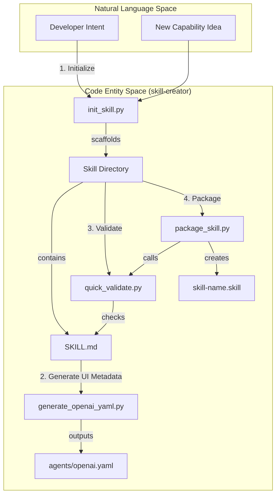
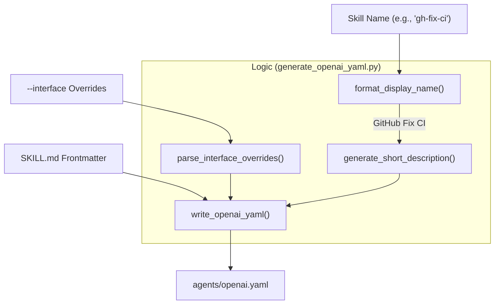

<!-- source: DeepWiki mcp.deepwiki.com · repo openai/skills · page 6.1 skill-creator · fetched 2026-10-30 -->

# skill-creator

<details>
<summary>Relevant source files</summary>

The following files were used as context for generating this wiki page:

- [skills/.system/skill-creator/LICENSE.txt](skills/.system/skill-creator/LICENSE.txt)
- [skills/.system/skill-creator/SKILL.md](skills/.system/skill-creator/SKILL.md)
- [skills/.system/skill-creator/references/openai_yaml.md](skills/.system/skill-creator/references/openai_yaml.md)
- [skills/.system/skill-creator/scripts/generate_openai_yaml.py](skills/.system/skill-creator/scripts/generate_openai_yaml.py)
- [skills/.system/skill-creator/scripts/init_skill.py](skills/.system/skill-creator/scripts/init_skill.py)
- [skills/.system/skill-creator/scripts/quick_validate.py](skills/.system/skill-creator/scripts/quick_validate.py)

</details>


## Purpose and Scope

The `skill-creator` system is an auto-installed system skill that provides command-line tools for developing and managing skills. It consists of Python scripts that handle skill initialization, metadata generation, validation, and packaging, along with comprehensive documentation on skill design principles.

This page documents the technical implementation of the skill-creator toolchain. For guidance on using these tools to create skills from a developer perspective, see [Creating Skills]().

**Sources:** [skills/.system/skill-creator/SKILL.md:1-10](), [skills/.system/skill-creator/scripts/init_skill.py:1-14]()

## System Architecture

The skill-creator system consists of four primary command-line tools that operate sequentially in the skill development workflow:



**Diagram: Skill Creation Workflow (Natural Language to Code Entities)**

**Sources:** [skills/.system/skill-creator/SKILL.md:48-83](), [skills/.system/skill-creator/scripts/init_skill.py:1-14](), [skills/.system/skill-creator/scripts/generate_openai_yaml.py:1-7]()

## Tool Locations and Entry Points

| Tool | File Path | Entry Point | Purpose |
|------|-----------|-------------|---------|
| **Initializer** | `skills/.system/skill-creator/scripts/init_skill.py` | `main()` at line 320 | Scaffold new skill directories and initial metadata |
| **UI Metadata Gen** | `skills/.system/skill-creator/scripts/generate_openai_yaml.py` | `write_openai_yaml()` at line 155 | Create/Update `agents/openai.yaml` for UI integration |
| **Validator** | `skills/.system/skill-creator/scripts/quick_validate.py` | `validate_skill()` at line 15 | Check skill structure, naming, and frontmatter |
| **Packager** | `package_skill.py` (referenced) | `package_skill()` | Create distributable .skill files (ZIP archives) |

**Sources:** [skills/.system/skill-creator/scripts/init_skill.py:320-378](), [skills/.system/skill-creator/scripts/generate_openai_yaml.py:155-186](), [skills/.system/skill-creator/scripts/quick_validate.py:15-92]()

## init_skill.py - Skill Scaffolding

### Command-Line Interface

```bash
init_skill.py <skill-name> --path <path> [--resources scripts,references,assets] [--examples] [--interface key=value]
```

**Parameters:**
- `skill_name` (required): Skill name, automatically normalized to hyphen-case. [skills/.system/skill-creator/scripts/init_skill.py:231-253]()
- `--path` (required): Output directory where the skill folder will be created. [skills/.system/skill-creator/scripts/init_skill.py:206-212]()
- `--resources` (optional): Comma-separated list of resource directories (`scripts`, `references`, `assets`). [skills/.system/skill-creator/scripts/init_skill.py:24]()
- `--interface` (optional): Key-value pairs for `agents/openai.yaml` (e.g., `short_description="My skill"`). [skills/.system/skill-creator/scripts/init_skill.py:13]()

**Sources:** [skills/.system/skill-creator/scripts/init_skill.py:1-14](), [skills/.system/skill-creator/scripts/init_skill.py:320-336]()

### Implementation Flow

The script normalizes the name, creates the directory structure, generates `SKILL.md` from a template, and calls `write_openai_yaml` logic to initialize UI metadata.

**Sources:** [skills/.system/skill-creator/scripts/init_skill.py:255-317](), [skills/.system/skill-creator/scripts/init_skill.py:21]()

## generate_openai_yaml.py - UI Metadata Management

This script generates the `agents/openai.yaml` file, which is used by the system to display skills in UI lists and chips.

### Metadata Logic



**Diagram: UI Metadata Generation Flow**

### Formatting Rules
- **Display Name**: `format_display_name` splits by hyphens and capitalizes. It uses a lookup for `ACRONYMS` (GH, MCP, API, CI, CLI, PDF, PR, UI, SQL) and `BRANDS` (OpenAI, GitHub, PagerDuty, DataDog, SQLite, FastAPI) to ensure correct casing. [skills/.system/skill-creator/scripts/generate_openai_yaml.py:16-38](), [skills/.system/skill-creator/scripts/generate_openai_yaml.py:57-73]()
- **Short Description**: `generate_short_description` ensures the string is between 25 and 64 characters, appending "tasks" or "workflows" as padding if too short, or trimming if too long. [skills/.system/skill-creator/scripts/generate_openai_yaml.py:76-103]()

**Sources:** [skills/.system/skill-creator/scripts/generate_openai_yaml.py:16-49](), [skills/.system/skill-creator/scripts/generate_openai_yaml.py:57-103](), [skills/.system/skill-creator/references/openai_yaml.md:25-44]()

## quick_validate.py - Skill Validation

### Validation Rules

The `validate_skill()` function enforces the following constraints:

| Entity | Constraint | Code Reference |
|--------|------------|----------------|
| **File** | `SKILL.md` must exist and contain YAML frontmatter | [skills/.system/skill-creator/scripts/quick_validate.py:19-31]() |
| **Keys** | Only `name`, `description`, `license`, `allowed-tools`, `metadata` allowed | [skills/.system/skill-creator/scripts/quick_validate.py:40-49]() |
| **Name** | Hyphen-case, max 64 chars, regex `^[a-z0-9-]+$` | [skills/.system/skill-creator/scripts/quick_validate.py:61-76]() |
| **Description** | Max 1024 chars, no angle brackets (`<`, `>`) | [skills/.system/skill-creator/scripts/quick_validate.py:78-89]() |

**Sources:** [skills/.system/skill-creator/scripts/quick_validate.py:15-92]()

## Skill Anatomy and Resources

Every skill created by `skill-creator` follows a standard directory structure:

| Component | Path | Required | Purpose |
|-----------|------|----------|---------|
| **Core Instructions** | `SKILL.md` | Yes | Frontmatter for triggering, Body for instructions. |
| **UI Metadata** | `agents/openai.yaml` | Rec. | Display name, icons, and default prompts. |
| **Scripts** | `scripts/` | No | Deterministic executable code (Python/Bash). |
| **References** | `references/` | No | Deep-dive docs loaded into context only when needed. |
| **Assets** | `assets/` | No | Static files (templates, logos) used in output. |

**Sources:** [skills/.system/skill-creator/SKILL.md:48-65](), [skills/.system/skill-creator/SKILL.md:84-114]()

### Progressive Disclosure
The system utilizes a three-level loading strategy supported by this structure:
1. **Metadata**: `name` + `description` (always in context). [skills/.system/skill-creator/SKILL.md:131]()
2. **SKILL.md body**: Loaded when skill triggers. [skills/.system/skill-creator/SKILL.md:132]()
3. **Resources**: Files in `references/` or `scripts/` (loaded as needed). [skills/.system/skill-creator/SKILL.md:133-135]()

**Sources:** [skills/.system/skill-creator/SKILL.md:127-135]()

---

