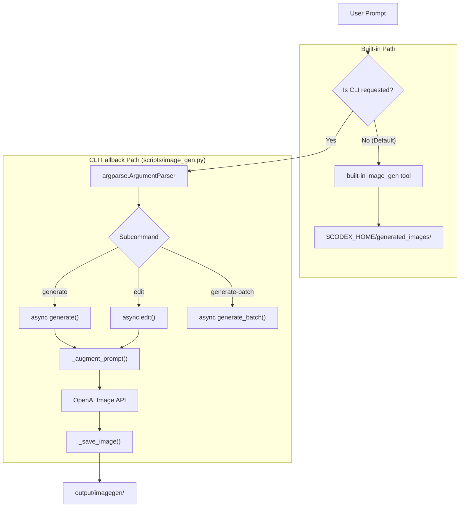

<!-- source: DeepWiki mcp.deepwiki.com · repo openai/skills · page 6.2 imagegen (System) · fetched 2026-10-30 -->

# imagegen (System)

Relevant source files

The following files were used as context for generating this wiki page:

- [skills/.system/imagegen/LICENSE.txt](skills/.system/imagegen/LICENSE.txt)
- [skills/.system/imagegen/SKILL.md](skills/.system/imagegen/SKILL.md)
- [skills/.system/imagegen/agents/openai.yaml](skills/.system/imagegen/agents/openai.yaml)
- [skills/.system/imagegen/assets/imagegen-small.svg](skills/.system/imagegen/assets/imagegen-small.svg)
- [skills/.system/imagegen/assets/imagegen.png](skills/.system/imagegen/assets/imagegen.png)
- [skills/.system/imagegen/references/cli.md](skills/.system/imagegen/references/cli.md)
- [skills/.system/imagegen/references/codex-network.md](skills/.system/imagegen/references/codex-network.md)
- [skills/.system/imagegen/references/image-api.md](skills/.system/imagegen/references/image-api.md)
- [skills/.system/imagegen/references/prompting.md](skills/.system/imagegen/references/prompting.md)
- [skills/.system/imagegen/references/sample-prompts.md](skills/.system/imagegen/references/sample-prompts.md)
- [skills/.system/imagegen/scripts/image_gen.py](skills/.system/imagegen/scripts/image_gen.py)

The `imagegen` system skill provides a robust interface for generating and editing raster images (photos, illustrations, textures, sprites, and mockups) using GPT Image models. It is designed with a "built-in first" philosophy, offering a high-level tool for standard tasks and a comprehensive Python CLI fallback for advanced batch processing and fine-grained control.

## Overview and Architecture

The skill is organized into two primary execution paths: the **Built-in Tool Mode** (preferred) and the **Fallback CLI Mode** (explicit-only) [skills/.system/imagegen/SKILL.md:12-16](). 

### System Organization
- **Built-in Tool**: The default interface for standard generation and editing. It manages image storage under `$CODEX_HOME` and does not require a local `OPENAI_API_KEY` to be managed by the user [skills/.system/imagegen/SKILL.md:14-14](), [skills/.system/imagegen/SKILL.md:31-31]().
- **CLI Fallback (`image_gen.py`)**: A standalone script used only when requested. It supports subcommands for `generate`, `edit`, and `generate-batch` [skills/.system/imagegen/scripts/image_gen.py:2-10](), [skills/.system/imagegen/SKILL.md:17-21]().

### Data Flow Diagram: Image Generation Request
The following diagram illustrates how a natural language request is routed through the skill's logic to reach the underlying code entities.

"Natural Language Space to Code Entity Space"

Sources: [skills/.system/imagegen/SKILL.md:12-21](), [skills/.system/imagegen/scripts/image_gen.py:1150-1200](), [skills/.system/imagegen/scripts/image_gen.py:191-194]()

## Implementation Details

### CLI Fallback: `image_gen.py`
The CLI is a production-grade wrapper around the OpenAI Image API, defaulting to the `gpt-image-1.5` model [skills/.system/imagegen/scripts/image_gen.py:24-24]().

#### Key Subcommands and Functions
| Subcommand | Implementation Function | Description |
| :--- | :--- | :--- |
| `generate` | `async main()` (via `args.func`) | Generates 1-10 images from a text prompt [skills/.system/imagegen/scripts/image_gen.py:1172-1175](). |
| `edit` | `async main()` (via `args.func`) | Modifies existing images using up to 16 input images and an optional mask [skills/.system/imagegen/scripts/image_gen.py:1181-1185](). |
| `generate-batch` | `async generate_batch()` | Processes a JSONL file of prompts concurrently using `asyncio` [skills/.system/imagegen/scripts/image_gen.py:1010-1015](). |

Sources: [skills/.system/imagegen/scripts/image_gen.py:2-31](), [skills/.system/imagegen/references/cli.md:7-10]()

### Prompt Augmentation
The skill implements a structured prompt augmentation workflow to improve output quality for generic user requests. This logic is encapsulated in `_augment_prompt_fields` [skills/.system/imagegen/scripts/image_gen.py:196-196]().

The augmentation assembles the following fields into a final prompt:
- **Use case**: Sets the context (e.g., `product-mockup`, `ui-mockup`) [skills/.system/imagegen/scripts/image_gen.py:201-202]().
- **Primary request**: The core user intent [skills/.system/imagegen/scripts/image_gen.py:203-203]().
- **Stylistic Cues**: `scene`, `subject`, `style`, `composition`, `lighting`, and `materials` [skills/.system/imagegen/scripts/image_gen.py:204-213]().
- **Safety/Invariants**: Automatically appends constraints like "no logos or trademarks; no watermark" [skills/.system/imagegen/scripts/image_gen.py:214-215]().

Sources: [skills/.system/imagegen/scripts/image_gen.py:191-220](), [skills/.system/imagegen/references/prompting.md:32-44]()

### Batch Processing and Asyncio
The `generate-batch` subcommand utilizes `asyncio.Semaphore` to manage concurrency (defaulting to 5 concurrent jobs) [skills/.system/imagegen/scripts/image_gen.py:28-28](), [skills/.system/imagegen/scripts/image_gen.py:1020-1030](). It reads from a `.jsonl` input file where each line is a JSON object representing a generation job [skills/.system/imagegen/references/cli.md:130-140]().

Sources: [skills/.system/imagegen/scripts/image_gen.py:1010-1100](), [skills/.system/imagegen/references/cli.md:128-150]()

## Configuration and Network Policy

### Sandbox Environment
In Codex sandbox environments (e.g., `workspace-write`), the fallback CLI requires explicit network access to reach the OpenAI API [skills/.system/imagegen/references/codex-network.md:7-12]().

"Sandbox Network Configuration"
| Setting | Recommended Value | Description |
| :--- | :--- | :--- |
| `network_access` | `true` | Required for API communication [skills/.system/imagegen/references/codex-network.md:27-27](). |
| `approval_policy` | `on-request` | Balances safety with developer friction [skills/.system/imagegen/references/codex-network.md:23-23](). |
| `OPENAI_API_KEY` | (Environment Variable) | Required for the fallback CLI [skills/.system/imagegen/scripts/image_gen.py:62-70](). |

Sources: [skills/.system/imagegen/references/codex-network.md:1-33]()

## Usage Constraints and Guidelines

### When to Use
- Creating new raster assets (concept art, website heroes, textures) [skills/.system/imagegen/SKILL.md:50-50]().
- Transforming existing images (background removal, lighting changes) [skills/.system/imagegen/SKILL.md:52-52]().
- Generating variants from style references [skills/.system/imagegen/SKILL.md:51-51]().

### When to Avoid
- **Vector Graphics**: Do not use for SVG icons or logo systems already established in the repo [skills/.system/imagegen/SKILL.md:56-57]().
- **Deterministic UI**: If the asset can be built with HTML/CSS/Canvas, prefer code over bitmaps [skills/.system/imagegen/SKILL.md:59-60]().

### File Path Policy
- **Built-in**: Images are initially saved in `$CODEX_HOME`. They must be moved to the workspace if they are project assets [skills/.system/imagegen/SKILL.md:31-38]().
- **CLI**: Uses `tmp/imagegen/` for scratch files and `output/imagegen/` for final results [skills/.system/imagegen/references/cli.md:96-97]().

Sources: [skills/.system/imagegen/SKILL.md:49-60](), [skills/.system/imagegen/SKILL.md:30-40](), [skills/.system/imagegen/references/cli.md:95-101]()

---

