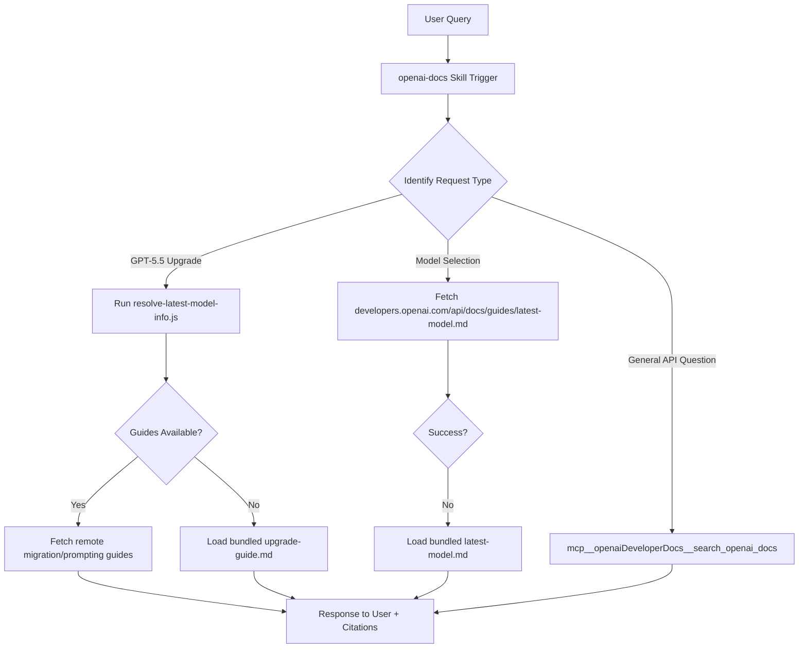
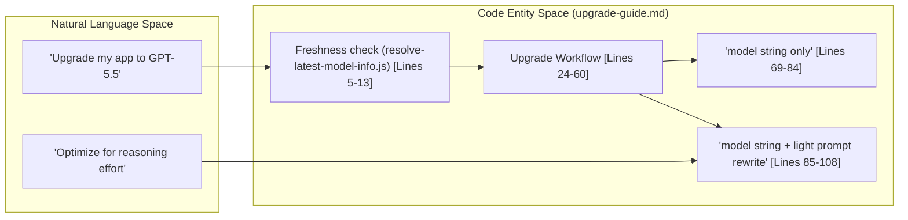

<!-- source: DeepWiki mcp.deepwiki.com · repo openai/skills · page 6.3 openai-docs (System) · fetched 2026-10-30 -->

# openai-docs (System)

Relevant source files

The following files were used as context for generating this wiki page:

- [skills/.curated/openai-docs/references/latest-model.md](skills/.curated/openai-docs/references/latest-model.md)
- [skills/.system/openai-docs/SKILL.md](skills/.system/openai-docs/SKILL.md)
- [skills/.system/openai-docs/agents/openai.yaml](skills/.system/openai-docs/agents/openai.yaml)
- [skills/.system/openai-docs/references/latest-model.md](skills/.system/openai-docs/references/latest-model.md)
- [skills/.system/openai-docs/references/prompting-guide.md](skills/.system/openai-docs/references/prompting-guide.md)
- [skills/.system/openai-docs/references/upgrade-guide.md](skills/.system/openai-docs/references/upgrade-guide.md)
- [skills/.system/openai-docs/scripts/resolve-latest-model-info.js](skills/.system/openai-docs/scripts/resolve-latest-model-info.js)

The `openai-docs` skill is a system-tier capability designed to provide authoritative, up-to-date guidance on OpenAI products, APIs, and model selection. It serves as the primary reference point for developers building with OpenAI, offering specialized workflows for upgrading integrations to GPT-5.5 and optimizing prompts for reasoning models.

## System Overview

This skill operates at the `.system` tier, meaning it is automatically available to the Codex environment [skills/.system/openai-docs/SKILL.md:1-4](). It primarily functions as a bridge to the `openaiDeveloperDocs` Model Context Protocol (MCP) server, which provides real-time access to official documentation at `developers.openai.com` [skills/.system/openai-docs/SKILL.md:7-9]().

### Key Components
- **MCP Integration**: Connects to `https://developers.openai.com/mcp` via the `streamable_http` transport [skills/.system/openai-docs/agents/openai.yaml:8-15]().
- **Bundled References**: Contains curated, version-controlled Markdown files for high-frequency technical tasks like model mapping and GPT-5.5 upgrades [skills/.system/openai-docs/SKILL.md:64-71]().
- **Dynamic Resolver**: Includes a Node.js script `resolve-latest-model-info.js` to programmatically determine the current "latest" model and fetch remote migration guides [skills/.system/openai-docs/scripts/resolve-latest-model-info.js:1-148]().
- **Fallback Logic**: Implements a hierarchy where MCP tools are prioritized, followed by bundled references, and finally restricted web searches to official domains [skills/.system/openai-docs/SKILL.md:84-89]().

Sources: [skills/.system/openai-docs/SKILL.md:1-89](), [skills/.system/openai-docs/agents/openai.yaml:1-15]()

## Implementation & Data Flow

The skill follows a "Docs-as-Source-of-Truth" pattern. While it contains local reference files, it is instructed to verify any local recommendation against the live MCP server or remote model guides to prevent information drift [skills/.system/openai-docs/references/latest-model.md:3-5]().

### Technical Architecture
The following diagram illustrates how a user query for "latest model" or "GPT-5.5 upgrade" flows through the skill's decision logic, involving the dynamic resolver script and the MCP server.

**OpenAI Docs Request Flow**

Sources: [skills/.system/openai-docs/SKILL.md:47-57](), [skills/.system/openai-docs/scripts/resolve-latest-model-info.js:130-142]()

## Reference Library

The skill includes a `references/` directory containing high-density technical guides. These are used to provide immediate context before performing deep searches or as fallbacks when remote resources are unreachable.

| File | Purpose | Key Content |
| :--- | :--- | :--- |
| `latest-model.md` | Model mapping | Maps `gpt-5.5`, `gpt-5.5-pro`, `gpt-5.3-codex`, etc., to specific use cases [skills/.system/openai-docs/references/latest-model.md:7-32](). |
| `upgrade-guide.md` | Upgrade Framework | Defines "model string only" vs "light prompt rewrite" vs "blocked" strategies for GPT-5.5 [skills/.system/openai-docs/references/upgrade-guide.md:69-115](). |
| `prompting-guide.md` | Prompt Engineering | Guidance on personality, collaboration style, and outcome-first prompts for GPT-5.5 [skills/.system/openai-docs/references/prompting-guide.md:9-108](). |

Sources: [skills/.system/openai-docs/references/latest-model.md:1-32](), [skills/.system/openai-docs/references/upgrade-guide.md:1-115](), [skills/.system/openai-docs/references/prompting-guide.md:1-110]()

## GPT-5.5 Upgrade Framework

A core function of this skill is managing the transition to GPT-5.5. It uses a structured "Upgrade Posture" to minimize breaking changes, preferring the narrowest safe change set [skills/.system/openai-docs/references/upgrade-guide.md:15-23]().

### Upgrade Classification Logic
The skill classifies upgrade tasks into three distinct buckets:

1.  **Model String Only**: Used when the source is GPT-5.4 and prompts are already task-bounded [skills/.system/openai-docs/references/upgrade-guide.md:69-84]().
2.  **Model String + Light Prompt Rewrite**: Used when the task needs stronger completeness, citation discipline, or specific formatting [skills/.system/openai-docs/references/upgrade-guide.md:85-108]().
3.  **Blocked**: Used if the upgrade requires API-surface changes, tool rewiring, or parameter changes not exposed to the agent [skills/.system/openai-docs/references/upgrade-guide.md:109-115]().

**Code-to-Concept Mapping: Upgrade Logic**

Sources: [skills/.system/openai-docs/references/upgrade-guide.md:5-115](), [skills/.system/openai-docs/scripts/resolve-latest-model-info.js:103-128]()

## MCP Tooling & Fallback Strategies

The skill relies on the `openaiDeveloperDocs` MCP server. If the server is missing or fails, the skill implements a self-healing protocol.

### Tool Interface
The skill utilizes the following primary tools from the MCP server:
- `mcp__openaiDeveloperDocs__search_openai_docs`: Finding relevant doc pages [skills/.system/openai-docs/SKILL.md:19]().
- `mcp__openaiDeveloperDocs__fetch_openai_doc`: Pulling exact sections and quoting accurately [skills/.system/openai-docs/SKILL.md:20]().
- `mcp__openaiDeveloperDocs__list_openai_docs`: Browsing or discovering pages without a clear query [skills/.system/openai-docs/SKILL.md:21]().

### Error Handling & Installation
If the tools are unavailable, the agent follows these steps:
1.  Attempt to install via `codex mcp add openaiDeveloperDocs --url https://developers.openai.com/mcp` [skills/.system/openai-docs/SKILL.md:41]().
2.  Retry with escalated permissions if sandboxing occurs [skills/.system/openai-docs/SKILL.md:42]().
3.  Fallback to web search only if MCP remains unavailable, restricting results to `developers.openai.com` or `platform.openai.com` [skills/.system/openai-docs/SKILL.md:87-88]().

Sources: [skills/.system/openai-docs/SKILL.md:17-21](), [skills/.system/openai-docs/SKILL.md:37-46](), [skills/.system/openai-docs/agents/openai.yaml:8-15]()

---

