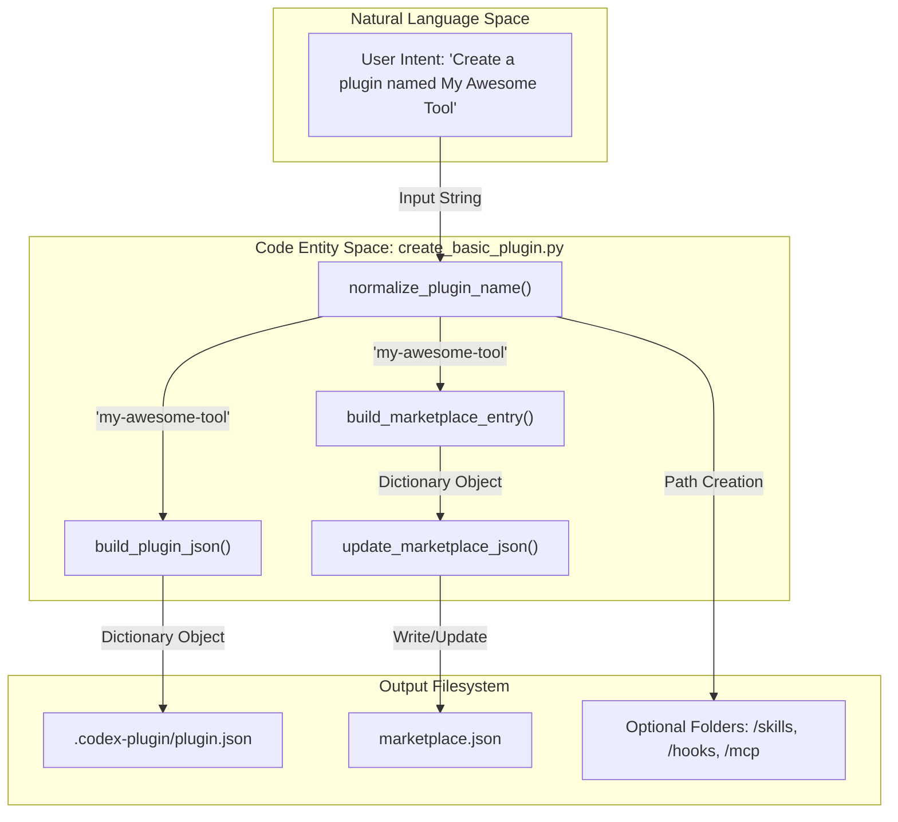
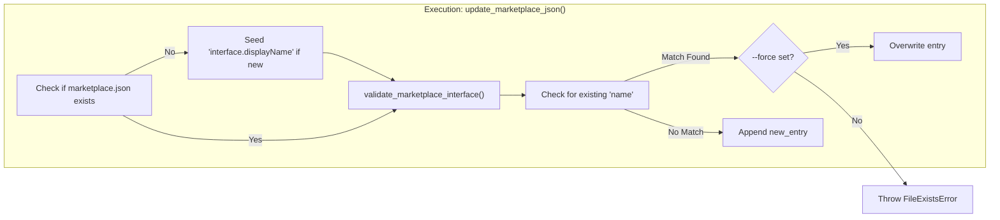

<!-- source: DeepWiki mcp.deepwiki.com · repo openai/skills · page 6.4 plugin-creator (System) · fetched 2026-10-30 -->

# plugin-creator (System)

Relevant source files

The following files were used as context for generating this wiki page:

- [skills/.system/plugin-creator/LICENSE.txt](skills/.system/plugin-creator/LICENSE.txt)
- [skills/.system/plugin-creator/SKILL.md](skills/.system/plugin-creator/SKILL.md)
- [skills/.system/plugin-creator/agents/openai.yaml](skills/.system/plugin-creator/agents/openai.yaml)
- [skills/.system/plugin-creator/references/plugin-json-spec.md](skills/.system/plugin-creator/references/plugin-json-spec.md)
- [skills/.system/plugin-creator/scripts/create_basic_plugin.py](skills/.system/plugin-creator/scripts/create_basic_plugin.py)

The `plugin-creator` is a system-tier skill designed to scaffold Codex plugin directories. It automates the creation of the required `.codex-plugin/plugin.json` manifest, establishes standard directory structures (skills, hooks, scripts, etc.), and manages `marketplace.json` entries which control plugin discovery and ordering within the Codex UI [skills/.system/plugin-creator/SKILL.md:1-4]().

## Implementation Overview

The skill is primarily driven by a Python scaffolding engine that enforces strict naming conventions and metadata schemas. It operates by generating boilerplate files with `[TODO: ...]` placeholders that developers must fill before deployment [skills/.system/plugin-creator/SKILL.md:20-21]().

### Core Logic and Normalization
The primary entry point is `create_basic_plugin.py`. It includes a normalization routine to ensure plugin identifiers are compatible with the Codex ecosystem:
*   **Normalization**: Names are converted to lower-case hyphen-case. Spaces, underscores, and punctuation are replaced with single hyphens, and consecutive hyphens are collapsed [skills/.system/plugin-creator/scripts/create_basic_plugin.py:24-30]().
*   **Constraints**: Plugin names are capped at 64 characters [skills/.system/plugin-creator/scripts/create_basic_plugin.py:13]().

### Scaffolding Process (Natural Language to Code Entity)

The following diagram illustrates how natural language intent (e.g., "Create a productivity plugin") is transformed into specific code entities and file structures by the `plugin-creator`.

**Title: Plugin Scaffolding Data Flow**

**Sources:** [skills/.system/plugin-creator/scripts/create_basic_plugin.py:24-30](), [skills/.system/plugin-creator/scripts/create_basic_plugin.py:43-85](), [skills/.system/plugin-creator/scripts/create_basic_plugin.py:88-105](), [skills/.system/plugin-creator/SKILL.md:55-60]()

## Data Structures and Metadata

### Plugin Manifest (`plugin.json`)
Every plugin must contain a `.codex-plugin/plugin.json` file. The `plugin-creator` scaffolds this with a comprehensive `interface` block used for UI rendering [skills/.system/plugin-creator/references/plugin-json-spec.md:21-44]().

| Field | Type | Description |
| :--- | :--- | :--- |
| `name` | `string` | Unique identifier (kebab-case) [skills/.system/plugin-creator/references/plugin-json-spec.md:52](). |
| `skills` | `string` | Path to skill directories (default `./skills/`) [skills/.system/plugin-creator/references/plugin-json-spec.md:63](). |
| `interface.displayName` | `string` | Human-readable title shown in Codex [skills/.system/plugin-creator/references/plugin-json-spec.md:71](). |
| `interface.defaultPrompt` | `array` | Starter prompts (max 3, capped at 128 chars each) [skills/.system/plugin-creator/references/plugin-json-spec.md:80-82](). |

### Marketplace Configuration (`marketplace.json`)
The `marketplace.json` file determines how plugins are presented to the user. It can reside at the repository root (`.agents/plugins/marketplace.json`) or in the user's home directory (`~/.agents/plugins/marketplace.json`) [skills/.system/plugin-creator/references/plugin-json-spec.md:102-103]().

**Title: Marketplace Entry Lifecycle**

**Sources:** [skills/.system/plugin-creator/scripts/create_basic_plugin.py:129-165](), [skills/.system/plugin-creator/SKILL.md:73-83]()

## Key Functions

### `create_basic_plugin.py`
This script is the core engine for the skill.

*   **`build_plugin_json(plugin_name)`**: Returns a dictionary representing the full schema of a `plugin.json` file, populated with TODO placeholders for the author, license, and interface metadata [skills/.system/plugin-creator/scripts/create_basic_plugin.py:43-85]().
*   **`update_marketplace_json(...)`**: Handles the idempotent update of the marketplace file. It ensures that required fields like `policy.installation` (default: `AVAILABLE`) and `policy.authentication` (default: `ON_INSTALL`) are always present [skills/.system/plugin-creator/scripts/create_basic_plugin.py:129-165](), [skills/.system/plugin-creator/scripts/create_basic_plugin.py:16-17]().
*   **`write_json(path, data, force)`**: A safety-first utility that prevents accidental overwrites unless the `--force` flag is explicitly provided [skills/.system/plugin-creator/scripts/create_basic_plugin.py:168-175]().

## Directory Structure Scaffolding
The skill supports creating optional sub-directories and configuration files to support complex plugin architectures:
*   `skills/`: For modular capabilities [skills/.system/plugin-creator/SKILL.md:61]().
*   `hooks/`: For event-driven integration [skills/.system/plugin-creator/SKILL.md:62]().
*   `.mcp.json`: For Model Context Protocol server definitions [skills/.system/plugin-creator/SKILL.md:65]().
*   `.app.json`: For application manifest integrations [skills/.system/plugin-creator/SKILL.md:66]().

**Sources:** [skills/.system/plugin-creator/SKILL.md:60-67](), [skills/.system/plugin-creator/scripts/create_basic_plugin.py:199-202]()

---

